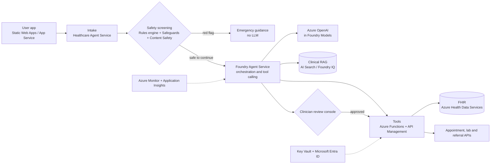

# Sanad (سند) — A Private Front Door for Men's Reproductive Health

> **From signals to the right care — earlier, privately.**
> An agentic AI platform on Microsoft Azure that helps men understand reproductive health risks *before* infertility is diagnosed, and guides them to the right level of care, with a clinician always in the loop.

Built by **AetherHealth** for the [Future Health Digital Innovation Challenge 2026](https://hack2skill.com/event/futurehealthchallenge/) · *Fertility · Challenge 01: Male Reproductive Health*

> [!IMPORTANT]
> **Research prototype. Not a medical device.** Sanad screens for risk and helps people find care. It does **not** diagnose infertility and does not replace a clinician. All data in this repository is **synthetic** or comes from public research datasets. Reported metrics are **simulated performance**, not clinical validation.

---

## Table of contents

- [Why Sanad](#why-sanad)
- [What it delivers](#what-it-delivers)
- [How Sanad works: the agentic loop](#how-sanad-works-the-agentic-loop)
- [Architecture](#architecture)
- [Azure services](#azure-services)
- [Agents](#agents)
- [Triage levels](#triage-levels)
- [User journeys](#user-journeys)
- [Safety in layers](#safety-in-layers)
- [Privacy by design](#privacy-by-design)
- [Cultural design principles](#cultural-design-principles)
- [Data residency](#data-residency)
- [Repository structure](#repository-structure)
- [Getting started](#getting-started)
- [Evaluation](#evaluation)
- [Roadmap](#roadmap)
- [Project management](#project-management)
- [Team](#team)
- [Assumptions and limitations](#assumptions-and-limitations)
- [License](#license)

---

## Why Sanad

*Sanad* means "support" in Arabic. The name is deliberately neutral, with no mention of infertility, so the app can sit on a phone's home screen without embarrassment.

- Male factors contribute to about half of infertility cases, yet men often come to care late, usually after their partner has been assessed.
- Male reproductive health is also a window into general health: metabolic disease, cardiovascular risk and mortality.
- Most digital products start at a semen test, when a couple is already struggling. Few look at **upstream risk**, design for **Gulf cultural and religious sensitivities**, or **connect to the health system**.

Sanad fills that gap with a trusted, low-friction front door for men. It turns risk signals into safe, explainable clinical action.

## What it delivers

| Desired outcome (challenge) | How Sanad delivers it |
|---|---|
| **Earlier, explainable risk identification** | A male-specific risk model across six domains: metabolic, infectious, anatomical, genetic, lifestyle and test results. Every flag cites a guideline. Every result is labelled **"Screening — not diagnosis."** |
| **A culturally trusted experience** | Arabic and English with right-to-left layout, neutral language, optional family-plan questions, spouse-privacy controls, and sample-collection options that respect religious views. |
| **Lower-friction assessment** | Anonymous self-assessment, lab-report upload, teleconsult booking, at-home steps where clinically appropriate, and fewer unnecessary visits. |
| **Safe triage and referral** | Deterministic red-flag rules run before any AI. Five triage levels, from self-care to emergency. A clinician approves every clinical recommendation. |
| Privacy and responsible AI *(judging criterion)* | Purpose-level consent, data minimisation, user-controlled sharing, audit trail, Microsoft healthcare safeguards. |
| Demonstrable value *(judging criterion)* | A synthetic cohort of 1,000 cases with clinician-labelled ground truth, plus safety, fairness and usability metrics. |

It also covers three points from the challenge brief:
- **Genomic-enabled care:** with the user's consent, reads premarital genetic screening results and suggests genetic counselling.
- **Keeping choices open:** fast-track referral for fertility preservation, for example before chemotherapy or for men using testosterone.
- **Across life stages:** education content for young adults, before marriage, before trying to conceive, and after 40.

## How Sanad works: the agentic loop

Sanad is an agent system, not a chatbot. It works through a process: **Perceive → Reason → Plan → Act → Learn**, under human oversight at every step that affects care.

| Stage | What happens | Agents | Azure services | Output |
|---|---|---|---|---|
| **1. Perceive** | Collect consent, history, lifestyle and symptoms through conversation. Read uploaded lab reports and, with consent, existing health records. | Gatekeeper (Intake), Evidence | Healthcare Agent Service, Document Intelligence, Azure Health Data Services | FHIR `Consent`, `QuestionnaireResponse`, `Observation` |
| **2. Reason** | Check red flags first with fixed rules. Then retrieve guidelines and reason over the evidence to produce risk flags with citations. | Safety screening, Clinical Risk | Rules engine (Azure Functions), Healthcare Agent Service Safeguards, AI Content Safety, Foundry Agent Service, Azure OpenAI, AI Search / Foundry IQ | Red-flag decision, risk flags with citations |
| **3. Plan** | Choose a triage level that is never lower than the rules engine's level. Draft a clinician report and a plain-language summary. Queue for clinician approval. | Clinical Risk, Report | Foundry Agent Service, Azure OpenAI | Suggested triage level, draft reports |
| **4. Act** | After approval: book a teleconsult, create the referral, send reminders, share data only with consented recipients. | Navigation | Azure Functions, API Management, Azure Health Data Services | FHIR `ServiceRequest`, appointment, reminder |
| **5. Learn** | Track outcomes, clinician edits and user feedback. Run evaluations. People review results and update rules, prompts and the knowledge base. | All | Azure Monitor, Application Insights, Foundry evaluations | Evaluation reports, reviewed updates |

> **Learn never means training on patient data.** Sanad does not fine-tune models on user data. Improvements come from offline evaluation on synthetic data and from human-reviewed changes to rules, prompts and content.

## Architecture



Main rules of the design:
1. **Rules before AI.** The deterministic red-flag check runs first and can stop the pipeline on its own.
2. **Tools behind a gateway.** Agents reach data and external systems only through API Management, with Entra ID identities and least privilege.
3. **Clinician approval before action.** For yellow-level cases and above, nothing reaches the user or another provider until a clinician approves it.
4. **Trace everything.** Every agent step, tool call and approval is traced and audit-logged.

## Azure services

| Layer | Azure service | Purpose |
|---|---|---|
| User | Azure Static Web Apps / App Service | Web and mobile front end (PWA, Arabic/English, right-to-left) |
| Intake | Healthcare Agent Service | Conversation and health-information intake, built-in triage scenarios |
| Safety screening | Healthcare Agent Service Safeguards + Azure AI Content Safety | Red flags, output safety, response control, Prompt Shields |
| Reasoning / agents | Foundry Agent Service | Agent reasoning, orchestration, tool calling |
| LLM | Azure OpenAI in Foundry Models | Reasoning and generation |
| Clinical RAG | Azure AI Search / Foundry IQ | Retrieval over guidelines and medical documents, with citations |
| Patient data | Azure Health Data Services (FHIR) | Consent, observations, referrals in FHIR R4 |
| API / tools | Azure Functions + API Management | Appointment, lab and hospital APIs; deterministic rules engine |
| Identity / secrets | Key Vault + Microsoft Entra ID | Identity, secrets, access control |
| Monitoring | Azure Monitor + Application Insights | Tracing, audit, monitoring |
| Document reading *(added)* | Azure AI Document Intelligence | OCR for semen, hormone, HbA1c and STI reports |
| Storage *(added)* | Azure Blob Storage | Temporary uploads, deleted automatically after extraction |

> Healthcare Agent Service is **not a medical device** according to Microsoft. Its safeguards (evidence detection, provenance, clinical code validation, disclaimers) complement Sanad's own rules engine and clinician review. They do not replace them.

## Agents

| Agent | Loop stage | Runs on | Role | Guardrails |
|---|---|---|---|---|
| **Gatekeeper (Intake)** | Perceive | Healthcare Agent Service | Purpose-level consent, adaptive questionnaire, red-flag questions asked first, "Case Ready" checklist | Red flags decided by **rules, not the LLM**. Minimal data. Family-plan questions are optional. |
| **Evidence** | Perceive | Function + Document Intelligence | Extracts lab values, normalises units, compares results with WHO 2021 reference limits | Low-confidence fields go back to the user. Files are deleted after extraction. |
| **Clinical Risk** | Reason, Plan | Foundry Agent Service | Combines rules output with retrieved guidelines to produce risk flags and a suggested triage level | A citation is required for every claim, or the claim is dropped. Triage never goes below the rules floor. Abstains when data is insufficient. |
| **Report** | Plan | Foundry Agent Service | Writes a structured clinician report and a bilingual plain-language summary | Marked "AI-generated for clinician review". Released after approval for yellow-level cases and above. |
| **Navigation** | Act | Foundry Agent Service + Functions/APIM | Books care, creates the FHIR `ServiceRequest`, sends reminders | Shares data only with recipients the user consented to. |
| **Clinician (human)** | Plan → Act | Clinician console | Reviews, edits, approves or rejects | Every action is audit-logged, with service-level targets. |

## Triage levels

| Level | Example triggers | Next step | Reviewer |
|---|---|---|---|
| 🔴 **Emergency** | Sudden severe scrotal pain; fever with painful scrotal swelling; scrotal trauma | Emergency care now (call 998) | Rules engine; clinician reviews afterwards |
| 🟠 **Priority (≤ 2 weeks)** | Palpable testicular mass; no sperm on a report; **upcoming chemotherapy or radiotherapy (fertility preservation)** | Urology / andrology; fertility preservation counselling | Clinician within 24 h |
| 🟡 **Specialist** | ≥ 1 parameter below WHO reference limit; cryptorchidism or mumps orchitis history; testosterone/steroid use; ≥ 12 months trying (≥ 6 if partner ≥ 35); **genetic finding from premarital screening** | Andrology / fertility services; genetic counselling | Clinician within 48 h |
| 🔵 **Primary care** | Obesity, metabolic syndrome, uncontrolled diabetes, STI history, medicines that affect sperm production | GP / primary care screening | Clinician |
| 🟢 **Self-care** | Lifestyle factors only: smoking, vaping, alcohol, heat exposure | Cited education by life stage; re-check in 3–6 months | Pre-approved content |

> Sanad always says: *a result below a reference limit does not mean you cannot have children.*

## User journeys

| # | Persona | Flow | Outcome |
|---|---|---|---|
| J1 | Single man, 24, before marriage, high BMI, anabolic steroid use | Anonymous self-assessment | Steroid and obesity flags → education + primary care. No assumptions about family plans. |
| J2 | Married man, 31, type 2 diabetes, past mumps orchitis, consanguineous marriage | Self-assessment + HbA1c upload + consented premarital genetic result | Metabolic, infection-history and genetic flags → genetic counselling + semen analysis. He decides what to share with his spouse. |
| J3 | Man, 36, couple trying for 6–12 months | Semen report upload → OCR vs WHO 2021 | Clinician-approved report → andrology referral via FHIR `ServiceRequest` |
| J4 | Man, 19, sudden severe scrotal pain | First screening question | **Pipeline stops.** Emergency guidance from the rules engine, no LLM involved. |

## Safety in layers

| Layer | Control | Where |
|---|---|---|
| 1 | Deterministic red-flag rules and triage floors | Rules engine (Azure Functions) |
| 2 | Healthcare safeguards: evidence detection, provenance, clinical code validation, disclaimers | Healthcare Agent Service |
| 3 | Content filtering and prompt-injection detection on chat and uploaded files | Azure AI Content Safety, Prompt Shields |
| 4 | Grounding: citations required, groundedness checks, abstention | Foundry Agent Service + AI Search |
| 5 | Human approval before clinical action | Clinician console |
| 6 | Tracing, audit, red-team suite, fairness monitoring | Azure Monitor, Application Insights, `eval/` |

Documentation: model card, data sheet and risk register, mapped to the Abu Dhabi DoH Responsible AI Standard.

## Privacy by design

- **Purpose-level consent**, stored as FHIR `Consent`: (a) risk assessment, (b) clinician review, (c) sharing with the referred provider, (d) sharing with spouse, (e) de-identified data for improvement, **off by default**. The user can withdraw consent at any time.
- **Data minimisation:** anonymous mode until the user chooses a referral; uploaded files are deleted after extraction.
- **Access control:** Entra ID, managed identities, role-based access, MFA for clinicians, secrets in Key Vault, private endpoints.
- **Plain-language data page:** what the data will be used for, and what it will never be used for.

## Cultural design principles

1. Neutral language ("men's health", not "infertility"). No assumption that the user is married or wants children.
2. Sample-collection options that respect religious views, including a non-spermicidal collection device used during marital intercourse. Sanad **does not give religious rulings**. It offers options and suggests asking a trusted imam or doctor.
3. Spouse privacy: nothing is shared with a partner without explicit consent, in either direction.
4. Discretion: neutral icon, notifications without content, biometric lock, quick exit.
5. Arabic and English with right-to-left layout; option to request a male clinician.
6. Navigation follows UAE assisted-reproduction law. Sanad never infers a user's religion.

## Data residency

UAE Federal Law No. 2 of 2019 restricts storing and processing health data outside the UAE. Before any real data is used, check every service:

| Service | Status | Prototype (synthetic data) | Pilot (real data) |
|---|---|---|---|
| Azure Health Data Services (FHIR) | **Not listed for UAE North** (Middle East: Qatar Central only, at last check) | Deploy in a supported region; synthetic data only | Confirm an in-country option, or self-host an open-source FHIR server in UAE North |
| Healthcare Agent Service | UAE North availability and **Arabic support not confirmed** | Use if available; otherwise build intake in Foundry | Confirm region and language with Microsoft |
| Azure OpenAI | Global deployments may process data outside the UAE | Global Standard is acceptable | Regional / Provisioned deployment in UAE North |
| AI Search, Foundry Agent Service | Available in UAE North | UAE North | UAE North |
| Document Intelligence, Content Safety | Likely available in UAE North, not confirmed on the official page | Check when creating the resource | Confirm |

## Repository structure

```text
sanad-front-door/
├── apps/
│   ├── web/                    # User PWA (Static Web Apps), AR/EN, RTL
│   └── clinician-console/      # Review, edit, approve queue
├── intake/                     # Healthcare Agent Service scenarios and safeguard settings (exported)
├── agents/                     # Foundry Agent Service definitions and prompts
│   ├── clinical_risk/
│   ├── report/
│   └── navigation/
├── functions/                  # Azure Functions
│   ├── rules_engine/           # Deterministic red flags and triage floors
│   ├── evidence/               # Document Intelligence OCR → FHIR Observation
│   └── tools/                  # Appointment, lab, referral, FHIR tools
├── apim/                       # API Management policies and API definitions
├── knowledge/
│   ├── manifests/              # Guideline sources, sections, versions, evidence grades
│   └── ingestion/              # Chunking + indexing into AI Search / Foundry IQ
├── fhir/                       # FHIR profiles and synthetic sample bundles
├── data/
│   ├── synthetic/              # Cohort generator and cases
│   └── ocr-samples/            # Synthetic lab reports (AR/EN)
├── vision-poc/                 # VISEM-Tracking experiments (stretch)
├── eval/                       # Metrics, fairness, red-team, reports
├── infra/                      # Bicep templates
├── docs/                       # Architecture, model card, data sheet, risk register
└── README.md
```

## Getting started

> These commands describe the intended setup. Update them as the code lands.

### Prerequisites

- Azure subscription with access to Foundry, Azure OpenAI, AI Search, Healthcare Agent Service and Azure Health Data Services
- Azure CLI, Azure Functions Core Tools
- Python 3.11+ and Node.js 20+

### Configuration

Copy `.env.example` to `.env`:

```bash
FOUNDRY_PROJECT_ENDPOINT=
AZURE_OPENAI_DEPLOYMENT=
AZURE_SEARCH_ENDPOINT=
AZURE_SEARCH_INDEX=sanad-guidelines
HEALTHCARE_AGENT_ENDPOINT=
CONTENT_SAFETY_ENDPOINT=
DOCINTEL_ENDPOINT=
FHIR_BASE_URL=
APIM_GATEWAY_URL=
KEY_VAULT_URI=
APPLICATIONINSIGHTS_CONNECTION_STRING=
```

Use managed identities where possible. Never commit keys or real patient data.

### Run

```bash
git clone https://github.com/aetherhealth-sanad/sanad-front-door.git
cd sanad-front-door
cp .env.example .env
az deployment group create -g <resource-group> -f infra/main.bicep   # Azure resources
python knowledge/ingestion/build_index.py                            # Index guidelines
python data/synthetic/generate.py --n 1000                           # Synthetic cohort
func start --script-root functions/                                  # Rules engine and tools locally
```

### Evaluate

```bash
python eval/run_eval.py --cohort data/synthetic/cohort.jsonl --out eval/reports/
```

## Evaluation

All figures are **targets** for simulated performance on synthetic data. Results go to `eval/reports/`.

| Area | Metric | Target |
|---|---|---|
| Safety | Red-flag recall | ≥ 99% |
| Triage | Accuracy / weighted κ vs clinicians | ≥ 90% / ≥ 0.8 |
| Triage | Under-triage rate | ≤ 2% |
| Risk flags | Sensitivity / specificity per domain | ≥ 90% / ≥ 85% |
| Grounding | Citation precision | ≥ 95% |
| Calibration | Expected calibration error | ≤ 0.05 |
| OCR | Field-level accuracy | ≥ 95% |
| Fairness | Max gap between subgroups (age, nationality group, AR/EN) | ≤ 5 percentage points |
| Access | Cases resolved without an in-person visit (self-care or teleconsult) | Reported |
| Process | Assessment completion rate | ≥ 80% |
| Experience | System Usability Scale | ≥ 75 |
| Clinical | Clinician rating of report quality (1–5) | ≥ 4.2 |

Ground truth: two clinicians independently label 200 stratified cases (Cohen's κ reported). The other cases use labels derived from guideline rules.

## Roadmap

| Week | Dates (2026) | Milestone |
|---|---|---|
| 1 | 22–28 Oct | Scope locked, guideline corpus, red-flag rules v1 signed off by a clinician, Azure baseline |
| 2 | 29 Oct – 4 Nov | Intake on Healthcare Agent Service, rules engine, Clinical Risk Agent with citations, FHIR, synthetic cohort, OCR v1. **J1 and J4 end-to-end** |
| 3 | 5–11 Nov | Report Agent, clinician console, Navigation with Functions/APIM, evaluation v1. **J2 and J3 end-to-end** |
| 4 | 12–19 Nov | Fixes, fairness, red-team, usability test, demo video, documentation. **Submit 19 Nov** (deadline 20 Nov) |

**Stretch:** Vision PoC on VISEM-Tracking, Arabic medical reviewer with MBZUAI BiMediX2, Arabic voice input, mock Malaffi integration.

## Project management

- Organization: [`aetherhealth-sanad`](https://github.com/aetherhealth-sanad)
- Project board: **Sanad Front Door** (organization project #2), views: Backlog, Priority board, Team items, Roadmap, My items
- Backlog: 41 issues, 4 weekly milestones, labels `role:*`, `area:*`, `P0-mvp`, `P1-stretch`
- Flow: assign yourself → branch `feat/<issue>-<name>` → PR with `Closes #<issue>` → one review → merge

## Team

**AetherHealth**

| Member | Role | Owns |
|---|---|---|
| Trung | Tech lead | Architecture, Azure and CI, FHIR, rules engine, security, review, submission |
| Phúc | Senior AI engineer | RAG, Foundry agents, safety layers, red-team; mentors Hoàng |
| Hoàng | AI engineer (OCR, deep learning) | Synthetic lab reports, Document Intelligence OCR, Vision PoC, cohort and evaluation |
| Vinh | Full-stack engineer | User app, clinician console, approval workflow, Navigation tools |
| Đạt | Business analyst | Scope, journeys, red flags with clinicians, ground truth, usability, docs, demo script |
| _TBD_ | Clinical advisor (urology/andrology) | Red-flag sign-off, case labelling |

## Assumptions and limitations

- Performance is measured on **synthetic data** and may not reflect real users.
- Consanguinity rates in the UAE vary widely between sources (about 39–65%). The cohort samples a range and reports sensitivity analysis.
- Many lifestyle risk factors have limited evidence (low guideline grades). Sanad shows the evidence grade and does not recommend treatment based on weak evidence alone.
- Healthcare Agent Service region and Arabic support, and an in-country FHIR option, must be confirmed before any pilot.
- Clinician review times (24–48 h) are design assumptions.
- Regulatory classification (for example software as a medical device) must be confirmed with UAE authorities before any pilot.

## License

To be confirmed against the challenge rules on intellectual property. Until then, all rights reserved by the AetherHealth team.

## Acknowledgements

Built for the Future Health Digital Innovation Challenge 2026 by Future Health — A Global Initiative by Abu Dhabi, co-created with Microsoft, Inception and MBZUAI, hosted on Hack2skill.
