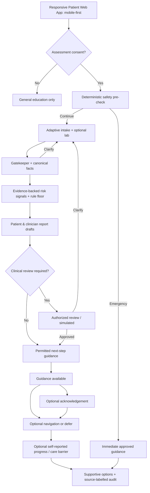
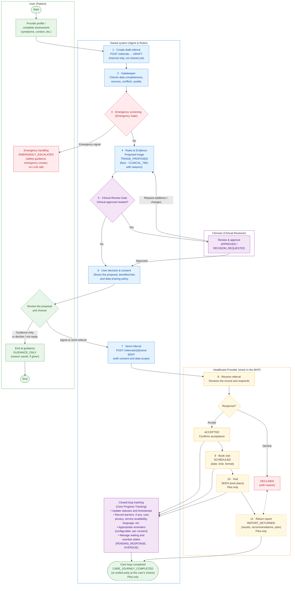
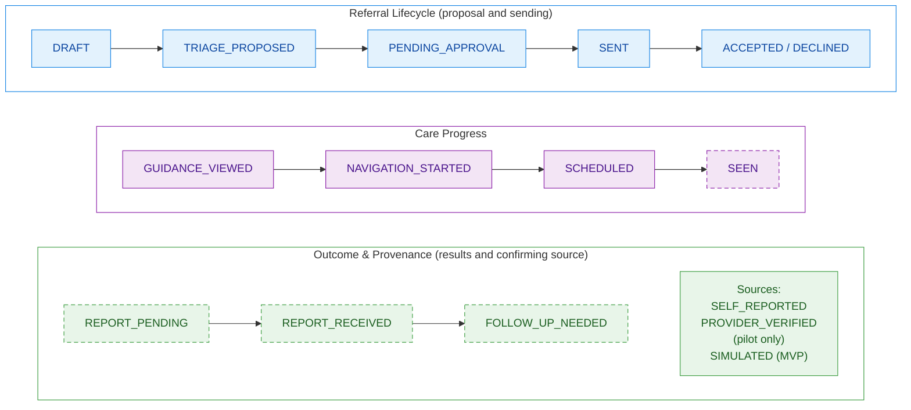
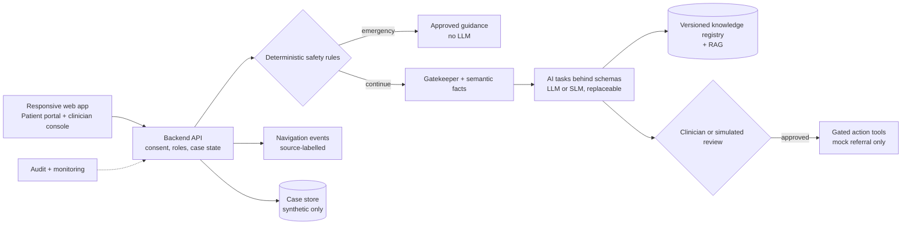

# Sanad (سند) — A Private Front Door for Men's Reproductive Health

> **From signals to the right care — earlier, privately.**
> A responsive web app that lets men start a private health assessment without an account or appointment, understand what their answers do and do not show, and find a safe next step, with clinical decisions kept under human review.

Built by **AetherHealth** for the [Future Health Digital Innovation Challenge 2026](https://hack2skill.com/event/futurehealthchallenge/) · *Fertility · Challenge 01: Male Reproductive Health*

> [!IMPORTANT]
> **Research prototype. Not a medical device.** Sanad does **not** diagnose infertility, prescribe, estimate a personal probability of infertility, or replace a clinician. The MVP uses **public or synthetic data only**. Its clinical rules are **drafts that no clinician has approved**, and referrals and bookings are **mock**.

---

## Table of contents

- [Project status](#project-status)
- [Why Sanad](#why-sanad)
- [What the MVP delivers](#what-the-mvp-delivers)
- [How Sanad works](#how-sanad-works)
- [Care journey and release scope](#care-journey-and-release-scope)
- [User journeys](#user-journeys)
- [Triage actions](#triage-actions)
- [Closed-loop navigation](#closed-loop-navigation)
- [Safety in layers](#safety-in-layers)
- [Privacy by design](#privacy-by-design)
- [Cultural design principles](#cultural-design-principles)
- [AI approach](#ai-approach)
- [Proposed architecture](#proposed-architecture)
- [Data and research boundaries](#data-and-research-boundaries)
- [Repository structure](#repository-structure)
- [Getting started](#getting-started)
- [Evaluation](#evaluation)
- [Roadmap](#roadmap)
- [Open decisions](#open-decisions)
- [Project management](#project-management)
- [Team](#team)
- [Assumptions and limitations](#assumptions-and-limitations)
- [License](#license)

---

## Project status

| Area | Status |
|---|---|
| **Requirements** | [BRD v0.4](specs/Sanad_AetherHealth_BRD_v0.4.md), [PRD v0.4](specs/Sanad_AetherHealth_PRD_v0.4.md), and [E2E workflow v0.4](specs/Sanad_E2E_Workflow_v0.4.md), dated 2026-11-03. Drafts; clinical rules remain pending approval. |
| **Implementation** | Python/FastAPI backend and React/TypeScript patient, Mock Reviewer and Mock Facility UI source exist under `apps/`. The deterministic referral gate, structured profile validation, optional redacted Langfuse telemetry, and authoring-only knowledge MCP code are present. API/UI acceptance and CI verification remain pending; check each section below for implemented versus planned behavior. |
| **Clinical policy** | **Not approved.** Clinical advisor is still marked TBD in the specs. Any rule without sign-off must be presented as simulated policy. |
| **Key dates** | Internal MVP freeze 19 Nov 2026. Challenge submission 20 Nov 2026 (reconfirm with the organiser). |

**Which document wins:** for MVP scope and behavior, BRD v0.4 and PRD v0.4 take precedence over this README. The E2E workflow v0.4 describes the intended flow. Changes to clinical rules, triage levels, label taxonomy, consent scopes or data policy go through [change control](#project-management).

The specs mark how settled each item is: `TEAM_DECISION`, `PROPOSED`, `CLINICAL_TBD` (not approved by a clinician), `TECH_TBD` (needs technical verification) and `RESEARCH_ONLY` (never used for care decisions).

## Why Sanad

*Sanad* means "support" in Arabic. The name is deliberately neutral, with no mention of infertility, so the app can sit on a phone's home screen without embarrassment.

- Men often reach reproductive health assessment late, face privacy barriers, and do not know which service to approach.
- Information is scattered across self-report, lab results and professional sources, and a chat app alone can draw conclusions it has no basis for.
- A single score built on BMI, smoking or one lab value invites misunderstanding. A muscular man with a high BMI may be misread as overweight, and a smoker may be "diagnosed" from one behaviour.
- People do not know where their data goes, who sees it, or whether it could reach their spouse.

Sanad is not a chatbot that gives plausible answers. It is **a process with state, evidence, access rights, the ability to decline, and clear approval points**. Every result must answer four questions: *What is known? What is not known? Why this next step? Who or what is responsible for approving it?*

## What the MVP delivers

| Challenge capability | How the MVP addresses it |
|---|---|
| **Earlier, explainable identification** | Evidence-backed **risk signals**, not diagnoses or probabilities. Each clinical claim carries a source and version, or says the evidence is insufficient. |
| **A culturally trusted experience** | Neutral language with no assumptions about marriage, religion or family plans. Separate control over sharing, including with a spouse. Arabic and right-to-left layout on key screens once translations are reviewed. |
| **Lower-friction assessment** | No account, no appointment and no camera. Adaptive questions that accept `Prefer not to answer` and `Not sure`. |
| **Safe triage and referral** | Deterministic emergency rules run before any AI. AI cannot go below the rule floor. Mock referrals are blocked by the backend without valid consent and approval. |
| **Privacy by design** | Five separate consent scopes, pseudonymous sessions, minimal logging, synthetic data only. |
| **Measurable value** | A reproducible test suite that reports what was actually measured, and separates workflow results from clinical agreement and research metrics. |

Three themes from the challenge brief are **not MVP commitments**:

- **Genomic-enabled care:** genetics and genomics are out of MVP scope. J2 may offer genetics support only when a result exists and consent is valid, and never infers genetic disease from family relationships.
- **Keeping choices open:** fertility preservation remains a draft triage trigger awaiting clinical review.
- **Across life stages:** life-stage education is not yet scoped in the BRD or PRD.

## How Sanad works

| Step | What happens |
|---|---|
| **1. Capture** | Take consent, collect contextual self-report, and optionally accept existing lab results. |
| **2. Validate** | Check for missing or conflicting data, unknown states and warning signs before any LLM runs. |
| **3. Assess** | Identify evidence-backed risk signals. The safety rules stay separate from the LLM that explains them. |
| **4. Review** | Draft reports for the patient and clinician. A clinician checks the actions that need approval. |
| **5. Navigate** | Offer reviewed information, a next step, or a mock referral or booking with consent. |
| **6. Close the loop** | The user may acknowledge guidance, start looking for a service, report progress or name a barrier. All of it is optional and tied to the anonymous session. |
| **7. Evaluate** | Measure workflow correctness and step-by-step conversion with clear denominators. A click or self-report is never treated as verified care. |


*The flow as specified in [BRD v0.4.2 §7](specs/Sanad_AetherHealth_BRD_v0.4.md#7-future-state-to-be) and [PRD v0.4.2](specs/Sanad_AetherHealth_PRD_v0.4.md) §1.3, §4.7 and §4.7.1. It shows the target design, not only what is built: the free-text emergency scan (S0b) remains `PROPOSED`; structured profile shape and synthetic-data checks are implemented, but do not classify clinical content. The steps marked "AI may draft" make no model calls in the current source. All clinical rules, triggers and wording are `CLINICAL_TBD`.*



The assessment state machine is in [PRD v0.4 §4.7](specs/Sanad_AetherHealth_PRD_v0.4.md#47-assessment-state-machine). Navigation progress is a separate append-only event stream; it does not mark a case as care-completed.

## Care journey and release scope

The long-term vision has eight stages that users can enter at several points. **It is a roadmap, not a mandatory sequence and not all P0.** Booking is never required before assessment, someone who already has results can go straight to entering them, and emergencies bypass the sequence entirely.

| Stage | P0 (MVP) | P1 / P2 |
|---|---|---|
| **S1** Private entry | Entry without login, consent | P1: mock appointment intent |
| **S2** Pre-visit intake | Adaptive intake, Gatekeeper, semantic facts | P1: clinic-ready handoff |
| **S3** Consultation support | Limited clinician view | P1: clinical note draft, structured suggestions |
| **S4** Next evaluation decision | Evidence-backed risk flags, draft triage | P1: clinician reasoning view |
| **S5** Test and order execution | — | P2: mock preparation checklist. No automatic orders. |
| **S6** Review results | — | P1: manual lab entry. P2: timeline and comparison. |
| **S7** Explain and plan | Draft reports, review gate | P1: care plan draft |
| **S8** Follow-up | Opt-in status and barrier capture, not treatment tracking | P2: mock reminders with consent |

**P0 also includes:** an English patient experience and simulated reviewer console; source-labelled event logging; synthetic fixtures and security tests; optional psychosocial context (up to three voluntary self-report items, not diagnostic and not used for automatic triage); and lightweight closed-loop acknowledgement, self-reported progress and barrier capture. UI source exists, but acceptance and CI verification are pending.

**P0 design also includes:** a versioned conceptual FHIR R4 mapping manifest. BRD §8.1 includes Arabic/English and key-screen RTL in P0, while BRD FR-11 marks it P1 and PRD-FR-11 marks it Should; translation and RTL review are open. No Arabic UI is present. Evaluation priority also differs: BRD §8.1 includes evaluation/reporting in P0 and BRD FR-14 marks the dashboard P1; PRD-FR-14 marks golden-set evaluation Must, and PRD-AC-40 requires a J9/J10 funnel dashboard. The reviewer UI has the closed-loop funnel, but no golden-set evaluation runner or report export. FHIR alignment is conceptual and `NOT_EVALUATED`; there is no export or conformance claim.

**Out of scope for the MVP:**

- Diagnosis, prescribing, personalised treatment advice or personal infertility probabilities.
- Real hospital integration, real referrals, teleconsultation, payments or production FHIR/EHR.
- Real patient records, training on user data, or clinical rules that update themselves from feedback.
- Mandatory camera use, video interviews, emotion recognition, or analysis of sperm images and video.
- Claims of verified care from a click, acknowledgement, self-report or mock booking.
- Claims of clinical validity, legal compliance or generalisation to the UAE population.

## User journeys

| # | Scenario | Path | Expected outcome | Priority |
|---|---|---|---|---|
| **J1** | Omar, 24, high BMI, trains at the gym, reports anabolic steroid use, before marriage | Anonymous consent → safety check → interview → signals → rule floor → draft review | Asks about BMI context instead of concluding obesity. Steroid use triggers the draft `SPECIALIST` floor (`CLINICAL_TBD`). No infertility assumption. | P0 |
| **J2** | Man, 31, type 2 diabetes, medical history, possibly shared genetics results | Consent review → mixed evidence → Gatekeeper → clinical review | No genetic disease inferred from family relationships. Genetics support only with a result and valid consent. | Exploratory |
| **J3** | Man, 36, holds a semen report | Manual entry → confirm values → evidence → draft → review | No conclusion about ability to have children from a single value. | P0 journey* |
| **J4** | Man, 19, symptom on the emergency rule list | First safety screen → stop AI → emergency guidance | Does not wait for an LLM, a clinician or the rest of the questionnaire. | P0 |
| **J5** | User skips questions or gives missing or conflicting data | Completeness check → clarify or abstain | `NEEDS_MORE_INFORMATION`, never treated as low risk. | P0 |
| **J6** | User already has or wants an appointment | Optional intent → consent → pre-visit summary | Mock appointment intent. Neither booking nor assessment is forced first. | P1 |
| **J7** | Returning user with new results | Clinician draft notes → lab timeline → plan draft | Plans and orders wait for an authorised person. | P1 / P2 |
| **J8** | User with an approved plan | Approved plan → optional reminders and tasks | Mock only, with separate notification consent. | P2 |
| **J9** | User has guidance but may not want to book yet | View guidance → voluntary acknowledgement → navigation → status self-report | Separates viewed, searching and self-reported booking. Never claims verified care. | P0 |
| **J10** | User hesitant about privacy, cost, language or readiness | Optional barrier choice → non-clinical support or defer | Never forces a reason or infers mental state. Barriers do not change triage. | P0 |

\* J3 is a required MVP journey, while the manual lab entry it relies on is rated P1 (`PRD-FR-12`).

Personas are design scenarios, not findings from UAE user research.

## Triage actions

> [!WARNING]
> **Provisional, not medical policy.** Every trigger below is a draft for clinician review (`CLINICAL_TBD`). BR-16 uses the steroid → `SPECIALIST` floor as the J1 regression rule, pending clinical approval. No review or response times are set until a clinician approves them.

| Action code | Meaning | Draft example triggers | Approval condition |
|---|---|---|---|
| `EMERGENCY_GUIDANCE` | Seek emergency help now (call 998) | Sudden severe scrotal pain; fever with painful scrotal swelling; scrotal trauma | Pre-approved content, no model dependency |
| `PRIORITY_REVIEW` | Arrange prompt assessment for the specific context | Palpable testicular mass; no sperm on a report; upcoming chemotherapy or radiotherapy (fertility preservation) | Clinical guideline and clinical advisor |
| `SPECIALIST` | Consider andrology or fertility services | ≥ 1 parameter below WHO reference limit; cryptorchidism or mumps orchitis history; **testosterone or steroid use**; ≥ 12 months trying (≥ 6 if partner ≥ 35); genetic finding with valid consent | Rule or clinician reviewed |
| `PRIMARY_CARE` | Consider primary care advice | Confirmed obesity, metabolic syndrome, uncontrolled diabetes, STI history, medicines that affect sperm production | Rule or clinician reviewed |
| `EDUCATION` | Approved health content, no diagnostic assessment | Lifestyle factors only: smoking, vaping, alcohol, heat exposure | Approved material with disclaimer |
| `NEEDS_MORE_INFORMATION` | Not enough data; needs more input or professional review | Missing, declined or conflicting answers | Never treated as low risk |

Three things stay separate and must never be merged into one label: a `risk_signal` (for example, "user reports smoking"), a `semen_diagnostic` (a SEED-ML research label), and a `triage_action` (a care access decision).

> Sanad always says: *a result below a reference limit does not mean you cannot have children.*

## Closed-loop navigation

New in v0.4. After guidance, users may tell Sanad what happened next. Everything is voluntary, session-scoped, and leaving is never recorded as failure.

| Evidence source | Used for | MVP |
|---|---|---|
| `SYSTEM_EVENT` | Acknowledgement and navigation opened. Shows only that a UI event happened. | Yes |
| `USER_REPORTED` | Self-reported booking or visit. Shown as *Self-reported — not verified by a clinic*. | Yes |
| `SIMULATED` | Mock referral | Yes |
| `PROVIDER_VERIFIED` | Confirmation from a partner provider | **No.** Future pilot only. |

- **Statuses:** `GUIDANCE_AVAILABLE`, `GUIDANCE_ACKNOWLEDGED`, `NAVIGATION_STARTED`, `BOOKING_SELF_REPORTED`, `VISIT_SELF_REPORTED`, `UNABLE_TO_PROCEED`, `DEFERRED`, `DECLINED`, `NO_UPDATE`.
- **Barriers (optional, multi-select):** `PRIVACY_CONCERN`, `LANGUAGE_BARRIER`, `COST_CONCERN`, `SERVICE_UNCLEAR`, `SCHEDULE_CONSTRAINT`, `NOT_READY`, `OTHER`, `PREFER_NOT_TO_SAY`.
- **Support after a barrier is non-clinical only:** reviewing privacy, changing language, finding services or saving the next step. It never books, sends a record or changes triage.
- **No default reminders.** Notifications are P2 and require separate consent.
- **`CARE_COMPLETED` is never set in the MVP**, and `NO_UPDATE` does not mean missed treatment.

### Referral workflow (v0.3, updated)

How a referral is proposed, sent and tracked, with safety controls, clinical approval and user consent.

> [!NOTE]
> **Team proposal, not yet reconciled with the specs.** Where this workflow differs from the BRD or PRD (see the table at the end of this section), the specs take precedence until [change control](#project-management) says otherwise. In the MVP the provider side is **mock**: nothing reaches a real clinic, and no visit or report is verified.



Dashed outlines mark what is pilot only. The dotted link between `DECLINED` and step 11 has no label in the team's source diagram, so its meaning is still to be confirmed.

**State model, separated by domain:**



**Main exception paths:**

| Situation | Handling |
|---|---|
| User does not agree to sharing | `GUIDANCE_ONLY` (referral not sent) |
| Clinician asks for more information | `REVISION_REQUESTED` (back to step 4) |
| Provider declines the referral | `DECLINED` (reason recorded, other options suggested) |
| No response from the provider | `PENDING_RESPONSE` → `OVERDUE` (per the configured SLA) |
| User has not booked yet | `NAVIGATION_IN_PROGRESS` (barriers recorded, support continues) |
| User wants to stop | `WITHDRAWN` / `CANCELLED` (per the consent policy) |

**Rollout scope:**

| MVP (P0, build now) | Pilot / future (P1–P2) |
|---|---|
| Draft referral creation, Gatekeeper, rules | Formal clinical approval |
| Triage proposal with reasons shown | Provider integration (real accept and decline) |
| Consent and privacy | Scheduling sync and visit confirmation |
| Mock (or internal) referral sending | Receiving reports from health systems |
| Progress tracking and self-reported status | Measuring care outcomes |
| Barrier recording and basic reporting | |

**Suggested events to log (audit and traceability):** `referral.created`, `triage.proposed`, `clinical.reviewed`, `consent.given`, `referral.sent`, `provider.responded`, `appointment.scheduled`, `visit.completed`, `report.returned`, `barrier.logged`, `referral.closed`.

**Where this differs from the specs:**

| Topic | This workflow | BRD, PRD and referral flows spec |
|---|---|---|
| Emergency check | Step 3, after the assessment and Gatekeeper | Right after consent and before other questions, so guidance never waits for the questionnaire (BR-06, `PRD-FR-03`) |
| First consent | Step 6, for sharing only | Assessment consent comes before any health data is collected (BR-01) |
| Draft referral | Created at step 1 with `POST /referrals` | A mock referral is created only when the gate passes, through `POST /cases/{id}/mock-referral` (`PRD-FR-10`, [RF-12](specs/referal-flows/product-spec.md#rf-12-referral-gate-m3)) |
| Skipping review | "No" at step 5 can still lead to sending | Every referral needs user consent, clinician approval and backend permission (RF-12). Which other actions can skip review is still open (TBD-07). |
| Review outcomes | `APPROVED` or `REVISION_REQUESTED` | Also edit and reject (`PRD-FR-09`) |
| Visits, reports and completion | Steps 10–11, `CARE_JOURNEY_COMPLETED` and `visit.completed` | Not in the MVP. `CARE_COMPLETED` is never set, and a visit can only be self-reported as `VISIT_SELF_REPORTED` (BRD §8.2, BR-29). |
| Overdue and reminders | `OVERDUE` from a configured SLA, reminders per consent | No response times until a clinician approves them, so the MVP uses a mock delay timer that is not a clinical deadline ([RF-14](specs/referal-flows/product-spec.md#rf-14-tracking-with-delayed-flag-m3)). Reminders are P2 with separate consent (BR-24, BR-32). |
| Status names | `EMERGENCY_ESCALATED`, `PENDING_APPROVAL`, `REVISION_REQUESTED`, `GUIDANCE_VIEWED`, `SELF_REPORTED`, and `DECLINED` for a provider | `EMERGENCY_GUIDANCE_ISSUED`, `PENDING_CLINICIAN_REVIEW`, `REVISION_REQUIRED`, `GUIDANCE_AVAILABLE`, `USER_REPORTED`, and `DECLINED` for a user. Renaming labels needs change control. |

The MVP build of this flow is specified in the [referral flows product spec](specs/referal-flows/product-spec.md), which follows the BRD and PRD.

## Safety in layers

| Layer | Control | Checked by |
|---|---|---|
| 1 | Deterministic emergency override that works with no LLM available | J4 and provider outage tests |
| 2 | Versioned rules and triage floor that AI cannot lower | Rule-table tests |
| 3 | Field states that keep unknowns unknown: `KNOWN_POSITIVE`, `KNOWN_NEGATIVE`, `UNKNOWN`, `NOT_ASKED`, `DECLINED`, `CONFLICTING` | Data integrity tests |
| 4 | LLMs limited to drafting, summarising and suggesting questions from an approved list, through output schemas | Schema-negative tests |
| 5 | Grounding: source and version on every clinical claim, or abstain | Citation audit, abstention tests |
| 6 | Human approval, visibly labelled `SIMULATED REVIEW — NOT CLINICALLY APPROVED` when no licensed clinician is involved | Permission tests |
| 7 | Backend checks of consent and approval before any action, never prompt-only guards | Negative API tests |
| 8 | Audit of case, actor, time, and rule, prompt and source versions, without excess health content | Case reconstruction test |

If a model, key or search service is missing, Sanad falls back safely and does not produce a confident-looking recommendation.

**Stop the demo and fix first** if there is a dangerous clinical claim without approval or source, no safe warning path, a consent bypass, real personal data in traces, or a mock referral shown as real.

Planned documentation includes a risk register ([BRD v0.4 §18](specs/Sanad_AetherHealth_BRD_v0.4.md#18-risk-register-business-level)) and model and data cards. Aligning with the Abu Dhabi DoH Responsible AI Standard is a goal, not a claim of compliance.

## Privacy by design

- **Purpose-level consent**, versioned and revocable, enforced by the backend at the moment of each action. The scopes are `assessment`, `clinician_review`, `provider_share`, `spouse_share` and `research_use`. All are off unless explicitly chosen, and `assessment` consent never implies sharing, notifications or long-term tracking.
- **Decline and still get help:** without assessment consent, the user sees general education only.
- **Pseudonymous by default:** no account or login for assessment.
- **Data minimisation:** no real patient data, navigation progress is deleted when the anonymous session ends or expires, and logs contain neither answers nor barrier selections.
- **Lab documents:** optional OCR (P2) is limited to synthetic samples. Real file uploads are blocked in the synthetic-only demo or suitably protected.
- **No biometric inference:** no mandatory camera and no facial or emotion analysis.
- **Training:** no training or fine-tuning on user records.

General case-data deletion and retention remain open. Navigation acknowledgement, progress and barrier data are session-scoped: the backend deletes them on explicit session end and runs expiry cleanup for expired anonymous sessions. Progress is not shared with providers or carried across sessions.

## Cultural design principles

Required by the specs:

1. Neutral language ("men's health", not "infertility"). No assumption that the user is married, religious or wants children.
2. Spouse privacy: nothing is shared with a partner without explicit, purpose-specific consent.
3. Sanad never infers a user's religion or fertility plans.
4. A discreet brand and a private, text-based start.
5. Arabic health content needs localization review before it counts as ready. Arabic/RTL screens are not implemented; their P0/P1 priority conflicts between BRD §8.1, BRD FR-11 and PRD-FR-11.

Design intent carried over from earlier work, **not scoped in BRD or PRD v0.4**:

- Sample-collection options that respect religious views, including a non-spermicidal collection device used during marital intercourse. Sanad **does not give religious rulings**. It offers options and suggests asking a trusted imam or doctor.
- Notifications without content, biometric lock and quick exit.
- An option to request a male clinician.
- Navigation that follows UAE assisted-reproduction law.

## AI approach

**AI is used only where it earns its place.** If an AI-assisted intake does not beat a static form and a rule-based adaptive form on the same cases, it is not kept just to have more agents.

| Element | Position | Status |
|---|---|---|
| **SLM-first** | Try small language models for narrow tasks such as extraction, controlled question suggestion and sourced summaries. A hypothesis to test, not a model decision. | `PROPOSED`, P1 |
| **Semantic Layer (thin)** | Canonical facts recording concept, polarity, time, source, verification status, unit and consent. "Used steroids in the past" ≠ "uses steroids now". No full FHIR or ontology server. | `PROPOSED`, P0 |
| **Knowledge layer** | Versioned source registry and RAG with license and review status. OKF packaging is optional, and what OKF refers to is unconfirmed. | P1, `TECH_TBD` |
| **Clinical policy** | Deterministic safety, approval workflow and backend action gates. Models never prescribe, order tests or change triage rules. | P0, `CLINICAL_TBD` |
| **Care progress** | Event log and voluntary barrier reasons. | P0 |

The current backend retains the single pure Python `evaluate_gate` referral policy. Langfuse tracing is opt-in and records only route templates, methods, status, duration, and allowlisted policy codes. The separate `apps/knowledge` MCP server is authoring-only, stdio, read-only, and accepts fixed topic codes rather than user text. The checked-in source manifest is empty, so this code does not currently return approved evidence. Neither MCP nor Langfuse is called by emergency input routes.

SLM benchmark variants, each on the same cases: (A) structured form, (B) SLM, (C) SLM + Semantic Layer, (D) adding knowledge and RAG, (E) a larger LLM for reference. Benchmark results must be measured, and no gain is claimed in advance.

### Proposed agent roles

These roles still need AI/ML confirmation, and each can be replaced by a simpler component if the benchmarks favour it.

| Role | Responsibility | Guardrails |
|---|---|---|
| **Gatekeeper** | Validates completeness, conflicts, units and provenance. Returns `READY_FOR_ASSESSMENT`, `NEEDS_INFORMATION` or `CONFLICTING_DATA`. | Emergency decisions belong to rules, not the LLM. Never invents missing values. |
| **Evidence** | Validates manually entered lab values. Optional OCR on a synthetic sample (P2). | Unclear units need user confirmation. No forced conversion. |
| **Clinical Risk** | Combines rule output with retrieved guidelines to produce risk signals and a triage proposal. | Citation required or the claim is withheld. Never below the rule floor. Abstains on thin data. |
| **Report** | Writes the clinician draft and the plain-language patient summary. | Marked `AI-generated draft`, with clinical or simulated approval status. |
| **Navigation** | Suggests the care type and handles mock referrals through gated tools. | Backend checks consent and approval. Does not pick hospitals or specialties on its own. |
| **Clinician (human)** | Approves, edits, rejects or requests clarification. | Role-checked at the backend, audit-logged and versioned. |

## Proposed architecture

> [!NOTE]
> **Azure is a proposal, not a final decision** (`TECH_TBD`). Region, quota and Arabic support are unconfirmed, so rules and workflow must not be locked to one provider: the LLM and search services must be replaceable, and the demo must have a safe fallback path.



Main rules of the design:

1. **Rules before AI.** The deterministic check runs first and can stop the pipeline without any model.
2. **Backend gates, not prompts.** Every action checks consent, role and case state on the server.
3. **Approval before action.** Which actions need clinician approval and which are pre-approved is [still open](#open-decisions).
4. **Trace without oversharing.** Record who, when and which versions, without excess health content.

### Candidate Azure services

| Layer | Azure service | Position |
|---|---|---|
| User | Static Web Apps / App Service | Candidate |
| Rules and tools | Azure Functions + API Management | Candidate. External actions are mock only. |
| Agents / orchestration | Foundry Agent Service | Candidate |
| LLM | Azure OpenAI in Foundry Models | Candidate, compared against SLMs |
| Knowledge retrieval | Azure AI Search / Foundry IQ | Candidate, after license checks on sources |
| Intake and safeguards | Healthcare Agent Service, AI Content Safety | Optional. They add to Sanad's rules and review, and never replace them. Microsoft states Healthcare Agent Service is **not a medical device**. |
| Identity / secrets | Key Vault + Microsoft Entra ID | Candidate |
| Monitoring | Azure Monitor + Application Insights | Candidate |
| Document reading | Azure AI Document Intelligence | P2 only, for optional OCR on a synthetic sample |
| Patient data | Azure Health Data Services (FHIR) | **Post-MVP**, after legal, residency and provider review |

### Data residency

UAE Federal Law No. 2 of 2019 restricts storing and processing health data outside the UAE. The MVP avoids this by using synthetic or public data only, and legal or data-officer review is required before any pilot. These notes are for that review and need re-checking:

| Service | Last known status | Pilot (real data) |
|---|---|---|
| Azure Health Data Services (FHIR) | **Not listed for UAE North** (Middle East: Qatar Central only) | Confirm an in-country option, or self-host an open-source FHIR server in UAE North |
| Healthcare Agent Service | UAE North availability and **Arabic support not confirmed** | Confirm region and language with Microsoft |
| Azure OpenAI | Global deployments may process data outside the UAE | Regional / Provisioned deployment in UAE North |
| AI Search, Foundry Agent Service | Available in UAE North | UAE North |
| Document Intelligence, Content Safety | Likely available in UAE North, not confirmed on the official page | Confirm |

## Data and research boundaries

The product workstream (WS-A) must work without any research output. Research (WS-C) never feeds a care decision.

| Source | Used for | Must not be used for |
|---|---|---|
| **Synthetic workflow fixtures** | API, UX, state machine and safety regression | Claiming clinical accuracy or representing real patients |
| **WHO, AUA/ASRM guidelines** | Draft rule catalogue and RAG, after license checks | Patient-level training labels |
| **[SEED-ML v3](https://data.mendeley.com/datasets/sc8rsz2vd7/3)** — 10,124 records, 84 features, 9 `diagnostic` classes, CC BY 4.0 | Dataset audit and semen-phenotype benchmark (`research/seed_ml`) | Training lifestyle risk (it has no BMI or smoking data), producing `triage_action`, or claiming UAE validity |
| **[CDC NSFG Male 2022–2023](https://www.cdc.gov/nchs/nsfg/nsfg-2022-2023-puf.htm)** — 4,371 men, 1,157 variables per the team's audit | Research into factors and access barriers (`research/nsfg_2022_2023_male`) | Treating self-reported `FATHDIFF` or `INFHELP` as diagnosis or triage labels |
| **[MIMIC-IV-Ext CDS](https://physionet.org/content/mimic-iv-ext-cds/1.0.2/)** — restricted emergency dataset | Methods research, with credentialed access and DUA only (`research/mimic_iv_ext`) | Outpatient male-health referral rules, public repos, or AI services not cleared for it |
| **Clinician-labelled cases** | Independent evaluation | **None exist yet.** Do not claim them until they are signed off. |

Rows from different sources are never joined into one "patient". The SEED-ML baselines are majority class, Logistic Regression, Random Forest and XGBoost if available, reported with Macro-F1, Balanced Accuracy, per-class recall and a confusion matrix.

## Repository structure

**Current repository:**

```text
sanad-front-door/
├── apps/api/                   # Python/FastAPI backend and pytest suite
├── apps/knowledge/             # Authoring-only, read-only knowledge MCP server
├── catalogue/                  # Consent, question, lab and Mock facility catalogues
├── data/synthetic/             # Synthetic assessment fixtures only
├── docs/images/                # Patient flow diagram (SVG)
├── eval/golden/                # Deterministic rule-conformance cases
├── rules/                      # Versioned draft rules (CLINICAL_TBD)
├── schemas/                    # Closed synthetic upload schema
├── specs/                      # BRD/PRD v0.4, workflow, and API/spec documents
└── README.md
```

There is no `apps/web`, production FHIR exporter, model integration, outbound referral transport or live provider integration in the current source tree.

The API includes consent-guarded assessment, review and Mock referral flows; an optional psychosocial capture endpoint with explicit `PATIENT_REPORTED`/`UNVERIFIED` provenance; and session-scoped navigation acknowledgement, self-reported progress and barrier endpoints. Psychosocial responses are stored separately from the clinical facts used by rules and cannot change triage. Navigation funnel reporting is reviewer-only and reports verified care as `NOT_AVAILABLE`.

The conceptual mapping registry is [fhir-r4-mapping-0.1.json](catalogue/fhir-r4-mapping-0.1.json). It is a design artifact, not a FHIR validator or export implementation.

The checked-in fixtures are inventoried in [fixture-manifest.v0.4.json](data/synthetic/fixture-manifest.v0.4.json). Their clinical truth remains `NOT_EVALUATED`, and lab reference ranges are absent or unverified unless a future reviewed manifest says otherwise.

| Endpoint | Purpose |
|---|---|
| `GET /api/cases/{id}/psychosocial` / `PUT .../psychosocial` | Read or replace up to three optional, consented self-reports; omitted questions remain `NOT_ASKED`. |
| `GET /api/cases/{id}/navigation` | Read the current session's navigation episode and event history. |
| `POST /api/cases/{id}/navigation/acknowledgements` | Record explicit acknowledgement of the current released guidance. |
| `POST /api/cases/{id}/navigation/progress` | Append a user-selected status with `USER_REPORTED` provenance; send an `idempotency_key` to make retries safe. |
| `POST /api/cases/{id}/navigation/barriers` | Record optional barrier codes without free text; send an `idempotency_key` to make retries safe. |
| `GET /api/evaluation/navigation-funnel` | Reviewer-only synthetic funnel with explicit denominators and source labels. |

```text
sanad-front-door/
├── apps/
│   ├── web/                    # Patient web app, mobile-first
│   └── clinician-console/      # Review queue, decisions, audit view
├── agents/                     # Agent or SLM/LLM task definitions and prompts
├── functions/
│   ├── rules_engine/           # Deterministic emergency rules and triage floors
│   ├── evidence/               # Lab validation; optional OCR (P2)
│   └── tools/                  # Gated action tools, mock referral
├── knowledge/
│   ├── manifests/              # Sources, versions, licenses, review status
│   └── ingestion/              # Chunking and indexing
├── data/
│   └── synthetic/
│       └── assessments/        # One folder per case, e.g. J1-001/
├── eval/
│   └── golden/                 # Workflow, rules, consent, grounding, semantic and closed-loop sets
├── ml/
│   └── seed_ml/                # Isolated research workstream
├── infra/                      # Infrastructure templates
├── docs/                       # Architecture, model and data cards
├── specs/                      # BRD and PRD
└── README.md
```

## Getting started

The backend requires Python 3.12 or newer. From the repository root:

```bash
python3 -m venv apps/api/.venv
apps/api/.venv/bin/python -m pip install -e 'apps/api[dev]'
apps/api/.venv/bin/uvicorn sanad_api.main:create_app --factory --app-dir apps/api --reload
```

The API is available at `http://127.0.0.1:8000`; OpenAPI docs are at `/api/docs` and the deploy health check is `/version`. The default local database is SQLite and the app uses synthetic fixtures. Configure a separate local database URL through the API settings when needed; never point a demo at real patient data.

Run the backend test suite from `apps/api`:

```bash
.venv/bin/python -m pytest
```

GitHub Actions runs the backend pytest suite and Ruff for pushes and pull requests. Repository branch protection must separately mark the workflow check as required.

Start with [BRD v0.4](specs/Sanad_AetherHealth_BRD_v0.4.md) for business scope, [PRD v0.4](specs/Sanad_AetherHealth_PRD_v0.4.md) for product/data contracts, and the [E2E workflow v0.4](specs/Sanad_E2E_Workflow_v0.4.md) for the end-to-end flow. By default the backend has no model credentials or external service dependency. The optional Azure OpenAI answer matching for the chat (RF-21, `PROPOSED`) needs credentials only when it is enabled; see [RUNBOOK.md](RUNBOOK.md#optional-azure-openai-answer-matching-in-the-chat).

When contributing, never commit keys or real patient data.

## Evaluation

All values below are **provisional goals, not results**. No software pass may be described as clinical validation.

| Tier | What it covers | Evidence |
|---|---|---|
| **L0 Functional** | API, consent, workflow, approval gates, emergency route, sourced reports | Synthetic cases |
| **L0b Navigation funnel** | Guidance viewed, navigation opened, self-reported progress and barriers | Software events and self-report, not care outcomes |
| **L1 Clinical-process alignment** | Agreement with approved rules, and with independently labelled cases if they exist | Requires clinician input; otherwise `NOT_EVALUATED` |
| **L2 User impact** | Time to care, reduced barriers, real-world effect in the UAE | **Not provable by the MVP**; needs a pilot |
| **L3 Research ML** | SEED-ML model metrics | Never read as triage accuracy |

| Metric | Goal | Tier |
|---|---|---|
| Emergency bypass: fixtures that trigger the rules path without waiting for an LLM | 100%, not a clinical sensitivity claim | L0 |
| Consent bypass: shares or referrals created without permission | 0 in the defined test suite | L0 |
| Unknown or declined answers changed to `NO` or `NORMAL` | 0% changed | L0 |
| Clinical claims with a source or uncertainty label in the demo set | 100% | L0 |
| Rule floor lowered against the rules | 0% of cases | L0 |
| Semantic fact integrity on paired cases | Report errors by type | L0 |
| Acknowledgement, navigation, self-reported booking and visit rates | Report with denominator and source | L0b |
| Barrier distribution | Report selections, with refusals and non-responses separately | L0b |
| Clinician agreement and under-triage | Report only, if an independent set exists | L1 |
| Completion and time in simulated usability tests | Report n, median time and drop-off | L1 |
| SEED-ML Macro-F1, Balanced Accuracy and rare-class recall | Report only, no promised accuracy | L3 |

**Test data:** the plan starts with 12–20 synthetic fixtures and targets at least 36 workflow regression cases. These are software tests, not clinical validation.

**Four truth sources that are never mixed:**

1. **Software oracle:** expected state, permission and validation, written by BA/QA.
2. **Draft rule oracle:** rules engine output under draft rules, which checks consistency only.
3. **Clinical reference label:** exists only if a qualified expert labels or approves it independently.
4. **SEED-ML observed label:** the dataset's own `diagnostic` field, never used as a reference for triage.

The same rules engine must never both generate labels and be scored for "clinical accuracy" against them.

Figures earlier versions of this README listed, such as red-flag recall ≥ 99%, triage accuracy ≥ 90%, under-triage ≤ 2% and ECE ≤ 0.05, are **aspirational only**. They must not be presented as results or as clinical validity. Without a good independent reference set, Sanad reports rule conformance and states its limits.

## Roadmap

| Phase | Dates (2026) | Exit criteria |
|---|---|---|
| **Scope and contracts** | 27–30 Oct | BRD review, P0 list, data schema and rule inventory, clinical TBDs assigned |
| **Core workflow** | 31 Oct – 6 Nov | J1 and J4 end to end, consent and safety, canonical facts on synthetic fixtures |
| **Review and lab path** | 7–12 Nov | J3, J5, clinician console, mock navigation, evidence source registry; SLM benchmark if resources allow |
| **Evaluation and hardening** | 13–17 Nov | Evaluation report, failure cases, regression tests, separate SEED-ML benchmark report |
| **Submission freeze** | 18–19 Nov | Demo video, known limitations, stable deployment, reviewed change log |
| **Official submission** | 20 Nov | Submit as confirmed by the organiser |

The demo is designed for 5–7 minutes and covers J1, J4, J5, J3, then J9 and J10, with a consent-denied referral and a separate evaluation report. J9/J10 backend and user-facing source now exist; their acceptance checks and review remain pending. The separate full evaluation report remains outstanding.

**After the MVP (only with the right partners, consent and legal review):** clinical workflow support for S3–S8, verified booking and visit confirmation, opt-in notifications, real clinic integrations, real FHIR in the UAE, and UAE user research.

## Open decisions

The most critical items from the specs:

| Decision | Owner | Ref |
|---|---|---|
| Will a clinical advisor approve the emergency rules and the J1 steroid floor? If not, how far can the demo go? | Product + Clinical | OQ-01, TBD-01 |
| What approval policy applies to each triage action, and is any priority SLA valid? | Clinical + Product | OQ-02, TBD-02, TBD-07 |
| How do consent revocation, anonymous session expiry, deletion and retention work? | Backend + Security | OQ-04, TBD-04 |
| Will evaluation have an independent medical reviewer? If not, how is that limit stated in the pitch? | QA + Clinical | OQ-08 |
| Does any future cross-session retention need a separate consent scope and deletion workflow? | Product + Security | OQ-19, TBD-19 |
| Which guideline sources may be indexed and cited under their licenses? | Clinical + AI | OQ-03, TBD-08 |
| Are Azure quota, UAE North and provider fallback enough for a synthetic demo? | Tech Lead | OQ-09, TBD-06 |
| What must be submitted: video, live URL, technical report, source code? | Submission Lead | OQ-11, TBD-10 |

Full lists: [BRD v0.4 §14](specs/Sanad_AetherHealth_BRD_v0.4.md#14-assumptions--open-questions--tbd) and [PRD v0.4 §14](specs/Sanad_AetherHealth_PRD_v0.4.md#14-open-questions--decisions-needed).

## Project management

- Organization: [`aetherhealth-sanad`](https://github.com/aetherhealth-sanad)
- Project board: **Sanad Front Door** (organization project #2), views: Backlog, Priority board, Team items, Roadmap, My items
- Labels: `role:*`, `area:*`, `P0-mvp`, `P1-stretch`
- **Backlog needs re-aligning:** ensure issues reflect BRD and PRD v0.4, including bounded psychosocial context, synthetic fixtures and closed-loop navigation.
- Flow: assign yourself → branch `feat/<issue>-<name>` → PR with `Closes #<issue>` → one review → merge
- **Change control:** changes to clinical rules, triage levels, label taxonomy, consent scopes or data policy need an issue or PR recording `reason → evidence → affected journeys → tests → approver → version`. Unapproved rules must not be described as expert-confirmed.

## Team

**AetherHealth**

| Member | Role | Owns |
|---|---|---|
| Trung | Tech lead | Architecture, cloud and CI, rules engine, security, review, submission |
| Phúc | Senior AI engineer | RAG, AI tasks and agent roles, safety layers; mentors Hoàng |
| Hoàng | AI engineer (OCR, deep learning) | Synthetic lab reports, optional OCR, evaluation |
| Vinh | Full-stack engineer | User app, clinician console, approval workflow, navigation tools |
| Đạt | Business analyst | Scope, journeys, rules with clinicians, synthetic fixtures, usability, docs, demo script |
| _TBD_ | Clinical advisor (urology/andrology) | Rule sign-off, independent case review |

Owners for v0.4 additions (psychosocial UX review, FHIR mapping, synthetic fixture provenance and closed-loop navigation) still need confirmation.

## Assumptions and limitations

- Any performance is measured on **synthetic data** and may not reflect real users. Synthetic cases do not represent real patient populations.
- There is no clinical validation, and no clinician-labelled set exists yet.
- Self-reported progress may differ from what really happened. No channel exists to verify bookings or visits.
- Many lifestyle risk factors have limited evidence (low guideline grades). Sanad does not recommend treatment based on weak evidence alone.
- SEED-ML is single-centre and imbalanced, and lacks patient identifiers for repeat visits, so its results are not claimed to generalise to the UAE.
- Azure region and Arabic support, and any in-country FHIR option, must be confirmed before any pilot.
- Regulatory classification (for example software as a medical device) must be confirmed with UAE authorities before any pilot.
- Claims about saved time, cost or improved access cannot be made until a lawful, reviewed pilot measures them.

## License

To be confirmed against the challenge rules on intellectual property. Until then, all rights reserved by the AetherHealth team.

## Acknowledgements

Built for the Future Health Digital Innovation Challenge 2026 by Future Health — A Global Initiative by Abu Dhabi, co-created with Microsoft, Inception and MBZUAI, hosted on Hack2skill.
