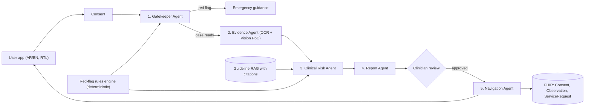

# Sanad (سند) — A Private Front Door for Men's Reproductive Health

> **From signals to the right care — earlier, privately.**
> A bilingual (Arabic/English), privacy-first multi-agent platform that helps men understand reproductive health risks *before* infertility is diagnosed, and guides them to the right level of care with a clinician always in the loop.

Built by **AetherHealth** for the [Future Health Digital Innovation Challenge 2026](https://hack2skill.com/event/futurehealthchallenge/) — *Fertility · Challenge 01: Male Reproductive Health.*

> [!IMPORTANT]
> **Research prototype. Not a medical device.** Sanad is a risk-screening and navigation tool. It does **not** diagnose infertility and does not replace a clinician. All data in this repository is **synthetic** or from public research datasets. Reported metrics are **simulated performance**, not clinical validation.

---

## Table of contents

- [Why Sanad](#why-sanad)
- [What it does](#what-it-does)
- [User journeys](#user-journeys)
- [Architecture](#architecture)
- [The five agents](#the-five-agents)
- [Triage levels](#triage-levels)
- [Safety and responsible AI](#safety-and-responsible-ai)
- [Privacy by design](#privacy-by-design)
- [Cultural design principles](#cultural-design-principles)
- [Tech stack](#tech-stack)
- [Repository structure](#repository-structure)
- [Getting started](#getting-started)
- [Evaluation](#evaluation)
- [Data and knowledge sources](#data-and-knowledge-sources)
- [Roadmap](#roadmap)
- [Assumptions and limitations](#assumptions-and-limitations)
- [Team](#team)
- [License](#license)

---

## Why Sanad

*Sanad* means "support" in Arabic. The name is deliberately neutral — no "infertility", no "sperm" — so the app can sit on a phone's home screen without embarrassment.

- Male factors contribute to about half of infertility cases, yet men often enter care late — usually after their partner has been assessed.
- Male reproductive health is also a window into general health (metabolic disease, cardiovascular risk, mortality).
- Existing digital products mostly start at a semen test, when a couple is already struggling. Few address **upstream risk**, **Gulf cultural and religious sensitivities**, or **integration with the health system**.

Sanad focuses on exactly that gap: a trusted, low-friction front door for men that turns risk signals into safe, explainable clinical action.

## What it does

| Challenge requirement | How Sanad addresses it |
|---|---|
| Earlier, explainable risk identification | Guideline-grounded risk flags across six domains (metabolic, infectious, anatomical, genetic, lifestyle, semen results), each with a citation. Always labelled **"Screening — not diagnosis."** |
| Culturally trusted experience | Arabic/English with RTL, neutral language, optional family-plan questions, partner-privacy controls, religiously acceptable sample-collection options. |
| Lower-friction assessment | Anonymous 6-minute self-assessment, lab-report upload with OCR, teleconsult booking, discreet at-home steps where clinically appropriate. |
| Safe triage and referral | Deterministic red-flag rules run **before** any AI. Five triage levels from self-care to emergency. Clinician approval for every clinical recommendation. |
| Privacy by design | Purpose-level consent, data minimisation, user-controlled sharing, in-country (UAE) deployment design. |
| Demonstrable value | Synthetic cohort of 1,000 cases with clinician-labelled ground truth, safety, fairness and usability metrics. |

## User journeys

| # | Persona | Flow | Outcome |
|---|---|---|---|
| J1 | Single man, 24, pre-marriage, high BMI, anabolic steroid use | Anonymous self-assessment | Flags for exogenous testosterone/steroids and obesity → education + primary-care referral. No assumptions about family plans. |
| J2 | Married man, 31, type 2 diabetes, past mumps orchitis, consanguineous marriage | Self-assessment + HbA1c report upload | Metabolic, infectious-history and genetic flags → genetic counselling + baseline semen analysis. He decides whether to share with his spouse. |
| J3 | Man, 36, couple trying for 6–12 months | Lab or at-home sample → semen report upload → OCR vs WHO 2021 reference limits | Clinician-reviewed report → andrology/urology referral via FHIR `ServiceRequest`. |
| J4 | Young man with sudden severe scrotal pain | First screening question | **Pipeline stops.** Immediate emergency guidance from the rules engine — no LLM involved. |

## Architecture



Pipeline: **Consent → Intake/Validation → Evidence → Guidelines (RAG) → Risk Reasoning → Report → Clinician Review → Navigation/Referral**

*"A chatbot talks. An agent system works through a process."*

## The five agents

| Agent | Role | Key guardrails |
|---|---|---|
| **1. Gatekeeper** (Consent & Intake) | Purpose-level consent, adaptive questionnaire, red-flag check first, "Case Ready" checklist. Outputs FHIR `QuestionnaireResponse`. | Red flags decided by **rules, not the LLM**. Minimal data collection. No questions about religion or marital status unless needed. |
| **2. Evidence** (Lab OCR + Vision PoC) | Extracts values from semen, hormone, HbA1c and STI reports; normalises units into FHIR `Observation`. Vision PoC detects and tracks sperm on research video. | Low-confidence fields go back to the user for confirmation. Vision output is labelled *research prototype* and is **never used for triage** in the MVP. |
| **3. Clinical Risk** (Guideline RAG + Reasoning) | Combines rules and retrieval to produce explainable risk flags and a suggested triage level. | Every clinical claim needs a citation (source, section, evidence grade) or it is not shown. Triage can never be lower than the rules engine's level. Abstains when data is insufficient. |
| **4. Report** | Two outputs: a structured clinician report (key findings, quantitative values, guideline references, safety checks) and a plain-language bilingual summary for the user. | Marked *"AI-generated for clinician review."* User summary for yellow-or-higher cases is released only after clinician approval. |
| **5. Navigation & Referral** | Turns the approved triage level into action: matching services, teleconsult booking, FHIR `ServiceRequest`, follow-up reminders. | Shares data only with recipients the user has explicitly consented to. |

**Clinician-in-the-loop:** GPs and andrologists review, edit, approve or reject in a console. Every action is audit-logged.

## Triage levels

| Level | Example triggers | Action | Reviewer |
|---|---|---|---|
| 🔴 Emergency | Sudden severe scrotal pain, fever with painful swelling, scrotal trauma | Go to emergency now (call 998) | Rules engine; clinician reviews afterwards |
| 🟠 Priority (≤ 2 weeks) | Palpable testicular mass, no sperm on a report | Urology/andrology referral | Clinician within 24 h |
| 🟡 Specialist | ≥ 1 parameter below WHO reference limit, cryptorchidism or mumps orchitis history, testosterone/steroid use, ≥ 12 months trying (≥ 6 months if partner ≥ 35) | Andrology/fertility, repeat semen analysis, hormones | Clinician within 48 h |
| 🔵 Primary care | Obesity, metabolic syndrome, uncontrolled diabetes, STI history, medications affecting spermatogenesis | GP / primary care screening | Clinician |
| 🟢 Self-care | Lifestyle factors only (smoking, vaping, alcohol, heat exposure) | Cited education, re-check in 3–6 months | Pre-approved content |

> Sanad always tells users: *a result below a reference limit does not mean you cannot have children.*

## Safety and responsible AI

- **Deterministic red-flag engine** runs before and independently of every LLM call.
- **Citation-required RAG** with groundedness checks; ungrounded claims are dropped.
- **Abstention and calibration** — agents can say "not enough information".
- **Prompt-injection protection** for uploaded files (Azure AI Content Safety / Prompt Shields).
- **Red-teaming** with a library of unsafe prompts (e.g. dosing requests, "am I infertile?").
- **Fairness monitoring** across age, nationality group and language (AR/EN).
- **Documentation:** model card, data sheet and risk register, mapped to the Abu Dhabi DoH Responsible AI Standard.

## Privacy by design

- **Purpose-level consent** recorded as FHIR `Consent`: (a) risk assessment, (b) clinician review, (c) sharing with referred provider, (d) sharing with spouse, (e) de-identified data for model improvement — **off by default**. Revocable at any time.
- **Data minimisation:** anonymous mode until a referral is chosen; images and videos deleted after extraction.
- **In-country design:** target deployment in Azure **UAE North**, aligned with UAE Federal Law No. 2 of 2019 on health data and ADHICS.
- **Access control:** RBAC, Entra ID, MFA for clinicians, Key Vault, private endpoints, immutable audit logs.
- **Plain-language data page:** what your data will and will never be used for.

## Cultural design principles

1. Neutral language ("men's health", not "infertility"); no assumption that the user is married or wants children.
2. Sample-collection options that respect religious views, including a non-spermicidal collection device used during marital intercourse. Sanad **does not issue religious rulings** — it presents options and suggests consulting a trusted imam or doctor.
3. Spousal privacy: nothing is shared with a partner without explicit consent, in either direction.
4. Discretion: neutral icon, content-free notifications, biometric lock, quick-exit.
5. Native Arabic and English with full RTL support; option to request a male clinician.
6. Navigation respects UAE assisted-reproduction law; Sanad never infers a user's religion.

## Tech stack

| Layer | Choice |
|---|---|
| Frontend | PWA (Next.js), Arabic/English, RTL |
| Orchestration | Azure AI Foundry Agent Service or Semantic Kernel on Azure Container Apps |
| LLM | Azure OpenAI (Regional/Provisioned deployment in UAE North for real data) |
| Arabic medical review (stretch) | MBZUAI **BiMediX2** (open weights) as a terminology and readability reviewer |
| Retrieval | Azure AI Search (hybrid + semantic) |
| Document OCR | Azure AI Document Intelligence (custom model) |
| Vision PoC | YOLO-based detection/tracking trained on VISEM-Tracking |
| Safety | Azure AI Content Safety, Prompt Shields, custom rules engine |
| Interoperability | Self-hosted open-source FHIR R4 server in UAE North |
| Security & ops | Entra ID, Key Vault, Private Endpoints, Log Analytics, Defender for Cloud |
| Infrastructure as code | Bicep or Terraform |

> **Data residency note:** Azure Health Data Services (managed FHIR) is not available in UAE North, so Sanad self-hosts FHIR. Azure OpenAI *Global* deployments may process data outside the UAE; the prototype uses synthetic data only, and a pilot would move to a Regional/Provisioned deployment in UAE North.

## Repository structure

```text
sanad/
├── apps/
│   ├── web/                    # User PWA (AR/EN, RTL)
│   └── clinician-console/      # Review, edit, approve queue
├── services/
│   ├── orchestrator/           # Agent pipeline and state
│   ├── agents/
│   │   ├── gatekeeper/
│   │   ├── evidence/
│   │   ├── clinical_risk/
│   │   ├── report/
│   │   └── navigation/
│   ├── rules-engine/           # Deterministic red flags and triage floors
│   └── fhir/                   # FHIR server config and profiles
├── knowledge/
│   ├── manifests/              # Guideline sources, sections, versions, evidence grades
│   └── ingestion/              # Chunking + indexing scripts (no copyrighted PDFs committed)
├── data/
│   ├── synthetic/              # Cohort generator and generated cases
│   └── ocr-samples/            # Synthetic lab reports (AR/EN)
├── vision-poc/                 # VISEM-Tracking experiments
├── eval/                       # Metrics, fairness, red-team suites, reports
├── infra/                      # Bicep/Terraform for UAE North
├── docs/                       # Architecture, model card, data sheet, risk register
├── docker-compose.yml
└── README.md
```

## Getting started

> Commands below describe the intended setup; update them as the code lands.

### Prerequisites

- Docker and Docker Compose
- Python 3.11+ and Node.js 20+
- An Azure subscription with access to Azure OpenAI, Azure AI Search and Document Intelligence

### Configuration

Copy `.env.example` to `.env` and fill in:

```bash
AZURE_OPENAI_ENDPOINT=
AZURE_OPENAI_DEPLOYMENT=
AZURE_SEARCH_ENDPOINT=
AZURE_SEARCH_INDEX=sanad-guidelines
AZURE_DOCINTEL_ENDPOINT=
AZURE_CONTENT_SAFETY_ENDPOINT=
FHIR_BASE_URL=http://localhost:8080/fhir
```

Never commit real keys or real patient data.

### Run locally

```bash
git clone https://github.com/<org>/sanad.git
cd sanad
cp .env.example .env
docker compose up -d                       # FHIR server, orchestrator, apps
python knowledge/ingestion/build_index.py  # Index the guideline corpus
python data/synthetic/generate.py --n 1000 # Generate the synthetic cohort
```

Then open the user app and the clinician console at the ports listed in `docker-compose.yml`.

### Run the evaluation

```bash
python eval/run_eval.py --cohort data/synthetic/cohort.jsonl --out eval/reports/
```

## Evaluation

All figures are **targets** for simulated performance on synthetic data; results will be published in `eval/reports/`.

| Area | Metric | Target |
|---|---|---|
| Safety | Red-flag recall | ≥ 99% |
| Triage | Accuracy / weighted κ vs clinicians | ≥ 90% / ≥ 0.8 |
| Triage | Under-triage rate | ≤ 2% |
| Risk flags | Sensitivity / specificity per domain | ≥ 90% / ≥ 85% |
| Grounding | Citation precision | ≥ 95% |
| Calibration | Expected calibration error | ≤ 0.05 |
| OCR | Field-level accuracy | ≥ 95% |
| Fairness | Max gap between subgroups (age, nationality group, AR/EN) | ≤ 5 percentage points |
| Process | Assessment completion rate | ≥ 80% |
| Experience | System Usability Scale | ≥ 75 |
| Clinical | Clinician rating of report quality (1–5) | ≥ 4.2 |

**Ground truth:** two clinicians independently label a stratified subset of 200 cases (Cohen's κ reported); remaining cases use guideline-derived rule labels.

## Data and knowledge sources

**Clinical knowledge (RAG corpus)** — each chunk carries `source`, `edition`, `section`, `page`, `evidence_grade`, `jurisdiction`, `last_reviewed`:

- WHO Laboratory Manual for the Examination and Processing of Human Semen, 6th edition (2021)
- AUA/ASRM Guideline on Diagnosis and Treatment of Infertility in Men (2020, amended 2024)
- EAU Guidelines on Sexual and Reproductive Health
- NICE CG156 — Fertility problems: assessment and treatment

Guideline documents are copyrighted by their publishers. This repo stores **manifests and ingestion scripts only**; obtain the source documents from the publishers.

**Datasets**

- [VISEM-Tracking](https://www.nature.com/articles/s41597-023-02173-4) — sperm video dataset (CC BY 4.0), used for the Vision PoC
- Synthetic patient cohort — generated in `data/synthetic/`
- Synthetic Arabic/English lab reports — generated in `data/ocr-samples/`

## Roadmap

| Week | Dates (2026) | Milestone |
|---|---|---|
| 1 | 22–28 Oct | Scope locked, guideline corpus indexed, red-flag rules v1 signed off by a clinician, Azure baseline in UAE North |
| 2 | 29 Oct – 4 Nov | Gatekeeper + Clinical Risk Agent with citations, FHIR server, synthetic cohort v1, OCR model v1 — journeys J1 and J4 end-to-end |
| 3 | 5–11 Nov | Report Agent, clinician console, Navigation Agent + `ServiceRequest`, Vision PoC, first evaluation run — J2 and J3 working |
| 4 | 12–20 Nov | Fixes from evaluation, fairness and red-team, usability testing, demo video, documentation — **submit by 19 Nov** |

**Stretch:** live Vision PoC, BiMediX2 Arabic reviewer, Arabic voice input, mock Malaffi integration, end-to-end encrypted partner sharing.

## Assumptions and limitations

- Performance is measured on **synthetic data** and may not reflect real users.
- Consanguinity rates in the UAE vary widely across sources; the cohort generator samples a range and reports sensitivity analysis.
- The Vision PoC is trained on a non-Gulf research cohort and is **not** used for clinical decisions.
- Many lifestyle risk factors have limited evidence (low guideline grades); Sanad shows the evidence grade and does not recommend treatment based on weak evidence alone.
- Clinician review times (24–48 h) are design assumptions, not validated service levels.
- Regulatory classification (e.g. software as a medical device) would need confirmation with the relevant UAE authorities before any pilot.

## Team

**AetherHealth**

| Role | Name |
|---|---|
| Product & clinical lead | _TBD_ |
| AI / agent engineer | _TBD_ |
| Backend & cloud | _TBD_ |
| Frontend & UX | _TBD_ |
| Data & evaluation | _TBD_ |
| Clinical advisor (urology/andrology) | _TBD_ |

## License

To be confirmed against the challenge rules on intellectual property. Until then, all rights reserved by the AetherHealth team.

## Acknowledgements

Built for the Future Health Digital Innovation Challenge 2026 by Future Health — A Global Initiative by Abu Dhabi, co-created with Microsoft, Inception and MBZUAI, hosted on Hack2skill.
