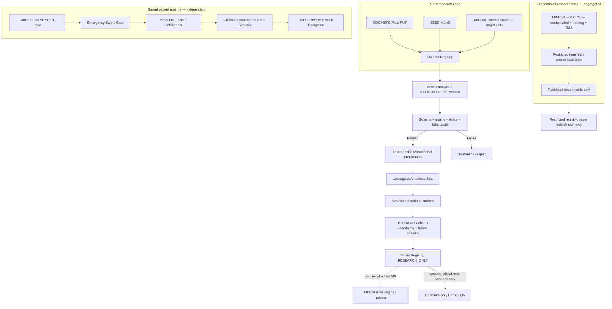

# SANAD — DATA INGESTION, ML TRAINING & MODEL INTEGRATION SPECIFICATION

**Document ID:** `AETHERHEALTH/SANAD/DATA-ML-PIPELINE/0.1`  
**Version / date:** v0.1 · 2026-11-03  
**Status:** DRAFT — Architecture / AI-ML / BA / Security review; **not implemented or clinically validated**  
**Baselines:** Sanad BRD v0.4; PRD v0.4; Data Dictionary & Synthetic v0.4; System Architecture v0.4; Evaluation Plan v0.4.  
**Scope:** Offline research data ingestion, reproducible training, artifact governance, sandbox integration boundaries. **Not** a clinical decision system and **not** a production EHR specification.

## 1. Executive decision and boundary

Sanad has **two fundamentally distinct data flows**. (A) **Offline research datasets** are registered, audited, prepared, split, trained and evaluated in purpose-specific workspaces; resulting artifacts are isolated from clinical decisions. (B) **Runtime inputs** from a consenting user enter the patient assessment workflow: deterministic emergency gate → adaptive intake → semantic validation → approved evidence/rules → draft/review → private/mock care navigation. The flows do not share a patient table, and an ML experiment cannot automatically issue `triage_action`.

**Decision v0.1:** Deliver a traceable offline training framework and *research sandbox contract*, not an automatic connection between a research classifier and Sanad's clinician-facing recommendations. **Training is optional for the MVP; safe workflow must operate without any trained model.**

### 1.1 System / trust boundary



## 2. Explicit objectives and non-goals

| Category | Decision | Evidence expected |
|---|---|---|
| In scope | Dataset registration, file integrity, schema contracts, rights/licensing | Versioned manifest, SHA-256, owner/approver |
| In scope | NSFG two existing prepared tasks and independent research SEED/MIMIC/Malaysia adapters | Mapping report with per-column status and target provenance |
| In scope | Leakage-safe experiment lifecycle, reproducible baselines, evaluation | Split IDs, held-out scores, metric definitions, failure log |
| In scope | Model registry and sandbox-only integration controls | Artifact signature, model card, denied requests, rollback |
| In scope | Psychosocial incremental value study only if **same-person** psychosocial inputs and semen outcome are validated | Dataset audit, cohort/target definition, ablation protocol |
| Out of scope | Training a diagnostic infertility predictor from NSFG, SEED labels or synthetic workflow data | Explicit hard denial |
| Out of scope | Training from credentialed PhysioNet in unrestricted cloud, ChatGPT/third-party endpoints without documented compliance | Security enforcement + DUA review |
| Out of scope | Auto-referral, drug/order recommendation or changes to clinician-approved triage floor | Backend authorization independent of model |
| Out of scope | FHIR server, Sahatna interface, production clinical validation | Remain TECH_TBD / PILOT |

## 3. Pipeline stages and acceptance gates

| Stage | Input | Transformation / validation | Required output | Fail-closed gate |
|---|---|---|---|---|
| G0 Register | Dataset source and license | Pin URL, publisher, version, DOI, authorization, permitted use, geography | `dataset_manifest.yaml` | Unknown license/access → `QUARANTINED` |
| G1 Acquire | Original file(s) | Authorized local download; checksum; no overwrite | Raw immutable bytes, `SHA256SUMS.txt` | Checksum/version mismatch → stop |
| G2 Profile | Original dataset | Inspect sheets/files, actual headers, codebook, grain, row ID, missing special values | `raw_schema.json`, profiling report | Unverified column/target → cannot train task |
| G3 Privacy | Access classification | DUA/training/individual rights, retention, external tool approval, storage boundary | `access_review.json` | Restricted records to public zone → deny |
| G4 Task label | Original target | Establish unit of observation, label meaning, eligibility, temporal ordering, negative class | `task_card.md` | No legitimate target / post-outcome leakage → reject |
| G5 Prepare | Approved raw + mapping | Cast, range check, explicit missingness, dedupe, source/time preservation | Prepared feature table + transformation version | Bad units, unknown coding semantics → block |
| G6 Split | Prepared data + group ids | Train/val/test, group/time stratification when valid; survey design if relevant | `split_manifest.json`, fixed row IDs | Same patient/visit family across splits → fail |
| G7 Train | Train set | Majority and simple statistical baselines first, optional advanced model | Fitted pipeline, config, env, seeds | Fit scaler/imputer on test → fail |
| G8 Evaluate | Frozen held-out set | Appropriate metrics, CIs, class counts, slice errors, leakage review | Signed `evaluation_report.md`, model card | No independent test → cannot promote |
| G9 Register | Evaluated artifact | Model file hash, feature signature, allowed task, constraints, reproducibility | `model_manifest.json` in isolated registry | Missing metadata → reject |
| G10 Sandbox | Registered artifact | Whitelisted test-only route and synthetic/test input; version and safety checks | Research tab response, logs | Any `triage_action` / provider share request → deny |

**Stage status enums:** `NOT_STARTED`, `IN_PROGRESS`, `PASSED`, `FAILED`, `QUARANTINED`, `BLOCKED_ACCESS`, `NOT_EVALUATED`. A dataset may be `READY_FOR_AUDIT` but never `TRAINING_READY` solely from its published abstract.

## 4. Canonical data contracts and warehouse segregation

| Object | Key fields | Notes |
|---|---|---|
| `ResearchDataset` | `dataset_id`, `version`, `source_uri`, `doi`, `license`, `access_tier`, `checksum`, `verified_columns`, `codebook_ref` | Raw source is immutable; approved owner required |
| `ResearchTask` | `task_id`, `dataset_id`, `unit_of_analysis`, `target_source_col`, `target_definition`, `eligibility`, `feature_policy`, `label_source` | No cross-dataset patient fusion |
| `FeatureMapping` | `source_col`, `semantic_meaning`, `raw_codes`, `transform`, `time_anchor`, `missing_codes`, `role`, `verification_status` | Each mapping individually reviewed |
| `DatasetSplit` | `split_id`, `method`, `seed`, `group_key`, `row_hashes`, `train_n`, `val_n`, `test_n`, `leakage_checks` | Lock before model selection |
| `Experiment` | `run_id`, `commit_sha`, `env_lock`, `input_manifest_sha`, `split_id`, `estimator`, `hyperparams`, `metrics` | Full reproducibility and audit |
| `ModelArtifact` | `model_id`, `run_id`, `sha256`, `feature_schema_sha`, `label_schema`, `allowed_use`, `promotion_state` | Default `RESEARCH_ONLY` |
| `InferenceAudit` | `model_id`, `purpose`, `input_schema_ver`, `decision`, `reason_code`, `timestamp` | Metadata only, no unnecessary patient text |

**Storage namespaces (suggested):** `research/public/{dataset_id}/{version}/...`, `research/credentialed/{dataset_id}/{version}/...` (separate ACL and key), `research/experiments/{task_id}/...`, `research/registry/...`, `product/synthetic/...`. **No shared patient-level join ID** across research sources or runtime cases. Never use runtime `case_id` as a training source identifier.

## 5. Task-specific research designs

### 5.1 NSFG Male Respondent 2022–2023 — two existing tasks

The existing `Sanad_NSFG_Audit_v1` artifact already includes `data/prepared/self_reported_fertility_difficulty/` (`FATHDIFF`) and `data/prepared/prior_infertility_care_use/` (`INFHELP`), each with train/validation/test files and task card. The original audit counted **4,371 rows / 1,157 columns**, with valid research subsets **3,437 / 3,722 rows** respectively. **Reuse these prepared artifacts after checksum and task-card verification**; do not demand a fresh preprocessing run just to load existing CSVs. Labels are survey self-report and past care use, not clinical diagnoses, triage or provider-referral decisions. Survey skip patterns, special raw codes, geography and timing are part of label limitations.

**NSFG key input fields in audited research subset:** `AGE_R`, `GENHEALT`, `BMIcat`, `SMK100`, `SMOKE30`, `DRINK12`. **Targets** `FATHDIFF`, `INFHELP` are **mutually separate tasks**. Survey `CaseID` is never a feature. Survey weights and PSU/stratum design variables belong to survey inference methodology, **not** ordinary health features. Existing splits must not be casually merged or replaced.

### 5.2 SEED-ML v3 — semen phenotype benchmark

Proposed task: research classification of the source `diagnostic` labels as defined by SEED-ML documentation. **Target must be audited for derived-feature leakage** (features contributing directly to diagnostic label formation may make evaluation circular). A model that classifies a semen-analysis phenotype is **not** an early fertility prediction, and cannot issue `triage_action`. No BMI/smoking/stress columns should be invented when absent. Check patient linkage before group splitting; if unavailable, disclose possible repeated-visit leakage.

### 5.3 MIMIC-IV-Ext CDS v1.0.2 — restricted, ED-focused

Source files documented publicly include `vital_signs.csv`, `patient_demographics.csv`, `initial_assessment_info.csv`, `clinical_data.csv`, `triage_level.csv`, `specialty_referral.csv`, `specialty_referral_clinician_approved.csv` and `diagnosis.csv`, connected through `stay_id`. **Do not infer complete schemas without reading accessible files.** `specialty_referral.csv` is initially LLM-generated; the clinician-approved subset is selective, not an independent prospective fertility referral ground truth. The source population is emergency-department cases, not an Abu Dhabi outpatient male-fertility cohort. **Access requires individual credentialing + dataset-specific required training + DUA** before touching files. Files remain in an isolated local environment. No release of data/model memorization outputs or patient-level derivatives to teammates lacking rights.

### 5.4 Malaysia occupational stress — candidate only, label gate unresolved

Mendeley DOI `10.17632/cgyh5s88kc.3` publicly lists `DIB dataset and codebook.xlsx` and `DIB questionnaire.docx` for a survey of occupational stress, job satisfaction and performance among male fertility patients. **The web listing does not prove an exact semen-quality target column exists in the Excel workbook.** Proposed `OS1–OS41` item mapping and any semen quality category require direct sheet/header/codebook audit; status `PENDING_SCHEMA_AUDIT`. **If no individual-level semen outcome exists: do not train the intended stress→semen predictor.** Consider alternative research questions on stress, but avoid post-hoc relabeling or inventing scores.

### 5.5 Psychosocial incremental value gate

Primary research hypothesis (not an expected outcome): *Do verified psychosocial features add predictive information for measured semen-quality outcomes beyond pre-specified clinical/lifestyle baselines?* Eligibility requires (1) same-person linked stress/sleep/anxiety and semen outcome; (2) measurement timing and analyte units; (3) usable sample and event counts; (4) privacy/license; (5) confounding/leakage assessment. Compare **baseline clinical/lifestyle** against **baseline + psychosocial**, with the *same frozen holdout* and feature selection entirely inside training folds. Report Δmetric + uncertainty and null/negative results. If a dataset contains **occupational stress only**, do not claim stress+sleep+anxiety model was trained.

## 6. Data splitting, preprocessing and evaluation details

- **Leakage:** Check participant identifiers, repeated visits, duplicate text, post-outcome information, target-derived lab values, and tuning on the test set. Record explicit exclusions. Source-level random split must be rejected if the same person has multiple records; use group-aware split when linkage exists.
- **Missing data:** Preserve `NOT_ASKED`, `DECLINED`, survey routing codes and clinically missing measures; don't cast them to `NO`. Impute inside training folds only. For restricted records, avoid publishing small cells or memorized text.
- **Preprocessing:** pin types and units; normalized concept codes are *research features* and not automatically FHIR Observation codes. Save transformer with estimator, refuse unseen categorical values unless explicitly handled.
- **Class imbalance:** majority prediction, logistic/regularized baselines, tree baseline. For rare groups use per-class support, Macro-F1, Balanced Accuracy, PR-AUC when meaningful, confusion matrix. Do not assume a nine-class model is adequate with underrepresented classes.
- **Calibration:** only for a well-defined prediction target and appropriate holdout; calibrated survey probability ≠ individual medical risk.
- **Uncertainty:** bootstrap at participant/group level when possible; report sample sizes and confidence intervals for metric differences; external validation absent → mark `NOT_EVALUATED`.
- **Transportability:** Malaysia/US/ED data do not establish reliability for the UAE outpatient population. Do not claim clinical sensitivity from synthetic tests.
- **SLM track:** compare static form / rule-based extraction / SLM / LLM with held-out annotated extraction cases; metrics = per-field F1, temporal/negation error, unsupported claims, abstention, p95 latency and cost. It is a **distinct benchmark** from fertility outcomes.

## 7. Promotion, deployment and rollback

| Stage | Allowed behavior | Gate |
|---|---|---|
| `EXPERIMENTAL` | local research runs | manifest + permitted data use |
| `RESEARCH_VALIDATED` | frozen benchmark and report | holdout, leakage/privacy review, signed model card |
| `SANDBOX_DEMO` | isolated research tab with synthetic/sample approved inputs | allowlisted API, no triage/referral, version display |
| `CLINICAL_CANDIDATE` | documentation only; no real clinical effect | external clinical validation plan + risk analysis + approval pending |
| `CLINICAL_APPROVED` | **not currently available in Sanad v0.4** | independent clinical/regulatory/privacy sign-off required |

**Non-negotiable runtime invariant:** `research_model_output` **never** directly maps to `TriageDecision.action`, clinician-approved `CarePlan`, `ServiceRequest` or automatic referral. An offline trained model may appear as `RESEARCH_ONLY` in a protected sandbox only after G0–G10 pass. A report or GUI label cannot upgrade its permitted use. Rollback on schema/model mismatch, unexpected OOD, missing audit or any consent/security regression.

## 8. Security and rights management

- For PhysioNet: each human recipient needs their own credentialed access and accepted applicable DUA; being on the same team does not grant access. Enforce separate OS users/ACL, encrypted-at-rest storage where supported, private key management and explicit data retention/deletion policy.
- Do **not** place PhysioNet rows, notes, prompts, examples, model extracts or patient-identifiable derivatives in GitHub, shared drives, public demos, ChatGPT chats, OpenRouter or third-party LLM APIs absent separately documented DUA-compliant approvals. PhysioNet's September 2025 guidance strongly favors local LLMs; any online service needs verified zero retention, no training, no human review and assessment of logging/cache controls. If uncertain, do not send the data.
- Research `training_data` must not be populated from live Sanad user input without a **new purpose-specific opt-in and governance review**; default MVP is synthetic-only.
- **Publication gate:** dataset license/DUA review → aggregation and disclosure check → owner approval. Public model weights trained on credentialed records also require explicit review for potential data leakage and rights; don't assume they can be shared.
- Keep security incidents auditable with minimal metadata, not raw protected content.

## 9. Suggested repository layout and interfaces

```text
sanad/
  data_registry/                 # manifests, mappings only (no restricted CSV)
    datasets.yaml
    mappings/{dataset_id}.yaml
    task_cards/{task_id}.md
  research/
    datasets/public/            # gitignored; access policy respected
    datasets/credentialed/      # separately protected; gitignored
    prepared/{task_id}/         # never publish restricted rows
    experiments/{task_id}/{run_id}/
    registry/{model_id}/         # model cards + pointers, gated binaries
  eval/
    workflow_golden/            # synthetic QA; independent from ML
    extraction_holdout/         # annotated nonrestricted cases
  apps/
    patient-web/
    clinician-web/
  services/
    research-sandbox/           # optional, isolated API / no clinical rights
    clinical-workflow/          # deterministic rules, consent, reviews
```

**Proposed CLI contracts (design; scripts NOT claimed implemented):** `sanad-data register --manifest ...`, `sanad-data audit --dataset ...`, `sanad-data prepare --task ...`, `sanad-ml train --task ... --split ...`, `sanad-ml evaluate --run ...`, `sanad-ml promote --run ... --tier sandbox`, `sanad-model infer --model ... --purpose RESEARCH_ONLY`. Each command writes a manifest with status, actor, timestamps, SHA and non-sensitive errors. **No raw samples in default logs**.

## 10. Acceptance criteria and source traceability

| ID | Given / When | Then | Links |
|---|---|---|---|
| DML-AC-01 | Dataset lacks license/version | Registration fails to quarantine | BR-26, PRD-FR-15 |
| DML-AC-02 | Malaysia target header not verified | No stress→semen training job allowed | BO-13, PRD-FR-34 |
| DML-AC-03 | NSFG prepared splits already exist and match task manifest | Use as read-only inputs without rerunning preparation | PRD §4.12 |
| DML-AC-04 | Survey response missing/skip | No automatic `NO` or `NORMAL`; codebook rules used | BR-03, BR-19 |
| DML-AC-05 | Same participant appears in train and test | Split invalid; stop training | PRD §7 |
| DML-AC-06 | Restricted file pointed to public data store/cloud | Ingestion denied + security audit event | BR-26, NFR-12 |
| DML-AC-07 | Model requests `triage_action` or real referral | Backend denies regardless of LLM/model output | BR-13, PRD-AC-34 |
| DML-AC-08 | Artifact lacks feature schema hash / model card | Cannot promote to sandbox | PRD-FR-15 |
| DML-AC-09 | No clinician-labelled evaluation cohort | Clinical validity shown `NOT_EVALUATED` | PRD §9 |
| DML-AC-10 | Psychosocial ablation lacks same-person outcome | Research conclusion blocked | BR-35, PRD-FR-34 |
| DML-AC-11 | Model serving environment changes input schema | Fail closed, no action, alert QA | NFR-03 |
| DML-AC-12 | Synthetic FHIR demo requests dataset originals | Data separation gate denies; use designated synthetic fixtures | PRD-FR-31/33 |

## 11. Owners, decisions and immediate action plan

| Owner | Deliverable | Gate |
|---|---|---|
| BA/Product | Confirm tasks, intended users, no clinical claims | Approve registry task cards |
| Data Engineer | Inspect workbook/CSV, raw immutable copies, mappings and split manifests | G0–G6 |
| AI/ML | Baseline models, ablation plan, metrics, model cards | G7–G9 |
| QA | Leakage/privacy negative tests and reproducibility | G2–G10 |
| Security/Compliance | Dataset license, PhysioNet DUA, third-party software list | G0, G3, publication |
| Clinical Advisor (TBD) | Validate medical interpretation, outcome scope and future clinical gate | Before any clinical-use claim |

**Execution order:** (1) freeze registry and file checksums; (2) reuse validated NSFG prepared splits; (3) audit Malaysia Excel target rather than assume semen category; (4) audit SEED-ML leakage; (5) only after credential/training/DUA completion, independently audit local MIMIC in secure zone; (6) train simple baselines; (7) produce report/model card; (8) optional research sandbox. No step requires cloud GPU to start.

## 12. References and verification notes

- Sanad BRD/PRD/System Architecture/Data Dictionary/Evaluation v0.4 (2026-11-03): **team requirements**, not validated implementation.
- CDC NSFG Male PUF: https://www.cdc.gov/nchs/nsfg/nsfg-2022-2023-puf.htm ; prior local artifact: `Sanad_NSFG_Audit_v1/DATA_AUDIT_REPORT.md` (2026-10-27).
- SEED-ML v3: https://data.mendeley.com/datasets/sc8rsz2vd7/3 .
- Mendeley occupational stress dataset v3: https://data.mendeley.com/datasets/cgyh5s88kc/3 (published 2024-01-02). The web page **does not independently certify a semen outcome column**.
- MIMIC-IV-Ext CDS v1.0.2: https://physionet.org/content/mimic-iv-ext-cds/1.0.2/ (credentialed, required training and DUA).
- PhysioNet policy on restricted data with LLMs (2025-09-24): https://physionet.org/news/post/llm-responsible-use/ .
- FHIR R4 (conceptual only): https://hl7.org/fhir/R4/ ; runtime integration and resource validation are separate activities.
