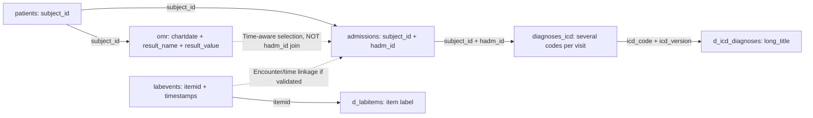
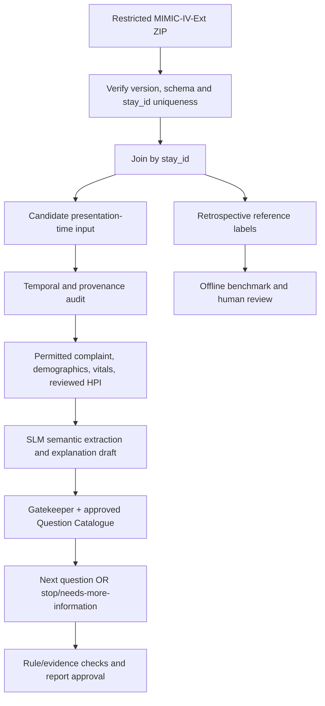

# SANAD — DATASET REGISTRY, FEATURE MAPPING & LABEL PROVENANCE

**Document ID:** `AETHERHEALTH/SANAD/DATASET-REGISTRY/0.2`  
**Version / date:** v0.2 — 2026-11-07; complete English edition of the integrated v0.2 registry  
**Status:** DRAFT. Dataset documentation and two embedded MIMIC operating guides; does **not** establish clinical validation, unrestricted access, or a complete row-level audit.  
**Related specifications:** Sanad Data & ML Pipeline Specification v0.2, Model Integration Contract, Sanad BRD/PRD, MAS technical addendum.

**Changes in v0.2:** Language is standardized to English throughout editorial text, tables, captions, examples, QA, and code comments. This document directly integrates the MIMIC-IV v3.1 `hosp` and MIMIC-IV-Ext CDS v1.0.2 extraction guides. It preserves NSFG, SEED-ML, and Malaysia registry concepts, 14 dataset links, data isolation, evidence levels, and research-only safeguards. This is **one standalone registry**, not an index of separate guides.

> **RESTRICTED-DATA / LINK SHARING WARNING:** The Drive and Sheets URLs below point to copies of PhysioNet restricted datasets, **not to publicly redistributable data**. Their cloud-storage compliance, share permissions, and recipient authorization are not yet confirmed. Do not share the source files or these internal links with unauthorized collaborators, place this document in a public Git repository, or submit restricted patient records to unapproved external AI services. Audit access controls and the applicable Data Use Agreement (DUA) first.

## 1. Registry purpose and evidence levels

A registry entry records the **exact dataset version, access and licensing terms, physical schema evidence, unit of analysis, label definition, feature eligibility, transformations, train/validation/test splits, and dissemination limits**. A proposed mapping must never be silently treated as an audited input feature.

| Evidence level | Definition | Processing gate |
|---|---|---|
| `AUDITED_LOCAL_FILE` | Exact file was opened; headers, source, row counts and checksum were recorded | Eligible for further task, leakage and governance reviews |
| `VERIFIED_LOCAL_REPORT` | Previous verified audit has source/hash and task card; raw input not reopened in this update | Verify the referenced artifacts before reuse |
| `PUBLISHED_DOCUMENTATION` | Official paper or landing page describes fields; physical file not inspected | Physical schema verification still required |
| `PROPOSED_MAPPING` | Candidate semantic mapping awaiting codebook/subject-matter review | Do not enable it as an assumed model feature |
| `UNVERIFIED` | Unsupported, conflicting or unavailable evidence | No training on that assumed field |

**Required mapping-row fields:** `source_file`, `source_sheet`, `source_column`, `column_type`, `raw_codebook_ref`, `semantic_field`, `transformation`, `feature_or_target`, `missing_policy`, `temporal_anchor`, `evidence_level`, `reviewer`, `review_date`.

## 2. Master dataset registry

| Dataset ID | Provenance / access tier | Verified or intended scope | Current status | Hard prohibition |
|---|---|---|---|---|
| `nsfg_male_2022_2023_puf` | CDC Male NSFG 2022–2023; public survey data subject to terms | `FATHDIFF` self-reported difficulty; `INFHELP` prior infertility-care use | Existing audit v1 | Neither label is a clinical infertility diagnosis or referral action |
| `seed_ml_v3` | Mendeley `sc8rsz2vd7/3`; confirm exact license in manifest | Semen-related phenotype/`diagnostic` classification | Re-audit physical codebook/schema | No invented lifestyle features; no clinical triage |
| `mimic_iv_3_1_hosp` | [PhysioNet MIMIC-IV v3.1](https://physionet.org/content/mimiciv/3.1/); **credentialed/restricted** | Patients, admissions, OMR measurements, coded ICD diagnoses and lab dictionary | Six Drive filenames/MIME types verified; full checksums/coverage pending | No future OMR values or post-discharge ICD labels in intake SLM prompts |
| `mimic_iv_ext_cds_1_0_2` | [PhysioNet MIMIC-IV-Ext CDS v1.0.2](https://physionet.org/content/mimic-iv-ext-cds/1.0.2/); **credentialed/restricted** | Emergency HPI/complaints/vitals and retrospective diagnosis, triage, referral | Eight Sheet filenames and row-1 headers verified; full-copy audit pending | Do not leak retrospective targets; ED labels are not fertility ground truth |
| `malaysia_occ_stress_v3` | Mendeley DOI `10.17632/cgyh5s88kc.3`; CC BY 4.0 indicated in source listing | Occupational stress, satisfaction, performance questionnaire | Individual-level semen target unverified | No supervised stress-to-semen training without a verified matching target |

**Cross-dataset rule:** NSFG, SEED-ML, Malaysia, and MIMIC are not a shared patient cohort. Even though MIMIC-IV-Ext belongs to the MIMIC ecosystem, cross-source linkage requires an explicit audit of identifiers, timing, rights and provenance. **Never fabricate a single patient by joining unrelated rows.**

## 3. NSFG — Mapping based on the existing audit

**Evidence:** Earlier `Sanad_NSFG_Audit_v1/DATA_AUDIT_REPORT.md` and task cards. Recorded source archive SHA-256: `949f330a67a37d3e8906492fb404a9e8c669850ff75369777036dfbb31f44073`. The original survey reportedly contains **4,371 respondents and 1,157 columns**; confirm the loaded file path and checksum before rerunning any experiment. One row is a survey respondent, not a hospital encounter.

| Source field | Meaning / usage | Missing and category handling | Canonical research mapping | Limitation |
|---|---|---|---|---|
| `AGE_R` | Age, input | Numeric; task-specific eligibility | `age_years` | Survey-context age |
| `GENHEALT` | Self-reported overall health, input | 1–5 categorical; 8 refused; 9 don't know | `general_health_self_rated` | Not a continuous clinical score |
| `BMIcat` | BMI category, input | 1–4 categories, 5 undefined; age-related missingness | `bmi_category_survey` | No inference about muscularity/body fat |
| `SMK100` | Ever smoked at least 100 cigarettes | 1 yes / 5 no in prior audited codebook | `smoked_100_lifetime_survey` | Not equivalent to smoking now |
| `SMOKE30` | Smoking response for past 30 days | Conditional question routing | `smoking_30d_survey` | Routing blank does not mean zero use |
| `DRINK12` | Alcohol behavior survey response | Preserve codebook routing and categories | `alcohol_12m_survey` | Verify categories per task card |
| `FATHDIFF` | **Target A:** self-reported fertility difficulty | Eligible yes/no only after special-code exclusion | `target_self_reported_difficulty` | **Not an infertility diagnosis** |
| `INFHELP` | **Target B:** prior infertility-related help | Yes/no and special codes per codebook | `target_ever_care_use` | **Not a clinical referral label** |
| `CaseID` | Source row identifier | Retain for lineage only | `research_row_id` | Never use as a feature |
| `WGT2022_2023`, `VEST`, `VECL` | Survey weights/design | Survey inference only, when justified | Metadata | Not ordinary patient features |
| `BARRIER_01..08` | General healthcare access barriers | Multi-response logic | Exploratory description | Not infertility referral completion |

**Previously prepared research tasks:**

| Task | Source target | Eligible N | Positive N | Previously documented artifacts |
|---|---|---:|---:|---|
| `nsfg_self_reported_fertility_difficulty_v1` | `FATHDIFF` | 3,437 | 142 | `data/prepared/self_reported_fertility_difficulty/{train,validation,test}.csv`, `task_card.json` |
| `nsfg_prior_infertility_care_use_v1` | `INFHELP` | 3,722 | 227 | `data/prepared/prior_infertility_care_use/{train,validation,test}.csv`, `task_card.json` |

The two tasks are filtered subsets of the **same** survey, not independent cohorts. File names are historical references; verify physical files, hashes and split definitions before reusing. Do not retrain merely because this registry was updated.

## 4. SEED-ML v3 — Pending schema and leakage audit

| Field group | Proposed role | Current evidence | Required verification |
|---|---|---|---|
| `diagnostic` | Research phenotype label; nine classes in prior notes | Source/project documentation, not clinical triage | Exact headers, categories and class counts |
| Semen-related measurements | Candidate predictors | Dataset documentation mentions sperm measurements | Per-field meaning, units, specimen/assay time and missing codes |
| Measurement-derived diagnoses | Potential leakage | Label may be defined using predictors themselves | Identify target-defining features; exclude from early-prediction claims |
| Patient/visit IDs | Group-aware splitting | Linkage not yet established | Detect repeated visits; split by patient if available |
| BMI, smoking, stress, sleep, anxiety | **Not confirmed features** | Not established in physical SEED-ML schema | Do not invent these columns or claim availability |

**Task gate:** `seed_ml_diagnostic_benchmark_v1` can only use the source-defined `diagnostic` label after verification. With contemporaneous semen measurements, describe the task as **phenotype classification**, not pre-laboratory fertility prediction. Outputs such as `triage_action`, clinical infertility probability or psychosocial treatment effects are prohibited.

## 5. MIMIC-IV v3.1 `hosp` — Structured Measurements and Retrospective ICD Diagnoses

**Source:** [MIMIC-IV v3.1 on PhysioNet](https://physionet.org/content/mimiciv/3.1/). This is the **original MIMIC-IV hospital module**, not MIMIC-IV-Ext CDS v1.0.2. It covers patient identifiers (`subject_id`), hospital admissions (`hadm_id`), date-stamped measurements (`chartdate`), and coded diagnoses. It does **not** constitute synthetic data and must remain inside an authorized research environment.

### 5.0. Direct dataset links: Six MIMIC-IV v3.1 `hosp` CSV files

| File and verified Drive link | Role | Primary fields | Intended use |
|---|---|---|---|
| [`patients.csv`](https://drive.google.com/file/d/1mHqbH43k5X7EHY4t2i8uvi0y-EzPgvUc/view?usp=drive_web) | Patient-level demographics and age anchors | `subject_id`, `gender`, `anchor_age`, `anchor_year` | Define cohorts and estimate age at a specific encounter |
| [`admissions.csv`](https://drive.google.com/file/d/1sBh_sMfiRFnZajTnIqYllzg8t7rzf8iz/view?usp=drive_web) | Hospital admission records and timestamps | `subject_id`, `hadm_id`, `admittime`, `dischtime` | Create encounters, define `t0`, and audit temporal leakage |
| [`omr.csv`](https://drive.google.com/file/d/1v2sSNyNXYizO8Z_fq68ku9ch2vKmvg92/view?usp=drive_web) | Date-stamped named observations such as BMI, blood pressure, height, and weight | `subject_id`, `chartdate`, `result_name`, `result_value` | Parse and validate observations available before `t0` |
| [`diagnoses_icd.csv`](https://drive.google.com/file/d/16UORLckQkHa6d_Xdk541KJpbI5un08hm/view?usp=drive_web) | Admission-associated ICD diagnosis codes | `subject_id`, `hadm_id`, `icd_code`, `icd_version`, `seq_num` | Retrospective diagnosis context and candidate research labels, **not at-intake predictors** |
| [`d_icd_diagnoses.csv`](https://drive.google.com/file/d/1HtXndPV1C11ZKhZzpnGCA_gaJiS28g8q/view?usp=drive_web) | ICD code-to-description dictionary | `icd_code`, `icd_version`, `long_title` | Resolve recorded ICD codes into readable condition names |
| [`d_labitems.csv`](https://drive.google.com/file/d/1g6U1EVThHTwFc6Y8atFPoRTRaz0lZ8--/view?usp=drive_web) | Laboratory-item dictionary, **not actual patient results** | `itemid`, `label`, `fluid`, `category` | Discover relevant tests before extracting from large `labevents` |

**Link verification (2026-11-07):** File names and MIME types were checked through Google Drive metadata. Row-by-row completeness, hashes, share permissions, and DUA compliance of these Drive-hosted copies have **not** been validated. These `.csv` links refer to extracted files; the source distribution may use `.csv.gz`. Verify the real local extension and SHA-256 before processing. No separate guide links are included.

### 5.1. Intended research use and boundaries

The engineering goal is to assemble **structured patient and encounter context** for three separate tasks: (a) measure coverage of BMI, height, weight, blood pressure, and diagnosis codes; (b) evaluate an SLM's ability to explain validated measurements and propose approved follow-up questions; and (c) screen potentially relevant male reproductive/urogenital diagnosis codes. **Do not infer infertility diagnoses or use MIMIC-derived outputs to issue clinical triage decisions for Sanad patients.**

Keep two distinct products:

- **Retrospective research table:** can contain historical ICD coding, date-aligned measurements, and well-defined research labels; stays restricted.
- **At-intake SLM input:** can contain **only information established as available by the selected assessment cutoff time `t0`**. Never expose future measurements or post-discharge labels as pre-encounter facts.

Never splice different people's rows or unrelated cohorts into one apparent patient. Identifiers such as `subject_id` and `hadm_id` are linkage keys, **not health predictors**.

### 5.2. Files and responsibilities

#### 5.2.1. First-phase six-file subset

| File in original `.csv.gz` distribution | Compressed size shown in prior listing | Content and role | Important handling rule | Priority |
|---|---:|---|---|---|
| `patients.csv.gz` | ~2.7 MB | Demographics; age anchor and year anchor | `anchor_age` is not the age at every visit | P0 |
| `admissions.csv.gz` | ~19 MB | Admission and discharge timestamps, type and context | A patient may have several `hadm_id` values | P0 |
| `diagnoses_icd.csv.gz` | ~32 MB | One or more coded diagnoses per admission | Preserve `seq_num` and ICD version; not presentation-time truth | P0 |
| `d_icd_diagnoses.csv.gz` | ~855.8 KB | Code dictionary: `icd_code`, `icd_version`, `long_title` | No `subject_id`; join on **both** code and version | P0 |
| `omr.csv.gz` | ~42 MB | `result_name` / `result_value` observations recorded by `chartdate` | No `hadm_id`; link by patient and time policy | P0 |
| `d_labitems.csv.gz` | ~12.9 KB | Laboratory catalog | Does not contain laboratory results; verify actual headers | P0 discovery |

**Paste correction:** An earlier example labeled `d_labitems.csv.gz` had the admission-table columns (`admittime`, `hadm_id`, etc.), suggesting that the wrong table was pasted. Verify actual file headers rather than treating that example as evidence of the lab dictionary schema.

#### 5.2.2. Additional MIMIC-IV `hosp` files in the directory listing

| File | Role | When to use it |
|---|---|---|
| `labevents.csv.gz` | **Observed laboratory results** with `itemid`, timestamps, values, units, and available reference ranges | After discovering relevant item IDs in `d_labitems`; stream or query selectively because the compressed file is ~2.4 GB in the listing |
| `microbiologyevents.csv.gz` | Cultures and microbiology | Infection-focused research, if justified |
| `prescriptions.csv.gz` | Medication orders/prescriptions | Treatment context; a prescription does not prove actual administration |
| `pharmacy.csv.gz` | Pharmacy processing and medication details | Detailed prescription studies |
| `emar.csv.gz` | Electronic medication administration records | When distinguishing prescribed from recorded administered medication |
| `emar_detail.csv.gz` | Details attached to eMAR | Dose/route investigation with validated keys |
| `poe.csv.gz` | Provider order entry | Orders for medications, tests, or procedures |
| `poe_detail.csv.gz` | Additional order details | Reviewing order context |
| `procedures_icd.csv.gz` | ICD procedure codes associated with admissions | Retrospective procedures |
| `d_icd_procedures.csv.gz` | Procedure ICD dictionary | Decode procedures using code **and** version |
| `hcpcsevents.csv.gz` | HCPCS billing/service events | Specific service/billing analyses |
| `d_hcpcs.csv.gz` | HCPCS descriptions | Decode HCPCS codes |
| `drgcodes.csv.gz` | Diagnosis Related Group coding | Administrative grouping; not narrative notes |
| `services.csv.gz` | Hospital service changes | Care pathway and department changes |
| `transfers.csv.gz` | Location and care-unit transfers | Inpatient timelines and multiple transfers per visit |
| `provider.csv.gz` | Coded provider identifiers | Key lookups only; never attempt re-identification |

**Not included in these six files:** Full narrative notes require separately authorized **MIMIC-IV-Note** (`discharge`, `radiology`). ED vitals/triage and ICU measurements may be found in **MIMIC-IV-ED** and the ICU module, respectively. Do not assume these are included in the six-file subset.

### 5.3. Data relationships and safe joins



The cardinality matters: `patients.subject_id` identifies a patient, `admissions.hadm_id` identifies an admission, and `diagnoses_icd` has potentially many coded diagnoses per admission. Join admission diagnoses on **both** `subject_id` and `hadm_id`, then join the dictionary on **both** `icd_code` and `icd_version`. Preserve ICD codes as strings so `07070` does not lose its leading zero. `seq_num` is ordering within coded diagnoses, **not** a clinical severity score.

`omr` contains no `hadm_id`; a blind patient-only merge multiplies rows and can associate measurements from unrelated visits. Select valid observations by patient **and** time windows, considering `chartdate`, `result_name`, repeated values, units, and `t0`.

#### 5.3.1. Synthetic ICD-join example

| `subject_id` | `hadm_id` | `seq_num` | `icd_code` | `icd_version` |
|---|---|---:|---|---:|
| `SYNTHETIC_PATIENT` | `SYNTHETIC_ADMISSION` | 1 | `5723` | 9 |

Dictionary (`5723`, `9`) resolves to **Portal hypertension**. This means *a coded diagnosis associated with that admission*, **not** an SLM diagnosis and not necessarily a condition known at initial intake.

#### 5.3.2. Time-leakage example

If admission starts on May 6 while BMI is recorded on May 7, that BMI must **not** be used as an input for a May 6 at-intake benchmark. Since OMR `chartdate` contains a date but not a time, a same-day observation cannot be proven to precede admission. A conservative baseline accepts only `chartdate < DATE(admittime)`; classify same-day entries as `TIMING_UNCERTAIN` unless more precise timestamps are proven.

### 5.4. Recommended ETL procedure

1. **Inventory and provenance:** Record exact MIMIC version, download source, SHA-256, DUA authorization, and restricted storage. Do not expose patient IDs in public file names.
2. **Schema validation:** Verify file headers and types; catch a mislabeled `d_labitems` file. Keep ICD codes as strings.
3. **Cohort selection:** Define research eligibility (e.g., recorded `gender=M`, relevant age and visits); recorded sex alone does **not** establish a fertility population.
4. **Encounter context:** Join patients to admissions; estimate age using `anchor_age + admission_year - anchor_year` (shifted, not literal birth date).
5. **Diagnosis mapping:** Join the ICD dictionary on `(icd_code, icd_version)`; retain `seq_num`; count missing dictionary matches.
6. **Male reproductive code screening:** Candidate ICD-10 prefixes `N44`, `N45`, `N46` are only an initial screen. Review codes individually; they do not collectively indicate male infertility.
7. **OMR extraction:** Select BMI, height, weight and BP; parse units and repeated observations and select values through an explicit time policy.
8. **Optional lab search:** Inspect `d_labitems` first, then query/stream only relevant `labevents` `itemid` and time windows. Never assume semen measurements are present.
9. **Leakage-safe views:** Separate values available at `t0` from post-encounter diagnosis codes, discharge outcomes, and future tests.
10. **QA/benchmark:** Report missingness, duplicates, multiple admissions, unmatched ICD, age/unit errors, and temporal leakage. Use separately reviewed synthetic cases for SLM explanation and question-choice accuracy.

#### 5.4.1. Age and demographic cautions

- `anchor_year` is date-shifted; it does **not** disclose the patient's real birth year.
- `age_at_admission ≈ anchor_age + year(admittime) - anchor_year` is a dataset-based age estimate, not an exact age at birthday resolution.
- Do not use date-shifting or extreme-age handling to attempt re-identification.
- Fields such as `race`, `insurance`, and `marital_status` do **not** become fertility-risk predictors merely because they are present.

#### 5.4.2. OMR parsing

| `result_name` | Representation | Required parsing and caution |
|---|---|---|
| `BMI (kg/m2)` | Numeric string | Parse numeric value, validate plausible range, retain date/source; not an infertility diagnosis |
| `Height (Inches)` | Numeric string | Convert to cm only when the raw unit and field are verified; 1 in = 2.54 cm |
| `Weight (Lbs)` | Numeric string | Convert to kg only when verified; 1 lb ≈ 0.45359237 kg |
| `Blood Pressure` | Text `systolic/diastolic` | Parse into two distinct numbers and keep measurement date |

`seq_num` and repeated values can represent multiple observations. Do not blindly drop duplicates on `(subject_id, chartdate, result_name)` when values conflict. Retain raw values and define a documented measurement-selection policy.

### 5.5. Python: Local-only examples

These examples use authorized local copies of `.csv.gz` files and do not require manual decompression. They demonstrate linkage and screening, **not production ETL**. Do not share printed patient-level records, screenshots, or exported restricted CSVs with unauthorized team members. Use chunked processing or DuckDB/SQL for very large tables.

#### 5.5.1. Diagnosis joins by admission

```python
from pathlib import Path
import pandas as pd

DATA = Path("/secure/path/to/mimic-iv-3.1/hosp")  # replace with the authorized local path

patients = pd.read_csv(
    DATA / "patients.csv.gz",
    usecols=["subject_id", "gender", "anchor_age", "anchor_year"]
)
admissions = pd.read_csv(
    DATA / "admissions.csv.gz",
    usecols=["subject_id", "hadm_id", "admittime", "dischtime"]
)
diagnoses = pd.read_csv(
    DATA / "diagnoses_icd.csv.gz",
    usecols=["subject_id", "hadm_id", "seq_num", "icd_code", "icd_version"],
    dtype={"icd_code": "string", "icd_version": "string"}
)
dictionary = pd.read_csv(
    DATA / "d_icd_diagnoses.csv.gz",
    usecols=["icd_code", "icd_version", "long_title"],
    dtype={"icd_code": "string", "icd_version": "string"}
)

# Cohort: recorded gender M does not establish fertility status.
male_patients = patients.loc[patients["gender"].eq("M")]
male_admissions = admissions.merge(
    male_patients, on="subject_id", how="inner", validate="many_to_one"
)

# Bind diagnoses to the correct admission using both identifiers.
dx = diagnoses.merge(
    male_admissions,
    on=["subject_id", "hadm_id"], how="inner", validate="many_to_one"
).merge(
    dictionary,
    on=["icd_code", "icd_version"], how="left", validate="many_to_one"
)

# ICD-10 N44/N45/N46 are candidate screens, NOT fertility gold labels.
related = dx[
    dx["icd_version"].eq("10")
    & dx["icd_code"].str.startswith(("N44", "N45", "N46"), na=False)
]

# Estimate encounter age from anchors, never actual date of birth.
related = related.copy()
related["admission_year"] = related["admittime"].str[:4].astype(int)
related["age_at_admission_est"] = (
    related["anchor_age"] + related["admission_year"] - related["anchor_year"]
)

# Print aggregates only; never publish patient-level records.
print("Male admissions:", male_admissions["hadm_id"].nunique())
print("Matched ICD rows:", dx["long_title"].notna().sum())
print("Unmatched ICD rows:", dx["long_title"].isna().sum())
print("Related ICD rows:", len(related))
print("Related unique admissions:", related["hadm_id"].nunique())
```

#### 5.5.2. Date-safe OMR selection for one local encounter

```python
import pandas as pd

# Select an admission within the authorized local environment.
# Never share this subject_id or hadm_id.
if male_admissions.empty:
    raise RuntimeError("No admissions in the selected cohort")

encounter = male_admissions.iloc[0]
subject_id = encounter["subject_id"]
cutoff_day = str(encounter["admittime"])[:10]  # YYYY-MM-DD

parts = []
for chunk in pd.read_csv(
    DATA / "omr.csv.gz",
    usecols=["subject_id", "chartdate", "seq_num", "result_name", "result_value"],
    dtype={"result_name": "string", "result_value": "string", "chartdate": "string"},
    chunksize=250_000
):
    part = chunk.loc[
        chunk["subject_id"].eq(subject_id)
        & chunk["result_name"].isin([
            "BMI (kg/m2)", "Height (Inches)",
            "Weight (Lbs)", "Blood Pressure"
        ])
        & chunk["chartdate"].notna()
        & chunk["chartdate"].lt(cutoff_day),
        ["chartdate", "seq_num", "result_name", "result_value"]
    ]
    if not part.empty:
        parts.append(part)

if parts:
    omr_before = pd.concat(parts, ignore_index=True)
    # Candidate observations may repeat within a day.
    omr_before = omr_before.sort_values(["result_name", "chartdate", "seq_num"])
    # Select the latest observation only under a documented duplicate policy.
    latest_candidate = omr_before.groupby("result_name", sort=False).tail(1)
    print("Number of pre-admission OMR measurements:", len(omr_before))
    print("Measurement types present:", latest_candidate["result_name"].tolist())
else:
    print("No relevant OMR measurement predating this admission.")
```

#### 5.5.3. Discover relevant laboratory tests before retrieving large result files

```python
lab_dict = pd.read_csv(DATA / "d_labitems.csv.gz")
print("d_labitems columns:", lab_dict.columns.tolist())

terms = r"testosterone|follicle.stimulating|luteinizing|prolactin|semen|sperm"
candidates = lab_dict[
    lab_dict["label"].fillna("").str.contains(terms, case=False, regex=True)
]
print("Candidate lab item count:", len(candidates))
# Inspect label/itemid only on authorized machines; verify test semantics.
# Dictionary membership does NOT establish the presence of lab results.
```

**Interpretation constraint:** The ICD `long_title` is a dictionary label, **not** a physician narrative or a Sanad `ClinicalFinding`. The diagnosis codes are retrospective context. If used as research labels, the task must define label timing, consistency, and provenance.

**OMR time-window constraint:** `chartdate < DATE(admittime)` prevents obvious future leakage but does **not** establish clinical recency or accuracy; specify `max_age_days`, unit checks, outlier handling, and duplicate policies. For a full cohort, avoid looping over every patient with a full-table scan.

**Lab discovery constraint:** An `itemid` in `d_labitems` does **not** guarantee the test has observations in `labevents`. Verify row counts and timestamps before promising feature coverage.

### 5.6. Normalized input and the SLM boundary

#### 5.6.1. Synthetic research example (not a MIMIC record)

```json
{
  "case_id": "SYNTHETIC-DEMO-001",
  "assessment_time": "SYNTHETIC_T0",
  "observations": [
    {"concept": "bmi", "value": 23.7, "unit": "kg/m2", "source_table": "omr",
     "time_relation": "BEFORE_T0", "verification_status": "RESEARCH_RECORD_NOT_CLINICIAN_VERIFIED"}
  ],
  "diagnosis_history": [],
  "unknowns": ["smoking_status", "fertility_history"],
  "next_question_candidates": ["ASK_SMOKING_STATUS"],
  "clinical_decision_allowed": false
}
```

`ASK_SMOKING_STATUS` is an illustrative identifier, **not** an approved catalogue entry. The SLM can explain established observations and *propose* a `next_question_id` from an approved catalogue; it cannot independently diagnose, output infertility probability, prescribe, or set `triage_action`. Backend Gatekeeper decides whether to ask another question and enforces safety rechecks and limits.

ICD codes or results unavailable at `t0` must be confined to `retrospective_research_labels` rather than intake prompts.

#### 5.6.2. Information coverage and gaps in the six core files

| Sanad requirement | Available from the six files? | Additional work needed |
|---|---|---|
| BMI, height, weight, BP | Possibly via OMR, not for every admission | Coverage, time window, unit, duplicate audit |
| Gender and encounter-age estimate | Yes, through linkage | Join `patients` + `admissions` and apply shifted age anchor correctly |
| Retrospective ICD codes and titles | Yes | Join `diagnoses_icd` + `d_icd_diagnoses`; not equivalent to clinical notes |
| Current or past smoking | **No verified dedicated variable** | Authorized notes/other EHR data or direct questionnaire; historical tobacco code ≠ current smoking |
| Chief complaint, HPI, clinician narrative | Not in the six-file subset | MIMIC-IV-Note, ED, or Ext with separate rights and validated linkage |
| Semen results and fertility assessment | Not established | Review `d_labitems`, `labevents` and specialized sources |
| Gold next-question answers | No | Approved Question Catalogue and expert-reviewed synthetic cases |
| Medical explanatory evidence | No | Approved guidelines, source registry and reviewer validation |

### 5.7. QA acceptance checklist

| ID | Test condition | Expected outcome |
|---|---|---|
| MIMIC-JOIN-01 | ICD-9 code begins with `0` | Preserve leading zero |
| MIMIC-JOIN-02 | ICD strings overlap across versions | Join on code **and** version |
| MIMIC-JOIN-03 | One patient has multiple admissions | Preserve the correct encounter per diagnosis |
| MIMIC-JOIN-04 | One admission has several diagnoses | Retain all recorded codes |
| MIMIC-OMR-01 | BMI recorded after admission | Exclude from at-intake input |
| MIMIC-OMR-02 | OMR recorded on admission date with no time | `TIMING_UNCERTAIN` |
| MIMIC-OMR-03 | Two weights recorded on same day | Do not silently discard different measurements |
| MIMIC-OMR-04 | BP stored as `110/65` | Parse systolic and diastolic components |
| MIMIC-CODE-01 | ICD-9 `V1582` | Historical tobacco use, **not** evidence of current smoking |
| MIMIC-AGE-01 | Admission year differs from `anchor_year` | Apply encounter-age estimation |
| MIMIC-LAB-01 | Lab dictionary contains an item | Do not assert patient results without checking `labevents` |
| MIMIC-SLM-01 | Post-discharge diagnosis supplied to at-intake SLM | Block leakage |
| MIMIC-SLM-02 | Smoking absent from available context | Return `UNKNOWN`, not `NO` |
| MIMIC-SEC-01 | Uncredentialed colleague requests raw records | Deny access and do not share |

### 5.8. Recommended delivery sequence

**Phase A — Data audit:** Use `patients`, `admissions`, `diagnoses_icd`, `d_icd_diagnoses`, and `omr`; count male/encounter coverage, pre-`t0` BMI availability, candidate male reproductive ICD matches and unmatched codes.

**Phase B — Interpretation context:** Inspect `d_labitems` and optionally stream selected `labevents`; add licensed notes only if the NLP/SLM task genuinely requires them.

**Phase C — SLM explanation and question selection:** Normalize Semantic Facts; construct an approved Question Catalogue and independent reviewed golden cases; evaluate extraction F1, negation/time correctness, claim support, question validity, abstention, latency, and cost. Do not disclose retrospective labels to the model.

**Phase D — Sanad runtime:** Keep the P0 prototype synthetic-only, with deterministic safety gates, a model adapter, Gatekeeper, approved evidence retrieval, report drafting, and authorization/review. Research MIMIC models cannot independently alter clinical decisions.

### 5.9. Security, DUA, and sharing

- Both MIMIC databases are **PhysioNet restricted**. Each researcher must have their own authorized access; never share credentials, raw patient rows, clinical notes, or identifiable derivations.
- Do not upload records to public GitHub, public notebooks, or ordinary third-party LLM APIs. Review DUA, retention, cloud provider, access controls, and permitted use **before** using any external service; prefer a controlled local research environment.
- These guides contain **direct links to restricted Drive copies**; therefore **do not publish this document publicly** or assume the links themselves are compliant with PhysioNet terms. Review shared link permissions and cloud-hosting approvals; revoke broad sharing where present.
- The MIMIC population does not automatically generalize to UAE male reproductive-care users; assess population shift and seek clinical review.

### 5.10. Reference documentation

- [MIMIC-IV v3.1 PhysioNet](https://physionet.org/content/mimiciv/3.1/)
- [MIMIC-IV `hosp` schema](https://mimic.mit.edu/docs/iv/modules/hosp/)
- [Patients](https://mimic.mit.edu/docs/iv/modules/hosp/patients.html), [Admissions](https://mimic.mit.edu/docs/iv/modules/hosp/admissions.html), [OMR](https://mimic.mit.edu/docs/iv/modules/hosp/omr.html)
- [Diagnosis codes](https://mimic.mit.edu/docs/iv/modules/hosp/diagnoses_icd.html), [ICD dictionary](https://mimic.mit.edu/docs/iv/modules/hosp/d_icd_diagnoses.html), [Lab dictionary](https://mimic.mit.edu/docs/iv/modules/hosp/d_labitems.html)
- [MIMIC-IV modules](https://mimic.mit.edu/docs/iv/)

The prior user's `hosp` screenshot and pasted rows were examples; a **complete row-level audit of the Drive CSVs is still pending**.

---

## 6. MIMIC-IV-Ext CDS v1.0.2 — Narrative Context and Retrospective Clinical-Decision Labels

**Source:** [PhysioNet MIMIC-IV-Ext CDS v1.0.2](https://physionet.org/content/mimic-iv-ext-cds/1.0.2/). Unlike MIMIC-IV `hosp`, Ext organizes curated emergency-department cases, narrative HPI, initial presentation data, and retrospective diagnosis/triage/referral labels. Most Ext tables use `stay_id`; this is **not interchangeable** with `subject_id` or `hadm_id`. Never join the two datasets by row number, patient age/sex, or guessed identifiers.

### 6.0. Direct dataset links: Eight MIMIC-IV-Ext CDS Google Sheets

| Linked dataset table | Verified first-row fields | Role | Input availability and caution |
|---|---|---|---|
| [`patient_demographics`](https://docs.google.com/spreadsheets/d/1AiSzfkyk1q-Q5nIMSVUt-SjiZqg1Sj9nhEdGzkOrt4U/edit?usp=drivesdk) | `stay_id`, `patient_info` | Encoded age/gender context | Candidate intake after parsing and verification |
| [`vital_signs`](https://docs.google.com/spreadsheets/d/1FW0MrAy-O9nE5enzI3gfhzZeZDidWSLEBNfAs3PiIOo/edit?usp=drivesdk) | `stay_id`, `subject_id`, `hadm_id`, `initial_vitals` | Initial ED vitals embedded in a text field | Candidate intake after units/missingness/temporal checks |
| [`initial_assessment_info`](https://docs.google.com/spreadsheets/d/1TK24Vqueq4OZBMVv9PflKNKmKtemo0FlECW-7WjYLUk/edit?usp=drivesdk) | `stay_id`, `triage`, `pain`, `chiefcomplaint`, `arrival_transport`, `disposition`, `icd_code`, `icd_title`, `icd_version` | Complaint, pain and retrospective ICD/triage metadata | `chiefcomplaint`/`pain` are conditional inputs; triage/disposition/ICD are retrospective |
| [`clinical_data`](https://docs.google.com/spreadsheets/d/1YG_ozKmRrCFYTsQUF9_aL2riwXwgDD5j54QidWv2cQE/edit?usp=drivesdk) | `stay_id`, `text`, `HPI`, `tests`, `past_medication`, `diagnosis`, `primary_diagnosis`, `secondary_diagnosis` | Note text, HPI, tests, medication, diagnoses | Entire `text` is retrospective; HPI requires leakage audit |
| [`diagnosis`](https://docs.google.com/spreadsheets/d/1-kcVACN4zj_3Lh3WSKcFAttc_ul39QGqZIcF7Ra5fbw/edit?usp=drivesdk) | `stay_id`, `HPI`, `patient_info`, `initial_vitals`, `diagnosis`, `primary_diagnosis`, `secondary_diagnosis` | Diagnosis benchmark context and extracted diagnosis labels | Keep diagnosis fields away from intake prompts |
| [`triage_level`](https://docs.google.com/spreadsheets/d/1MkkHWjCRD5SRj7EX1wlCiHH2ig4MZtBxPWisXn0kzeY/edit?usp=drivesdk) | `stay_id`, `HPI`, `patient_info`, `initial_vitals`, `triage` | ED acuity/triage benchmark | `triage` is a reference target, not an at-intake predictor |
| [`specialty_referral`](https://docs.google.com/spreadsheets/d/1FjP4CLxQ4lEWuwTYCRfcQJhe1BH5jKzN-snT5Hkii1g/edit?usp=drivesdk) | `stay_id`, `HPI`, `patient_info`, `initial_vitals`, `specialty` | LLM-generated specialty referral suggestion | Not clinician gold standard |
| [`specialty_referral_clinician_approved`](https://docs.google.com/spreadsheets/d/1sGXFbfQ7ofXkntwKGXrfjU1bcF9E2jUMrJsgQdbcSyM/edit?usp=drivesdk) | `stay_id`, `HPI`, `patient_info`, `initial_vitals`, `specialty clinician approved` | Selected clinician-agreed referral subset | Selection bias; not representative of all ED cases |

**Verification (2026-11-07):** Google Drive metadata and row-1 headers of all eight Sheets were checked. The Sheets' full contents, row-level fidelity, permissions, and SHA-256 equivalence to the original ZIP were **not** checked. Historical aggregate counts below refer to the **original user-supplied ZIP**, not necessarily to the Drive copies. Review DUA and cloud/Sheet storage permissions before using them.

### 6.1. Why diagnosis may appear blank

**The entire diagnosis dataset is not empty.** A prior local ZIP audit counted **9,149 distinct `stay_id`** values:

| Source | Field | Nonempty | Empty | Interpretation |
|---|---|---:|---:|---|
| `diagnosis.csv` | `diagnosis` | **9,141** | 8 | Narrative diagnosis extracted from discharge notes; empty includes missing/`None`/`N/A` |
| `diagnosis.csv` | `primary_diagnosis` | **9,137** | 12 | Extracted primary-diagnosis list; `[]` represents an empty list |
| `diagnosis.csv` | `secondary_diagnosis` | **1,755** | **7,394** | Many cases have no **extracted secondary entry**; `[]` is common |
| `initial_assessment_info.csv` | `icd_code` and `icd_title` | **9,149** | 0 | Curated ED ICD codes and titles in a different table |
| `clinical_data.csv` (nested ZIP) | `diagnosis` | **9,141** | 8 | Narrative diagnosis within the full curated clinical data |

A blank-looking spreadsheet could reflect the `secondary_diagnosis` column, a `[]` value, a collapsed/long cell, or confusion with a nested `clinical_data.csv.zip`. Do not infer all patients lack diagnoses.

#### 6.1.1. Three distinct kinds of diagnosis information

- **`diagnosis`:** extracted narrative diagnosis from discharge notes, **not** a validated explanation or next-question gold label for Sanad.
- **`primary_diagnosis` / `secondary_diagnosis`:** string representations of Python-style lists, such as `['Example condition']` and `[]`. Parse with `ast.literal_eval` after validation; **never use `eval`**.
- **`icd_code`, `icd_title`, `icd_version`:** curated coded ED diagnoses in `initial_assessment_info`; these serve as retrospective references. The dataset construction kept `seq_num=1` in its ICD selection, which should not be mistaken for a complete list of diagnoses.

An empty `secondary_diagnosis` does **not** prove the absence of comorbidities.

### 6.2. File-level responsibilities and at-intake status

| File / field | Operational meaning | Allowed as at-intake SLM input? |
|---|---|---|
| `patient_demographics.patient_info` | Age/sex narrative context | Conditional, after parsing and verification |
| `vital_signs.initial_vitals` | Temperature, heart rate, RR, SpO₂, SBP, DBP in text | Conditional, with time/units checked |
| `initial_assessment_info.chiefcomplaint`, `pain` | Presentation-time complaint and pain | Conditional |
| `initial_assessment_info.triage`, `disposition`, `icd_*` | ED urgency/outcome/diagnosis references | **No** — retrospective or target information |
| `clinical_data.HPI` | HPI extracted retrospectively from discharge material | Only after temporal/provenance review |
| `clinical_data.text`, `tests`, `past_medication` | Notes/tests/medications with potentially post-event information | Do not feed wholesale into intake; audit individual facts |
| `diagnosis.diagnosis`, `primary_diagnosis`, `secondary_diagnosis` | Retrospective diagnosis labels | **No** |
| `triage_level.triage` | ED acuity label | **No** |
| `specialty_referral.specialty` | LLM-suggested referral label | **No** |
| `specialty_referral_clinician_approved` | Selected clinician-agreed referral cases | Offline benchmark only; selection bias |

Most tables join on `stay_id` after uniqueness and missing-key checks. In the supplied Ext sheet headers, `subject_id` and `hadm_id` appear in the `vital_signs` table, not consistently in every table. Do not treat these or `stay_id` as model features.

### 6.3. Sanad-specific extraction and SLM workflow



**Candidate input view:** `patient_info`, `chiefcomplaint`, `pain`, `initial_vitals`, and selected `HPI` **only after time/provenance validation**. None of these fields is automatically guaranteed to be available at presentation time.

**Retrospective label view:** `diagnosis`, `primary_diagnosis`, `secondary_diagnosis`, `icd_code`, `icd_title`, `triage`, and referral fields. Use only in appropriately defined offline tasks; do **not** include as part of the SLM intake prompt.

**HPI caveat:** HPI in this Ext dataset was extracted from discharge-derived notes. Even if authors attempted to remove downstream details, do not assume all information from treatment, test results, diagnoses, or procedures has been removed. Manually or systematically audit hindsight leaks before making presentation-time benchmark claims.

#### 6.3.1. Explanation & Adaptive Questions procedure

1. Run a **deterministic emergency pre-check** based on a clinician-reviewed rule catalogue before any AI call; the SLM cannot independently lower urgency.
2. Parse structured text fields such as demographics and initial vital signs with code where deterministic parsing suffices.
3. Extract provenance-aware Semantic Facts from HPI, preserving negation, time, certainty, self-report versus retrospective-note origin, and unknowns.
4. Let the Gatekeeper check CORE/NON_CORE completeness and conflicts. If all required information is present, **stop asking**.
5. Ask the SLM for an `explanation_draft` and a proposed `next_question_id` **from the approved Question Catalogue**, or `null` for `READY_FOR_ASSESSMENT`.
6. Validate claim support, question IDs, schema, and safety independently of the model; prohibit new diagnoses, prescriptions, self-issued triage, or unsupported claims.
7. Clinical rules, evidence retrieval, and approval gates determine what may be shown as patient guidance. Unapproved policies must remain `SIMULATED` or `CLINICAL_TBD`.

Ext is an **emergency-department dataset, not a fertility multi-turn interview corpus**. It does not provide a ground-truth “best next question.” Build that evaluation set separately using approved questions and reviewed synthetic cases.

### 6.4. Offline audit and extraction — avoid full manual decompression

The existing offline script is named `audit_extract_mimic_ext.py` (Python 3.10+, standard library). Run it **only on an authorized local machine**; do not upload restricted data to public code hosting.

#### 6.4.1. Aggregate-only audit

```bash
python audit_extract_mimic_ext.py \
  --zip "/secure/mimic-iv-ext-clinical-decision-support-for-referral-triage-and-diagnosis-1.0.2.zip" \
  --out "/secure/output/mimic_ext_audit"
```

The default output is `aggregate_audit.json` with aggregate counts. No patient-level export should occur without the restricted-export option.

#### 6.4.2. Authorized restricted local export

```bash
python audit_extract_mimic_ext.py \
  --zip "/secure/mimic-iv-ext-clinical-decision-support-for-referral-triage-and-diagnosis-1.0.2.zip" \
  --out "/secure/output/mimic_ext_restricted" \
  --export-restricted-local \
  --male-only
```

This option produces `aggregate_audit.json`, `intake_candidates.RESTRICTED.jsonl`, and `retrospective_labels.RESTRICTED.jsonl`. The latter two contain restricted data and must stay under access controls. Candidate HPI must still be time-audited. The `--male-only` filter applies to exported candidates when recorded sex is male; the aggregate audit may cover all rows. The existing script refuses to overwrite prior restricted JSONL exports; use a fresh output directory. **Do not treat these exports as clinically validated annotations.**

#### 6.4.3. Safe header-only inspection

```python
import csv
import io
import zipfile

ZIP = "/secure/mimic-iv-ext-clinical-decision-support-for-referral-triage-and-diagnosis-1.0.2.zip"
with zipfile.ZipFile(ZIP) as z:
    path = next(n for n in z.namelist() if n.endswith("/diagnosis.csv"))
    with z.open(path) as fh:
        reader = csv.DictReader(io.TextIOWrapper(fh, encoding="utf-8-sig"))
        print(reader.fieldnames)  # Only print headers; no patient records
```

`clinical_data.csv` can be inside a nested `clinical_data.csv.zip` within the original ZIP. Skip incidental `__MACOSX/` files.

#### 6.4.4. Parsing diagnosis-list cells

```python
import ast

raw = "['Example primary diagnosis']"  # Synthetic demonstration
parsed = ast.literal_eval(raw)
assert isinstance(parsed, list)
assert parsed == ["Example primary diagnosis"]
assert ast.literal_eval("[]") == []
```

Do not assume `json.loads` will work on Python-style single-quoted lists. Never use `eval`; report `PARSE_ERROR` rather than replacing malformed values with “no disease.”

### 6.5. Finding candidate male-reproductive cases

Candidate keyword families include `testicular`, `scrotal`, `epididym`, `orchitis`, `torsion`, `semen`, `sperm`, `fertility`, and `infertility` across `chiefcomplaint`, `HPI`, and `icd_title`, with sex parsed from `patient_info`. A prior local audit found **4,448 cases labeled Male**, of which **48** matched screening keywords in *HPI + chief complaint + ICD title*. These **are keyword matches, not 48 clinically confirmed fertility/andrology cases**, and keyword coverage may miss relevant cases or include negation/false positives.

For a single-person combination of BMI + smoking + semen analysis + infertility outcome, Ext does not offer all such standardized columns. Audit original MIMIC-IV, other licensed data, or separate synthetic cases **without falsely joining unrelated people into one patient**.

### 6.6. Proposed SLM output contract (synthetic only)

```json
{
  "explanation_draft": {
    "text": "Recorded information is summarized with source attribution and limitations.",
    "supporting_fact_ids": ["SF-DEMO-01"],
    "is_diagnosis": false
  },
  "next_question_id": null,
  "status": "READY_FOR_ASSESSMENT",
  "uncertainties": [],
  "source_context": "SYNTHETIC_DEMO"
}
```

When a CORE fact is missing, use `NEEDS_CLARIFICATION` and select a question from the approved catalogue; when the person declines or clarification attempts are exhausted, use `NEEDS_MORE_INFORMATION`. An emergency safety hit bypasses the SLM. `READY_FOR_ASSESSMENT` is an orchestration state, **not a confirmation of diagnostic sufficiency**.

### 6.7. QA and acceptance checklist

- [ ] Confirm dataset version `1.0.2`, unique/matched `stay_id`, and never join by row order.
- [ ] Distinguish `diagnosis`, `primary_diagnosis`, `secondary_diagnosis`, and `icd_title`.
- [ ] Distinguish `[]`, `None`, `N/A`, empty string and `PARSE_ERROR`; none automatically means “no disease.”
- [ ] Parse Python-style diagnosis lists safely with `ast.literal_eval`.
- [ ] Prevent `diagnosis`, `primary_diagnosis`, `secondary_diagnosis`, `icd_title`, `triage`, `disposition`, `specialty` from leaking into intake SLM input.
- [ ] Mark extracted HPI `RETROSPECTIVE_DISCHARGE_DERIVED` until temporal audit resolves its admissibility.
- [ ] Forbid SLM-issued diagnoses, infertility probabilities, treatments, or unsupported clinical findings.
- [ ] Release explanations only with valid Semantic Facts, evidence, rules and any needed approval; abstain otherwise.
- [ ] Treat reproductive keyword matches as unverified screening candidates.
- [ ] Ensure restricted data are not shared with noncredentialed members or unapproved external services.
- [ ] Publish code only where permitted, without restricted rows, notes, prompts, or unreviewed model artifacts.

### 6.8. Open verification issues and limitations

1. **No next-question/explanation gold labels:** Build separately with clinician/expert-reviewed annotations and a controlled Question Catalogue.
2. **Diagnosis disagreement:** Nonempty diagnosis text is not automatically correct or equivalent to `icd_title`; define the benchmark reference and audit inconsistencies.
3. **Temporal leakage:** Discharge-derived HPI may retain hindsight; audit before presentation-time evaluation.
4. **Limited reproductive/lifestyle variables:** No validated full semen-feature coverage; BMI and smoking are not standardized dedicated Ext columns.
5. **Population mismatch:** ED CDS tasks are not outpatient male fertility assessments; evaluate transferability independently.

### 6.9. Source documentation

- [PhysioNet MIMIC-IV-Ext CDS v1.0.2](https://physionet.org/content/mimic-iv-ext-cds/1.0.2/), [DOI 10.13026/stnm-qx35](https://doi.org/10.13026/stnm-qx35).
- `README.txt` and `LICENSE.txt` within the original restricted ZIP.
- [Authors' dataset-building repository](https://github.com/BIMSBbioinfo/medLLMbenchmark). Code helps interpret HPI/diagnosis extraction but does not replace direct file validation.

**Recommendation:** Use Ext for **semantic extraction and NLP benchmarking**; use MIMIC-IV original structured sources for measurements and retrospective ICD codes. Keep extraction, access rights, and temporal rules separate until linkage is independently audited.

## 7. Malaysia occupational stress — Evidence status

**Source:** [Mendeley Data v3](https://data.mendeley.com/datasets/cgyh5s88kc/3), DOI `10.17632/cgyh5s88kc.3` (2024-01-02; CC BY 4.0 in the listing). Public files include `DIB dataset and codebook.xlsx` and `DIB questionnaire.docx`. The source describes occupational stress, job satisfaction, and job performance among male fertility patients; the **individual-level semen-quality target column has not been verified**.

| Candidate measurement family | Source fields discussed earlier | Evidence status | Mandatory next check |
|---|---|---|---|
| Occupational stress | `OS1...OS41` | `PROPOSED_MAPPING` | Open workbook; confirm exact headers, item text, reversed scoring and scale meaning |
| Job satisfaction | `JS1...JS36` | `PROPOSED_MAPPING` | Check actual column and codebook availability |
| Job performance | `JP1...JP6` | `PROPOSED_MAPPING` | Confirm before analysis |
| Semen-quality category | Unknown | `UNVERIFIED` | Identify exact sheet/field, specimen, clinical origin, and person-level matching |
| Semen analytes | Unknown | `UNVERIFIED` | Verify whether concentration, motility or morphology are measured |
| Sleep and anxiety | Unknown | `UNVERIFIED` | Search source codebook; do not assume these constructs are measured |

**Decision rules:** (1) If the source contains individual-level measured semen outcomes matched to stress and time, consider an exploratory study **only after** rights, methodology and clinical review. (2) If it contains stress scores alone, study occupational stress without predicting semen quality. (3) If only aggregate outcome statistics exist, do not build a row-level supervised task. (4) If a clinical class is present without raw tests, disclose that limitation and do not claim quantitative semen prediction.

**Blocked task:** `malaysia_stress_to_semen_exploratory_v1`, with `target_col: null` and `task_status: BLOCKED_TARGET_UNVERIFIED`. Publication licensing cannot substitute for a verified research label.

## 8. Cross-dataset feature ontology — Conceptual mapping only

| Canonical concept | NSFG | SEED-ML | MIMIC-IV v3.1 `hosp` | MIMIC-IV-Ext CDS v1.0.2 | Malaysia | Sanad runtime |
|---|---|---|---|---|---|---|
| Age | `AGE_R` | To audit | `anchor_age`, `anchor_year`, encounter year | Parse `patient_info` | To audit | Patient-reported `age_years` |
| BMI context | `BMIcat` categories | Not established | Date-stamped `omr` BMI, subject to `t0` | No dedicated BMI field; optional narrative mentions | To audit | BMI + activity context; never automatic infertility diagnosis |
| Blood pressure | Not in prepared NSFG tasks | Unknown | `omr: Blood Pressure` | Parse `initial_vitals` | Unknown | Validated observation with unit, time and source |
| Smoking status | `SMK100`, `SMOKE30` | Unknown | No dedicated field in six-file subset; ICD tobacco history is not current use | Narrative mentions may require negation/time parsing | Unknown | Self-report; `UNKNOWN` when absent |
| Occupational stress | No prepared mapping | Unknown | No standardized stress scale | ED note not equivalent to occupational stress instrument | `OS*` proposed | Optional `PSY-STRESS-01`; not scale-equivalent |
| Sleep disturbance | Not audited | Unknown | No standardized measure | No audited scale | Unknown | Optional `PSY-SLEEP-01` |
| Anxiety | Not audited | Unknown | No validated dedicated score in six files | Could appear in notes, if verified | Unknown | Optional `PSY-ANXIETY-01` |
| Semen measurements | No matched outcome | Semen-related source variables | Requires `d_labitems`/`labevents` audit | Not fertility-specific | Target not verified | Optional synthetic or manual test observations |
| Fertility difficulty | `FATHDIFF` self-report | Different phenotype task | ICD diagnosis ≠ survey difficulty | No validated outpatient fertility endpoint | Not verified | **No diagnosis from these inputs** |
| Prior care use | `INFHELP` self-report | Not equivalent | Admission ≠ prior infertility care | ED referral ≠ infertility care use | Not verified | Self-reported navigation only |
| Diagnosis context | No clinical diagnosis | Research phenotype label | Admission-associated retrospective ICD + dictionary | Discharge-derived diagnosis and curated ICD | Unknown | Clinical findings require validated facts, policies and evidence |
| Specialty recommendation | None | None | Not a recommendation task | LLM-generated labels and selected clinician-agreed subset | None | Authorized/mock only, never autonomous clinical referral |

A shared friendly name does **not** make measurements equivalent across population, instrument, time, reliability, geography, or research endpoint. Sanad's optional psychosocial questions must not be treated as identical to the Malaysia occupational stress scale without a validation study.

## 9. Registry schema, reviewers, and version control

**Required manifest fields:** `dataset_id`, `dataset_version`, `citation`, `original_url`, `download_date`, `sha256`, `access_tier`, `license`, `dua_status`, `training_status`, `storage_namespace`, `files`, `row_grain`, `target_definitions`, `feature_mappings`, `missing_codebook`, `raw_schema_status`, `task_status`, `reviewer`, `approved_at`, `permitted_purposes`, `prohibited_purposes`.

- A **dataset refresh** creates a new immutable version and checksum, with a fresh schema/coverage profile; do not silently overwrite existing training inputs.
- A **feature-mapping revision** increments mapping version and updates all task cards, splits and model artifacts that depend on it.
- A **research result** includes dataset attribution, data card, label provenance, limitations and reproducible test evidence; respect survey design and dataset population.
- A **change in access rights** immediately suspends processing until access/DUA review is complete.
- **Clinical reuse** needs independent clinical governance; research registry approval is not clinical authorization.

## 10. Registry acceptance tests

| Test ID | Failure condition | Expected enforcement |
|---|---|---|
| REG-AC-01 | Missing license or permitted research use | Set `QUARANTINED`; block preparation/training |
| REG-AC-02 | Malaysia semen target is `null` | Keep `BLOCKED_TARGET_UNVERIFIED`; block experiment scheduling |
| REG-AC-03 | `INFHELP` mapped to `triage_action` | Contract validation fails |
| REG-AC-04 | `SMOKE30` routed blank interpreted as never smoked | Mapping review fails |
| REG-AC-05 | MIMIC files placed in public repo or broadly shared drive | Deny access and remediate storage |
| REG-AC-06 | MIMIC DUA/training incomplete | Block restricted ingestion |
| REG-AC-07 | SEED early prediction uses a feature that defines the `diagnostic` target | Leakage gate excludes that feature |
| REG-AC-08 | Rows from different datasets combined into fabricated patients | Data lineage gate fails |
| REG-AC-09 | `CaseID` or `stay_id` used as numeric model feature | Identifier leakage gate fails |
| REG-AC-10 | Model task card lacks checksum or split definition | Model registration is blocked |
| REG-AC-11 | ICD codes read numerically | Detect lost leading zeros; require string and version |
| REG-AC-12 | OMR `chartdate >= DATE(t0)` | Exclude from baseline pre-admission intake; same-day is `TIMING_UNCERTAIN` |
| REG-AC-13 | Ext `secondary_diagnosis` is `[]` | Parse an empty extracted list, **not** proof of no disease |
| REG-AC-14 | Ext diagnosis, ICD, triage, disposition or specialty labels supplied to intake SLM | Block target leakage |
| REG-AC-15 | Restricted dataset link accessible to an unauthorized collaborator | Block sharing, audit permissions and remediate under DUA |
| REG-AC-16 | Dataset availability used to claim clinical validation of SLM | Block claim; require independent expert-reviewed evaluations |

## 11. Sources and documentation

- Sanad BRD/PRD v0.4; historical `Sanad_NSFG_Audit_v1/DATA_AUDIT_REPORT.md`; prior MIMIC extraction guides, now **fully integrated into this document**.
- [CDC NSFG 2022–2023](https://www.cdc.gov/nchs/nsfg/nsfg-2022-2023-puf.htm).
- [SEED-ML data](https://data.mendeley.com/datasets/sc8rsz2vd7/3).
- [Malaysia occupational stress data](https://data.mendeley.com/datasets/cgyh5s88kc/3).
- [MIMIC-IV v3.1](https://physionet.org/content/mimiciv/3.1/); [hospital schema](https://mimic.mit.edu/docs/iv/modules/hosp/).
- [MIMIC-IV-Ext CDS v1.0.2](https://physionet.org/content/mimic-iv-ext-cds/1.0.2/); [PhysioNet FAQs](https://physionet.org/about/faqs/); [Responsible LLM use](https://physionet.org/news/post/llm-responsible-use/).

**Release note:** This is a complete English-language research documentation draft. It documents **intended** pipelines and evidence from prior local audits and metadata reads; it does not assert that all restricted Google Drive copies have been fully validated, shared lawfully, or clinically approved.
