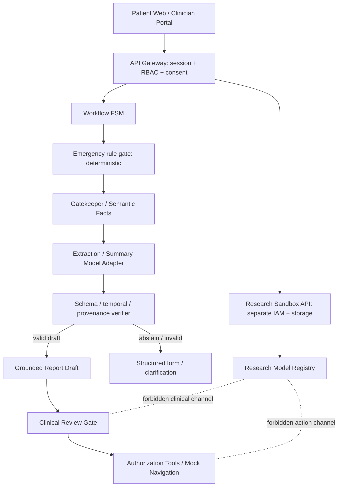

# SANAD — MODEL INTEGRATION CONTRACT & INFERENCE SAFETY GATES

**Document ID:** `AETHERHEALTH/SANAD/MODEL-INTEGRATION/0.1`  
**Version / date:** v0.1 · 2026-11-03  
**Status:** DRAFT — Backend/AI/ML/Security/Clinical review; **API routes are proposals, not audited implementations**  
**Source alignment:** Sanad BRD/PRD v0.4; Data Ingestion & ML Pipeline Specification v0.1; Dataset Registry v0.1.

## 1. The integration decision

**Sanad v0.4 has two model-use classes.**

1. **Operational language tasks** can assist with controlled extraction, summary drafting and catalogue-bounded question suggestions. Every output passes deterministic schema/provenance checks; if it fails, the system abstains or falls back to a structured form. These models **cannot make clinical decisions, issue referrals or grant consent**.
2. **Offline research predictors** (SEED-ML phenotype, NSFG survey labels, MIMIC ED experiments, possible Malaysia stress study after target audit) may be used in an **isolated research sandbox** if approved. Their predictions cannot become clinical triage actions, diagnoses, semen-risk scores in the patient portal, or provider-visible recommendations.

**Critical trust boundary:** A valid JSON response from an ML model is not a clinically valid recommendation. Only backend policy, consent and a legitimately approved clinical review can authorize allowed downstream actions. User-authored instruction, LLM prompt or sandbox artifact cannot change this policy.

## 2. Context diagram: responsibility separation



## 3. Model Registry manifest (mandatory)

| Property | Example / meaning | Validation |
|---|---|---|
| `model_id` | immutable model version `nsfg-fathdiff-baseline-2026-10-27` | unique; no alias-only loading |
| `task_id` | `nsfg_self_reported_fertility_difficulty_v1` | must match task card |
| `dataset_manifest_sha256` | source lineage | hexadecimal SHA-256 present |
| `artifact_sha256` | serialized model integrity | recompute before load |
| `feature_schema_version` | typed named input columns, allowed categories | exact match or versioned adapter |
| `label_schema_version` | survey response / semen phenotype / extraction-only | disallow clinical target substitution |
| `model_type` | logistic baseline / RF / constrained SLM | explicit environment/dependencies |
| `training_run_id`, `split_id` | immutable training lineage | linked evaluation evidence |
| `metric_report_ref` | held-out metrics and CIs | cannot be missing for promotion |
| `use_policy` | `RESEARCH_ONLY`, `EXTRACTION_DRAFT_ONLY` | server validated, default deny |
| `access_tier` | `PUBLIC` / `CREDENTIALED_RESTRICTED` | restricted artifact cannot be publicly served |
| `approval_state` | EXPERIMENTAL / RESEARCH_VALIDATED / SANDBOX_DEMO | no automatic CLINICAL_APPROVED |
| `domain_scope` | CDC US survey / ED / Malaysia clinic / synthetic cases | show OOD limitation |
| `owner`, `reviewed_by`, `created_at` | accountability | required metadata |

Any mismatch → `MODEL_NOT_ELIGIBLE`, no automatic fallback to another predictor that may have different clinical meaning.

## 4. Proposed endpoints and RBAC

| Endpoint (proposed, `TECH_TBD`) | Role/purpose | Allowed response | Hard deny |
|---|---|---|---|
| `GET /internal/research/models` | RESEARCHER and authorized QA | model cards/metadata (non-sensitive) | unapproved user, restricted metadata exposure |
| `POST /internal/research/infer` | RESEARCHER; `RESEARCH_ONLY` | research prediction + limitations on **approved** input | runtime patient input, `triage_action`, undocumented task |
| `POST /internal/models/extract` | Assessor internal backend; allowed session | `SemanticFactDraft[]` or abstain | diagnosis, treatment plan, unapproved question |
| `POST /internal/models/summarize` | Authorized workflow service | draft report with evidence IDs | uncited clinical recommendation or auto-approval |
| `POST /internal/models/ask-next` | Allowed questionnaire state | `allowed_question_id` from catalogue | free-form clinical question outside catalogue |
| `POST /internal/models/promote` | AI/ML owner + Security/QA approval | registry transition limited to sandbox | no holdout/rights/DUA or approval bypass |
| `POST /cases/{id}/mock-referral` | user action through backend policy | `SIMULATED` only if consent/action gate passes | model-issued unsolicited or unapproved share |

`/internal/research/infer` **must not be mounted inside the patient-facing app API namespace**. All calls authenticate and authorize at the server; UI hiding does not count as access control. For sensitive models, server remains within the permitted compute zone.

## 5. Operational extraction input/output (proposed)

**Input:** reference to a consented assessment state plus bounded text/choices, language, question catalogue version, task schema. Disclose only minimum data needed to the model, and do not send credentialed research rows. **Output:** a draft of `SemanticFact` with actual evidence to the source answer, temporality, polarity, unit, extraction confidence/uncertainty and ability to abstain.

```json
{
  "request_id": "QA-REQ-001",
  "case_id": "SYNTHETIC-J1-001",
  "purpose": "EXTRACTION_DRAFT_ONLY",
  "language": "en",
  "question_catalogue_version": "QCAT-v0.4",
  "input_text": "I used anabolic steroids last year; I no longer use them.",
  "data_origin": "SYNTHETIC_FIXTURE"
}
```

```json
{
  "request_id": "QA-REQ-001",
  "result_status": "DRAFT_VALIDATION_REQUIRED",
  "semantic_facts": [
    {
      "concept_code": "anabolic_steroid_use",
      "value": true,
      "polarity": "AFFIRMED",
      "temporal_status": "PAST",
      "source_type": "PATIENT_REPORTED",
      "verification_status": "UNVERIFIED",
      "raw_response_id": "QA-ANS-001"
    },
    {
      "concept_code": "anabolic_steroid_use",
      "value": false,
      "polarity": "NEGATED",
      "temporal_status": "CURRENT",
      "source_type": "PATIENT_REPORTED",
      "verification_status": "UNVERIFIED",
      "raw_response_id": "QA-ANS-001"
    }
  ],
  "requires_user_confirmation": true,
  "clinical_action": null
}
```

**Example status:** These JSON records are **synthetic illustrations**, not claims that an extractor already achieves this behavior. Clinical logic must accept multiple temporal facts without rewriting `PAST` to `CURRENT`. `source_type=PATIENT_REPORTED` cannot be upgraded to clinician verified by the model. Inferred diagnoses or treatment instructions are invalid regardless of confidence.

## 6. Research inference request/response

**Proposed request:** fixed `model_id`, `task_id`, `purpose=RESEARCH_ONLY`, `input_source=APPROVED_RESEARCH_FIXTURE`, `feature_schema_version`, `feature_vector`, a client-supplied `request_id` and a server-issued authorized research context. For credentialed data, the input may be a **server-side record reference inside the restricted zone** instead of raw payload crossing a boundary.

```json
{
  "request_id": "RESEARCH-QA-001",
  "purpose": "RESEARCH_ONLY",
  "model_id": "example-nsfg-baseline-v1",
  "task_id": "nsfg_self_reported_fertility_difficulty_v1",
  "input_source": "APPROVED_SYNTHETIC_RESEARCH_TEST",
  "feature_schema_version": "nsfg-baseline-v1",
  "features": {
    "AGE_R": 30,
    "GENHEALT": 2,
    "BMIcat": 2,
    "SMK100": 5,
    "SMOKE30": null,
    "DRINK12": 1
  }
}
```

```json
{
  "request_id": "RESEARCH-QA-001",
  "status": "RESEARCH_ONLY",
  "task_id": "nsfg_self_reported_fertility_difficulty_v1",
  "model_id": "example-nsfg-baseline-v1",
  "prediction": {
    "label_name": "FATHDIFF_SELF_REPORT",
    "predicted_class": null,
    "score": null,
    "status": "NOT_EVALUATED"
  },
  "limitations": [
    "Self-reported survey outcome, not infertility diagnosis",
    "Illustrative fixture only; model artifact not provided"
  ],
  "triage_action": null,
  "clinical_recommendation": null,
  "shareable_with_provider": false
}
```

**Do not interpret `status=NOT_EVALUATED` as a useful prediction.** Values are null because no trained artifact has been loaded. An actual trained, approved research model could emit a well-defined survey class **only on the separately authorized research endpoint**; it could never emit an individual medical risk probability for Sanad users.

## 7. Psychosocial feature policy

- User-facing psychosocial micro-intake (v0.4) includes up to three optional self-reported questions (`PSY-STRESS-01`, `PSY-SLEEP-01`, `PSY-ANXIETY-01`). They are **not validated psychiatric diagnoses or semen biomarker surrogates**.
- A model trained on Malaysia occupational-stress item scores cannot automatically consume these three questions; instruments, reference periods and scaling differ. Compatibility requires a separate measurement equivalence study.
- Before any supervised psychosocial predictor, require **matched individual semen outcomes** with a legitimate temporal relationship. Without that, return `TASK_NOT_TRAINABLE`, do not invent a target or fabricate synthetic ground truth.
- If a valid research dataset is eventually acquired, a research-only score may appear in an internal experiment dashboard after data/clinical-method review. **It is excluded from patient reports, clinician recommendations, triage, referrals and care tasks**.

## 8. Evidence, action gating and fail-safe precedence

**Decision order (authoritative server-side):**

1. Authenticate session/role; determine `purpose` and permitted data access tier.
2. Check legal/contractual restrictions for research source and processing environment.
3. For patient workflow, enforce assessment consent and run **deterministic emergency safety gate** before non-essential AI calls. Emergency guidance must not depend on inference.
4. Execute bounded model task only if allowlisted in current workflow state, model approval tier and schema version.
5. Validate output types, allowed vocabulary, missingness, temporal/provenance invariants, evidence references and no prohibited fields.
6. Apply clinician-reviewed rules independent of model; if approval is required, keep draft pending.
7. Revalidate purpose-level consent, actor permission, approved action and current case version **at action time**. Default deny on uncertainty.
8. Emit privacy-minimal audit event and return approved patient-safe content or abstain.

**Error outcomes:** `403_SCOPE_DENIED`, `403_ROLE_DENIED`, `409_CASE_VERSION_CONFLICT`, `422_SCHEMA_INVALID`, `422_UNVERIFIED_TARGET`, `423_CLINICAL_APPROVAL_REQUIRED`, `424_EVIDENCE_UNAVAILABLE`, `429_PROVIDER_RATE_LIMIT`, `503_MODEL_UNAVAILABLE`, `503_POLICY_UNAVAILABLE`, `RESEARCH_ONLY_NOT_PATIENT_ELIGIBLE`. Error codes are **design proposals**, not implemented API behavior. No error may silently downgrade rule floor or disclose restricted content.

## 9. Consent and data provenance matrix

| Action | Minimum permission | Runtime source allowed | Output/audit |
|---|---|---|---|
| Anonymous self-assessment | explicit `assessment` | patient input / synthetic QA | pseudonymous case |
| Optional psychosocial answers | current assessment consent; voluntary response | `PATIENT_REPORTED` only | `UNKNOWN/DECLINED/NOT_ASKED` preserved |
| Report draft extraction | authorized backend case processing | minimum necessary consented data | draft provenance, no diagnosis |
| Clinician review | `clinician_review` + authorized clinician role | case with allowed scope | actor/version/reason |
| Provider share/referral | current `provider_share` + user action + required clinical approval | permitted documents only | mock in MVP; real pilot separately gated |
| Offline NSFG/SEED research | dataset rights + research-purpose policy | research-only, no patient case | task card and model card |
| Credentialed PhysioNet research | individual approved access, required training and signed DUA | restricted local zone | restricted audit metadata |
| FHIR R4 synthetic export | QA role and mapping permissions | **synthetic** case only | draft/test bundle, `NOT_EVALUATED` unless validated |

## 10. FHIR mapping is downstream, not a model output channel

Sanad PRD v0.4 proposes conceptual mapping of `Patient`, `QuestionnaireResponse`, `Observation` and `DiagnosticReport`. A research model's prediction is **not** automatically an `Observation`, `DiagnosticReport` or `ServiceRequest` with medical authority. Only verified, policy-approved data may be exposed through a future FHIR mapping boundary, with record provenance and explicit validation against chosen FHIR R4 resources/profiles. No connected Sahatna endpoint has been established.

## 11. Integration test catalogue

| ID | Scenario | Required result |
|---|---|---|
| MIC-AC-01 | Research NSFG model response contains `triage_action=SPECIALIST` | reject response; security event; never reach clinical rules/actions |
| MIC-AC-02 | PhysioNet restricted row sent to open cloud adapter | request blocked before transmission |
| MIC-AC-03 | Model returns `PAST` steroid use as `CURRENT` | semantic conflict detected; request clarification |
| MIC-AC-04 | User declined psychosocial question | stored `DECLINED`, no fake `NO`; model not retried to infer hidden answer |
| MIC-AC-05 | Extractor returns invented citation | evidence checker abstains; no claim released |
| MIC-AC-06 | LLM unavailable while emergency fixture triggered | deterministic emergency guidance still runs |
| MIC-AC-07 | Provider share scope false | 403 deny, no outbound referral |
| MIC-AC-08 | `PENDING_CLINICIAN_REVIEW` action needs approval | action denied pending review |
| MIC-AC-09 | Model registry lacks artifact SHA or field schema | model not loaded; fail closed |
| MIC-AC-10 | Feature schema mismatches registry | 422 deny, no silent column reordering |
| MIC-AC-11 | Malaysia task has no verified semen target | `422_UNVERIFIED_TARGET`, no training/inference |
| MIC-AC-12 | Clinical metrics absent | display `NOT_EVALUATED`; no clinical precision claims |
| MIC-AC-13 | A mock appointment marked provider-verified without source | reject invalid provenance transition |
| MIC-AC-14 | Caller attempts real `ServiceRequest` via research endpoint | reject cross-domain action |
| MIC-AC-15 | Existing NSFG research baseline accessed for study | model card displays US survey limitations, not UAE validation |
| MIC-AC-16 | `ConsentRecord` revoked between result and action | authorization recheck denies share |

## 12. Performance, monitoring and rollback

- **Model monitoring:** per task/schema validation failure, abstention rate, temporal/polarity error on QA cases, source-grounding violation, resource consumption, latency p50/p95, status of model/provider; **do not** send raw clinical text to analytics by default.
- **Research predictor monitoring:** test-set performance, drift measures where permitted, train/test feature coverage, missingness, OOD warning, version. No automatic self-learning on users.
- **Operational SLM model selection:** demonstrate incremental value relative to rule-based forms/structured extraction, with held-out annotated examples, privacy and latency. A small model is not assumed superior by definition.
- **Rollback trigger:** any action-gate bypass, restricted data leak, fabricated clinical citation, artifact/hash mismatch, wrong dataset/source lineage, temporal status overwrite, unexplained model swap, clinical risk. Roll back to **structured-form + deterministic rules** as the safe path.
- **Deployment review:** model, data, security, clinical, localization and backend signoffs are distinct; passing software tests or FHIR mapping does not establish clinical validity.

## 13. Suggested implementation checklist and handoff

| Sequence | Owner | Action | Evidence |
|---|---|---|---|
| 1 | BA + AI/ML | confirm exact target and allowed uses for each research task | task card with provenance |
| 2 | Backend + Security | create *separate* research namespace/route, default-deny clinical services | security tests |
| 3 | AI/ML | versioned model manifest and feature schema checker | model registry artifact |
| 4 | QA | run MIC-AC-01–16 and DML-AC cases | test report |
| 5 | Product | approve research-only copy and disclaimer | UI review |
| 6 | Clinical Advisor (future) | independent clinical validation and safety governance | separate approval, not implied |

**Implementation recommendation:** deploy the clinical workflow first. Keep experiments as optional local jobs/QA dashboard, and promote only those language-model components that beat a simple controlled baseline without sacrificing safety. Full multi-agent autonomy is **not** required for this contract.

## 14. References

- Sanad BRD/PRD/System Architecture/FHIR Mapping/Evaluation v0.4 (2026-11-03).
- CDC NSFG public-use materials: https://www.cdc.gov/nchs/nsfg/nsfg-2022-2023-puf.htm .
- PhysioNet MIMIC-IV-Ext CDS v1.0.2: https://physionet.org/content/mimic-iv-ext-cds/1.0.2/ ; https://physionet.org/news/post/llm-responsible-use/ .
- HL7 FHIR R4: https://hl7.org/fhir/R4/ .
