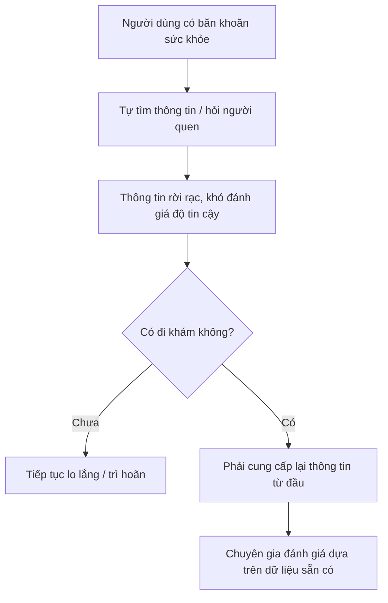
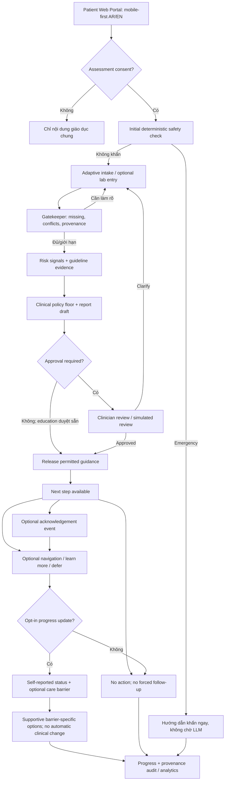

# Sanad (سند) — Business Requirements Document

> **A private front door for men's reproductive health**  
> **Tầm nhìn sản phẩm:** Private early assessment → evidence-grounded next step → closed-loop care navigation → clinician-assisted care journey (mở rộng).
> **Nguyên tắc triển khai:** Assessment-first; hỗ trợ 8 giai đoạn chăm sóc theo lộ trình, không yêu cầu đặt lịch trước khi tự đánh giá.

| Hạng mục | Nội dung |
| :--- | :--- |
| **Document ID** | `AETHERHEALTH/SANAD/BRD/0.4` |
| **Document Name** | `Sanad — Business Requirements Document` |
| **Project** | AetherHealth — Future Health Digital Innovation Challenge 2026, Fertility / Challenge 01 |
| **Document Owner** | AetherHealth — Business Analysis / Product |
| **Reviewers** | Tech Lead, AI/ML, Full-stack, QA và Clinical Advisor (TBD) |
| **Status** | **Draft for team review — not clinically approved** |
| **Creation Date** | `2026/10/27` |
| **Last Updated** | `2026/11/03` |
| **Version** | `0.4` |
| **Internal MVP Freeze** | `2026/11/19` (mốc mục tiêu nội bộ) |
| **Challenge Submission** | `2026/11/20` (theo trang cuộc thi, cần theo dõi cập nhật) |
| **Intended Market** | UAE / Abu Dhabi; prototype từ dữ liệu public hoặc synthetic, chưa dùng dữ liệu bệnh nhân thật |

> **Tuyên bố phạm vi:** Sanad trong BRD này là research prototype hỗ trợ nhận biết tín hiệu sức khỏe, điều hướng chăm sóc và chuẩn bị thông tin cho chuyên gia. Không chẩn đoán vô sinh, không kê đơn, không tự kết luận xác suất vô sinh, không thay thế bác sĩ. Quy tắc phân luồng lâm sàng là **bản dự thảo phải được chuyên gia xác nhận** trước khi được coi là lời khuyên có thể triển khai thực tế.

---

## Lịch sử cập nhật

| Version | Date | Nội dung cập nhật | Người cập nhật |
| :---: | :---: | :--- | :--- |
| 0.1 | 2026/10/27 | Thiết lập baseline nghiệp vụ: Early Assessment, Care Navigation, privacy/safety, clinician review và nhánh ML nghiên cứu. | AetherHealth BA/Product |
| **0.2** | **2026/10/29** | Mở rộng product vision thành hành trình chăm sóc 8 bước; giới hạn MVP theo assessment-first; bổ sung định hướng SLM-first, Semantic Layer, quản lý tri thức có provenance, dữ liệu NSFG/MIMIC và workflow trước–trong–sau khám. | AetherHealth BA/Product |
| **0.3** | **2026/10/29** | Bổ sung vòng lặp sau sàng lọc: acknowledgement → navigation → self-reported progress → barrier support; giữ nguồn xác nhận trạng thái, KPI và acceptance; chuẩn hóa Responsive Web App mobile-first (không buộc PWA). | AetherHealth BA/Product |

---

## Tài liệu liên quan và thứ tự ưu tiên khi có mâu thuẫn

1. **Challenge 01 — Male Reproductive Health:** https://hack2skill.com/event/futurehealthchallenge/
2. **Sanad repository README:** `README.md` do nhóm cung cấp (product vision, architecture proposal; có các mục chưa triển khai).
3. **WHO Infertility Guideline (2025):** https://www.who.int/publications/i/item/9789240115774
4. **WHO Semen Manual, 6th ed. (2021):** https://www.who.int/publications/i/item/9789240030787
5. **AUA/ASRM male infertility guidelines:** https://www.asrm.org/practice-guidance/practice-committee-documents/diagnosis-and-treatment-of-infertility-in-men-auaasrm-guideline-part-i-2020/
6. **SEED-ML dataset (Version 3):** https://data.mendeley.com/datasets/sc8rsz2vd7/3
7. **SEED-ML data article:** https://pmc.ncbi.nlm.nih.gov/articles/PMC13122780/
8. **UAE — ICT in health sector (khung pháp lý tham khảo):** https://u.ae/en/about-the-uae/digital-uae/whole-of-government-approach/digital-health/ict-in-the-health-sector
9. **CDC NSFG Male Respondent 2022–2023:** https://www.cdc.gov/nchs/nsfg/nsfg-2022-2023-puf.htm (dữ liệu khảo sát tự khai, dùng nghiên cứu, không phải nhãn triage).
10. **PhysioNet MIMIC-IV-Ext CDS v1.0.2:** https://physionet.org/content/mimic-iv-ext-cds/1.0.2/ (dữ liệu cấp cứu, giới hạn quyền truy cập và DUA).
11. **EAU Male Infertility:** https://uroweb.org/guidelines/sexual-and-reproductive-health/chapter/male-infertility (đầu vào tham khảo, chưa thay clinician approval).

**Quy ước nguồn:** Các yêu cầu được phân thành: `CONFIRMED_BY_CHALLENGE`, `TEAM_DECISION`, `PROPOSED_FOR_MVP`, `CLINICAL_TBD`, `TECH_TBD`. Nếu quy tắc nghiệp vụ mâu thuẫn với hướng dẫn chuyên môn đã được clinician duyệt, thay đổi phải thông qua change control; không tự sửa âm thầm bằng prompt.

---

| **0.4** | **2026/11/03** | BTC clarifications: optional psychosocial context, synthetic clinically plausible fixtures, FHIR R4 alignment; bounded P0/P1 scope and evidence gates. | AetherHealth BA/Product |

## 1. Executive Summary

### 1.1 Mục đích tài liệu

BRD này thống nhất **vấn đề nghiệp vụ, mục tiêu, người sử dụng, phạm vi, hành trình, quy tắc, dữ liệu, chỉ số và điều kiện nghiệm thu** của Sanad. Đây là đầu vào để nhóm xây PRD, user stories, API/data contracts, backlog, test cases và bản demo.

### 1.2 Tóm tắt giải pháp

Sanad là **Responsive Web Application (mobile-first Patient Portal, desktop-optimized Clinician Portal)**, hướng tới hỗ trợ hành trình nam khoa từ **trước khám, trong khám đến sau khám**. Người dùng có thể bắt đầu bằng *Private Assessment* mà **không cần đặt lịch**; các bước thực hiện xét nghiệm, kế hoạch điều trị và theo dõi chuyên sâu thuộc giai đoạn mở rộng, chịu kiểm soát của bác sĩ. Hệ thống MVP thực hiện:

1. **Capture:** nhận quyền đồng ý; thu thập tự khai theo ngữ cảnh; hỗ trợ nhập kết quả xét nghiệm sẵn có.
2. **Validate:** kiểm tra dữ liệu thiếu/mâu thuẫn, trạng thái chưa biết và dấu hiệu cảnh báo trước khi chạy LLM.
3. **Assess:** nhận diện *risk signals* có căn cứ; tách hệ thống quy tắc an toàn khỏi LLM giải thích.
4. **Review:** tạo báo cáo nháp, chỉ gửi đến bác sĩ/đơn vị khác khi có quyền hợp lệ; bác sĩ kiểm tra các mức cần phê duyệt.
5. **Navigate:** cung cấp thông tin đã kiểm duyệt, bước tiếp theo hoặc referral/booking mock có consent.
6. **Close the loop (MVP tối thiểu):** người dùng xác nhận đã nhận hướng dẫn, chủ động bắt đầu tìm dịch vụ, ghi nhận rào cản hoặc tự báo tiến độ; phân biệt **self-reported**, **simulated** và **provider-verified** (chưa triển khai).
7. **Evaluate:** đo độ đúng workflow và conversion theo từng bước có mẫu số rõ; không coi *click*, *acknowledgement* hay tự báo đặt lịch là kết quả chăm sóc đã xác minh.

**Ba workstream, có mức độ cam kết khác nhau:**

- **WS-A — Early Assessment & Care Navigation (MVP chính):** Private entry, adaptive interview, safety gate, Semantic Layer tối thiểu, Evidence/RAG, clinician-review draft, điều hướng/mock booking **và closed-loop progress tối thiểu**. Không phụ thuộc kết quả ML nghiên cứu.
- **WS-B — Clinical Workflow Continuity (P1/P2, phần lớn mock):** hỗ trợ bác sĩ xem hồ sơ theo ngữ cảnh, soạn ghi chú, gợi ý câu hỏi, hướng dẫn chuẩn bị chỉ định đã duyệt, nhập/so sánh xét nghiệm, kế hoạch sau khám và follow-up.
- **WS-C — Research & Data (không tham gia quyết định lâm sàng):** benchmark SEED-ML về kiểu hình tinh dịch; CDC NSFG về chỉ số/hành vi tự khai; MIMIC-IV-Ext chỉ nghiên cứu triage/referral khi được cấp quyền. Không chuyển trực tiếp output nghiên cứu thành `triage_action`.

### 1.3 Giá trị cốt lõi

Không phải "chatbot trả lời có vẻ hợp lý", mà là **một quy trình có trạng thái, bằng chứng, quyền truy cập, khả năng từ chối và điểm phê duyệt rõ ràng**. Mỗi kết quả phải trả lời: *Đã biết gì? Chưa biết gì? Vì sao gợi ý bước tiếp theo? Ai/cơ chế nào chịu trách nhiệm phê duyệt?*

---

### 1.4 Tầm nhìn hành trình chăm sóc — 8 giai đoạn

Đề xuất 8 bước được chuyển thành một **care journey có thể vào ở nhiều điểm**; đây là product vision và roadmap, không phải một quy trình bắt buộc cho mọi người dùng.

| Giai đoạn | Nhu cầu nghiệp vụ / giá trị | Phạm vi Sanad |
|---|---|---|
| **S1 — Tiếp cận / đặt lịch tùy chọn** | Chọn mục đích, ngôn ngữ, quyền riêng tư; có thể đặt lịch khi đã sẵn sàng | **P0:** private entry; **P1:** mock appointment intent |
| **S2 — Tiếp nhận trước khám** | Tóm tắt hồ sơ, đánh dấu thiếu/mâu thuẫn, nguồn khai báo | **P0:** adaptive intake, Gatekeeper, structured summary |
| **S3 — Hỏi bệnh và khám** | Bác sĩ xem thông tin theo ngữ cảnh, ghi chú nháp, câu hỏi chưa được trả lời | **P1:** clinician workspace demo, không khám từ xa thật |
| **S4 — Lựa chọn bước đánh giá tiếp** | Tra guideline, điều kiện áp dụng và nguồn bằng chứng | **P0:** triage/risk-signal + evidence; **P1:** clinician decision support draft |
| **S5 — Thực hiện chỉ định** | Hướng dẫn chuẩn bị đã duyệt, trạng thái hẹn/xét nghiệm | **P2:** mock instruction/checklist; không tự chỉ định |
| **S6 — Tiếp nhận và xem kết quả** | Chuẩn hóa đơn vị/thời gian, liên kết tài liệu gốc, so sánh lịch sử | **P1:** nhập tay kết quả; **P2:** timeline/compare |
| **S7 — Giải thích & kế hoạch sau khám** | Bản giải thích dễ hiểu, kế hoạch nháp, bác sĩ phê duyệt | **P0:** báo cáo nháp/review; **P1:** plan draft |
| **S8 — Theo dõi** | Theo dõi liệu người dùng có tiếp tục bước chăm sóc hay gặp rào cản; nhắc việc theo kế hoạch đã duyệt là mở rộng | **P0:** trạng thái tự khai + rào cản; **P2:** mock reminders/clinical plan tasks có consent |

**Điểm vào mặc định:** S1 *private self-assessment*, tiếp S2 → S4; không yêu cầu S1 phải bao gồm đặt lịch. Khi đã có thông tin cần xử lý, người dùng có thể đi thẳng tới S6 hoặc yêu cầu bác sĩ xem S7. Trường hợp khẩn cấp không chờ luồng 8 bước.

**Nguyên tắc closed loop:** Không ép người dùng hoàn thành S1–S8 tuần tự; vòng lặp MVP chỉ đo việc **nhận hướng dẫn → cân nhắc/khởi tạo bước tiếp → tự khai trạng thái hoặc rào cản**. Không đồng nhất sự kiện giao diện với việc đã khám, hoàn thành điều trị hay có outcome lâm sàng.

### 1.5 Ban tổ chức xác nhận — phạm vi và mức cam kết (2026/11/03)

**Source: phản hồi trực tiếp từ ban tổ chức do nhóm cung cấp; không phải bằng chứng validation y khoa.** (i) Nhóm được khuyến khích xem xét chronic stress, sleep disruption, anxiety nếu có rationale bằng chứng, tăng giá trị assessment/risk stratification/navigation và không làm intake nặng. (ii) Synthetic patient profiles và simulated semen analysis reports được chấp nhận, giá trị cần hợp lý về mặt lâm sàng. (iii) HL7 FHIR không mặc định bắt buộc ở prototype; alignment với `Patient`, `Observation`, `DiagnosticReport` là architectural best practice. Các phát biểu có điều kiện này **không** phê duyệt bất kỳ ngưỡng triage, mô hình dự đoán hay tích hợp thật nào.

**Team decision v0.4:** bổ sung tối đa ba câu hỏi psychosocial *optional* ở P0, giữ trạng thái tự khai/không trả lời; chuẩn bị conceptual mapping FHIR R4 P0 và chỉ coi validation/export là P1. Không đưa psychosocial vào automatic clinical triage hoặc supervised semen prediction nếu chưa có data/clinician validation.

## 2. Business Context

### 2.1 Bối cảnh

Challenge 01 đặt ra vấn đề nam giới thường tiếp cận đánh giá sức khỏe sinh sản muộn, gặp rào cản riêng tư và khó biết nên tìm đến loại dịch vụ nào. Mục tiêu là hành động sớm hơn, an toàn hơn và ít ma sát hơn, **trước khi có chẩn đoán vô sinh**. Từ góc nhìn sản phẩm, việc cung cấp một bảng điểm tổng quát chỉ dựa trên BMI, hút thuốc hay một thông số xét nghiệm dễ tạo ra hiểu lầm và hành động sai.

### 2.2 Cơ hội nghiệp vụ

- Cung cấp điểm bắt đầu kín đáo, không mặc định tình trạng hôn nhân, tôn giáo hoặc kế hoạch sinh con.
- Giảm chi phí thời gian tìm hiểu và thu thập thông tin trước khi gặp bác sĩ.
- Giúp chuyên gia nhận hồ sơ có cấu trúc, lý do và bằng chứng để review nhanh hơn (cần pilot mới chứng minh tác động).
- Hỗ trợ Arabic/English, ngôn ngữ trung tính, kiểm soát dữ liệu cá nhân và việc chia sẻ cho người thân.
- Phân biệt thông tin giáo dục/điều hướng với quyết định lâm sàng được chuyên gia phê duyệt.
- Nhận diện và hỗ trợ rào cản **do người dùng tự khai** (quyền riêng tư, ngôn ngữ, chi phí, chưa rõ loại dịch vụ, muốn trì hoãn), thay vì gửi nhắc việc lặp lại mặc định.
- Đo được tỷ lệ người dùng tiếp tục bước chăm sóc, nguồn xác nhận và điểm rơi rụng; chưa khẳng định tăng tỷ lệ khám thực tế nếu chưa có pilot.

### 2.3 Chỉ dấu thành công của challenge

Sanad phải thể hiện sáu năng lực: nhận diện sớm có giải thích, trải nghiệm đáng tin cậy về văn hóa, giảm rào cản đánh giá, phân luồng/chuyển tuyến an toàn, bảo mật thiết kế từ đầu và giá trị đo lường được. Các claim định lượng về giảm thời gian/chi phí chưa được khẳng định trước khi đo.

---

## 3. Business Problem Statement

**Vấn đề:** Người dùng có thông tin sức khỏe rời rạc và chưa biết ý nghĩa lâm sàng; một số e ngại tìm kiếm hỗ trợ; ứng dụng trò chuyện đơn thuần có thể kết luận thiếu căn cứ. Dữ liệu được thu thập từ các nguồn khác nhau (tự khai, xét nghiệm, nguồn chuyên môn), trong khi quyết định về bước chăm sóc cần được đặt trong bối cảnh và kiểm soát an toàn.

**Hệ quả:**

- Có nguy cơ bỏ qua tín hiệu cần khám hoặc chuyển tuyến không phù hợp.
- Người tập gym BMI cao có thể bị hiểu nhầm là thừa mỡ; người hút thuốc có thể bị "chẩn đoán" từ một hành vi đơn lẻ.
- Kết quả xét nghiệm tinh dịch dễ bị diễn giải nhầm thành khẳng định có hoặc không có khả năng sinh sản.
- Người dùng không biết dữ liệu đi đâu, ai xem và có được chia sẻ cho bạn đời hay không.
- Nhóm kỹ thuật khó kiểm thử nếu `risk flag`, `diagnostic label` và `triage action` bị trộn thành một nhãn.

---

### 3.1 Ranh giới giữa phần mềm điều phối và công cụ lâm sàng

Sanad không thay thế EHR/HIS hay phác đồ khám. Đối với S3–S8, dữ liệu và quyết định chuyên môn phải có nguồn, trạng thái phê duyệt và quyền truy cập rõ ràng. SLM/LLM soạn nháp nhưng không ký chỉ định, kê đơn hay xác nhận kết quả thay bác sĩ. Các thao tác tích hợp ngoài hệ thống trong MVP là **mô phỏng**.

## 4. Business Objectives

| ID | Mục tiêu | Business value | Trạng thái |
|---|---|---|---|
| BO-01 | Tiếp cận riêng tư, dễ bắt đầu | Giảm rào cản tìm hiểu sức khỏe | TEAM_DECISION |
| BO-02 | Thu thập thông tin theo bối cảnh | Hạn chế câu hỏi thừa và kết luận từ dữ liệu thiếu | TEAM_DECISION |
| BO-03 | Tín hiệu nguy cơ có căn cứ | Người dùng hiểu lý do gợi ý; không tự chẩn đoán | TEAM_DECISION |
| BO-04 | Phân luồng an toàn và có review | Giảm nguy cơ under-triage, hành động không được phép | CLINICAL_TBD |
| BO-05 | Điều hướng chăm sóc đúng quyền | Hướng dẫn rõ bước tiếp theo, giữ quyền kiểm soát chia sẻ | TEAM_DECISION |
| BO-06 | Đánh giá độc lập & tái lập | Chứng minh chất lượng công nghệ mà không phóng đại hiệu quả y tế | TEAM_DECISION |
| BO-07 | Research ML trên SEED-ML | Benchmark khoa học cho nhánh phân tích xét nghiệm | TEAM_DECISION |
| **BO-08** | Hỗ trợ tính liên tục trước–trong–sau khám | Giảm nhập lại dữ liệu, bảo toàn bối cảnh và trạng thái hồ sơ | **PROPOSED** |
| **BO-09** | Sử dụng AI vừa đủ và kiểm chứng được | SLM-first cho tác vụ hẹp, so sánh với baseline trước khi lựa chọn | **PROPOSED** |
| **BO-10** | Chuẩn hóa dữ liệu và tri thức có nguồn gốc | Canonical facts, thời điểm, chứng cứ, phiên bản, trạng thái xác minh | **PROPOSED** |
| **BO-11** | Khép kín vòng lặp từ assessment tới bước chăm sóc tiếp theo | Có acknowledgement, navigation progress và rào cản do người dùng tự khai | **TEAM_DECISION** |
| **BO-12** | Đo kết quả đúng mức độ chứng cứ | Không báo nhầm click/đặt lịch tự khai thành chăm sóc/điều trị đã hoàn thành | **TEAM_DECISION** |

---

### 4.1 Business objectives v0.4 (additive)

| ID | Mục tiêu | Giá trị / bằng chứng | Status |
|---|---|---|---|
| **BO-13** | Xem xét psychosocial context mà không gia tăng đáng kể gánh nặng intake | Optional micro-intake, opt-out, measure completion/extra time | TEAM_DECISION (product), CLINICAL_TBD (interpretation) |
| **BO-14** | Chứng minh khả năng trao đổi dữ liệu theo thiết kế FHIR-aligned | Field mapping, synthetic fixture, versioned export proposal | TEAM_DECISION; conformance TECH_TBD |
| **BO-15** | Tạo nguồn synthetic clinically plausible và có thể tái lập | Fixture provenance, unit/range checks, no real-person data | TEAM_DECISION; ranges CLINICAL_TBD |

## 5. Stakeholders & Personas

| Stakeholder / Persona | Nhu cầu | Giá trị nhận được / Quyền hạn |
|---|---|---|
| **P01 — Omar / Proactive Health Seeker** | Nam 24 tuổi ở UAE, quan tâm sức khỏe trước hôn nhân, ưu tiên riêng tư | Đánh giá ẩn danh; nhận thông tin không phán xét; điều hướng phù hợp |
| **P02 — User with multiple contextual risks** | Có bệnh nền / thuốc / tiền sử; thông tin nhiều nguồn | Được hỏi bổ sung theo ngữ cảnh; không bị gán nhãn do một yếu tố |
| **P03 — Semen report holder** | Đã có báo cáo xét nghiệm, muốn hiểu và biết nên làm gì | Giải thích giới hạn xét nghiệm, tóm tắt để bác sĩ kiểm tra |
| **P04 — User with urgent warning signs** | Có tình huống có thể cần cấp cứu | Nhận chỉ dẫn khẩn đã được duyệt, không chờ LLM hay approval |
| **P05 — Uncertain / limited-information user** | Thiếu/mâu thuẫn dữ liệu hoặc muốn bỏ qua câu hỏi | Được bảo vệ khỏi kết luận giả; có hướng xử lý khi không đủ dữ liệu |
| **Clinician / clinical reviewer** | Hồ sơ, bằng chứng, bản nháp và quyền chỉnh sửa | Approve/reject/request clarification; lưu dấu vết |
| **BA / Product** | Business rules, journeys, acceptance, metrics, nguồn | Quản trị yêu cầu và truy vết thay đổi |
| **AI/ML engineers** | Input/target rõ ràng, nguồn, baseline và evaluation | Phát triển mô hình không bị leakage/circular validation |
| **Engineering / Security / QA** | Trạng thái, quyền, audit, API contracts, test cases | Triển khai và chứng minh compliance ở mức prototype |
| **Hackathon judges / mentors** | Demo có bằng chứng và hạn chế minh bạch | Hiểu vấn đề, giải pháp và mức độ sẵn sàng thử nghiệm |

**Lưu ý:** P01–P05 là persona/scenario phục vụ thiết kế, không phải kết quả nghiên cứu người dùng tại UAE. Mỗi persona có thể có nhiều clinical scenarios và không tương đương với một triage label cố định.

---

### 5.1 Tác nhân bổ sung cho các chặng sau khám

| Actor | Nhiệm vụ | Giới hạn trong MVP |
|---|---|---|
| **Clinician / authorized reviewer** | Kiểm tra báo cáo, gợi ý câu hỏi, ghi chú và kế hoạch trước phát hành | Review demo; nếu không có chuyên gia thật phải gắn nhãn simulated |
| **Care coordinator** | Tiếp nhận yêu cầu lịch, theo dõi trạng thái dịch vụ/chỉ định | Chỉ mock; không gửi dữ liệu cho bệnh viện thật |
| **Patient returning with results** | Xem lại hồ sơ, bổ sung kết quả xét nghiệm và nhận kế hoạch đã duyệt | Có thể bắt đầu từ kết quả sẵn có; không buộc đi lại toàn bộ intake |

## 6. Current State (AS-IS)

### Pain points

- Ngại chia sẻ dữ liệu nhạy cảm; không biết cách bắt đầu.
- Nguồn thông tin chung chung, thiếu bối cảnh cá nhân.
- Thiếu nhất quán khi thu thập dữ liệu; thường không phân biệt `UNKNOWN` và `NORMAL`.
- Thiếu giải thích minh bạch vì sao cần hỗ trợ y tế hoặc chưa thể đánh giá.
- Không có workflow số hoá thống nhất từ nhận thông tin đến clinician review.
- Không biết người dùng đã đọc hướng dẫn, thực sự bắt đầu tìm dịch vụ, gặp rào cản hay chỉ rời khỏi ứng dụng.
- Không thể phân biệt trạng thái tự khai “đã đặt lịch” với xác nhận đặt lịch/tham dự từ cơ sở y tế.

---

## 7. Future State (TO-BE)

**Policy:** Acknowledgement **không phải bước bắt buộc** để xem navigation hoặc thoát phiên. Hướng dẫn khẩn theo quy tắc đã duyệt không được phụ thuộc follow-up hoặc model. `GUIDANCE_ACKNOWLEDGED` chỉ xác nhận người dùng đã xem/chấp nhận nhận thông tin, **không** chứng minh hiểu đúng, đã đặt lịch hoặc đã được khám. Navigation, tự khai tiến độ và nêu rào cản là **tùy chọn**, không ép buộc chia sẻ dữ liệu hay tạo tài khoản. Mọi hành động gửi hồ sơ ra ngoài cần consent riêng và backend gate.

### 7.1 Nguyên tắc điều phối hành trình

- **Non-linear journey:** người dùng không buộc đặt lịch trước; có thể dừng, bỏ qua hoặc quay lại khi có kết quả.
- **Stateful handoff:** mỗi bước chuyển phải duy trì `case_id`, dữ liệu đã biết/chưa biết, consent, nguồn và `review_status`.
- **Human-in-the-loop:** order, plan, lời khuyên điều trị và mọi đề xuất chuyên môn chưa được duyệt chỉ có thể ở trạng thái *draft*.
- **SLM-first là giả thuyết kỹ thuật:** ưu tiên thử model nhỏ cho extraction, note draft, question selection; lựa chọn sản xuất phải dựa vào benchmark và fallback.
- **Semantic Layer tối thiểu:** mô tả khái niệm, phủ định, thời điểm, độ tin cậy, nguồn, trạng thái người dùng/clinician xác nhận.
- **Knowledge packaging:** có thể nghiên cứu OKF (nếu nhóm xác nhận đúng định dạng mong muốn), không xem OKF là guideline, medical ontology hay rules engine. Chỉ những nguồn đã được kiểm tra và được phép sử dụng mới được đưa vào RAG.
- **Outcome provenance:** `acknowledgement` và `navigation_clicked` là sự kiện phần mềm; `BOOKING_SELF_REPORTED`/`VISIT_SELF_REPORTED` là tự khai; chỉ hệ thống/đối tác được phép mới có thể tạo `PROVIDER_VERIFIED` trong pilot tương lai.
- **Barrier-first assistance:** thay vì tự nhắc lặp lại, chỉ hỏi lý do chưa tiếp tục nếu người dùng chọn chia sẻ, rồi trình bày lựa chọn hỗ trợ; không suy luận tâm lý hay tự nâng/hạ phân luồng.

## 8. Business Scope

### 8.1 In Scope — MVP (P0)

- **Patient Web Portal:** giao diện mobile-first, chọn Arabic/English; tối thiểu luồng EN hoàn chỉnh và AR/RTL cho các màn hình quan trọng, nội dung sức khỏe phải được review bản địa hóa trước khi coi là sẵn sàng.
- **Privacy & Consent:** thông báo mục đích; đồng ý đánh giá tách riêng khỏi review/chia sẻ; chế độ pseudonymous hoặc không yêu cầu tài khoản ở luồng đánh giá thử; xóa dữ liệu phiên mô phỏng.
- **Safety first:** một số trường hợp cảnh báo khẩn có quy tắc được review; có đường dừng LLM ngay và nội dung hướng dẫn an toàn đã duyệt.
- **Adaptive Assessment:** hỏi dựa trên câu hỏi có cấu trúc, hiển thị trạng thái không biết/không trả lời; không suy đoán từ BMI/hút thuốc.
- **Canonical facts (mức tối thiểu):** chuẩn hóa nguồn, thời điểm, trạng thái xác minh, phủ định, đơn vị; không làm ontology/EHR sản xuất.
- **Gatekeeper:** kiểm tra tính hợp lệ, độ đầy đủ, mâu thuẫn, nguồn, đơn vị và phiên bản.
- **Evidence-backed risk signals:** tối thiểu các bối cảnh lối sống, bệnh sử và kết quả xét nghiệm sẵn có; mỗi claim có căn cứ hoặc ghi chưa đủ bằng chứng.
- **Triage & Action policy:** bản dự thảo rule catalog và state machine; không cho AI hạ mức dưới rule floor, với clinical advisor sign-off là phụ thuộc quan trọng.
- **Clinician Console:** xem hồ sơ có consent, sửa/duyệt/từ chối bản nháp, lưu actor/timestamp/reason; nếu demo chưa có bác sĩ thực phải gắn nhãn **simulated review**.
- **Result & Care Navigation:** patient summary, giới hạn suy luận, bước tiếp theo; referral/booking ở mức **mock**.
- **Closed-loop navigation (P0 nhẹ):** đánh dấu hướng dẫn đã được xem/xác nhận, tùy chọn cập nhật trạng thái tiếp cận dịch vụ và rào cản; minh bạch `SELF_REPORTED`/`SIMULATED`; không có xác minh từ bệnh viện trong MVP.
- **UX tiếp tục/thoát:** `Not now`, `Prefer not to say` và quay lại phiên (nếu còn hiệu lực); không mặc định lời nhắc hoặc thông báo y tế.
- **Evaluation:** bộ case giả lập có nhãn nguồn, baseline workflow, safety tests, báo cáo thử nghiệm minh bạch.
- **ML research:** audit và benchmark SEED-ML độc lập; tích hợp vào demo chỉ như chức năng nghiên cứu tùy mức sẵn sàng và disclaimer.

**P0 v0.4 additions (bounded):** Thêm 2–3 câu hỏi tùy chọn về stress cảm nhận, giấc ngủ và lo âu/liên quan hỗ trợ; cho phép `DECLINED/NOT_ASKED`, không tạo thang điểm chẩn đoán hay psychiatric diagnosis. Chỉ ghi nhận psychosocial context dưới dạng tự khai để hỗ trợ giải thích và tìm rào cản Care Navigation. Soạn FHIR R4 **conceptual mapping** cho Patient, QuestionnaireResponse, Observation, DiagnosticReport; không yêu cầu FHIR server hay integration. Bộ synthetic patient/semen report phải có nguồn tạo, đơn vị, thời điểm, và ranh giới tham chiếu được review.

### 8.2 Out of Scope — MVP

- Chẩn đoán vô sinh, điều trị/kê đơn, tính xác suất vô sinh từ dữ liệu lối sống thiếu nhãn.
- Tự gán tỷ lệ rủi ro cá nhân (ví dụ "76% vô sinh") không có validation.
- Thực hiện referral, teleconsult, thanh toán, gửi SMS/email y tế đến đối tác thật nếu chưa có kết nối và quyền được phê duyệt.
- Tự tuyên bố `CARE_COMPLETED`, `TREATMENT_COMPLETED`, `REFERRAL_COMPLETED` hoặc kết quả y khoa đã xác minh từ việc người dùng bấm nút, tự khai hay mock booking.
- Medical-grade OCR cho mọi báo cáo, ảnh tinh trùng, gene/genomics, wearable, FHIR hospital production.
- Sử dụng hồ sơ bệnh nhân thật, training LLM bằng dữ liệu người dùng hoặc tự cập nhật quy tắc lâm sàng từ phản hồi.
- Bắt buộc quay mặt/phỏng vấn video, phân tích biểu cảm hoặc suy ra nguy cơ sức khỏe từ hình ảnh khuôn mặt.
- Bác sĩ AI tự chỉ định xét nghiệm, kê thuốc, phê duyệt kế hoạch hay nhắc việc điều trị chưa có phê duyệt thật.
- Claim đã kiểm định trên bệnh nhân UAE, claim chứng nhận y tế/tuân thủ pháp lý khi chưa có đánh giá chính thức.

### 8.3 Post-MVP / pilot candidates (P1–P2)

- **Clinical workflow expansion (S3–S8):** clinician contextual notes; draft follow-up questions; mock preparation instructions, appointment intent, result timeline và nhắc việc theo kế hoạch đã duyệt.
- **Verified closed-loop pilot:** chỉ khi có đối tác, thỏa thuận chia sẻ và consent hợp lệ mới đồng bộ xác nhận lịch khám/tham dự, theo dõi outcome thực và đo time-to-assessment.
- **Notification opt-in:** lịch nhắc tự động, nội dung thông báo kín đáo và chăm sóc theo kế hoạch lâm sàng đã duyệt là P2, tách khỏi P0 progress self-report.
- **SLM task benchmark & knowledge packaging:** kiểm nghiệm SLM với LLM baseline, provenance manifest/OKF (sau khi xác nhận format), không tạo quy tắc y khoa mới bằng mô hình.
- Hỗ trợ upload và xác minh thông số tinh dịch từ báo cáo thực, OCR các mẫu giới hạn.
- Hỗ trợ review đa bác sĩ, tích hợp phòng khám đã ký thỏa thuận và consent đầy đủ.
- Khảo sát người dùng UAE/Arabic usability, đối tác y tế, nghiên cứu feasibility và fairness trên dữ liệu phù hợp.
- Nghiên cứu dữ liệu BMI, hút thuốc, lịch sử thuốc, vòng eo/vận động **từ nguồn khác** nếu được phép và có nhãn phù hợp.
- Kết nối FHIR thật trong UAE sau đánh giá pháp lý, residency và chính sách nhà cung cấp.

---

## 9. Business Rules & Policy Decisions

| Rule ID | Business Rule | Rationale / enforcement | Approval |
|---|---|---|---|
| **BR-01** | Assessment data chỉ được thu thập khi có **assessment consent** đang hiệu lực. | Kiểm tra backend; nếu không đồng ý chỉ hiển thị education chung. | TEAM_DECISION |
| **BR-02** | Quyền `assessment`, `clinician_review`, `provider_share`, `spouse_share`, `research_use` được quản lý **riêng**, off by default trừ quyền đánh giá được chọn rõ. | Consent ledger, revocation, versioned. | TEAM_DECISION |
| **BR-03** | Dữ liệu không cung cấp phải là `UNKNOWN/NOT_PROVIDED`, không suy thành `NO/NORMAL`. | Schema validation. | TEAM_DECISION |
| **BR-04** | Không suy diễn béo phì từ BMI đơn lẻ; phải nêu giới hạn ở người nhiều cơ và hỏi bối cảnh bổ sung khi phù hợp. | Context rule; không chẩn đoán. | CLINICAL_TBD |
| **BR-05** | Hút thuốc/steroid/BMI là **risk signals**, không phải nhãn vô sinh hay xác suất sinh sản. | Ngăn overclaim. | CLINICAL_TBD |
| **BR-06** | Tình huống cảnh báo khẩn đã được phê duyệt phải hiển thị hướng dẫn an toàn ngay và **không chờ LLM, bác sĩ hay hoàn tất câu hỏi**. | Server-side emergency override. | CLINICAL_TBD |
| **BR-07** | Kết quả phân luồng không được thấp hơn deterministic rule floor; *thứ tự/mức triage do clinician phê duyệt*, không mặc định mọi mức là tuyến tính trong mọi trường hợp. | Rules engine + state machine. | CLINICAL_TBD |
| **BR-08** | Mọi clinical claim có link nguồn + phiên bản; thiếu nguồn phù hợp phải nêu không đủ cơ sở hoặc chuyển review. | Evidence provenance. | TEAM_DECISION |
| **BR-09** | LLM chỉ soạn/tóm tắt/gợi ý câu hỏi trong danh mục cho phép; không tự tạo quy tắc khám, kê thuốc, chẩn đoán. | Tool contracts & output schema. | TEAM_DECISION |
| **BR-10** | `ApprovedActionTools` kiểm tra quyền và trạng thái phê duyệt ở backend trước khi gửi dữ liệu/referral. | Không dựa vào prompt-only guard. | TEAM_DECISION |
| **BR-11** | Hồ sơ báo cáo có dấu `AI-generated draft / clinical approval / simulated approval`. | Tránh hiểu nhầm demo thành khám bệnh. | TEAM_DECISION |
| **BR-12** | Không chia sẻ với vợ/chồng, đối tác hoặc clinician nếu thiếu consent đúng mục đích; có thể rút quyền, xử lý dữ liệu đã chuyển theo chính sách và luật. | Privacy workflow. | TEAM_DECISION |
| **BR-13** | ML SEED-ML **không** xuất trực tiếp `triage_action`; ML label và quyết định chăm sóc phải tách biệt. | Tránh nhầm mục tiêu mô hình. | TEAM_DECISION |
| **BR-14** | Khi cần clinician approval, hồ sơ giữ `PENDING_REVIEW` cho tới phê duyệt hợp lệ; nếu không có reviewer thật demo phải thể hiện là mock. | Audit + approval gate. | TEAM_DECISION |
| **BR-15** | Không train/fine-tune trên hồ sơ người dùng; chỉ dùng public/synthetic đúng giấy phép trong MVP. | Privacy & provenance. | TEAM_DECISION |
| **BR-16** | `J1` theo ruleset **dự thảo**: BMI cao cần hỏi thêm bối cảnh; sử dụng anabolic steroid kích hoạt **Specialist floor** như bảng README, không được hạ xuống Primary Care khi chạy integration test. | Sửa mâu thuẫn README/J1; quyết định lâm sàng phải được duyệt lại. | CLINICAL_TBD |
| **BR-17** | Version rules/prompts/knowledge base và actor/time luôn được ghi log; log không chứa văn bản sức khỏe nhạy cảm quá mức. | Audit & data minimisation. | TEAM_DECISION |
| **BR-18** | Không bắt buộc đặt lịch hoặc đăng nhập trước Private Assessment; appointment chỉ là lựa chọn opt-in. | Không tạo rào cản mới ở đầu hành trình. | TEAM_DECISION |
| **BR-19** | Mỗi dữ liệu lâm sàng/tự khai phải lưu được source, thời gian liên quan, phủ định và verification status. | Ngăn lẫn quá khứ/hiện tại, tự khai/kết quả xác minh. | PROPOSED |
| **BR-20** | SLM/LLM chỉ xử lý tác vụ được cấp quyền và qua schema; không tự phát hành chẩn đoán/chỉ định/clinical plan. | Narrow AI task contracts, deterministic guard. | TEAM_DECISION |
| **BR-21** | Ghi chú khám, chỉ định, kế hoạch sau khám và hướng dẫn chuẩn bị do AI sinh chỉ là bản nháp đến khi clinician cho phép. | Human-in-the-loop, audit. | CLINICAL_TBD |
| **BR-22** | Navigation chỉ đối sánh cơ sở/dịch vụ sau khi xác định hợp lệ loại chăm sóc; danh mục không thay thế approval. | Tránh AI tự chọn bệnh viện/chuyên khoa tùy tiện. | PROPOSED |
| **BR-23** | Không bắt buộc camera, không phân tích nét mặt để suy luận y tế trong sản phẩm MVP. | Privacy & non-discrimination. | TEAM_DECISION |
| **BR-24** | Follow-up/reminder phải dựa trên kế hoạch đã phê duyệt và consent truyền thông riêng; có chức năng tắt/thu hồi. | Không tự tạo lịch điều trị hoặc thông báo nhạy cảm. | PROPOSED |
| **BR-25** | Nhãn RAG/knowledge pack phải có source/license/version/approval; định dạng OKF là lựa chọn kỹ thuật chưa xác nhận. | Governance và traceability. | TECH_TBD |
| **BR-26** | Không gộp khảo sát CDC NSFG, SEED-ML và MIMIC thành patient records chung; không tái sử dụng MIMIC khi chưa có quyền DUA. | Data provenance/license, external validity. | TEAM_DECISION |
| **BR-27** | Khi phát hành hướng dẫn được phép, lưu trạng thái `GUIDANCE_AVAILABLE`; acknowledgement là **opt-in** và không phải xác nhận đã hiểu/đã đi khám. | Sự kiện UI có định nghĩa và dấu thời gian riêng. | TEAM_DECISION |
| **BR-28** | Người dùng có thể tự khai tiến độ: đang tìm dịch vụ, đã đặt lịch, đã tham dự, chưa thể tiếp tục, tạm hoãn, từ chối hoặc không cung cấp. | Không ép chuyển trạng thái một chiều; event history. | TEAM_DECISION |
| **BR-29** | Mọi sự kiện tiến độ phải lưu `verification_source` (`USER_REPORTED`, `SYSTEM_EVENT`, `SIMULATED`, `PROVIDER_VERIFIED`) và `verification_status`. **MVP không tự tạo `PROVIDER_VERIFIED`.** | Chặn outcome claims sai. | TEAM_DECISION |
| **BR-30** | `care_barrier_reason` chỉ thu khi người dùng tự nguyện; cho phép nhiều rào cản và `PREFER_NOT_TO_SAY`; không suy diễn tâm lý hay tự điều chỉnh clinical triage từ rào cản. | Privacy, contextual support, no stereotyping. | TEAM_DECISION |
| **BR-31** | Sau rào cản, chỉ đề xuất hỗ trợ phi lâm sàng: xem lại quyền riêng tư, đổi ngôn ngữ, cách tìm dịch vụ hoặc lưu bước tiếp; không tự đặt hẹn hay gửi hồ sơ. | Gated navigation with choice. | TEAM_DECISION |
| **BR-32** | Việc rời phiên, từ chối update hoặc không phản hồi không được ghi thành thất bại điều trị hay không tuân thủ; không gửi nhắc việc mặc định. | Avoid punitive tracking; minimize data. | TEAM_DECISION |
| **BR-33** | Các chỉ số về hành trình dùng mẫu số và nguồn xác minh rõ; tỷ lệ tự khai không được gọi là verified referral/visit completion. | Honest measurement and pilot boundary. | TEAM_DECISION |

### 9.0.1 Business rules v0.4 — additive

| Rule ID | Quy tắc | Enforcement | Approval |
|---|---|---|---|
| **BR-34** | Psychosocial intake tối đa ba câu hỏi khởi đầu, opt-in/skip, không chặn assessment khi bỏ qua | Question catalogue, explicit opt-out, analytics hạn chế | TEAM_DECISION |
| **BR-35** | Stress/anxiety/sleep tự khai không đồng nghĩa endocrine dysfunction, semen-quality impairment, infertility diagnosis hoặc automatic triage escalation | Separate context facts; clinical action rules unchanged | CLINICAL_TBD for clinical interpretation |
| **BR-36** | Không suy đoán trạng thái tâm lý từ giọng, camera, văn phong; không tự suy diễn nguyên nhân thiếu hẹn | Explicit response only, no biometric inference | TEAM_DECISION |
| **BR-37** | Từng câu psychosocial có scope, source, time window, `DECLINED/UNKNOWN`, quyền kiểm soát và minimization riêng | Server schema/consent verification | TEAM_DECISION |
| **BR-38** | Synthetic lab measurements phải dùng đơn vị chính xác, ngưỡng tham chiếu có nguồn/version và chuyên gia rà soát trước khi gọi clinically realistic | Fixture registry and validation checklist | CLINICAL_TBD |
| **BR-39** | FHIR R4 mapping là hướng tương tác; không claim FHIR compliance/Sahatna integration cho đến khi chạy conformance/profile/security tests và có đối tác | Explicit compatibility label | TECH_TBD |
| **BR-40** | Dữ liệu PhysioNet credentialed không được dùng làm synthetic fixture công khai hoặc đưa vào AI bên ngoài trái DUA | Separate access/licensing boundary | TEAM_DECISION |

### 9.1 Triage action catalogue (provisional — not medical policy)

| Action code | Ý nghĩa trải nghiệm | Điều kiện phê duyệt sản phẩm |
|---|---|---|
| `EDUCATION` | Nội dung sức khỏe đã duyệt, không đánh giá chẩn đoán | Tài liệu approved + disclaimer |
| `PRIMARY_CARE` | Đề xuất tìm tư vấn chăm sóc ban đầu | Rule/clinician reviewed |
| `SPECIALIST` | Đề xuất chuyên khoa nam học/sinh sản | Rule/clinician reviewed |
| `PRIORITY_REVIEW` | Cần sắp xếp đánh giá nhanh theo bối cảnh cụ thể | Clinical guideline/clinical advisor, không hardcode SLA 2 tuần khi chưa được duyệt |
| `EMERGENCY_GUIDANCE` | Hướng dẫn tìm trợ giúp cấp cứu ngay | Pre-approved content, no model dependency |
| `NEEDS_MORE_INFORMATION` | Chưa đủ dữ liệu, cần bổ sung hoặc được người chuyên môn xem xét | Không xem là mức nguy cơ thấp |

**Không đồng nhất:** `risk_signal` (ví dụ "user reports smoking") ≠ `semen_diagnostic` (nhãn SEED-ML) ≠ `triage_action` (quyết định tiếp cận chăm sóc).

---

## 10. Business Data Requirements

### 10.1 Năm lớp dữ liệu cho một assessment case

| Lớp | Ví dụ trường | Mục đích / giới hạn |
|---|---|---|
| **Identity & Consent** | case ID ngẫu nhiên, language, scopes, consent version, revoked_at | Quản lý phiên và quyền, tránh buộc định danh sớm |
| **Patient-reported context** | tuổi, nhu cầu, triệu chứng, thuốc, hút thuốc (số lượng/thời gian), hoạt động thể chất, BMI tự khai, tiền sử | Dữ liệu tự báo cáo, cần nguồn + thời điểm; BMI không thay thế thành phần cơ thể |
| **Clinical observations** | tinh dịch đồ nhập thủ công, hormone và các kết quả có tài liệu gốc nếu có | Cần đơn vị, reference range, collection date, provenance và xác nhận |
| **Evidence & Rules** | clinical source ID, guideline version, rule ID, evidence grade/status | Căn cứ để giải thích, truy vết kết quả |
| **Outcome & Audit** | risk flags, missing data, proposed triage, clinician verdict, action, timestamps | Đánh giá tính nhất quán và quyền phê duyệt |

### 10.2 Logical entities (tối thiểu)

`AssessmentCase`, `ConsentRecord`, `QuestionnaireResponse`, `ClinicalObservation`, `SemanticFact`, `RiskSignal`, `EvidenceReference`, `TriageDecision`, `ClinicalReview`, `AppointmentIntent`, `ClinicalNoteDraft`, `CarePlanDraft`, `CareTask`, `ProviderDirectoryEntry`, `ReferralDraft`, `AuditEvent`, `EvaluationCase`.

**Closed-loop MVP entities:** `CareNavigationEpisode`, `NextStepAcknowledgement`, `CareProgressEvent`, `CareBarrierReport`. Đây là các bảng logic đề xuất, chưa xác nhận là API/DB hiện có.

**Các entity mới** là thiết kế logic dự kiến, chưa phải bảng DB hoặc API đã có. Các entity thuộc S3–S8 chỉ được triển khai theo P1/P2 và phải giữ ranh giới clinician approval.

Các trạng thái trường thông tin: `KNOWN_POSITIVE`, `KNOWN_NEGATIVE`, `UNKNOWN`, `NOT_ASKED`, `DECLINED`, `CONFLICTING`. Không ghi "normal" thay cho dữ liệu thiếu.

### 10.3 Dataset strategy — quyết định hiện tại

| Dataset / source | Có gì? | Được dùng cho | Không được dùng để claim |
|---|---|---|---|
| **SEED-ML v3** | 10.124 bản ghi; 84 medical features và `diagnostic` (9 lớp) trong bài báo công bố | Dataset audit; supervised ML benchmark kiểu hình xét nghiệm tinh dịch; nghiên cứu leakage và imbalance | **Không** train risk từ BMI/hút thuốc (paper ghi không có các biến này); không trực tiếp gán `triage_action`; không claim UAE clinical validity |
| **Guidelines: WHO, AUA/ASRM** | Hướng dẫn chuyên môn | Draft clinical rule catalogue, knowledge base RAG; tham chiếu điều kiện chuyên gia review | Không coi là dataset patient-level supervised labels |
| **Synthetic workflow cases** | Hồ sơ tình huống có thể kiểm soát | API, UX, state-machine, safety regression | Không đại diện phân bố bệnh nhân thật; không chứng minh clinical accuracy |
| **Clinician-labelled cases** | Chưa được nhóm xác nhận có nguồn | Evaluation độc lập khi có chuyên gia và nhãn được phê duyệt | Không nói đã có nếu chưa được ký duyệt |
| **CDC NSFG Male 2022–2023** | 4.371 nam giới / 1.157 biến khảo sát theo bản nhóm đã audit; `FATHDIFF`, `INFHELP` là tự khai/hành vi | Nghiên cứu yếu tố và rào cản tiếp cận dịch vụ, benchmark riêng có data card | Không coi nhãn tự khai là chẩn đoán hoặc triage; không lấy performance khảo sát làm clinical sensitivity |
| **MIMIC-IV-Ext CDS** | Case cấp cứu và dữ liệu triage/referral; *credentialed access*, DUA | Nghiên cứu phương pháp nếu thành viên có quyền hợp lệ | Không suy ra quy tắc chuyển tuyến nam khoa ngoại trú; không đưa dữ liệu hạn chế vào dịch vụ AI chưa được phép |
| **Future contextual dataset** | BMI, smoking, exercise, anthropometrics, exposure + outcome; nguồn TBD | Nghiên cứu upstream risk ở giai đoạn sau | Không tự ghép các dataset không chung bệnh nhân rồi coi là dữ liệu thật |

### 10.4 SEED-ML workstream — data quality contract

- Chốt **version, checksum, license, schema, raw/cleaned split, provenance**.
- Báo cáo dữ liệu thiếu, biến `False` biểu thị missing khi đúng theo data dictionary, trùng lặp và phân bố 9 lớp.
- Tách nhóm đặc trưng trước/sau capacitation; chống **target leakage** từ biến dùng để tạo nhãn.
- Cân nhắc các lần khám của cùng bệnh nhân nhưng thiếu patient linkage; nêu giới hạn nếu không thể chia tập theo bệnh nhân.
- Baselines: Majority-class; Logistic Regression; Random Forest; XGBoost (nếu khả dụng). Split/validation khóa trước khi tuning.
- Báo cáo Macro-F1, Balanced Accuracy, per-class recall, confusion matrix; khả năng OOD/UAE **chưa được xác nhận**.
- Giấy phép CC BY 4.0 được ghi nhận, dataset citation đi kèm artifact/model card. Mô hình không được chuyển tự động sang action policy.

### 10.5 Tầng nhãn tách biệt

| Label type | Nguồn hợp lệ | Ví dụ |
|---|---|---|
| `observed_clinical_label` | Dữ liệu nguồn xét nghiệm, chuyên gia | `diagnostic` của SEED-ML (chỉ dùng trong nghiên cứu đúng mục tiêu) |
| `risk_signal` | Dữ liệu khai báo + guideline/rule ghi nguồn | `reports_anabolic_steroid_use`; `bmi_context_unknown` |
| `reference_triage` | Clinical advisor / independent clinician review | `SPECIALIST` khi phù hợp một tình huống đã duyệt |
| `system_action` | Rules engine + approval policy | `PENDING_CLINICIAN_REVIEW` hoặc `EDUCATION` |

**Chống circular evaluation:** Case được rules engine tự gán nhãn chỉ dùng để test **rules consistency**; không gọi là độc lập clinician ground truth.

---

### 10.6 Canonical Semantic Fact & Knowledge Governance (proposed)

- `SemanticFact` gồm: `concept_code`, `value`, `unit`, `polarity`, `temporal_status`, `effective_at`, `source_type`, `verification_status`, `evidence_ref`, `raw_text_ref` (khi hợp pháp), `consent_scope`. Không suy luận `past use = current use`, `UNKNOWN = NO`.
- Ví dụ khác biệt bắt buộc: “từng dùng steroid” ≠ “đang dùng steroid”; “BMI cao do thể hình” ≠ “béo phì đã xác nhận”.
- Evidence store dùng manifest có `source_id`, `version`, `jurisdiction`, `license`, `reviewed_by`, `review_status`, `valid_from`, `last_checked`. OKF chỉ là **format candidate**, chưa được mặc định nhóm quyết định hay triển khai.
- Clinical guideline, dữ liệu patient-level, codebook khảo sát và synthetic fixtures là **bốn loại tài nguyên tách biệt**; không sử dụng tài liệu hướng dẫn làm supervised ground truth cho hành động chuyển tuyến.
- Dữ liệu thực người dùng, nếu có trong tương lai, phải trải qua kiểm tra quyền, lưu giữ, xóa, bảo mật và đánh giá pháp lý riêng; MVP chỉ sử dụng public/synthetic.

### 10.7 Closed-loop Care Navigation — data & verification contract (P0, synthetic-only)

| Trường / thực thể | Quy tắc dữ liệu | Giới hạn chứng cứ |
|---|---|---|
| `CareNavigationEpisode` | `episode_id`, `case_id`, `guidance_id`, `guidance_version`, `opened_at`, `is_synthetic` | Bắt đầu khi có hướng dẫn hợp lệ; không đồng nghĩa referral. |
| `NextStepAcknowledgement` | `acknowledged_at`, `acknowledgement_type`, `source=SYSTEM_EVENT` | Chỉ đo event UI, không khẳng định hiểu hay đã đi khám. |
| `CareProgressEvent` | `status`, `occurred_at`, `recorded_at`, `verification_source`, `verification_status`, `actor` | Với `BOOKING_SELF_REPORTED`/`VISIT_SELF_REPORTED`, nguồn là `USER_REPORTED`. |
| `CareBarrierReport` | `barrier_reasons[]`, `free_text_opt_in`, `prefer_not_to_say`, `recorded_at` | Tối thiểu hóa nội dung nhạy cảm; không infer từ ngôn ngữ/biểu cảm. |
| `AuditEvent` | `case_id`, `event_type`, `actor`, `consent_version`, `timestamp` | Không log nội dung bệnh sử nguyên văn vào analytics. |

**Danh mục trạng thái dự kiến:** `GUIDANCE_AVAILABLE`, `GUIDANCE_ACKNOWLEDGED`, `NAVIGATION_STARTED`, `BOOKING_SELF_REPORTED`, `VISIT_SELF_REPORTED`, `UNABLE_TO_PROCEED`, `DEFERRED`, `DECLINED`, `NO_UPDATE`. `PROVIDER_VERIFIED` là **nguồn xác thực**, chỉ dành cho pilot sau này, không phải giá trị mặc định. Có thể cập nhật theo chuỗi event; không tự sửa xóa bằng chứng cũ.

**Danh mục rào cản dự kiến:** `PRIVACY_CONCERN`, `LANGUAGE_BARRIER`, `COST_CONCERN`, `SERVICE_UNCLEAR`, `SCHEDULE_CONSTRAINT`, `NOT_READY`, `OTHER`, `PREFER_NOT_TO_SAY`. Cho phép chọn nhiều giá trị, không bắt buộc giải thích. Nếu người dùng không cập nhật, ghi `NO_UPDATE` hoặc không phát sinh event, **không** suy diễn rằng họ không đi khám.

**Bảo vệ quyền:** `assessment consent` không mặc định bao gồm chia sẻ với cơ sở y tế, thông báo hoặc theo dõi dài hạn. Progress thủ công trong phiên mô phỏng chỉ lưu theo chính sách phiên; nhắc việc định kỳ và đồng bộ với provider đòi scope riêng ở P2/pilot.

### 10.8 Psychosocial & FHIR-aligned data boundaries (v0.4)

- `PsychosocialSelfReport`: `case_id`, `question_id`, `response_code`, `self_report_state`, `reference_period`, `observed_at`, `source=PATIENT_REPORTED`, `consent_scope`, `verification_status=UNVERIFIED`. Tránh tạo `mental_health_diagnosis` hoặc `semen_quality_prediction`.
- `SyntheticFixtureManifest`: `fixture_id`, `synthetic=true`, `generator_version`, `clinical_range_source`, `review_status`, `units`, `created_at`, `expected_software_behavior`, `clinical_truth_status=NOT_EVALUATED`.
- `FHIRMappingRecord`: internal entity/field → FHIR R4 resource/element, transform rule, required field, null/absent handling, provenance, terminology mapping, validation state.
- Mapping đề xuất: assessment profile → pseudonymous `Patient` (chỉ ở bản export có quyền); responses → `QuestionnaireResponse`; đo đạc → `Observation`; semen report header & observations → `DiagnosticReport.result` references; referral future → `ServiceRequest`; clinician outcome future → resources review-approved phù hợp. **Consent nội bộ vẫn được backend enforce**; mapping FHIR không thay permission model.
- Không gán mã LOINC/SNOMED/ICD khi chưa đối chiếu mã/giấy phép/định nghĩa chính xác; không biến khảo sát tâm lý thành xét nghiệm xét nghiệm sinh học.

## 11. User Journeys & Functional Requirements

### 11.1 Journeys chính

| Journey | Persona / clinical scenario | Main path | Expected outcome / caveat |
|---|---|---|---|
| **J1 — Lifestyle/context** | Omar 24, BMI cao, tập gym, self-reported anabolic steroid use, trước hôn nhân | Anonymous consent → initial safety → interview → flags → rule floor → draft review | Theo draft README: **SPECIALIST** cho steroid, BMI được hỏi bối cảnh; giáo dục không phán xét; không mặc định vô sinh; clinical sign-off pending |
| **J2 — Multiple signals** | Người 31 tuổi có T2D, tiền sử bệnh và có thể có kết quả genetics được chia sẻ | Review consent → gather heterogeneous evidence → gatekeeper → clinical review | Không tự suy luận bệnh di truyền từ quan hệ họ hàng; chỉ cung cấp genetics support nếu có kết quả và quyền hợp lệ |
| **J3 — Lab holder** | Nam 36 có báo cáo tinh dịch, mục tiêu sức khỏe sinh sản | Manual entry / optional OCR → confirm values → evidence → draft → review | Không kết luận có/không thể sinh con từ một chỉ số; ML nếu xuất hiện chỉ là nghiên cứu bổ trợ |
| **J4 — Emergency** | Người 19 tuổi có triệu chứng nằm trong bộ emergency rules được clinician duyệt | First safety screen → stop AI → emergency guidance | Không chờ clinician online hoặc bước questionnaire khác |
| **J5 — Incomplete/uncertain** | Người bỏ qua câu hỏi, dữ liệu thiếu hoặc mâu thuẫn | Check completeness → clarify/abstain | `NEEDS_MORE_INFORMATION`, không gán thành nhóm nguy cơ thấp |
| **J6 — Appointment-first (optional)** | Người đã có lịch khám hoặc chủ động muốn đặt lịch | Optional intent → consent → structured previsit summary | Tạo mock appointment intent; không yêu cầu assessment trước booking hoặc booking trước assessment |
| **J7 — Clinician & results continuity** | Người có hồ sơ trước khám và kết quả mới | Clinician draft notes → confirmation → lab timeline → plan draft | Tách observation gốc khỏi giải thích; mọi plan/order lâm sàng chờ người có thẩm quyền duyệt |
| **J8 — Follow-up** | Người có kế hoạch đã được phê duyệt | Approved plan → optional reminder/tasks → completion status | Không tự sinh chỉ định; consent riêng cho notification; mock trong MVP |
| **J9 — Closed-loop navigation** | Người đã nhận hướng dẫn, có thể chưa muốn đặt lịch | View guidance → voluntary acknowledgement → navigation intent → status self-report | Phân biệt đã xem/đã tìm/đã tự khai đặt lịch; không claim verified care. **P0** |
| **J10 — Participation barrier** | Người ngại chia sẻ, lo chi phí, ngôn ngữ hoặc chưa sẵn sàng | Optional barrier choice → tailored nonclinical support / defer | Không ép nhập lý do, không suy đoán tâm lý; không đổi triage từ barrier. **P0** |

**J11 — Optional psychosocial context:** Người dùng hoàn thành assessment hoặc chọn bỏ qua ba câu về chronic stress, sleep disruption và anxiety; hệ thống lưu nguồn/timing/verification, chỉ đưa vào phần Context, không nâng clinical triage hoặc dự đoán tinh dịch khi chưa được phê duyệt.

**J12 — Synthetic FHIR-ready export:** BA/QA chạy synthetic assessment + simulated semen report qua mapping P0; đối chiếu `Patient` (pseudonymous), `QuestionnaireResponse`, `Observation`, `DiagnosticReport` với nguồn dữ liệu. P1 mới chạy resource validation thật nếu triển khai; không gửi bệnh viện.

### 11.2 Functional requirements (MVP)

| ID | Requirement | Priority | Verification |
|---|---|---|---|
| FR-01 | User có thể bắt đầu assessment không bắt buộc tài khoản | P0 | Demo + integration test |
| FR-02 | Consent scopes độc lập, rút consent và chặn data sharing | P0 | API negative tests |
| FR-03 | Safety questionnaire ưu tiên chạy trước LLM | P0 | J4 regression |
| FR-04 | Intake adaptive theo câu hỏi được kiểm soát, lưu unknown/declined | P0 | J1/J5 |
| FR-05 | Gatekeeper kiểm tra missing, conflicting, units, provenance | P0 | Unit tests |
| FR-06 | Clinical rules phát hiện flags và xác lập triage floor | P0 | Rule-table tests |
| FR-07 | Giải thích có nguồn và hiển thị uncertainty / limitations | P0 | Citation audit |
| FR-08 | Report draft có patient summary và clinician view riêng | P0 | UI/UAT |
| FR-09 | Reviewer có thể approve/edit/reject/request clarification, có audit | P0 | Permission tests |
| FR-10 | Mock referral không chạy nếu thiếu consent/approval | P0 | API negative tests |
| FR-11 | AR/EN + RTL với các điểm chạm MVP được xác minh UX | P1 | Linguistic QA + layout QA |
| FR-12 | Nhập tay chỉ số xét nghiệm + xác nhận đơn vị và nguồn | P1 | J3 |
| FR-13 | Optional OCR cho 1 mẫu synthetic lab report | P2 | Field accuracy test |
| FR-14 | Dashboard evaluation và xuất báo cáo nhãn nguồn/baseline | P1 | Reproducibility tests |
| FR-15 | Research ML trên SEED-ML độc lập, không tham gia quyết định triage | P1 | Dataset audit + benchmark |
| **FR-16** | Optional appointment intent và pre-visit intake handoff | P1 | J6 mock flow + no forced booking test |
| **FR-17** | Canonical semantic facts với temporal/source/polarity/verification | **P0** | Paired ambiguity and provenance tests |
| **FR-18** | SLM-first extraction/summarization with schema and safe fallback | P1 | Task benchmark + schema-negative tests |
| **FR-19** | Clinician note draft + context-specific missing questions | P1 | J7 draft/edit/approval demo |
| **FR-20** | Mock order preparation and approved instruction checklist | P2 | No order without clinician authorization |
| **FR-21** | Longitudinal lab comparison with unit/date/source verification | P2 | No invalid mixed-unit trends |
| **FR-22** | Plan draft and consent-based follow-up tasks/reminders | P2 | J8 opt-in, revocation, approval tests |
| **FR-23** | Knowledge source registry with provenance and optional OKF packaging | P1 | Versioned manifest, unsupported source abstention |
| **FR-24** | Ghi nhận acknowledgement khi người dùng chủ động xác nhận đã xem bước tiếp theo | **P0** | J9: user event, no automatic care completion |
| **FR-25** | Cho phép người dùng tự cập nhật trạng thái navigation/booking/visit và ghi nguồn xác nhận | **P0** | J9: self-report, mock and event history tests |
| **FR-26** | Thu thập rào cản tùy chọn và hiển thị hỗ trợ phù hợp, không can thiệp clinical policy | **P0** | J10: opt-out, multi-select, privacy tests |
| **FR-27** | Tạo báo cáo funnel/continuity với mẫu số, source và giới hạn bằng chứng | **P0** | Analytics audit: no verified-care claim from click/self-report |
| **FR-28** | Cho phép người dùng trì hoãn/không cập nhật mà không bị thông báo bắt buộc | **P0** | J9/J10: decline/no-update and consent-negative tests |

### 11.2.1 Functional requirements v0.4 — additive

| ID | Requirement | Priority | Verification |
|---|---|---|---|
| **FR-29** | Cho phép 2–3 psychosocial questions tùy chọn và skip/decline | P0 | J11 intake/opt-out cases |
| **FR-30** | Bảo toàn self-report, thời gian, provenance, permission và không suy từ stress sang fertility diagnosis | P0 | Semantic paired tests + safety negative tests |
| **FR-31** | Xây dựng FHIR R4 conceptual mapping cho core case và semen report | P0 design | Mapping review + synthetic sample |
| **FR-32** | Tạo reproducible synthetic profiles và semen reports có unit/reference provenance | P0 QA | Schema/clinical range review checklist |
| **FR-33** | Export/validate FHIR R4 sample resources khi đủ capacity | P1 | FHIR validator, referential integrity, no real data |
| **FR-34** | Nghiên cứu incremental value của psychosocial inputs trên data đủ điều kiện | P1 research | Ablation with same split + avoid causal/triage claims |

### 11.3 Non-functional requirements

| ID | Requirement | Acceptance approach |
|---|---|---|
| NFR-01 | Bảo vệ dữ liệu nhạy cảm | Data minimization, role access, encryption, không có secrets trong repo, không log payload nhạy cảm |
| NFR-02 | Truy vết quyết định | Log `case_id`, rule version, consent version, knowledge source, actor, timestamps; dùng dữ liệu mô phỏng trong demo |
| NFR-03 | Fail-safe / abstention | Nếu thiếu model/key/search có đường fallback an toàn, không tạo recommendation có vẻ chắc chắn |
| NFR-04 | Locale / accessibility | Responsive mobile, bàn phím, RTL, thông điệp đọc được; kiểm thử AR bản địa hóa |
| NFR-05 | Provider portability | Rules and workflow không bị khóa cứng vào provider; mô hình cloud phải có fallback/timeout |
| NFR-06 | Demo reliability | Các kịch bản cốt lõi chạy lại được từ fixture và hướng dẫn một lệnh/ít bước |
| NFR-07 | Audit privacy | Chỉ log metadata tối thiểu; retention & deletion policy là cấu hình, chưa tuyên bố đã đạt chuẩn sản xuất |

---

## 12. Business Success Metrics & Evaluation Plan

### 12.1 Phân tầng kết quả

- **L0 Functional:** API, consent, workflow, approval gates, emergency route, báo cáo có nguồn. Kiểm được bằng synthetic case.
- **L1 Clinical-process alignment:** đối chiếu quyết định của hệ thống với guideline/rules được phê duyệt, và bộ case có clinician label độc lập nếu có.
- **L2 User impact:** thời gian đến tư vấn, giảm rào cản, chất lượng sử dụng, hiệu quả thực tại UAE. **Ngoài phạm vi chứng minh MVP** nếu không có thử nghiệm thực.
- **L3 Research ML:** Macro-F1, Balanced Accuracy, per-class recall trên SEED-ML; không suy ra triage accuracy.
- **L0b Navigation funnel:** sự kiện đã xem hướng dẫn, chủ động tìm dịch vụ, cập nhật tiến độ tự khai và rào cản. Không đồng nghĩa hiệu quả chăm sóc thực tế hoặc clinical outcomes.

### 12.2 KPI / chỉ tiêu MVP (provisional, chưa phải kết quả)

| Metric | Method | Target / cách báo cáo | Điều kiện |
|---|---|---|---|
| End-to-end demo success | Chạy lại J1, J3, J4 và J5 | 4/4 luồng demo chính hoàn tất trong môi trường ổn định | L0 |
| Semantic fact integrity | Paired cases về thời điểm, phủ định, unit, patient-report vs clinician-verified | Báo cáo lỗi extraction/normalization theo từng loại; không đánh đồng status | L0 |
| SLM incremental benefit | So sánh static form / SLM / SLM+Semantic / SLM+Semantic+evidence trên cùng test | Report-only: extraction F1, unsupported claim, p95 latency và cost; không hứa tăng hiệu năng | L0–L1 |
| Care continuity usability | Test J6–J8 mô phỏng nếu được làm | Tỷ lệ giữ nguồn gốc dữ liệu và approval state; không tuyên bố hiệu quả điều trị | L0 (P1/P2) |
| Consent bypass count | Negative API tests | 0 trường hợp tạo share/referral khi thiếu quyền trong bộ test xác định | L0 |
| Emergency bypass test | Case khẩn đã duyệt | 100% case emergency fixture kích hoạt đường rules, không chờ LLM | L0, không claim clinical sensitivity |
| Unknown/declined preservation | Data integrity tests | 100% `UNKNOWN/DECLINED` không bị đổi thành `NO/NORMAL` | L0 |
| Report traceability | Review sample reports | 100% clinical claims trong bộ demo có source/reference hoặc nhãn uncertainty | L0 |
| Triage floor consistency | Reference rules tests | 100% case có rule floor không bị hạ trái rule trong test suite | L0 |
| Clinician agreement | Independent clinician-labeled set (nếu có) | **Report only**: agreement, confusion matrix, under-triage; không đặt ngưỡng khi chưa có baseline | L1 |
| User completion / time | Usability test mô phỏng | Báo cáo n, median completion time, drop-off; không phóng đại thành số thực địa | L1 |
| SEED-ML model quality | Held-out split + leakage audit | Report Macro-F1, Balanced Accuracy, rare-class recall, CI nếu khả thi; không hứa accuracy | L3 |
| Next-step acknowledgement rate | Opt-in acknowledgement / eligible guidance displayed | Báo số ca đủ điều kiện, số xác nhận, nguồn `SYSTEM_EVENT`; không diễn giải là hiểu đúng | L0b |
| Navigation activation rate | Cases intentionally opening navigation / cases with eligible guidance | Báo lượng mẫu, tỷ lệ và sự kiện có consent hợp lệ | L0b |
| Self-reported booking / visit rate | User-reported booking or visit / cases offered voluntary progress update | Gắn nhãn **self-reported**, không phải completed clinical care | L0b |
| Barrier distribution | Voluntary barrier selections / cases answering barrier question | Báo multi-select, số người từ chối/không trả lời riêng | L0b |
| Follow-up status availability | Cases with any voluntary progress update / eligible cases | Không coi `NO_UPDATE` là missed treatment | L0b |

> Mục tiêu `red-flag recall ≥99%`, `triage accuracy ≥90%`, `under-triage ≤2%`, `ECE ≤0.05` từng xuất hiện trong README là **aspirational targets**; không được ghi là kết quả hoặc clinical validity. Nếu không có reference set độc lập đủ chất lượng, chỉ báo **rule conformance** và nêu giới hạn.

### 12.3 Evaluation protocol tối thiểu

1. Định nghĩa trước `case_id`, expected rule behaviour, nguồn nhãn và phiên bản; review trước khi xem kết quả mô hình.
2. Tách rõ *developer synthetic*, *rule consistency*, *clinician-independent holdout* (chỉ tồn tại khi có chuyên gia và protocol hợp lệ).
3. Báo cáo case lỗi, missingness, false reassurance, unsupported clinical claim, consent leak, under-triage.
4. Khi so sánh AI: baseline A = static form; B = rule-based adaptive form; C = AI-assisted intake/RAG. Dùng cùng case và công khai chi phí/độ trễ; nếu C không cải thiện thì không giữ chỉ để có nhiều agent.
5. Không sử dụng chính rules để sinh nhãn rồi báo cáo như clinician accuracy. Không dùng SEED-ML benchmark thay cho safety của Sanad.

---

### 12.4 v0.4 measurement additions

| KPI | Operational definition | Evidence classification |
|---|---|---|
| Psychosocial opt-in rate | consented users answering >=1 / eligible consented shown module | Synthetic UX or pilot, clearly labeled |
| Incremental intake burden | Additional completion time and psychosocial step drop-off vs baseline | UX test (no assumed reduction) |
| Psychosocial semantic integrity | Past/current, unknown/declined, source and negation pass / paired tests | Software QA |
| Synthetic report validity | unit/reference/temporal/schema checks passed / fixture reports; expert check separate | Software validation vs clinical review |
| FHIR mapping coverage | mapped required internal fields / scoped fields | Design review; not interoperability certification |
| FHIR conformance | validated export resources / exported resources | P1 only if validator implemented; else NOT_EVALUATED |

## 13. Constraints & Dependencies

| Constraint / dependency | Business impact | Workaround / owner |
|---|---|---|
| Hạn prototype 20/11; freeze nội bộ 19/11 | Cần kiểm soát scope | Product + Tech Lead: P0 trước P1/P2 |
| Chưa xác nhận Clinical Advisor | Không thể kết luận quy tắc lâm sàng đã được duyệt | Dùng mock + rõ disclaimer; ưu tiên mời reviewer y tế |
| SEED-ML chủ yếu là xét nghiệm; không gồm BMI, smoking theo data article | Không thể train J1 trực tiếp từ SEED-ML | Tách sản phẩm và nghiên cứu ML; không dùng output làm triage |
| NSFG có nhãn khảo sát tự khai và baseline còn yếu | Không phải ground truth cho chỉ định khám | Dùng nghiên cứu rào cản và associations; bảo đảm không kết luận clinical validity |
| MIMIC-IV-Ext có DUA và xuất phát từ cấp cứu | Không thể dùng như dữ liệu nam khoa ngoại trú trực tiếp | Chỉ nghiên cứu khi đã cấp quyền; không xuất patient-level file công khai |
| Chưa chốt OKF và chưa benchmark SLM | Rủi ro tăng scope và kiến trúc thiếu bằng chứng | Semantic contract tối thiểu P0, benchmark SLM P1, OKF optional |
| Khả năng Azure, quota, region, Arabic chưa chốt | Rủi ro triển khai | Provider-agnostic, fallback & synthetic-only |
| Khung pháp lý UAE và residency | Dữ liệu bệnh nhân thật không được dùng tùy ý | MVP synthetic/public; luật sư/data officer review trước pilot |
| Chưa có đối tác khám bệnh / booking | Referral thật chưa thực hiện | Mock referral, tránh tuyên bố hệ thống đã kết nối bệnh viện |
| Chưa có kênh xác minh lịch hẹn/khám | Self-report có thể khác thực tế | Trường `verification_source`; chỉ đo software funnel và self-report |
| Arabic medical content cần kiểm tra bản địa hóa | Rủi ro diễn đạt y tế | QA ngôn ngữ; giới hạn claim được kiểm chứng |
| Dataset single-center, classes imbalance và thiếu patient ID cho repeated visits | Giới hạn ngoại suy mô hình | Data audit, uncertainty report, không claim generalization sang UAE |

---

## 14. Assumptions / Open Questions / TBD

| ID | Open question / assumption | Ai xác nhận? | Due suggested |
|---|---|---|---|
| TBD-01 | Có clinician (urology/andrology) rà soát rule table, emergencies và J1 specialist floor không? | Product + clinical advisor | Trước demo y tế |
| TBD-02 | Hạng `PRIORITY_REVIEW` và thời gian đáp ứng theo guideline nào? | Clinical advisor | Trước freeze rules |
| TBD-03 | Dataset SEED-ML v3 file thực tế có schema/metadata nào? Nhiều lần khám có group identifiers không? | AI/ML | Trước training |
| TBD-04 | Hình thức lưu và xóa thông tin trong anonymous flow khi restart/tab close? | Backend/Security | Trước QA |
| TBD-05 | Chi tiết version ARA/EN, locale, RTL và reviewer ngôn ngữ? | UX/Localization | Trước submission |
| TBD-06 | Azure health services/quota/UAE North đủ cho prototype không? | Tech Lead | Trước deploy |
| TBD-07 | Những action nào cần clinician approval, action nào pre-approved? | Product + clinical advisor | Trước integration |
| TBD-08 | Có được quyền dùng những tài liệu guideline vào RAG theo giấy phép tương ứng không? | Legal/Content + Tech | Trước publish index |
| TBD-09 | Có bất kỳ dữ liệu nhạy cảm thực nào trong logs, model prompts hoặc report gửi đi không? | Security + QA | Continuous |
| TBD-10 | Các deliverables được Hack2skill yêu cầu và rule/IP chính xác? | Submission Lead | Trước 19/11 |
| TBD-11 | Người dùng có thể rút consent và yêu cầu xóa dữ liệu theo chính sách nào? | Privacy owner | Trước public pilot |
| TBD-12 | Yêu cầu minh chứng clinical review thật hay mô phỏng trong hackathon? | BTC/clinical advisor | Càng sớm càng tốt |
| **TBD-13** | OKF là Open Knowledge Format hay framework khác? Có lợi ích vượt source manifest thường không? | Tech Lead + member đề xuất | Trước lựa chọn KB format |
| **TBD-14** | SLM nào đạt extraction/Arabic performance so với LLM baseline? Hardware/quota thực tế? | AI/ML | Trước tối ưu model |
| **TBD-15** | Đâu là dữ liệu nào thực sự cần cho S3–S8, privacy/consent/clinical review tương ứng? | BA + Clinical + Security | Trước mở scope P1 |
| **TBD-16** | Có provider directory UAE hợp lệ, cập nhật, được phép tái sử dụng để mock/navigation? | BA + Legal | Trước live navigation |
| **TBD-17** | Ai phê duyệt follow-up plan/reminders và có chính sách tắt thông báo nhạy cảm? | Clinical + Product | Trước J8 |
| **TBD-18** | NSFG audit artifact có đúng phiên bản file và target leakage/missing survey-codes được review không? | AI/ML | Trước công bố ML findings |
| **TBD-19** | Có cần giữ progress data qua phiên ẩn danh không; retention và consent scope thế nào? | Product + Security | Trước QA |
| **TBD-20** | Rào cản nào phù hợp văn hóa UAE và cách diễn đạt tiếng Ả Rập đã được kiểm tra chưa? | UX + Localization | Trước localization review |
| **TBD-21** | Có danh mục provider được phép sử dụng cho demo hay chỉ hiển thị navigation type? | BA + Legal | Trước demo navigation |
| **TBD-22** | Quy trình xác minh booking/visit từ đối tác trong pilot tương lai cần quyền, đối soát nào? | Product + Legal | Post-MVP |

---

## 15. Business Acceptance for MVP

MVP đáp ứng BRD (ở mức **technical prototype, không phải sản phẩm y tế được xác nhận**) khi:

1. **J1:** Patient Web Portal không buộc đăng nhập; đồng ý đánh giá; thu thập BMI + bối cảnh tập gym + steroid; **không kết luận béo phì từ BMI đơn lẻ**; theo ruleset dự thảo triage floor `SPECIALIST`; giải thích có nguồn/giới hạn; hiển thị tình trạng chờ review hoặc simulated approval rõ ràng.
2. **J3:** Người dùng nhập ít nhất một chỉ số trong báo cáo synthetic; xác minh đơn vị và nguồn; hệ thống không diễn giải thành chẩn đoán vô sinh; xuất nháp cho chuyên gia.
3. **J4:** Case chứa emergency trigger do chuyên gia cho phép trong fixture; hiển thị hướng dẫn khẩn trực tiếp; không gọi LLM như bước chặn hoặc đợi clinician online.
4. **J5:** Dữ liệu thiếu, từ chối trả lời hoặc mâu thuẫn → `NEEDS_MORE_INFORMATION`/abstain; không tự tạo giá trị.
5. **Approval & privacy:** Người dùng không đồng ý chia sẻ thì hành động xuất hồ sơ/referral bị backend chặn, bất kể LLM muốn thực hiện gì; audit rõ trạng thái.
6. **Evidence:** Clinical claims được gắn nguồn tin cậy đã kiểm tra, version nguồn và trạng thái phê duyệt; nếu RAG không tìm được nguồn phù hợp, phải nêu thiếu căn cứ.
7. **Evaluation:** Test suite tách kết quả workflow/rule conformance khỏi clinical agreement và SEED-ML metrics, có report tái lập.
8. **Dataset audit:** SEED-ML có report schema, missingness, distributions, leakage, license, train-test strategy; chưa có mô hình đủ chất lượng thì không bắt buộc tích hợp vào triage.
9. **Submission:** Có live/mock demo theo đúng nhãn, architecture snapshot, limitations, README quickstart, video demo và pitch. Không dùng chỉ số định lượng chưa đo được.
10. **Assessment-first:** J1 bắt đầu mà không cần đặt lịch; có thể tạo mock appointment sau hướng dẫn hoặc tại entry point nếu người dùng chủ động.
11. **Semantic integrity:** Cùng thông tin nhưng phân biệt “past/current steroid use”, phủ định, nguồn do bệnh nhân khai và observation có xác nhận; kết quả không âm thầm hợp nhất.
12. **SLM/knowledge evidence:** Nếu bật SLM/OKF, phải có baseline, report extraction errors và citation-source integrity; nếu không đạt, dùng structured form + manifest thông thường.
13. **Continuity mock:** J7/J8 nếu xuất hiện trong demo phải ghi rõ simulated order/plan/reminder và không phát hành hành động y tế chưa duyệt.
14. **Camera excluded:** Không có bước buộc ghi hình mặt, suy luận cảm xúc hoặc phân loại nguy cơ qua khuôn mặt.
15. **J9:** Người dùng có thể xác nhận hướng dẫn, mở navigation, tự báo đã đặt lịch mà giao diện vẫn hiển thị `USER_REPORTED`, không báo `CARE_COMPLETED`.
16. **J10:** Rào cản là tùy chọn; `PREFER_NOT_TO_SAY` không làm mất hướng dẫn, không tạo đánh giá tâm lý, không gửi thông báo mặc định.
17. **Closed-loop metrics:** KPI tách đúng numerator/denominator và nguồn xác nhận; synthetic demo được ghi đúng nguồn.

### 15.1 Acceptance tests gợi ý để chuyển sang QA backlog

| ID | Given / When | Then |
|---|---|---|
| AC-J1-01 | BMI cao, hoạt động thể hình rõ, không có steroid | Không tự gán `obesity_confirmed`; hỏi thông tin bổ sung; không suy luận vô sinh |
| AC-J1-02 | BMI cao + self-reported anabolic steroid use | Lưu 2 signals tách biệt; theo *draft* rule floor `SPECIALIST` và đánh dấu `CLINICAL_TBD` |
| AC-J1-03 | Người dùng từ chối câu hỏi nhạy cảm | Lưu `DECLINED`, giải thích giới hạn, không coi là negative |
| AC-J3-01 | Upload/nhập lab có một đơn vị không hợp lệ | Không tự chuẩn hóa tùy tiện; đánh dấu cần xác minh trước báo cáo |
| AC-J4-01 | Emergency flag theo bộ approved fixture | Guidance tức thì; no LLM blocking; audit record |
| AC-CONSENT-01 | Không có provider_share consent, agent gọi referral tool | Tool trả 403/denied; không phát hồ sơ |
| AC-REVIEW-01 | Report chưa approved, action cần review | Không phát clinical recommendation thuộc diện phải phê duyệt |
| AC-ML-01 | Input only SEED-ML features, model dự đoán `diagnostic` | Không phát sinh `triage_action` như output ML |
| AC-J9-01 | Người dùng nhấn “I have read the guidance” | Chỉ tạo acknowledgement, không tự ghi `BOOKING`/`CARE_COMPLETED` |
| AC-J9-02 | Người dùng tự chọn “I booked an appointment” | `BOOKING_SELF_REPORTED`, source=`USER_REPORTED`; không tạo `PROVIDER_VERIFIED` |
| AC-J9-03 | Người dùng không cập nhật tiến độ | Không coi là không tuân thủ hoặc điều trị thất bại; không tự gửi nhắc |
| AC-J10-01 | Chọn `PRIVACY_CONCERN` hoặc `PREFER_NOT_TO_SAY` | Chỉ hiển thị hỗ trợ/hoãn tự nguyện; không tự đổi `triage_action` |
| AC-ANALYTICS-01 | Tính funnel từ dữ liệu demo | Hiển thị số mẫu, mẫu số, trạng thái self-report và giới hạn, không claim verified clinical impact |

---

### 15.2 v0.4 business acceptance (additive)

| ID | Given / When | Then |
|---|---|---|
| **AC-J11-01** | User skips all optional psychosocial questions | Assessment continues; no implied anxiety/stress = absent |
| **AC-J11-02** | User reports sleep disruption/stress | Semantic facts keep SELF_REPORT/UNVERIFIED/time; triage unchanged absent approved rule |
| **AC-J11-03** | No psychosocial sharing consent for later external handoff | Scope-gated export/share denied; permitted private assessment continues |
| **AC-J12-01** | Synthetic semen report has invalid unit or missing provenance | Fixture fails validation/review; no misleading report |
| **AC-J12-02** | FHIR mapping document reviewed | Each field has source, transform, status; no claim of full FHIR compliance |
| **AC-J12-03** | Credentialed source data accidentally enters public fixture | Release blocked; remove and audit source immediately |

## 16. Traceability to Product & Tech Workstreams

| Business need | BR / FR | Proposed implementation / artifact | Owner role |
|---|---|---|---|
| Privacy-first start | BR-01, BR-02, FR-01/02 | Patient Web Portal + consent ledger | Full-stack / Security |
| Adaptive context | BR-03/04/05, FR-04/05 | Structured schema, intake prompts, question planner | AI + Backend |
| Safe triage | BR-06/07/16, FR-03/06 | Deterministic rules, versioned rule catalogue | Backend + Clinical Advisor |
| Evidence | BR-08/09, FR-07 | Source manifests, retrieval tests, claim check | AI/RAG + Clinical Advisor |
| Clinical sign-off | BR-10/11/14, FR-08/09 | Clinician console, workflow FSM, audit | Full-stack + Backend |
| Care navigation | BR-10/12, FR-10 | Mock referral via gated action tools | Full-stack / Backend |
| Lab analysis | BR-13, FR-12/13/15 | Manual lab input; optional OCR; separate ML research | AI/ML + QA |
| Testing & evaluation | BO-06/07, FR-14 | Golden workflow cases, evaluation specs, baseline comparison | QA + BA + AI/ML |
| Culturally appropriate UX | BO-01, FR-11 | AR/EN, RTL, neutral copy, opt-in privacy | UX / Localization |
| Submission | BO-01→07, Section 15 | Demo script, architecture, technical limitations | Product + All |
| Closed-loop tracking | BO-11/12, BR-27→33, FR-24→28 | Navigation episode, progress event, barriers, funnel report | Full-stack + BA + QA |

---

## 17. Delivery Plan & Change Control

| Giai đoạn | Date target | Exit criteria |
|---|---|---|
| **Scope & contracts** | 27–30/10 | BRD v0.1 review; P0 list; data schema + triage rule inventory; clinical TBDs assigned |
| **Core workflow** | 31/10–06/11 | J1 + J4 end-to-end, consent/safety, canonical facts (semantic layer tối thiểu) trên synthetic fixtures |
| **Review & lab path** | 07–12/11 | J3, J5, clinician console, mock navigation, evidence source registry; SLM benchmark nếu còn nguồn lực |
| **Evaluation & hardening** | 13–17/11 | Evaluation report, failure cases, regression tests; separate SEED-ML benchmark report |
| **Submission freeze** | 18–19/11 | Demo video, known limitations, stable deployment, review change-log |
| **Official submission** | 20/11 | Nộp theo cơ chế/mốc ban tổ chức xác nhận |

**Change control:** Mỗi thay đổi về clinical rules, triage level, label taxonomy, consent scope hoặc data policy phải có issue/PR gồm `reason → evidence → affected journeys → tests → approver → version`. Quy tắc chưa ký duyệt không được mô tả là được chuyên gia xác nhận.

---

## 18. Risk Register (business-level)

| ID | Risk | Severity | Mitigation / trigger |
|---|---|---|---|
| R-01 | Under-triage do thiếu bối cảnh | Critical | Emergency rules, unknown handling, clinician-reviewed fixtures, abstain |
| R-02 | Conflation `BMI/Smoking → Infertility` | High | Prohibit unvalidated probabilities, contextual questions, separate data labels |
| R-03 | SEED-ML target leakage / class imbalance | High | Data audit, feature split, Macro-F1, per-class recall, research-only status |
| R-04 | Circular labeling of synthetic cohort | High | Separate rule conformance vs independent clinical ground truth |
| R-05 | Consent bypass / privacy leak | Critical | Backend authorization gates, negative tests, no real patient data |
| R-06 | Hallucinated citations / guideline drift | High | Source registry, versioned knowledge, abstention, claim verification |
| R-07 | No clinical advisor before deadline | Critical | Escalate priority; mock-only claims; remove unapproved clinical action from demo |
| R-08 | Azure dependency or region blocker | Medium | Provider-agnostic fallback; use synthetic data only |
| R-09 | Over-scoped roadmap | High | Freeze P0, optionalize ML/OCR/FHIR integration |
| R-10 | Arabic / cultural misunderstanding | High | Native/professional review, neutral language and no religion inference |
| **R-11** | Semantic normalization hiểu sai phủ định/thời điểm/nguồn | High | Paired tests, original-to-normalized trace, user confirmation |
| **R-12** | SLM accuracy không đủ cho medical-note extraction/Arabic | High | Feature-specific benchmarks, abstention, structured-form fallback |
| **R-13** | Full 8-stage journey phá vỡ MVP scope | High | Stage gate P0/P1/P2, mock-only S5/S8, no forced booking |
| **R-14** | Knowledge packaging dẫn tới nguồn lỗi thời hoặc vi phạm license | High | Manifest provenance, license check, version pinning, clinician review |
| **R-15** | Dữ liệu MIMIC bị dùng ngoài DUA hoặc ghép nhầm với NSFG/SEED | Critical | Access control, separate namespace, no row-level merge |
| **R-16** | Nhầm lượt click hoặc booking tự khai với kết quả chăm sóc đã xác minh | High | `verification_source` bắt buộc, nhãn rõ UI/report, KPI guard |
| **R-17** | Thu thập rào cản gây ngại chia sẻ hoặc tăng số lần nhắc | High | Optional questions, prefer-not-to-say, no default notifications |
| **R-18** | Mở rộng closed loop thành booking/HIS thực trước MVP | High | P0 event tracking only, provider verification/deep follow-up post-MVP |

---

### 18.1 New v0.4 risks

| ID | Risk | Mitigation |
|---|---|---|
| **R-16** | Psychosocial questions increase stigma, anxiety or survey burden | Voluntary short intake, neutral copy, measure drop-off, no diagnosis |
| **R-17** | Correlation presented as causation or fertility prediction | Evidence strength + no automatic clinical rule; clinical signoff |
| **R-18** | Synthetic semen values are implausible or wrong unit | Unit/reference contract and independent clinician review status |
| **R-19** | FHIR-aligned mapping overstated as FHIR-compliant or Sahatna-integrated | Explicit capability labels, validator only when run, no partner claims |

## 19. Changelog & Review Checklist

| Version | Date | Nội dung |
| :---: | :---: | :--- |
| 0.1 | 2026/10/27 | Thiết lập baseline screening/triage, quyền riêng tư và nhánh nghiên cứu ML, J1 consistency dự thảo. |
| **0.2** | **2026/10/29** | Bổ sung hành trình 8 giai đoạn, mô hình hỗ trợ bác sĩ, SLM/Semantic Layer/knowledge governance, cập nhật nguồn dữ liệu và phạm vi roadmap. |
| **0.3** | **2026/10/29** | Chuyển Care Navigation thành vòng lặp có trạng thái và rào cản tự khai; thêm BR-27–33, FR-24–28, J9–J10, KPI và acceptance; thống nhất Responsive Web App. |

| **0.4** | **2026/11/03** | Add BO-13–15, BR-34–40, FR-29–34, J11–J12, synthetic/FHIR design and QA boundaries. |

### Checklist trước khi đổi trạng thái sang `Approved for MVP development`

- [ ] Product Owner / BA chấp nhận in/out scope P0.
- [ ] Tech Lead xác nhận state machine, consent gate và fallback.
- [ ] AI/ML xác nhận research-only boundary của SEED-ML; có data audit plan.
- [ ] Clinical Advisor xác nhận hoặc loại bỏ các rule có ý nghĩa lâm sàng (bao gồm J1 steroid floor và emergency cases).
- [ ] QA xác nhận acceptance cases không circular và có negative security tests.
- [ ] Security/Privacy xác nhận dữ liệu synthetic/public và không gửi hồ sơ thật tới cloud.
- [ ] Nhóm thống nhất owner cho các TBD và ngày hoàn tất.
- [ ] Nhóm xác nhận 8 giai đoạn là vision, không phải toàn bộ P0.
- [ ] Tech Lead xác nhận OKF cụ thể và có benchmark SLM trước khi chọn model/format.
- [ ] Product/Clinical đánh dấu mọi plan/order/reminder giai đoạn S3–S8 là mock hoặc draft khi chưa được duyệt.
- [ ] Product/QA chốt status catalogue, nguồn xác minh, funnel denominator, no false `CARE_COMPLETED`.
- [ ] UX/Privacy chấp nhận optional barrier intake, right to defer và không mặc định notification.

**Tuyên bố cuối:** Tài liệu này thống nhất yêu cầu nghiệp vụ của **prototype Sanad v0.4** và định hướng roadmap hỗ trợ trước–trong–sau khám. Chưa phải chính sách y tế, clinical guideline hoặc tài liệu chứng nhận sản phẩm.
