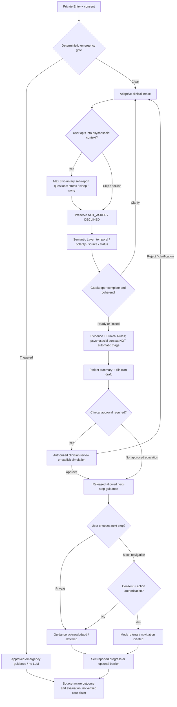

# Sanad — End-to-End Workflow v0.4

Version: 0.4 | Date: 2026/11/03 | Status: Draft; clinical safety rules pending approval.

## Scope
P0 = mobile-first responsive patient web app, desktop clinician portal, consent and safety, optional psychosocial input, evidence-backed reports, mock navigation, voluntary progress and barrier tracking. P1 = FHIR R4 validator, optional exports. P2/pilot = actual clinician/provider integrations.

## Swimlane responsibilities

| Actor | P0 responsibility | Not permitted |
|---|---|---|
| Patient | Grants scopes, answers/skips optional questions, selects navigation, self-reports status | Not obligated to share sensitive information |
| Sanad | Emergency check, bounded AI tasks, semantic validation, rules, mock tracking | Diagnose infertility, infer semen quality from stress, auto-share |
| Clinician | Review/approve permitted drafts when actual reviewer exists; otherwise show simulation clearly | Simulated approval cannot be presented as real |
| Healthcare provider | No live provider integration in MVP | No `SCHEDULED/SEEN` as verified without real evidence |

## Data-exchange boundary
Internal case → FHIR R4 conceptual mapper (`Patient`, `QuestionnaireResponse`, `Observation`, `DiagnosticReport`) using synthetic case. Mapping does not change consent enforcement or constitute FHIR conformance. Provider interfaces require separate security, clinical and legal review.

## Exceptions and regression cases
Emergency always overrides AI; LLM outage leaves safe form/rules; opt-out does not block intake; missing information does not imply normal; clinically unapproved signals cannot cause automatic referral; consent revoked blocks sharing; user booking/visit reports remain `SELF_REPORTED`; simulated outcomes not called verified.
