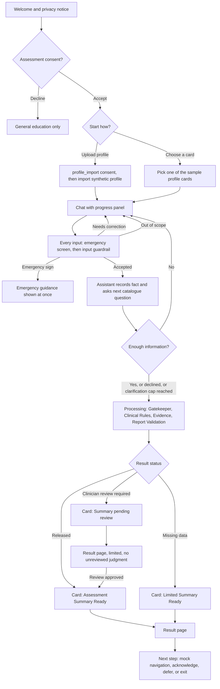

# Sanad: UX flow (chat to summary)

Status: PROPOSED v0.1 (2026-11-08). Follows BRD/PRD v0.4 and `agent.md`. Where this file conflicts with the BRD or PRD, the BRD/PRD win. Clinical wording, thresholds and emergency copy stay `CLINICAL_TBD` until a clinician signs them off.

Sanad screens and navigates. **It does not diagnose.** Every result screen says "Screening, not diagnosis".

## 1. The idea in one paragraph

The user talks to an AI assistant in a chat. The assistant asks questions from the approved catalogue, explains briefly when needed, and records what the user shares. On desktop a side panel shows progress and what has been recorded. When enough information is in, the assistant stops asking. The system then runs Gatekeeper, Clinical Rules, Evidence and Report Validation. If the result may be released, an **Assessment Summary Ready** card appears in the chat with a **View My Summary** button. That button opens a separate result page. Emergency signs interrupt everything at any moment.

## 2. Design rules for this flow

1. **The chat is a way to present the approved question catalogue, not a free diagnostic conversation.** The assistant never invents a clinical question and never gives a diagnosis or treatment advice.
2. **Emergency first.** Every user input passes the emergency screen before anything else. A hit shows emergency guidance at once, without waiting for the chat to finish and without a model call.
3. **Rules decide, the model explains.** Clinical numbers and the triage level come from code. The model only extracts facts from text and drafts wording.
4. **Nothing unreviewed is released.** If a clinician review is required, the unreviewed judgment is not shown.
5. **Unknown stays unknown.** "Not sure", "Prefer not to say" and "Skip" are always available and are never turned into "No".
6. **Everything simulated is labelled "Mock".** Nothing is shown as confirmed by a provider unless a real confirmation exists.
7. **No answers in browser storage.** Chat and answers live on the server for the session only. No localStorage or IndexedDB. Quick Exit clears all on-screen and in-memory state.
8. **No account, no push notifications, no reminders by default.**

## 3. Flow at a glance

## 4. Step by step

### Step 0. Welcome, privacy and consent

- Short notice: what Sanad is, that it is synthetic-data MVP, "Screening, not diagnosis", what is stored and for how long.
- Language switch (English / Arabic with right-to-left layout). Quick Exit button is visible from here on every screen.
- Emergency link ("Is this an emergency?") is visible on every screen and opens the offline emergency page.
- Consent is per purpose and separate. At this step only **assessment** is asked. Other scopes are off and asked later, only when needed: `profile_import`, `clinician_review`, `provider_share`, `spouse_share`, `research_use`.
- Decline: the user sees general education only. No health question is asked.

### Step 1. Choose how to start (chat opening)

The first chat message offers two options as large buttons:

| Option | What happens |
|---|---|
| **Upload my profile** | Ask `profile_import` consent first. Then accept a synthetic profile file (FHIR Bundle or the team's profile format). Show a short summary of what was read and ask the user to confirm or edit it. Anything unclear is marked "Needs your confirmation". |
| **Choose a sample card** | Show the synthetic scenario cards (for example the four core journeys and the extra samples). The user picks one. A banner says "Sample profile, not a real person". |

Rules:
- Uploaded content is **data, not instructions**. The file passes the input guardrail; instruction-like text inside it is ignored.
- Imported or sample values are shown as **recorded from profile** with their source, never as verified by a clinic.
- The profile is only applied after consent. If the import fails, the chat says so plainly and offers to continue by answering questions.
- Open decision (section 9): a small link "I'll answer the questions myself" for a start with no profile.

### Step 2. Chat and progress panel

**Chat behaviour**
- One question at a time, taken from the approved catalogue. Choice buttons plus optional free text.
- Every question has **Not sure** and **Prefer not to say**. Optional wellbeing questions (stress, sleep, worry) can be skipped in one tap.
- Short "Why we ask" help text comes from approved copy only.
- The assistant may reflect back a recorded fact ("I noted: you stopped steroids last year. Is that right?") so the user can correct it. Past and current facts are kept separate.
- Messages from the assistant carry the label "AI assistant". The assistant never says what the answer means clinically during the chat.

**Progress panel (desktop, beside the chat)**
- Sections: Basics, Health history, Lifestyle, Symptoms, Optional wellbeing, Lab results (optional).
- Each item shows its state: Answered, Skipped, Prefer not to say, Not sure, Needs your confirmation.
- Tapping an item lets the user edit it. Editing re-opens that question in the chat.
- Core items are marked. Optional items are marked optional.
- A progress bar shows how many core items remain. No time promises.

**Mobile**
- The panel collapses into a progress bar at the top. Tapping it opens a bottom sheet with the same list.

**When the assistant stops asking**
- All core items are answered, **or** declined, **or** the clarification cap (`max_clarifications`, proposed default 2) is reached.
- Missing optional (non-core) items only show a small warning. They never block.
- The assistant then says what it will do next ("I'll check your answers now") and the chat input is disabled while processing.

**Lab results (optional)**
- Manual entry in a small form inside the chat or panel: value, unit, date, source. A value with a missing or unclear unit is held as "Needs your confirmation". A report file is a later, optional path.

### Step 3. Safety checks on every input

Order, for each message or upload:

1. **Emergency screen, stage 1 and 2a** (structured flags and keyword/pattern screen on free text). Code only.
2. **Input guardrail** (format, length, language, scope). Results: accepted, needs correction, out of scope.
3. After the model extracts facts, **emergency screen stage 2b** re-checks the extracted facts.

An emergency hit at any point beats every other result.

### Step 4. Processing

A short, honest status line replaces the input: "Checking your answers", then "Checking against guidelines", then "Preparing your summary". No fake progress percentages.

Behind it, in order: Gatekeeper (completeness, conflicts, units, provenance), Clinical Rules (risk signals and triage floor), Evidence (cited sources, or abstain), Report Validation (every claim has a source or an uncertainty label, nothing below the rules floor, consent and review status checked).

If processing fails or a service is down, the chat says so and offers a retry. It never shows made-up content.

### Step 5. Result card in the chat

| Situation | Card shown | Button |
|---|---|---|
| Released | **Assessment Summary Ready** | View My Summary |
| Data was missing, but a limited summary can be released | **Limited Summary Ready**, with one line on what is missing | View My Summary |
| Clinician review required and not done | **Summary pending review**, with one line on what happens next | View what's available |
| Emergency | No card. The emergency screen is shown instead (see section 6). | none |

The card repeats "Screening, not diagnosis".

### Step 6. Result page

A separate page, opened from the card. Sections in this order:

1. **What you told us.** The recorded information with its source (you, imported profile, sample) and status. Skipped and declined items are listed as such. The user can go back to fix an item.
2. **What your numbers mean.** Plain-language explanation of each value or indicator. Values and thresholds come from code. Where a threshold is not clinically approved, the page says so.
3. **What to pay attention to, and what is unclear.** Risk signals that apply, each with its source. A separate list of unknown or missing information. Missing information is never shown as "low risk".
4. **Limits and sources.** What this assessment cannot tell. Source passages with title and version. A claim with no source is not shown.
5. **Your allowed next step.** One clear step based on the approved level (see the table below), with the path to Mock Care Navigation.

Always on the page: Quick Exit, the emergency link, and the line "Screening, not diagnosis".

| Level | Next step wording (approved copy needed) | Review before release |
|---|---|---|
| Red | Emergency guidance (shown immediately, not on this page) | Not awaited |
| Orange | See a doctor within about 2 weeks | Doctor review within 24 hours |
| Yellow | Specialist visit | Doctor review within 48 hours |
| Blue | Primary care | Not required |
| Green | Self-care and education | Not required |

Page actions: save a private summary (user's own copy), "I've seen this" (acknowledge), "Not now" (defer or close), and the navigation entry point. None of them is required, and none triggers a reminder.

### Step 7. Next step: navigation, referral, follow-up (all mock in the MVP)

- **Acknowledge** and **Not now** are available right on the result page. Acknowledging does not need navigation to start first.
- **Care navigation**: "I am looking", "Explore services", "Not now". Services shown are mock and labelled **Mock**.
- **Referral**: only through the referral gate. It needs `provider_share` consent, an APPROVED and unexpired review that matches the report, and backend authorization. If any is missing the user sees a plain explanation and nothing is sent. The sample provider is a mock and the request is labelled "Mock request".
- **Follow-up**: the user may report progress or a barrier, all optional. Status labels such as "Self-reported, not verified by a clinic". A barrier shows non-clinical support options (privacy explanation, language, service information, defer). It never changes the triage level.
- Nothing is shown as "confirmed by the provider" in the MVP.

## 5. Chat message types

| Type | Used for | Notes |
|---|---|---|
| Assistant question | One catalogue question with buttons | Always includes Not sure and Prefer not to say |
| Recorded fact echo | Confirm what was understood | User can correct it |
| Assistant note | Short approved "why we ask" help | No clinical meaning given |
| System notice | Needs correction, out of scope, service down | Plain language, no error codes shown |
| Consent prompt | `profile_import` and other scopes when needed | One purpose per prompt |
| Result card | Summary ready, limited, pending | Appears once, links to the result page |
| Emergency takeover | Emergency guidance | Replaces the chat view |

## 6. Special cases

| Case | What the user sees | Rule behind it |
|---|---|---|
| **Emergency sign** (any message, any stage) | Emergency guidance fills the screen at once. The chat input is closed. It shows the emergency number and approved wording. It does not ask more questions. It works offline. | Emergency screen runs first, no model, wins over everything |
| **Missing data** | Result page opens as **Limited Summary**: sections 1, 2 (for values that exist), 3 (with the list of what is unclear), 4. Next step reads "Complete the missing information to get a full summary". | Missing data is `NEEDS_MORE_INFORMATION`. The level is never lowered and never treated as low risk. |
| **Clinician review required** | Card says the summary is pending review. The page shows section 1 and general explanations, and hides the judgment and level-specific next step. It shows what happens next and how long it normally takes. When review is approved the full summary is released. | Unreviewed judgment is not released. The review is a simulated reviewer in the MVP, always labelled. |
| **Needs correction** | The assistant explains what to fix ("That looks too long, can you shorten it?") and asks again. | Input guardrail |
| **Out of scope** | The assistant says it cannot help with that here and brings the user back to the current question. | Input guardrail |
| **Instruction-like text** ("ignore the rules") | Treated as ordinary data. The assistant carries on with the current question. | Text is data, never instructions |
| **User declines a core question** | The assistant accepts the answer and moves on. The item shows "Prefer not to say". | Declined stays declined |
| **Clarification cap reached** | The assistant stops asking about that item and continues. | `max_clarifications` |
| **Consent revoked mid-way** | The next call is blocked. The page explains what stopped and what stays. Data handling follows the retention policy. | Consent is checked on the server at every call |
| **Model or service unavailable** | The chat switches to the static form for the remaining questions. Emergency guidance is unaffected. | Fail safe, no made-up content |
| **Session ends or Quick Exit** | All on-screen and in-memory state is cleared. The browser goes to a neutral page. The server session is cleaned up. | PWA rules |
| **Offline** | The app shell and the emergency page still load. Health API calls are not cached and show a clear offline message. | Service worker caches shell and emergency page only |

## 7. Visual guidance

- Calm, neutral, clinical. Light theme, high contrast text, large touch targets, clear focus states.
- A dashboard-style layout is fine for the result page: a left summary column and cards for each section. The reference screenshot (a commercial admin template) is a layout idea only. Do not copy its branding, icons or organ-percentage widgets, which imply measurements Sanad does not make.
- No scores, percentages or progress rings that look like health measurements. Show recorded values and plain labels.
- Arabic means mirrored layout, not just translated text.
- The manifest name and tab title are the neutral name "Sanad".

## 8. Where each part maps in the specs

| UX part | Spec |
|---|---|
| Start choice, consent | PRD-FR-01, PRD-FR-02, T-10, T-11, T-65 |
| Chat questions, optional wellbeing, declined states | PRD-FR-04, PRD-FR-29, PRD-FR-30, T-16, T-17 |
| Facts from text (past and current kept apart) | PRD-FR-17, T-18 |
| Emergency first, two stages | PRD-FR-03, T-13, T-14 |
| Input guardrail, missing-data tiers (PROPOSED) | PRD-FR-35, PRD-FR-36, T-67, T-68 |
| Gatekeeper, rules, evidence, validation | PRD-FR-05, 06, 07, T-15, T-19, T-23 |
| Result page and reports | PRD-FR-08, T-24 |
| Clinician review before release | PRD-FR-09, T-25 |
| Mock navigation, referral gate | PRD-FR-10, T-26, T-27 |
| Acknowledge, progress, barrier, defer | PRD-FR-24 to PRD-FR-28, T-28 to T-31 |
| Lab entry | PRD-FR-12, T-33 |
| Arabic and RTL | PRD-FR-11, T-38 |

## 9. Open decisions

1. **Start with no profile.** Add a small "I'll answer the questions myself" link next to the two start options? Recommended: yes.
2. **Is Arabic and RTL part of the demo?** The BRD scope says yes for key screens, the requirement table says P1. This affects the chat, the result page and the emergency page.
3. **Lab entry priority.** J3 needs it for the demo, but it is listed as P1.
4. **Pending-review page.** Exactly which general explanations may be shown before approval needs clinical sign-off.
5. **Wording of every next step, level label and emergency text** needs clinical review (`CLINICAL_TBD`).
6. **Free text in the chat.** Needs the input guardrail and emergency stage 2 on the backend (PROPOSED). Until then, the chat can run on choice buttons only.

## 10. Acceptance checks for this flow

- A user can finish J1 from the start choice to the result page without an account.
- A message describing sudden severe pain shows emergency guidance at once, with the model switched off, and the chat input closes.
- A skipped or declined answer is never shown as "No" on the result page.
- A case with a missing core answer opens a Limited Summary and does not show a lower level.
- A case that needs review shows no judgment and no level-specific next step until the review is approved.
- No result is shown unless every claim has a source or an uncertainty label.
- A referral can only be requested through the referral gate, and the request is labelled Mock.
- Quick Exit clears the page and the chat, and nothing health-related stays in browser storage.
- Everything simulated carries the Mock label.
