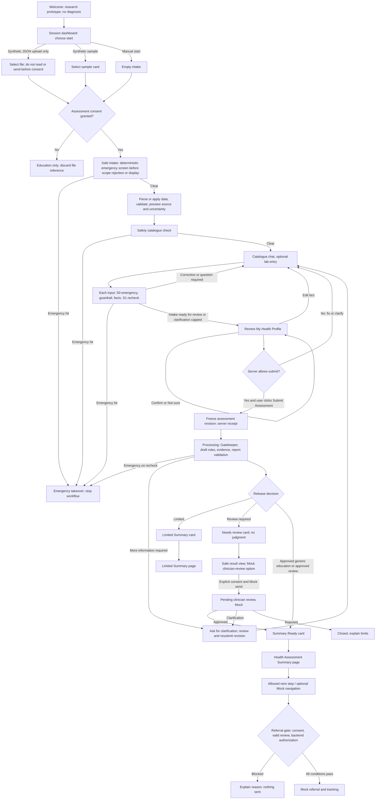

# Sanad: UX flow (session dashboard with chat)

Status: **PROPOSED v0.3 (updated 2026-11-11; version unchanged)**. Not reviewed. Follows [BRD v0.4](Sanad_AetherHealth_BRD_v0.4.md), [PRD v0.4](Sanad_AetherHealth_PRD_v0.4.md), the [referral-flow product spec](referal-flows/product-spec.md) and [AGENTS.md](../AGENTS.md).

- This file is not in the AGENTS.md "where the truth lives" table. Where it conflicts with the BRD, PRD or product spec, those documents win. The conflicts already known are listed in §11.
- The session dashboard (§3), review/submit gate (§3.6 and §5), and route transitions change the patient model in product-spec §5. They are **proposed**, not implemented. The spec/API/state-machine changes in §11 require approval before build.
- All clinical wording, thresholds, triage labels and emergency copy stay `CLINICAL_TBD` until a clinician signs them off. The IPS-inspired PDF is a **synthetic source fixture**, not an HL7-validated FHIR Bundle or a clinician-approved result.

Sanad screens and navigates. **It does not diagnose.** Every result view says "Screening, not diagnosis".

| Version | Date | Change |
|---|---|---|
| 0.1 | 2026-11-08 | First draft: chat to summary. |
| 0.2 | 2026-11-08 | Adds the session dashboard that hosts the chat. Aligns with BRD/PRD v0.4 and the product spec: start order, five consent scopes, action codes instead of colours, no response times, honest assistant label, the review request step and the current task IDs. Updates open decisions. |
| 0.3 | 2026-11-11 | Adds reference dashboard mapping (§3.5). The review amendment incorporates a separate Review My Health Profile screen, explicit Submit Assessment, source-level confirmation, mock IPS PDF import caveat, and revised release/navigation gates. |

## 1. The idea in one paragraph

After a short welcome, the user works in a **session dashboard**: the chat offers three starts (closed-schema **synthetic JSON** upload, sample card, or blank questionnaire); consent and deterministic emergency checks occur before the main questions. The assistant shows questions from the approved catalogue and the server records source-aware facts, including optional manually entered lab values. Once questions are complete, declined, or the clarification cap is reached, the user proceeds to **Review My Health Profile** — a separate, readable review surface showing each recorded item, its source, date, conflicts, and status. The user can **Confirm**, **Edit**, or mark **Not sure**; patient confirmation verifies that Sanad captured what the user meant, **not** that the fact is clinically verified. The user then explicitly selects **Submit Assessment**. Only after a successful, version-checked submission does the server process the case through safety rechecks, Gatekeeper, draft rules, evidence, and report validation. A result-status card appears in chat and opens the separate **Health Assessment Summary** (IPS-inspired presentation, not certified IPS). Emergency signs interrupt immediately at any stage. Sharing the outcome with a mock care facility is a **different, separately consented action**, never a side effect of Submit.

**Product boundary:** The synthetic Patient Summary PDF reviewed with Trung informs document design and QA, but the current MVP intake accepts **synthetic JSON only**, not PDF/OCR/FHIR Bundle uploads. It is not yet a clinical record and it cannot be used to claim HL7 FHIR compliance.

## 2. Design rules for this flow

1. **The chat presents the approved question catalogue. It is not a free diagnostic conversation.** The assistant never invents a clinical question and never gives a diagnosis or treatment advice (BR-09).
2. **The assistant label is honest.** No model is in the current flow, so assistant messages are labelled "Sanad assistant" with the note "Scripted questions from a draft catalogue". The words "AI" or "AI assistant" are used only when a model task actually produced the text. The product spec drops the `AI-generated draft` label for the same reason (RF-11).
3. **Emergency first.** Every answer and upload passes the emergency check before anything else. A hit shows emergency guidance at once. It does not wait for the chat to finish, a model or a clinician (BR-06, BR-45).
4. **Rules decide, text explains.** Clinical numbers and the triage action come from versioned code and catalogues. Wording comes from approved or draft-labelled copy.
5. **Nothing unreviewed is released.** If the next step needs clinician review, the judgment and the step-specific next step stay hidden until an approval exists (BR-14, AC-08.9).
6. **Unknown stays unknown.** "Not sure", "Prefer not to say" and "Skip" are always available and never become "No" (BR-03).
7. **The server decides what the dashboard shows.** Every panel renders from the case state that the API returns. Hiding or disabling a panel is presentation only. Every action is checked again on the server (AGENTS.md rule 1, RF-04).
8. **Everything simulated is labelled Mock.** No element looks confirmed by a provider or a clinician unless a real confirmation exists.
9. **No answers in browser storage.** Answers live on the server for the session only. No localStorage or IndexedDB for health data. Quick Exit clears all on-screen and in-memory state (RF-09).
10. **No account, no push notifications, no reminders by default** (BR-18, BR-32).
11. **Review is explicit; release is separate.** Chat answers are a session draft. "Submit Assessment" freezes a reviewed assessment revision for processing; it does not create a diagnosis, release a judgment, or send anything to a provider. The corresponding API/action is a proposed change (§11).
12. **Patient confirmation is not clinical verification.** Track `USER_CONFIRMED` separately from `CLINICIAN_VERIFIED`; reported diagnoses, meds, labs and the synthetic PDF remain unverified unless independent evidence/review exists.
13. **All clinical data retain provenance and timing.** Show where each fact came from (sample, synthetic upload, chat, manual lab), observation date when known, any disagreement, and whether it is current/past/unknown. An unknown observation date remains unknown, not today's date.
14. **IPS-inspired is not IPS-compliant.** Render a patient-readable summary from structured data; only call it a validated FHIR IPS when a proper `Bundle`/`Composition` and referenced resources actually pass profile validation. Do not label a standalone PDF `FHIR validated`.

## 3. Session dashboard

The dashboard is the patient's workspace for one session. It replaces the separate safety, intake and lab screens with one layout. It is a **patient** view and is separate from the Clinician Dashboard (PRD Screen 7) and the Evaluation Dashboard (PRD Screen 9).

### 3.1 Desktop layout

The dashboard uses a left rail, a central chat, and supporting cards. **Review My Health Profile** takes over the central workspace after the intake; it may use a proposed `/session/review` route or full-width dashboard step, **subject to product-spec route approval** (§11). The summary is not released until after submission and processing.

```text
+----------------------------------------------------------------------------------------+
| Sanad · Screening, not diagnosis      [EN | AR] [Emergency help]       [Quick exit]   |
| Synthetic research demo · No real health data · Draft, unapproved clinical rules       |
+-----------------+---------------------------------------------------------------------+
| YOUR SESSION    | +----------------------------------+ +--------------+ +-----------+ |
| ✓ Consent       | | CHAT                             | | SUMMARY      | | RECORDED  | |
| ✓ Safety check  | | Sanad assistant                  | | Not ready    | | INFORMATION| |
| ● Questions     | | Scripted, draft catalogue        | |              | | Questions | |
| ○ Review profile| | Have you used anabolic steroids? | +--------------+ | 6 / 9    | |
| ○ Submit        | | [Now] [In past] [No]             | | LAB RESULTS  | | Sources   | |
| ○ Summary       | | [Not sure] [Prefer not to say]   | | Optional     | | Statuses  | |
| ○ Next step     | |                                  | | [Add]        | | [Edit]    | |
|                 | | [Continue to profile review]     | +--------------+ |           | |
|                 | +----------------------------------+ | PRIVACY      | +-----------+ |
|                 |                                      | Assessment on|               |
|                 |                                      +--------------+               |
+-----------------+---------------------------------------------------------------------+
```

All values and labels are synthetic illustrations. **Continue to profile review** appears only when the server allows that transition, including a supported incomplete-data path; no health percentage or diagnosis is shown.

### 3.2 Panels

| Panel / surface | What it shows | When active | Allowed actions | Spec status |
|---|---|---|---|---|
| **Top bar** | Sanad, screening disclaimer, language, emergency link, Quick Exit, synthetic warning | Every screen | Language, emergency, Quick Exit | RF-05/RF-09 |
| **Chat** | Start options, consent, safety, catalogue questions, optional lab form, processing notices, result card | Inputs only in allowed intake/revision states; read-only after submission | Answer/skip/correct, open review | RF-06/RF-10; new review CTA proposed |
| **Your session** | Consent → Safety → Questions → **Review profile** → **Submit** → Summary → Next step | From consent | Read-only server-derived step | RF-04; new step sequence proposed |
| **Recorded information** | Short source-aware list, `Not sure`, declined, conflicts, past/current | During intake and review | Edit opens relevant question; read-only after submission | RF-06/PRD-FR-17 |
| **Review My Health Profile** | Detailed reviewed/unknown/conflicting facts, evidence source, date, provenance, final acknowledgment | After questions, before processing; on revision requested | Confirm/Edit/Not sure; Submit only when server permits | **NEW / proposed**, §3.6 |
| **Summary** | Not ready; Submitted/Processing; Limited; Needs review; Pending (Mock); Ready; Closed | Every session stage | Result page only when a releasable/safe view exists | RF-07/RF-11; statuses are view labels, not new backend enums |
| **Lab results** | Manual value, unit, date, source, confirm preview | During intake and review before Submit | Add/edit/remove; submit triggers validation | RF-15 |
| **Privacy** | Five consent scopes, only `assessment` on for intake by default | Post-consent | Review/revoke in `/privacy` | RF-03 |
| **Next step** | Only allowed, released next step; mock services, progress, barriers and referral tracking | After appropriate guidance release | Acknowledge, mock navigate, defer, self-report | RF-12/RF-14 |

**Response states vs fact statuses:** `DRAFT`, `ASSESSING`, `NEEDS_INFORMATION`, `REVISION_REQUIRED` etc. are backend case states per the approved spec; `Review required`, `Ready to submit`, `Submitted`, `Processing` are **proposed UI substeps**. Do not create `SUBMITTED` or `REVIEW_READY` server enum values without a state-machine/API change. Preserve unknown, declined, conflicting, and correction-needed facts individually.

A "Core: n of m answered" count includes Not sure/Prefer not to say for questionnaire progress only. It must **never** imply completeness of medical facts or a health score. Which questions are CORE remains TBD-24.

### 3.3 Mobile layout

- Chat fills the viewport; emergency link and Quick Exit stay visible. A compact "Questions n of m answered" indicator opens recorded facts in a sheet.
- "Session" opens a panel for steps, summary status, manual lab entry and privacy.
- **Review My Health Profile opens as a full page** (not a crowded chat bubble) with collapsible groups, sticky "Review & Submit" footer, source/date/status text, and Confirm/Edit/Not sure actions that work with touch and keyboard.
- Editing a field opens the original question or lab form, then returns to the review page with an updated preview and any affected confirmations invalidated.
- After Submit, use a receipt/status screen; offer "View My Summary" only when the server reports a released or permissible limited view. No client-side success assumption.

### 3.4 Dashboard rules

- A later-stage panel shows "Not available yet" rather than future data. Multi-panel and new review route are change-controlled (§11).
- `409 INVALID_TRANSITION`, stale assessment revision, or stale consent require a refetch and safe redraw. Never submit twice or guess the next state.
- Draft answers persist only within the authorized server-side session. Reload returns to the same eligible step; no health data in localStorage/IndexedDB. The proposal to rebuild chat history from answers remains open (§10).
- After an edit on Review Profile, recompute conflicts, completeness and emergency checks server-side. If a revised fact changes supporting claims, invalidate downstream draft/report/review as appropriate.
- The summary page never reuses an earlier report version after an edited resubmission; show the current assessment revision and release status.
- No health scores/gauges, time-to-clinic promises, invented certainty, or diagnoses. Tab title remains "Sanad".

### 3.5 Reference screenshot and what Sanad takes from it

The team's reference is a screenshot of a third-party commercial medical admin template. The screenshot is not stored in this repository. It has its own branding and artwork, a stock photo of a person and a sample diagnosis. The wireframe below records its layout only. The numbers match the table.

```text
+---------------+----------------------------------------------------------------------+
| Logo + name   | [2] [=] [Search ..........]     User name, ADMIN  [photo] [o] [o]    |
+---------------+----------------------------------------------------------------------+
| [1] Dashboard | +-[3]-------+ +-[4]----------------+ +-[5]----------+ +-[7]--------+ |
|   Patients    | | Lungs  90%| | Body composition   | | Patient card | | Calendar   | |
|   Doctor      | | Stomach99%| |                    | | [photo]      | | month view | |
|   Hospital    | | Liver  95%| | (donut chart of    | | name         | | booked slot| |
|  Appointments | | Heart  89%| |  element %s)       | | last check-in| | highlighted| |
|  Patients   > | | Brain  85%| |                    | | sex, age,    | +-[8]--------+ |
|  Reports      | |           | | (anatomy figure)   | | department   | | Appointment| |
|  Doctors    > | |           | |                    | +-[6]----------+ | type, date,| |
|               | +-[9]------------------------------+ | Latest       | | clinician  | |
|  COMPONENTS   | | Bar chart, Jan to Dec            | | diagnosis:   | | name       | |
|  Features   > | | (calories)                       | | condition    | | [report]   | |
|  Forms      > | |                                  | | [History ->] | +-[11]-------+ |
|  Charts     > | |  |  |   |    | |  ||  | |  |     | +-[10]---------+ | Checkup    | |
|  Apps       > | |  |  |   | |  | |  ||  | |  |     | | Progress     | | card, date,| |
|  Auth       > | |  |  | | | |  | |  ||  | |  |     | | gauge 85%    | | clinician, | |
|  Misc       > | |                                  | |              | | trend line | |
|               | +----------------------------------+ +--------------+ +------------+ |
+---------------+----------------------------------------------------------------------+
```

| # | Reference widget | In Sanad | Why |
|---|---|---|---|
| 1 | Sidebar menu of admin sections (patients, doctors, hospital, reports) | Patient view: the "Your session" steps rail. A section menu suits the Clinician portal (PRD Screen 7), not the patient. | The patient has one case on one path, and the server holds the step (RF-04). |
| 2 | Top bar with search, user name, role, avatar and icons | Top bar with "Sanad", "Screening, not diagnosis", language, emergency link and Quick Exit. No search, name or avatar. | No account and no identifiers (BR-18, AGENTS.md rule 9). Emergency link and Quick Exit on every screen (RF-05, RF-09). |
| 3 | Organ cards with percentages | Dropped. "What you've told us" lists recorded items with their state. | They imply measurements Sanad does not make (AGENTS.md rule 8, §8). |
| 4 | Body composition donut and anatomy figure | Dropped. This slot holds the chat. | No body-composition measurement exists, and BMI is never read on its own (BR-04). |
| 5 | Patient card: photo, name, sex, age, department, last check-in | The top banner says where the data came from: "Sample profile, not a real person" or "Uploaded file, unverified". Age appears only in "What you've told us". | No names, photos or identifiers (rule 9). No camera (rule 13). |
| 6 | Latest diagnosis card with a history button | Summary card: Not ready yet, Limited summary, Needs review, Pending review (Mock), Ready or Closed, with "View My Summary" when the state allows it. | No diagnosis (rule 8). Unreviewed judgment stays hidden (BR-14). |
| 7 | Calendar with a booked slot | Dropped. | No booking in the MVP. Appointment intent is P1 and Mock (PRD-FR-16). No reminders (BR-32). |
| 8 | Appointment card: therapy type, date, clinician name, report file | Next step card: the allowed next step and mock services labelled **Mock**. | No real provider or clinician names (AGENTS.md). Nothing simulated looks real (rule 6). |
| 9 | Calories bar chart | Dropped. | No health tracking or wearables in scope (BRD §8.2). |
| 10 | Monthly progress gauge (85%) | The text line "Core questions: 6 of 9 done", which counts questions only. | No gauges or rings that look like health measurements (§8). |
| 11 | Checkup card with clinician and trend line | Mock referral tracking in the Next step card, with the delayed flag (RF-14), labelled **Mock**. No trend lines. | No verified care and no `CARE_COMPLETED` (rule 7). |
| — | Template options: dark mode, multi-colour, RTL ready | Light theme (§8). RTL mirrored layout if Arabic is in the demo (§10, decision 3). | Visual guidance in §8 |

What Sanad keeps: a fixed top bar, a left rail, a grid of cards with clear titles, generous spacing and at most one primary button per card.


### 3.6 Review My Health Profile — proposed patient screen

**Purpose:** Explicit, source-aware verification of a *draft intake*, **not** a clinical diagnosis or the final assessment summary. This screen sits **after intake questions and before Submit Assessment**, not after the clinical report has been released.

**Desktop wireframe:**

```text
+--------------------------------------------------------------------------------+
| Sanad   Review My Health Profile             [Emergency help]     [Quick exit] |
| Synthetic research session · Screening, not diagnosis                          |
+------------------+-------------------------------------------------------------+
| YOUR SESSION     | Review your answers before submission                      |
| Consent ✓        | "Please confirm what we recorded. Unknown is OK."          |
| Safety ✓         |                                                             |
| Questions ✓      | [1] Basic context                             [Edit]        |
| Review ●         | Age: 36 · Source: Sample profile · Status: Unconfirmed       |
| Submit ○         | [Confirm] [Edit] [Not sure]                                  |
| Summary ○        |                                                             |
| Next step ○      | [2] Health & lifestyle                       [Edit]         |
|                  | Tobacco: Not reported · Source: Intake chat                 |
|                  | [Confirm] [Edit] [Not sure]                                  |
|                  |                                                             |
|                  | [3] Conditions, medications and lab results                |
|                  | Mumps orchitis history · Self-reported · Unconfirmed       |
|                  | Semen value · Source: Synthetic fixture · Date: 2026-10-05 |
|                  | [Confirm] [Edit] [Not sure]                                  |
|                  |                                                             |
|                  | Missing: allergies unknown; 1 unresolved conflict          |
|                  | [Continue questions] [See source details]                  |
|                  | [ ] I reviewed the information to the best of my knowledge |
|                  | [Submit Assessment] (server-authorized only)               |
+------------------+-------------------------------------------------------------+
```

The sample values are *illustrative* and may originate from the review fixture; they do not mean the current Sanad JSON schema already accepts all those medical fields.

**Sections:** (1) basic context; (2) reproductive concern and health history; (3) medications/allergies; (4) lifestyle; (5) measurements/lab values with unit and measurement date; (6) missing or conflicting information; (7) privacy and submission acknowledgment. Hide nonexistent sections with an explicit `Not provided` state; do not fill with made-up negatives.

**Per-fact display contract:** Show `concept/display`, answer/value + unit, observation/recorded date (or `Unknown`), origin (`Chat`, `Sample`, `Uploaded synthetic JSON`, `Manual lab`), `self_reported` vs document-extracted, `temporal_status` (current/past/unknown), `verification_status` (including not clinically verified), and an optional source-view action. Display `rule_id`/`evidence` only in clinician-facing/detailed traceability UI as applicable; never imply a code is a diagnosis.

**Three user actions:**

| Action | Behavior | What it must **not** imply |
|---|---|---|
| **Confirm** | Accept that the recorded value matches what the user intended to report; record a `patient_confirmation` event for current `fact_revision`. | Does **not** turn self-report or uploaded value into clinician-verified fact. |
| **Edit** | Reopen originating catalogue question/lab editor; submit corrected data through all safety and validation gates; return with incremented revision. | Does not silently overwrite a contradictory original fact; retain audit trail within retention policy. |
| **Not sure** | Set user review status to uncertain or preserve a `NOT_SURE` answer; flag unresolved info. | Must never convert unknown into `No`, a normal test, or low risk. |

**Final acknowledgment and Submit:** Show one plain statement: "I have reviewed the information above to the best of my knowledge." The acknowledgment is not clinical consent or a warranty of medical accuracy. **Submit Assessment** confirms the case revision for assessment processing only; it is **not** provider sharing, clinical approval, FHIR IPS validation, or report release. The backend requires assessment consent, non-expired session, no unsafe pending correction, and current review revision. A decline/uncertain item may proceed to **limited assessment** only if server completeness rules permit it; it must not force a clinical conclusion. Explicit refusal to share remains possible.

**After Submit:** Show server-confirmed receipt/status with case reference (random session ID, not personal identifier), revision, and safe text "Assessment received for processing". Keep a retry/idempotency guard. From `PROCESSING`, `NEEDS_MORE_INFORMATION`, `PENDING_CLINICIAN_REVIEW`, `LIMITED_REPORT`, or released result, show only sections the server authorizes. When more information is requested, reopen the right question(s), re-review changed facts and **resubmit a new revision** rather than silently changing an earlier released report.

**One-time import preview vs final review:** The small "what was read" preview immediately after a consented synthetic import is a **data-quality check**. The full screen above is the **final pre-submission check** after chat. They must not be collapsed into a post-report confirmation screen.

**Scope and FHIR boundary:** The team-provided `Sanad_Synthetic_Patient_Summary_IPS.pdf` is a **synthetic, IPS-inspired test document**, not a certified IPS resource or currently supported input type. In current P0, import remains closed-schema JSON (`is_synthetic: true`, ≤256 KB). Do not label PDF upload/OCR or real-patient import as working. If future import is approved: scan document, extract candidate facts with source and timing, run deterministic emergency checks, show data-quality preview, request per-fact review, and avoid treating `final` PDF status as clinical verification. FHIR R4 `QuestionnaireResponse`, `Observation`, `DocumentReference`, and `Provenance` are possible **mappings**; only a validated `Bundle`/`Composition` can support an IPS-conformance claim.

**Minimal proposed UI-to-backend contract** (illustrative; requires spec/API approval):

```json
{
  "case_id": "SYN-CASE-001",
  "assessment_revision": 3,
  "assessment_consent": true,
  "review_status": "IN_PROGRESS",
  "facts": [
    {
      "fact_id": "F-BMI-01",
      "fact_revision": 2,
      "concept_code": "body_mass_index",
      "value": 28.7,
      "unit": "kg/m2",
      "observed_at": "2026-10-05",
      "source_type": "SAMPLE_PROFILE",
      "source_ref": "SYN-J3-001",
      "temporal_status": "PAST",
      "verification_status": "UNVERIFIED",
      "patient_review_status": "CONFIRMED_AS_RECORDED"
    }
  ],
  "blocking_issues": [],
  "submit_allowed": false,
  "submit_block_reason": "SERVER_DECISION_PENDING"
}
```

The example's `submit_allowed` is intentionally false because no server decision has been made. `submit_allowed` and review completeness must be returned by the server; frontend never infers them from a checked box alone. Backend routes and status enums below are **proposals**, not existing APIs.

## 4. Flow at a glance



**Crucial distinctions:** (a) `Submit Assessment` is **not** `Send to care facility` or a provider referral; (b) `Review My Health Profile` happens **before** processing, whereas `Health Assessment Summary` appears **after** release validation; (c) every edit, upload and free-text candidate follows emergency-first gates; (d) the new submission transition is proposed and requires backend/spec updates (§11).

## 5. Step by step

### Step 0. Welcome

- Show Sanad as a synthetic-data research prototype, the privacy/retention policy and "Screening, not diagnosis". No login, name, phone, email, booking or account required in P0 (BR-18).
- **Start private assessment** or **Read general information**; language switch, emergency link and Quick Exit always visible. `/urgent.html` works offline after first load.

### Step 1. Choose how to start

| Option | Current MVP behaviour | Boundary |
|---|---|---|
| **Upload my profile** | Choose a **synthetic JSON** file conforming to the closed schema; select first, read/send only after assessment consent. Offer a template. | Reject non-JSON, >256 KB, unknown fields, missing `is_synthetic: true`; no real patient data. |
| **Choose a sample card** | Choose J1/J3/J4/J5 or other synthetic fixtures and clearly mark them Mock. | A sample is not a clinician verified record. |
| **Answer the questions myself** | Blank start; collect information through approved questions. | No free diagnostic chat in P0. |

Each creates a server-side session `DRAFT` after the choice. An uploaded file is untrusted data, not instructions; rejection reveals only the rule failed, not contents. A PDF resembling Trung's synthetic IPS summary is **not** an accepted upload type at P0.

### Step 2. Consent and imported-data check

- Present the five consent scopes (`assessment`, `clinician_review`, `provider_share`, `spouse_share`, `research_use`); only `assessment` is requested at intake. Others remain off unless a specific later action needs them. No new `profile_import` scope is assumed.
- Declining assessment consent results in education-only mode; selected references are discarded. No data processing beyond what is necessary for safe selection/decline handling.
- After consent, apply the earliest feasible deterministic emergency check to accessible content **before ordinary scope rejection, redirect or extraction display**. For optional future free-text/PDF extraction, check raw safety signals before applying the regular input guardrail; untrusted document instructions cannot override safety.
- Safely parse/apply the synthetic upload or sample, preserving origin, date, polarity, temporal status and verification state; show a **brief import preview** and ask about obvious mismatches. This preview does **not** replace the final review screen.

### Step 3. Initial safety check

- Run the versioned deterministic emergency questions after consent and before ordinary assessment questions. A positive trigger opens emergency guidance immediately. No model/clinical-review wait.
- If the API is down, a positive browser-side safety answer still shows emergency guidance; non-triggering/unavailable results require retry without an all-clear promise.
- Re-check imported facts for emergency triggers; no late-stage review or submit button can suppress an emergency takeover.

### Step 4. Chat intake, structured facts and optional lab entry

- Ask one approved catalogue question at a time. Use choices/number inputs only until the proposed free-text guardrail and stages S0b/S1 exist (§11). Always show **Not sure** and **Prefer not to say**; optional wellbeing items may be skipped.
- Explain why questions are asked using reviewed or draft-labelled copy; do not infer a diagnosis or recommend treatment in-chat.
- Preserve past/current distinction, self-reported provenance, source ID, and observation/response date. If a sample and chat answer disagree, keep both and request clarification; do not silently overwrite.
- Optional wellbeing: at most three items, self-reported and excluded from triage. Optional manual labs: value, unit, date, source and review preview; missing unit is held pending correction.
- Stop when the catalogue/gatekeeper permits review: answered, explicitly declined/not sure, or clarification cap exhausted. Unknown/declined may lead to **limited** reporting, not automatic low risk. Unresolved mandatory format errors/conflicts require correction or a safe incomplete-data path determined by the server.
- Show **Review your profile** once the server permits the transition. Do not auto-run the report before the user has reviewed/submitted.

### Step 5. Emergency and validation checks on every change

Order for every answer, edited fact, imported item and manual measurement:

1. **S0 / S0b emergency checks first** on structured/raw text inputs; deterministic and fail-safe. If scope- or format-rejected content contains a plausible emergency signal, do not hide the emergency guidance behind an input error.
2. **Input guardrail**: type, unit, range, allowed catalogue scope, length and injection-resistant parsing. Output `ACCEPTED`, `NEEDS_CORRECTION`, or `OUT_OF_SCOPE` without discarding needed emergency signals.
3. **Fact validation + S1**: preserve source/temporal/polarity and recheck extracted facts. Conflicts and unknowns remain explicit.
4. **After Edit or Submit**: recompute safety, completeness and eligible transitions server-side. An emergency hit wins over Review, Submit, Processing and reporting.

S0b and S1 remain **PROPOSED** when they lack implementation tasks; frontend must not imply a medically validated detection capability.

### Step 6. Review My Health Profile (new, proposed)

- Show a **standalone review screen** using the facts actually recorded by Sanad, organized by personal context, reproductive concern, histories, medication/allergies, lifestyle, measurements/labs, and missing/conflicting items (§3.6).
- For each item show value, unit/date where applicable, source (`Chat`, `Sample`, `Synthetic JSON upload`, `Manual lab`), and status (`Self-reported`, `Unverified`, `Conflicting`, `Unknown`, or confirmed as recorded).
- Buttons **Confirm / Edit / Not sure**. Edits reopen the exact question/form and bring the user back with a new revision. Confirmation does **not** upgrade clinical verification.
- Show `DECLINED` and `UNKNOWN` as independent states, and a separate list of information still needed. Do not use an empty field to mean "No".
- Require a plain review acknowledgment before enabling the submission request. The server decides `submit_allowed`, whether a limited submission is permitted, and whether specific corrections are mandatory. No auto-submit on last chat answer.

### Step 7. Submit Assessment (new, proposed)

- Primary action: **Submit Assessment**. Supporting copy: "This submits the information to Sanad for assessment processing. It does not send your information to a health professional."
- Require assessment consent, current session/revision, completed review acknowledgment, and server authorization; use idempotency/revision tokens to prevent duplicate or stale submits.
- On server-confirmed receipt only, show **Assessment submitted** and a neutral **Processing** status. Do not present release/approval as complete. Show a session case reference if needed; no personal account or persistent patient portal is introduced.
- `Submit Assessment` must **not** toggle `clinician_review`, `provider_share`, `research_use` or any other optional scope. If extra information is requested, the user edits the relevant facts and explicitly **resubmits** an updated revision.

### Step 8. Server processing

- Processing copy: "Checking your information", "Applying draft rules", "Preparing a summary". Avoid fake percentages or timestamps.
- Backend: S1 safety recheck → Gatekeeper (core coverage, missingness, conflicts, units, provenance, revision validity) → draft rules → evidence registry → report validation (claim provenance, limitations, review conditions).
- Existing evidence step may abstain. Unreviewed findings and guidance remain hidden; if sources are missing, label insufficient evidence or omit the claim.
- Server may return `NEEDS_MORE_INFORMATION`, review-required status, limited result, permissible generic education, or a closed/rejected state. API errors show safe retry without invented content.

### Step 9. Result card in chat and status

| Server result | Card | Action |
|---|---|---|
| `REPORT_RELEASED` | Assessment Summary Ready | View My Summary |
| `LIMITED_REPORT` / `NEEDS_MORE_INFORMATION` (when a safe limited view exists) | Limited Summary Ready | View available information; optionally continue questions |
| Review required, no approved judgment | Summary needs review | View what's available; optional Mock review request |
| `PENDING_CLINICIAN_REVIEW` | Summary pending review (**Mock**) | View what's available |
| `REJECTED` | Summary closed, with limitations | View what's available |
| `EMERGENCY_GUIDANCE_ISSUED` | **No result card** | Emergency takeover |

A card is shown **after a submitted revision is processed**, not immediately after the last question. All cards say "Screening, not diagnosis" and are server-derived.

### Step 10. Health Assessment Summary result page

The result page is separate from Review My Health Profile and may organize information in an **IPS-inspired** order, without claiming IPS conformance:

1. **Recorded health profile:** facts as actually reported or imported, with source, date, polarity and verification state; unknown and declined items visible.
2. **Your measurements:** values, units, dates, reference ranges *only when reviewed*; no diagnosis from a single value or test.
3. **What may need attention / unresolved:** rule-supported signals only when safely released; show unknowns, disagreements and limitations separately.
4. **Optional context:** wellbeing, labelled self-reported and not used for triage.
5. **Evidence and limits:** claim source and rule version where permissible; never substitute synthetic/unknown sources for clinical validation.
6. **Review status:** Not reviewed, needs review, pending (Mock), simulated approval, or rejected. Hide all unapproved judgments and step-specific actions.
7. **Allowed next step:** only after applicable release and consent gates, including any optional mock care navigation.

**Special distinction:** An IPS-inspired *synthetic PDF* for test data, a FHIR R4 resource payload, the Review My Health Profile UI, and the final Sanad result page are **four different artifacts**. A standalone PDF with "Bundle ID" text does not establish a validated FHIR Bundle. A clinical claim in an uploaded document cannot be treated as confirmed simply because the PDF is marked `final`.

**Review request:** A separate **Send to care facility (Mock)** action may be offered on an appropriate safe view, requiring `clinician_review` consent; it is not triggered by Submit Assessment. No real clinician or service is contacted. Next-step wording remains `CLINICAL_TBD`; no service-level promise, health colour code, or appointment booking.

**Allowed next-step labels** (draft, subject to clinical sign-off):

| Action | Draft wording | Gate |
|---|---|---|
| `EMERGENCY_GUIDANCE` | Seek emergency help now | Immediate, not delayed by report |
| `PRIORITY_REVIEW` | Arrange a prompt assessment with a health professional | Only after release gate |
| `SPECIALIST` | Consider a specialist men's health service | Only after release gate |
| `PRIMARY_CARE` | Consider advice from primary care | Only after release gate |
| `EDUCATION` | General health information | Only approved generic education can release without review |
| `NEEDS_MORE_INFORMATION` | Not enough information to suggest a next step | Never equivalent to low risk |

### Step 11. Next step, progress and Mock referral (MVP)

- The result page offers **I have read this** (acknowledge), **Not now**, and optional Mock service navigation only when eligible. Acknowledgment is not proof of understanding or care completion.
- Mock service directory and request/tracking carry explicit Mock labels. The referral gate requires `provider_share` consent, valid review of the same report revision, and backend authorization; otherwise nothing is sent.
- Optional self-report progress (looking, booked, attended, unable to proceed) and barriers remain labelled *self-reported*, never provider-verified. No booking, reminders or provider confirmation in P0.
- Progress and barrier retention follows the current session data policy; Quick Exit hides content but does not imply retroactive deletion of a separate downloaded PDF or transmitted message.

## 6. Chat message types

| Type | Used for | Notes |
|---|---|---|
| Start options | Closed-schema JSON upload, sample, manual start | First message; no PDF upload in P0 |
| Consent card | Assessment scope now; other scopes only when specifically needed | Full card, one purpose per prompt |
| Import preview | Data-quality check of consented synthetic import | Early preview is **not** final review |
| Safety question | Versioned emergency catalogue | Deterministic; draft-labelled |
| Assistant question | Catalogue question and choices/number | Not sure / Prefer not to say |
| Recorded fact echo | Repeat the captured meaning of a fact | May be corrected; current/past distinction |
| Assistant note | Short "why we ask" | No uncontrolled clinical conclusions |
| Lab input | Manual values with source, unit/date and preview | Validation before recording |
| **Review Profile CTA** | Opens standalone Review My Health Profile | **New:** after intake, before processing |
| **Review correction return** | Returns from edit to review with updated revisions | **New:** invalidates stale confirmations |
| **Submit receipt/status** | Confirms server accepted the assessment revision | **New:** not review/clinical approval |
| System notice | Correction, scope issue, rejected file, API unavailable, stale revision | No raw rejected content in error |
| Processing status | Gatekeeper/rules/evidence/report validation | Never fabricate percentages |
| Result card | Ready, limited, needs review, pending, closed | Only after submit and processing |
| Emergency takeover | Immediate safety guidance | Preempts every other UI stage |

## 7. Special cases

| Case | User experience | Invariant |
|---|---|---|
| **Emergency at any stage** | `/urgent.html` replaces dashboard, review, submit, processing or result. Chat/input closes. | Deterministic safety overrides all; no clinician/model wait. |
| **Import has emergency-like content** | After authorized access, emergency-first check before ordinary rejection/redirect; show appropriate guidance. | Never let parsing/scope filters swallow a trigger. |
| **PDF selected in current MVP** | Explain only synthetic JSON is supported; show how to use sample JSON. | No fake PDF/OCR success; sample IPS PDF is a fixture only. |
| **Missing/declined CORE item** | Review lists it explicitly; if allowed, submit for a **limited** summary; else continue questions. | Not sure/Declined ≠ No; never default low risk. |
| **Value and unit mismatch** | Show source, date, exact field and correction action. | No medically misleading value conversion. |
| **Two sources conflict** | Display both with source labels, ask for resolution or keep unresolved. | Never silently choose one. |
| **History vs current** | Show separate time labels and source. | No inference that remote history is current disease. |
| **User confirms a fact** | "Confirmed as recorded by you" status only. | Not clinically verified or diagnosed. |
| **User edits after confirming** | New fact/assessment revision; affected confirmation invalidated and safety re-run. | No stale report/clinical review reused. |
| **User clicks Submit twice** | Show same server receipt using idempotency key. | Exactly-once logical transition; no duplicate processing. |
| **Submission unauthorized/expired** | Explain reason, reload state, offer safe retry/correction. | Frontend never declares success before API response. |
| **Needs more info after submit** | Reopen only needed questions, return to review, resubmit a new version. | Do not amend prior release silently. |
| **Pending clinician review** | Limited safe view; unapproved judgment and specific next-step hidden. | Review is Mock in P0; no response-time promises. |
| **Review rejected** | Closed view, reason and limitations. | Do not display rejected recommendation. |
| **Consent revoked** | Block affected actions immediately; show privacy explanation. | Backend permission check on every action. |
| **Out-of-order Back/tab action** | Refetch canonical server state after `409 INVALID_TRANSITION`. | No stale actions accepted. |
| **API unavailable** | Retry option; emergency link remains visible. | No invented result and no false negative safety assurance. |
| **Quick Exit** | One tap clears client UI/in-memory data; neutral page, no private browser storage. | Does not claim to delete a previously downloaded file. |
| **Arabic/RTL** | Mirror navigation, cards, review and result sections if Arabic supported. | True RTL, not text translation only. |

## 8. Visual guidance

- Calm, neutral, clinical. Light theme, high-contrast text, large touch targets, clear focus states, full keyboard use.
- The dashboard and result page may use a dashboard-style layout: a left summary column and cards. The reference screenshot (a commercial admin template) is a layout idea only; §3.5 lists what is kept and what is dropped. Do not copy its branding, icons, photos or illustrations, and do not use its organ-percentage, body-composition, diagnosis or gauge widgets, which imply measurements and conclusions Sanad does not make.
- No scores, percentages, gauges or progress rings that look like health measurements. Show recorded values and plain labels. Review completeness is text-only (e.g. "5 items reviewed; 2 unknown") and not a clinical score.
- Do not colour-code triage levels as a traffic light. The action wording carries the meaning.
- Every simulated element uses the shared Mock badge. For review, pair colour with words/icons; do not rely on warning colour alone or make "Confirm" look like medical approval.
- Arabic means a mirrored layout, including the dashboard, Review Profile, submission receipt, and result page, not only translated text.
- The manifest name and tab title are the neutral name "Sanad".

## 9. Where each part maps in the specs

Task IDs are from the [implementation plan](referal-flows/implementation-plan.md). The older `T-nn` IDs in harness.md are not used here.

| UX part | PRD / BRD | Product spec | Task |
|---|---|---|---|
| Session dashboard layout | PRD Screen 4 ("cards / chat + structured progress") | None yet (§11) | None yet |
| **Review My Health Profile and fact-level confirmation (proposed)** | PRD-FR-17 (partial: facts), additional requirement needed | Not specified; must be added (§11) | **No assigned task yet** |
| **Explicit Submit Assessment, revision + receipt (proposed)** | PRD §4.7 processing path affected; additional requirement needed | No existing review→submit transition (§11) | **No assigned task yet** |
| **IPS-inspired synthetic PDF fixture** | Outside current upload FR; future import path to be separately scoped | Closed JSON only in RF-02 | **Not an active PDF/OCR task** |
| Welcome, start choice, upload | PRD-FR-01, BR-18 | RF-02 | T1.7, T1.10 |
| Consent and privacy panel | PRD-FR-02, BR-01/02 | RF-03 | T1.8 |
| Step memory and order guard | PRD §4.7 | RF-04 | T1.5, T1.6 |
| Emergency page and safety check | PRD-FR-03, BR-06 | RF-05, RF-10 | T1.9, T2.1 |
| Chat questions, declined states | PRD-FR-04 | RF-06 | T2.2 |
| Optional wellbeing | PRD-FR-29, PRD-FR-30 | None | T4.1 |
| Facts, past and current kept apart | PRD-FR-17 | RF-11 | T2.3 |
| Input guardrail, missing-data tiers (`PROPOSED`) | PRD-FR-35, PRD-FR-36 | None | None yet |
| Gatekeeper, rules, draft result page | PRD-FR-05, 06, 08 | RF-11 | T2.3, T2.4, T2.5 |
| Evidence | PRD-FR-07 | RF-11 (AC-11.4), RF-16 | T2.5, T3.8 |
| Send for review, clinician review | PRD-FR-09 | RF-07, RF-08 | T2.6, T2.7 |
| Quick Exit | PRD-FR-11, NFR-08 | RF-09 | T2.8 |
| Referral gate, mock facility, tracking | PRD-FR-10 | RF-12, RF-13, RF-14 | T3.1 to T3.5 |
| Acknowledge, progress, barrier, defer | PRD-FR-24 to PRD-FR-28 | §3.3 (outside M1–M3) | T4.2 |
| Lab entry | PRD-FR-12 | RF-15 | T3.7 |
| Mock labels | BR-11 | RF-17 | T2.6, T3.9 |
| Arabic and RTL | PRD-FR-11 | Out of scope (§3.2) | None |

## 10. Open decisions

| # | Decision | Recommendation | Owner |
|---|---|---|---|
| 1 | Adopt the session dashboard as the patient layout for consent → safety → questions → lab? | Yes, after the spec changes in §11 | Product + Frontend |
| 2 | Assistant label while no model is in the flow | "Sanad assistant · Scripted questions from a draft catalogue" | Product + UX |
| 3 | Is Arabic and RTL part of the demo? The BRD P0 scope says yes for key screens, PRD-FR-11 is Should, and the product spec excludes it. This affects the dashboard, the result page and the emergency page. | Raise with the BRD owner; the BRD wins | Product |
| 4 | Which general explanations may the pending-review page show? | Needs clinical sign-off | Clinical advisor |
| 5 | Wording of every next step, level label and emergency text | Stays `CLINICAL_TBD` | Clinical advisor |
| 6 | Free text in the chat. Needs the input guardrail and emergency stage 2a/2b on the backend, and an API change (the API accepts fixed choices and numbers only). | Choice buttons and number fields only until those exist | Backend + Clinical |
| 7 | "Save a private summary": format, and whether a file that leaves the app's control fits the data policy (Quick Exit cannot clear it) | Decide before building; data-policy change control | Product + Security |
| 8 | Which questions are core, and the value of `max_clarifications` | TBD-24 | Clinical + UX |
| 9 | Which actions are released without review | TBD-07 | Product + Clinical |
| 10 | Rebuild the chat history from answers instead of storing a transcript | Yes, keeps data minimal | Backend + Security |
| 11 | Should Review My Health Profile be `/session/review` or a full-page step within `/session`? | One dedicated full-width screen with existing shared shell; route only after product spec updated | Product + Frontend |
| 12 | Review state contract: `fact_revision`, patient confirmation, `submit_allowed`, status labels, idempotency | Backend-owned, revision-aware; don't equate patient confirmation with clinician verification | Backend + AI + QA |
| 13 | Which missing/declined/conflicting facts permit limited submission vs block submission? | Explicit CORE policy; never coerce a No or imply low risk | Product + Clinical |
| 14 | Should PDF/OCR input for the synthetic IPS fixture be added in a later milestone? | **Out of P0**. Keep JSON-only until upload security, provenance and safety tasks are approved | Product + Security + AI |
| 15 | How to distinguish draft answer persistence vs Submit Assessment, and which server states/events represent that distinction? | Define in state machine and API before UI launch | Backend + Product |

Settled by existing specs (were open in v0.1): the blank start exists (AC-02.1); lab entry is in scope (RF-15, M3); the upload is **closed-schema synthetic JSON**, not PDF (RF-02); it is covered by `assessment` consent (BR-02). **New review/submit is not settled** and cannot be treated as an implemented state or API.

## 11. Spec changes needed before building

AGENTS.md requires spec first. These changes are needed before the dashboard is built. None is made by this file.

1. **Product spec, implementation plan and test plan.** Add a requirement and a task for the session dashboard **and Review My Health Profile / Submit Assessment**. Restate §5.1 "current state's content only" and the §5.2 state-to-route table for a multi-panel layout (for example one `/session` route hosting the safety, intake and lab panels, with `/result`, `/referral`, `/tracking` and `/urgent.html` unchanged). Add test cases equivalent to AC-04.2 for panels and actions. Add a change-log version entry. This affects the existing `SafetyScreen`, `IntakeScreen` and `StepProgress` in `apps/web`, plus a new Review Profile screen, Submit receipt/status and result routing.
2. **Consent scopes.** harness.md (HR-07) and v0.1 of this file use a `profile_import` scope that BR-02 and `consent-0.1.json` do not have. If the team wants it, it needs a change-control record. This file uses the five BR-02 scopes.
3. **Free text in the chat.** Needs tasks for PRD-FR-35 and BR-42 stages 2a/2b, an api-design change, and a data-policy record for storing and logging free text.
4. **Question catalogue.** Needs `criticality` (CORE/NON_CORE), `max_clarifications`, a display `section` and "why we ask" copy. It has `required` only today.
5. **harness.md.** Uses legacy `T-nn` task IDs, Red/Orange/Yellow/Blue/Green names and `profile_import`. It is outside the truth table, but it should be aligned or marked as legacy to avoid more drift.
6. **Explicit review/submit contract.** Propose new authenticated-in-session transitions for `GET review`, `POST fact-confirmation`, `POST fact-correction` (or reuse validated answer endpoints), and idempotent `POST submit-assessment`. Specify authoritative `submit_allowed`, `blocking_issues`, `assessment_revision`, consent check, race conditions, and read-only history after submission. These route/action names are examples, not observed endpoints.
7. **Processing trigger & report revision.** The current UX begins processing as soon as questions stop. Change state machine and acceptance criteria so processing starts only from a **server-confirmed Submit**, with a clear path for `NEEDS_MORE_INFORMATION` → Edit → Re-review → Resubmit and invalidation of obsolete report/review artifacts.
8. **Provenance and confirmation vocabulary.** Add `source_type`, `source_ref`, observed_at, polarity, temporal status, `patient_review_status`, verification status, and revision handling to the sanctioned data contract. Confirming a value must never write `CLINICIAN_VERIFIED`.
9. **FHIR/IPS scope.** Add an explicit design note: the team synthetic IPS PDF is a fixture/document mock, not a supported P0 upload or validated FHIR Bundle; future PDF extraction/FHIR export needs independent tasks, file security and versioned mapping validation.
10. **UX and QA.** Add routes/screens, tests for keyboard/mobile/RTL Review Profile, confusion between Submit and Share, duplicate submit, stale revision, emergency from edit or import, consent changes and browser storage.

## 12. Acceptance checks for this flow

**Review/Submit-specific acceptance criteria (proposed; must be added to the product test plan before implementation):**

- From a valid synthetic blank/sample/JSON intake, an eligible user sees **Review My Health Profile before processing**; no summary result is released merely because the last question was answered.
- All recorded facts have a source label and status. Missing, declined, and uncertain values are displayed separately from negatives; observation date can be "Unknown".
- Each fact supports Confirm, Edit and Not sure (or a clear reason an action is read-only), and the original clinical verification status is preserved after patient confirmation.
- Edit creates a new revision, reruns emergency checks, and invalidates affected confirmations and obsolete draft results; user returns to Review Profile.
- User acknowledgment alone does not enable Submit when `submit_allowed=false`; server gives specific blocking reasons and safe correction paths.
- Submit requires current consent, valid session and revision; a repeated click is idempotent; stale submissions do not process or release a report.
- UI displays a submission receipt only after server success. Submit neither enables clinician-review/provider-sharing consent nor sends anything to a real clinic.
- After `NEEDS_MORE_INFORMATION`, the user is routed to relevant questions, re-reviews and explicitly resubmits the new revision; no previously released judgment is recycled.
- PDF/OCR is visibly out of scope in P0; the sample IPS PDF is not treated as a validated FHIR Bundle or an accepted JSON upload.
- Emergency guidance interrupts import/review/submit/processing/results at any trigger; Quick Exit works from every new screen.

**Existing end-to-end acceptance checks, still applicable:**

- A user can finish J1 from welcome → dashboard → **Review My Health Profile → explicit Submit** → result page without an account.
- A message or upload that matches an emergency trigger shows emergency guidance at once, with no model involved. The guidance replaces the whole dashboard, and the chat closes.
- A skipped or declined answer is never shown as "No" in the panel or on the result page.
- A case with a missing core answer opens a Limited Summary and never shows a lower level.
- A case that needs review shows no judgment and no step-specific next step until an approval exists.
- No result is shown unless every claim has a source or an uncertainty label.
- No dashboard panel shows a health score, percentage, gauge or time promise.
- Every panel shows only what the server state allows. An out-of-order action changes nothing.
- A referral can be requested only through the referral gate, and the request is labelled Mock.
- Quick Exit clears the dashboard, the chat and the result page, and nothing health-related stays in browser storage.
- Everything simulated carries the Mock label, and no assistant message is labelled "AI" while no model produced it.

## 13. Change notes for Trung and the design team (review amendment, no version bump)

| Review ID | Change | Why it matters | Decision / ownership |
|---|---|---|---|
| UX-R01 | Insert full **Review My Health Profile** before processing, with three actions per fact. | A long medical PDF is not a patient edit/confirmation UI. | Product + UX + Frontend; proposed. |
| UX-R02 | Separate **Submit Assessment** from Send for Clinician Review / provider-share consent. | Internal intake submission must never imply provider data transfer. | Product + Backend + Security; proposed. |
| UX-R03 | Source, date, current/past and verification status visible in review. | Synthetic sample, self-report and actual clinical verification are different. | Backend + AI + QA; proposed. |
| UX-R04 | Review edits invalidate affected confirmations and report revision. | Prevents stale clinical interpretation from surviving corrected patient data. | Backend + QA; proposed. |
| UX-R05 | Preserve P0 JSON synthetic import; label Trung's IPS-inspired PDF as fixture only. | Current spec does not implement PDF/OCR or HL7 Bundle import. | Product + Data/AI; maintain MVP boundary. |
| UX-R06 | Add incomplete-data and post-submission clarification cycles. | Unknown/declined/conflicted answers must not be coerced to negative or low risk. | Clinical + Gatekeeper + UX; proposed. |
| UX-R07 | Add acceptance tests, server-authoritative submit, and submit receipt. | UI cannot claim processing/release success without the backend. | Backend + Frontend + QA; proposed. |

**Notes:** This document is a UX design proposal grounded in the uploaded v0.3 flow and the team's synthetic Patient Summary review. It does **not** change BRD/PRD/product spec, implement backend states or API endpoints, certify FHIR conformance, or authorize real patient data uploads. References to existing BRD/PRD/product-spec task IDs are inherited from the provided UX-flow file and should be rechecked against the repository source-of-truth documents at implementation time.
