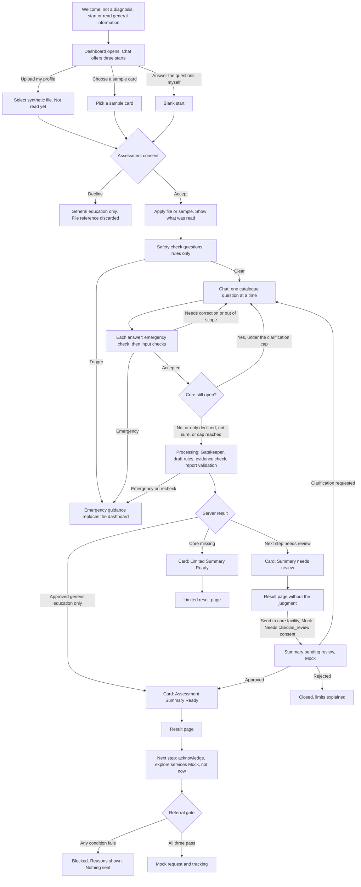

# Sanad: UX flow (session dashboard with chat)

Status: **PROPOSED v0.3 (2026-11-08)**. Not reviewed. Follows [BRD v0.4](Sanad_AetherHealth_BRD_v0.4.md), [PRD v0.4](Sanad_AetherHealth_PRD_v0.4.md), the [referral-flow product spec](referal-flows/product-spec.md) and [AGENTS.md](../AGENTS.md).

- This file is not in the AGENTS.md "where the truth lives" table. Where it conflicts with the BRD, PRD or product spec, those documents win. The conflicts already known are listed in §11.
- The session dashboard (§3) changes the patient route model in product-spec §5. It cannot be built until the spec changes in §11 are made and reviewed.
- All clinical wording, thresholds, triage labels and emergency copy stay `CLINICAL_TBD` until a clinician signs them off.

Sanad screens and navigates. **It does not diagnose.** Every result view says "Screening, not diagnosis".

| Version | Date | Change |
|---|---|---|
| 0.1 | 2026-11-08 | First draft: chat to summary. |
| 0.2 | 2026-11-08 | Adds the session dashboard that hosts the chat. Aligns with BRD/PRD v0.4 and the product spec: start order, five consent scopes, action codes instead of colours, no response times, honest assistant label, the review request step and the current task IDs. Updates open decisions. |
| 0.3 | 2026-11-08 | Adds the reference dashboard screenshot as a wireframe with a widget-by-widget mapping (§3.5). Redraws §3.1 in the same card grid. |

## 1. The idea in one paragraph

After a short welcome, the user works in a **session dashboard**. The centre of the dashboard is a chat. Its first message offers three ways to start: upload a synthetic profile, choose a sample card, or answer the questions directly. After consent and the safety check, the assistant asks questions from the approved catalogue one at a time, explains briefly when needed, and records what the user shares. Beside the chat, panels show the steps, what has been recorded, the summary status, privacy settings and optional lab entry. When enough information is in, the assistant stops asking. The server then runs Gatekeeper, draft clinical rules, the evidence check and report validation. A result card appears in the chat, and its button opens a separate result page. Emergency signs interrupt everything at any moment and replace the whole dashboard.

## 2. Design rules for this flow

1. **The chat presents the approved question catalogue. It is not a free diagnostic conversation.** The assistant never invents a clinical question and never gives a diagnosis or treatment advice (BR-09).
2. **The assistant label is honest.** No model is in the current flow, so assistant messages are labelled "Sanad assistant" with the note "Scripted questions from a draft catalogue". The words "AI" or "AI assistant" are used only when a model task actually produced the text. The product spec drops the `AI-generated draft` label for the same reason (RF-11).
3. **Emergency first.** Every answer and upload passes the emergency check before anything else. A hit shows emergency guidance at once. It does not wait for the chat to finish, a model or a clinician (BR-06, BR-45).
4. **Rules decide, text explains.** Clinical numbers and the triage action come from versioned code and catalogues. Wording comes from approved or draft-labelled copy.
5. **Nothing unreviewed is released.** If the next step needs clinician review, the judgment and the step-specific next step stay hidden until an approval exists (BR-14, AC-08.9).
6. **Unknown stays unknown.** "Not sure", "Prefer not to say" and "Skip" are always available and never become "No" (BR-03).
7. **The server decides what the dashboard shows.** Every panel renders from the case state that the API returns. Hiding or disabling a panel is presentation only. Every action is checked again on the server (AGENTS.md rule 1, RF-04).
8. **Everything simulated is labelled Mock.** No element looks confirmed by a provider or a clinician unless a real confirmation exists.
9. **No answers in browser storage.** Answers live on the server for the session only. No localStorage or IndexedDB for health data. Quick Exit clears all on-screen and in-memory state (RF-09).
10. **No account, no push notifications, no reminders by default** (BR-18, BR-32).

## 3. Session dashboard

The dashboard is the patient's workspace for one session. It replaces the separate safety, intake and lab screens with one layout. It is a **patient** view and is separate from the Clinician Dashboard (PRD Screen 7) and the Evaluation Dashboard (PRD Screen 9).

### 3.1 Desktop layout

The layout borrows the card grid of the reference screenshot (§3.5): a left rail, one large card and narrower cards beside it. Only the layout is reused.

```text
+--------------------------------------------------------------------------------------+
| Sanad   Screening, not diagnosis    [EN | AR]    Is this an emergency?  [Quick exit] |
| Sample profile, not a real person  ·  Draft rules, not clinically approved           |
+---------------+----------------------------------------------------------------------+
| YOUR SESSION  | +-------------------------------+ +--------------+ +---------------+ |
|               | | CHAT                          | | SUMMARY      | | WHAT YOU'VE   | |
| ✓ Consent     | | Sanad assistant               | | Not ready yet| | TOLD US       | |
| ✓ Safety check| | Scripted, draft catalogue     | |              | | Core questions| |
| ● Questions   | |                               | +--------------+ |  6 of 9 done  | |
| ○ Summary     | | Have you ever used anabolic   | | LAB RESULTS  | |               | |
| ○ Next step   | | steroids?                     | | Optional     | | Age ...... 24 | |
|               | | [Yes, now] [Yes, in the past] | | [Add]        | | BMI ...... 31 | |
|               | | [No] [Not sure]               | +--------------+ | Steroids:     | |
|               | | [Prefer not to say]           | | PRIVACY      | |  needs your   | |
|               | | (i) Why we ask                | | Assessment on| |  confirmation | |
|               | |                               | | Review off   | | Smoking:      | |
|               | |                               | | [Review or   | |  prefer not   | |
|               | | Buttons and numbers only      | |  revoke]     | |  to say       | |
|               | |                               | |              | | Sleep: skipped| |
|               | +-------------------------------+ +--------------+ +---------------+ |
|               | +------------------------------------------------------------------+ |
|               | | NEXT STEP   Not available yet. Opens when guidance is released.  | |
|               | +------------------------------------------------------------------+ |
+---------------+----------------------------------------------------------------------+
```

The values in the sketch are synthetic examples. The Next step card shows no case data until guidance is released.

### 3.2 Panels

| Panel | What it shows | When it is active | Actions | Spec |
|---|---|---|---|---|
| **Top bar** | Name "Sanad", "Screening, not diagnosis", language switch, emergency link, Quick Exit. A banner for sample profiles and draft rules. | Always, on every state and error screen | Switch language, open `/urgent.html`, Quick Exit | RF-05, RF-09, AC-05.8 |
| **Chat** (centre) | Start options, consent card, safety questions, catalogue questions, lab form, status lines, result card | Input open in `CONSENTED`, `ASSESSING` (no draft yet), `NEEDS_INFORMATION`, `REVISION_REQUIRED`. Read-only in every other state. | Answer, skip, correct a recorded fact | RF-06, RF-10 |
| **Your session** (steps rail) | Consent, Safety check, Questions, Summary, Next step, each marked done, current or not yet | From consent onwards | None. It is a display of the server state. | RF-04 |
| **Summary** | Status: Not ready yet, Limited summary, Needs review, Pending review (Mock), Ready, Closed | From consent onwards | Open the result page when the state allows it | RF-07, RF-11 |
| **Lab results** (optional) | Manual entry: value, unit, date, source, with a confirmation preview | `ASSESSING` before a draft exists | Add, edit, confirm, remove | RF-15 |
| **Privacy** | Which consent scopes are on | From consent onwards | Opens `/privacy` to review or revoke | RF-03 |
| **What you've told us** (right) | Each recorded item with its state and source, grouped by section | From consent onwards | Edit an item. Editing reopens that question in the chat. Offered only in states where the server accepts answers; otherwise read-only, with a one-line reason. | RF-06, PRD-FR-17 |
| **Next step** | Allowed next step, mock services, self-reported progress, mock referral tracking | From `GUIDANCE_AVAILABLE` onwards | Acknowledge, explore services (Mock), not now, report progress or a barrier | PRD-FR-24 to 28, RF-12, RF-14 |

Item states in "What you've told us": Answered, Not sure, Prefer not to say, Skipped, Conflicting, Needs your confirmation. Each item also shows its source: You, Uploaded file (unverified), or Sample profile. Past and current facts are shown separately ("Used in the past", "Using now").

The "Core: n of m done" line counts core questions that have any response, including Not sure and Prefer not to say. It measures the questionnaire, not health. Which questions are core is open (TBD-24). Until it is decided, the catalogue's `required` field is used.

### 3.3 Mobile layout

- The chat fills the screen. The top bar keeps the emergency link and Quick Exit visible at all times.
- Below the top bar, a slim line reads "Core: n of m done". Tapping it opens "What you've told us" as a bottom sheet.
- A "Session" button opens a sheet with the steps rail, summary status, lab entry and privacy.
- The Next step panel opens as a full screen when guidance is available.

### 3.4 Dashboard rules

- Panels show only what the current case state allows. A panel for a later step shows "Not available yet" and no case data. This restates product-spec §5.1 ("current state's content only") for a multi-panel layout and needs the spec change in §11.
- An action sent out of order returns `409 INVALID_TRANSITION`. The dashboard then re-reads the state and redraws. It never guesses the next state.
- On reload, the dashboard returns to the same step with its data (AC-04.1). The chat history is rebuilt from the recorded answers and the catalogue. No separate transcript is stored (proposed, see §10).
- No panel shows a score, percentage, gauge, ring or organ widget about health. Step and question counts are the only counts.
- The tab title is "Sanad" in every state (AC-09.8).

### 3.5 Reference screenshot and what Sanad takes from it

The team's reference is a screenshot of a third-party commercial medical admin template. The screenshot is not stored in this repository. It has its own branding and artwork, a stock photo of a person and a sample diagnosis. The wireframe below records its layout only. The numbers match the table.

```text
+---------------+----------------------------------------------------------------------+
| Logo + name   | [2] [=] [Search ..........]     User name, ADMIN  [photo] [o] [o]    |
+---------------+----------------------------------------------------------------------+
| [1] Dashboard | +-[3]-------+ +-[4]----------------+ +-[5]----------+ +-[7]--------+ |
|   Patients    | | Lungs  90%| | Body composition   | | Patient card | | Calendar   | |
|   Doctor      | | Stomach99%| |                    | | [photo]      | | month view | |
|   Hospital    | | Liver  95%| | (donut chart of    | | name         | | booked slot| |
|  Appointments | | Heart  89%| |  element %s)       | | last check-in| | highlighted| |
|  Patients   > | | Brain  85%| |                    | | sex, age,    | +-[8]--------+ |
|  Reports      | |           | | (anatomy figure)   | | department   | | Appointment| |
|  Doctors    > | |           | |                    | +-[6]----------+ | type, date,| |
|               | +-[9]------------------------------+ | Latest       | | clinician  | |
|  COMPONENTS   | | Bar chart, Jan to Dec            | | diagnosis:   | | name       | |
|  Features   > | | (calories)                       | | condition    | | [report]   | |
|  Forms      > | |                                  | | [History ->] | +-[11]-------+ |
|  Charts     > | |  |  |   |    | |  ||  | |  |     | +-[10]---------+ | Checkup    | |
|  Apps       > | |  |  |   | |  | |  ||  | |  |     | | Progress     | | card, date,| |
|  Auth       > | |  |  | | | |  | |  ||  | |  |     | | gauge 85%    | | clinician, | |
|  Misc       > | |                                  | |              | | trend line | |
|               | +----------------------------------+ +--------------+ +------------+ |
+---------------+----------------------------------------------------------------------+
```

| # | Reference widget | In Sanad | Why |
|---|---|---|---|
| 1 | Sidebar menu of admin sections (patients, doctors, hospital, reports) | Patient view: the "Your session" steps rail. A section menu suits the Clinician portal (PRD Screen 7), not the patient. | The patient has one case on one path, and the server holds the step (RF-04). |
| 2 | Top bar with search, user name, role, avatar and icons | Top bar with "Sanad", "Screening, not diagnosis", language, emergency link and Quick Exit. No search, name or avatar. | No account and no identifiers (BR-18, AGENTS.md rule 9). Emergency link and Quick Exit on every screen (RF-05, RF-09). |
| 3 | Organ cards with percentages | Dropped. "What you've told us" lists recorded items with their state. | They imply measurements Sanad does not make (AGENTS.md rule 8, §8). |
| 4 | Body composition donut and anatomy figure | Dropped. This slot holds the chat. | No body-composition measurement exists, and BMI is never read on its own (BR-04). |
| 5 | Patient card: photo, name, sex, age, department, last check-in | The top banner says where the data came from: "Sample profile, not a real person" or "Uploaded file, unverified". Age appears only in "What you've told us". | No names, photos or identifiers (rule 9). No camera (rule 13). |
| 6 | Latest diagnosis card with a history button | Summary card: Not ready yet, Limited summary, Needs review, Pending review (Mock), Ready or Closed, with "View My Summary" when the state allows it. | No diagnosis (rule 8). Unreviewed judgment stays hidden (BR-14). |
| 7 | Calendar with a booked slot | Dropped. | No booking in the MVP. Appointment intent is P1 and Mock (PRD-FR-16). No reminders (BR-32). |
| 8 | Appointment card: therapy type, date, clinician name, report file | Next step card: the allowed next step and mock services labelled **Mock**. | No real provider or clinician names (AGENTS.md). Nothing simulated looks real (rule 6). |
| 9 | Calories bar chart | Dropped. | No health tracking or wearables in scope (BRD §8.2). |
| 10 | Monthly progress gauge (85%) | The text line "Core questions: 6 of 9 done", which counts questions only. | No gauges or rings that look like health measurements (§8). |
| 11 | Checkup card with clinician and trend line | Mock referral tracking in the Next step card, with the delayed flag (RF-14), labelled **Mock**. No trend lines. | No verified care and no `CARE_COMPLETED` (rule 7). |
| — | Template options: dark mode, multi-colour, RTL ready | Light theme (§8). RTL mirrored layout if Arabic is in the demo (§10, decision 3). | Visual guidance in §8 |

What Sanad keeps: a fixed top bar, a left rail, a grid of cards with clear titles, generous spacing and at most one primary button per card.

## 4. Flow at a glance



## 5. Step by step

### Step 0. Welcome

- One short page before the dashboard (PRD Screen 1). It says what Sanad is, that it is a research prototype with synthetic data only, "Screening, not diagnosis", what is stored and for how long.
- Buttons: **Start private assessment** and **Read general information**. Language switch. No login, name, phone or email. No appointment required (AC-02.1, BR-18).
- The emergency link ("Is this an emergency?") and Quick Exit are visible here and on every later screen. The emergency link opens `/urgent.html`, which works offline after the first load.

### Step 1. Choose how to start (first chat message)

The first chat message offers three options as large buttons. No case exists until the user picks one.

| Option | What happens |
|---|---|
| **Upload my profile** | The user selects a synthetic JSON file that follows the closed upload schema. A template is offered for download. The file is not read or sent until assessment consent is granted (AC-02.3). The upload area says "Do not upload real health data". |
| **Choose a sample card** | The synthetic scenario cards appear (for example J1, J3, J4, J5). The user picks one. A banner says "Sample profile, not a real person". |
| **Answer the questions myself** | Blank start. The chat asks every question (AC-02.1). |

Each choice creates a `DRAFT` case with a random `case_id` and opens the consent card (AC-02.2).

Rules:
- Uploaded content is **data, not instructions**. Instruction-like text in a field is treated as ordinary data and ignored (BR-41).
- After consent, uploaded values carry `source: USER_UPLOADED` and `verification_status: UNVERIFIED` (AC-02.4). Sample values are shown as "From sample profile". Nothing is shown as verified by a clinic.
- The chat shows a short summary of what was read and asks the user to confirm or edit it. Unclear values are marked "Needs your confirmation".
- A rejected file (not JSON, over 256 KB, fails the schema, extra fields, or no `is_synthetic: true`) gets a plain message naming the rule broken. The message repeats none of the file's content, and nothing is stored (AC-02.5). The chat then offers a sample card or a blank start.
- FHIR Bundle upload is out of scope. FHIR is a conceptual mapping only (AGENTS.md rule 17).

### Step 2. Consent

- Consent is shown as a full card in the centre panel, not as a chat bubble, so every scope is readable.
- It lists all five scopes from BR-02 and `catalogue/consent-0.1.json`: `assessment`, `clinician_review`, `provider_share`, `spouse_share`, `research_use`. Each scope says what it covers, what it is used for, who sees it, and what happens if it stays off. Scopes this flow does not use say so (AC-03.1).
- Only `assessment` is asked for now. The others start off and are asked later, only when needed, one purpose per prompt (AC-03.4).
- The upload and the sample profile are covered by `assessment`. There is no separate `profile_import` scope (see §11).
- **Decline**: the case moves to `EDUCATION_ONLY` and the user sees general education only. Any selected file reference is discarded (AC-02.6). Emergency guidance stays available.

### Step 3. Safety check

- Right after consent, and before any other question, the chat asks the safety questions from the versioned emergency catalogue. The chat says they are a simulated draft, not clinically approved (AC-10.1).
- A trigger moves the case to `EMERGENCY_GUIDANCE_ISSUED` and opens emergency guidance at once (§7).
- If the API cannot be reached, a positive answer still shows guidance from the browser check. A negative answer offers a retry and the emergency link, and never says "all clear" (AC-10.3).
- A sample or uploaded profile that contains a trigger has the same effect (AC-10.6).

### Step 4. Chat and progress

**Chat behaviour**
- One question at a time, from the approved catalogue. Choice buttons and number fields only. The current API accepts no free text (see §10, decision 6).
- Every question offers **Not sure** and **Prefer not to say**. The optional wellbeing questions can be skipped in one tap.
- Short "Why we ask" help comes from approved or draft-labelled copy only.
- The assistant may repeat a recorded fact back so the user can correct it ("I noted: you used steroids in the past, not now. Is that right?"). Past and current facts stay separate (PRD-FR-17).
- The assistant never says what an answer means clinically during the chat.

**Optional wellbeing** (PRD-FR-29/30, T4.1)
- At most three questions, about stress, sleep and worry, asked after the core questions. Each has Skip, Prefer not to say and Not sure, and a one-line reason for asking.
- Answers are stored as `PATIENT_REPORTED` and `UNVERIFIED`. They never enter triage rules and never change the next step (AGENTS.md rule 15).

**Conflicting answers**
- If two values disagree (for example the profile and the chat), both are kept and marked "Conflicting". The system picks neither. The user may resolve it or decline (AC-06.3).

**When the assistant stops asking**
- Every core item has a response, **or** the user declined it, **or** the clarification cap (`max_clarifications`, engineering default 2, `TECH_TBD`) is reached.
- Unanswered and Conflicting items block continuing. Declined and Not sure items do not (AC-06.5).
- Missing optional items only show a small note. They never block.
- The assistant says what happens next ("I'll check your answers now"), and the chat input closes while processing.

**Lab results (optional)** (RF-15, T3.7)
- A small form in the chat or the Lab results panel: value, unit, date, source, then a confirmation preview.
- A value with a missing or unclear unit is held as "Needs your confirmation" and is not used until confirmed. Report file upload or OCR is a later, optional path (FR-13, P2).

### Step 5. Safety checks on every input

Order for each answer, edit or upload:

1. **Emergency check, stage 1** on structured answers (S0). If free text is added later, **stage 2a** keyword and pattern checks run on the text (S0b). Code only, no model.
2. **Input checks** (format, range, length, scope). Results: accepted, needs correction, out of scope. Emergency checks run first, so an out-of-scope answer can still trigger emergency guidance (AC-IG-04).
3. After facts are recorded, **stage 2b** re-checks the recorded facts (S1).

An emergency hit at any step beats every other result. The input guardrail and stage 2a/2b are `PROPOSED` (BR-41/42, PRD-FR-35) and have no task in the implementation plan yet.

### Step 6. Processing

- A short, honest status line replaces the input: "Checking your answers", then "Applying draft rules", then "Preparing your draft summary". No fake progress percentages.
- Behind it, in order: Gatekeeper (completeness, conflicts, units, provenance), draft clinical rules (risk signals and rule floor), evidence check (cited source, or "not enough evidence" when none), report validation (every claim has a source or an uncertainty label; nothing below the rule floor; consent and review status checked).
- In the current build the evidence step abstains: claims show "insufficient evidence" (AC-11.4).
- If processing fails or the API is down, the chat says so and offers a retry. It never shows made-up content.

### Step 7. Result card in the chat

The card appears once in the chat. The Summary panel shows the same status.

| Server result | Card | Button |
|---|---|---|
| `REPORT_RELEASED` (approved generic education, or after an approved review) | **Assessment Summary Ready** | View My Summary |
| `LIMITED_REPORT` / `NEEDS_MORE_INFORMATION` | **Limited Summary Ready**, with one line on what is missing | View My Summary |
| Draft exists and the next step needs review | **Summary needs review**, with one line on what review means | View what's available |
| `PENDING_CLINICIAN_REVIEW` | **Summary pending review (Mock)** | View what's available |
| `REJECTED` | **Summary closed**, with one line on the reason and the limits | View what's available |
| `EMERGENCY_GUIDANCE_ISSUED` | No card. Emergency guidance replaces the dashboard (§7). | None |

Every card repeats "Screening, not diagnosis". Which next steps need review is decided by the server. PRD §4.7 releases without review only for approved generic education, and the full list is open (TBD-07).

### Step 8. Result page

A separate page opened from the card. Desktop layout: a left summary column (status, review status, Quick Exit, emergency link) and one card per section. Mobile: the sections stack in this order. The section names follow PRD Screen 6.

1. **What you told us** (observed information). Each recorded item with its source and state. Skipped and declined items are listed as such and never shown as "No". The user can go back and fix an item while the server still accepts answers.
2. **About your values.** Each value with unit, date and source, and what a single value can and cannot show. A value is compared with a reference range only if the range is in the versioned catalogue and reviewed. Otherwise the page says "No reviewed reference range in this prototype". No conclusion comes from a single BMI, habit or lab value (BR-04, BR-05).
3. **Signals and what is unclear.** Risk signals from the draft rules, each with its rule ID and the label "Draft rule, not clinically approved". A separate list of unknown, declined and conflicting information. Missing information is never shown as low risk.
4. **Context you chose to share.** Optional wellbeing answers, if any, labelled "Self-reported. Not used to choose your next step."
5. **Limits and sources.** What this screening cannot tell. Source title and version for each claim. A claim with no source is shown as "not enough evidence" or not shown.
6. **Review status.** Not reviewed, Pending review (Mock), Simulated approval (not clinically approved), or Rejected with reason. Simulated review always carries the Mock label (AC-08.3).
7. **Your allowed next step.** Shown only after release. One clear step from the table below, with the entry to Mock Care Navigation.

Always on the page: Quick Exit, the emergency link, and "Screening, not diagnosis". The page title is "Draft, generated from draft rules" until a review approves it (RF-11).

**When review is needed but not done**, sections 6 and 7 change: the page shows "Pending review" or "Needs review" and hides the judgment and the step-specific next step (AC-08.9). Before the case is sent, the page offers **Send to care facility (Mock)**, with the helper text *A reviewer at a mock facility checks this first. Nothing goes to a real clinic.* (RF-07). That button asks for `clinician_review` consent if it is off. Declining sends nothing, and the page stays as it is (AC-07.2).

**Next-step wording.** The action codes come from `rules/triage.draft-0.1.json`. The draft wording is that file's `action_labels`, all `CLINICAL_TBD`. No time frame or response time is shown for any step. BRD §9.1 forbids a hard-coded SLA, and any clinically meaningful time needs human approval (AGENTS.md). The Red/Orange/Yellow/Blue/Green names are legacy planning terms ([harness.md](harness.md)). They are not shown to users and are not used as colour codes for the level.

| Action code | Draft wording (`CLINICAL_TBD`) | Where it appears | Review before release |
|---|---|---|---|
| `EMERGENCY_GUIDANCE` | "Seek emergency help now." | Emergency page, at once. Never on this page. | Never awaited |
| `PRIORITY_REVIEW` | "Arrange a prompt assessment with a health professional." | Result page, after release | Server decides (TBD-07) |
| `SPECIALIST` | "Consider a specialist men's health service (andrology)." | Result page, after release | Server decides (TBD-07) |
| `PRIMARY_CARE` | "Consider advice from a primary care service." | Result page, after release | Server decides (TBD-07) |
| `EDUCATION` | "General health information." | Result page | Not needed only when the education content is approved (PRD §4.7) |
| `NEEDS_MORE_INFORMATION` | "There is not enough information to suggest a next step. More information or a professional review is needed." | Limited summary | Not a level and never low risk (BR-44) |

**Page actions.** "I have read this" (acknowledge), "Not now" (defer or close), and the navigation entry. None of them is required, and none triggers a reminder. "Save a private summary" (PRD Screen 6) waits for decision 7 in §10.

### Step 9. Next step (all Mock in the MVP)

- **Acknowledge** and **Not now** are on the result page and in the Next step panel. Acknowledging records a system event only. It does not mean the user understood the guidance or saw anyone (BR-27).
- **Care navigation**: "Explore services" shows mock services from the mock directory, each labelled **Mock**.
- **Self-reported progress** (optional): "I am looking", "I booked (self-reported)", "I attended (self-reported)", "Unable to proceed". Each is labelled "Self-reported, not verified by a clinic" (BR-29).
- **Barriers** (optional): a fixed list (privacy concern, language, cost, service unclear, schedule, not ready, other, prefer not to say), multi-select, no free text. A barrier shows non-clinical support: privacy explanation, language switch, service information, defer. It never changes the next step (BR-30, BR-31).
- **Referral**: only through the referral gate (RF-12). It needs `provider_share` consent, an approved and unexpired review that matches the report version, and backend authorisation. If any is missing, the user sees a plain reason and nothing is sent. The request is labelled "Mock request", and tracking shows mock facility events with a delayed flag (RF-14), each labelled **Mock**.
- Progress and barrier data are deleted at session end or expiry (CC-010, `PROPOSED`).
- Nothing is shown as "confirmed by the provider" in the MVP, and no code path writes `PROVIDER_VERIFIED` or `CARE_COMPLETED`.

## 6. Chat message types

| Type | Used for | Notes |
|---|---|---|
| Start options | Upload, sample card, answer myself | First message only |
| Consent card | `assessment` now; other scopes when needed | Full card, one purpose per prompt |
| Safety question | Emergency catalogue questions | Labelled simulated draft |
| Assistant question | One catalogue question with buttons or a number field | Always includes Not sure and Prefer not to say |
| Recorded fact echo | Confirm what was understood | The user can correct it |
| Assistant note | Short "why we ask" help | No clinical meaning given |
| Lab entry form | Optional manual lab values | Confirmation preview before use |
| System notice | Needs correction, out of scope, file rejected, service down | Plain language, no error codes |
| Status line | Processing steps | Replaces the input while processing |
| Result card | Ready, limited, needs review, pending, closed | Appears once, links to the result page |
| Emergency takeover | Emergency guidance | Replaces the whole dashboard |

## 7. Special cases

| Case | What the user sees | Rule behind it |
|---|---|---|
| **Emergency sign** (any answer, upload or stage) | Emergency guidance (`/urgent.html`) replaces the whole dashboard at once. The chat closes. It shows the emergency number and the draft wording, with the label "Draft guidance for a research prototype, not clinically approved". It asks no more questions and works offline. | Emergency check runs first, no model, wins over everything (BR-06, RF-05, RF-10) |
| **Missing data** | Limited Summary: sections 1, 2 (for values that exist), 3 (with the list of what is unclear), 5 and 6. Next step reads "Complete the missing information to get a full summary", and the user may decline. | `NEEDS_MORE_INFORMATION`. The level is never lowered and never treated as low risk (BR-44). |
| **Review needed or pending** | The card says review is needed or pending. The page shows section 1 and general explanations, and hides the judgment and the step-specific next step. No time promise is shown. Review in the MVP is simulated and labelled Mock. | Unreviewed judgment is not released (BR-14, AC-08.9) |
| **Clarification requested by the reviewer** | The chat reopens with only the questions the reviewer asked about. | AC-08.8 |
| **Review rejected** | The summary is closed, with the reason and the limits. | `REJECTED`, AC-08.4 |
| **Needs correction** | The assistant explains what to fix ("That number looks out of range. Can you check it?") and asks again. Safety checks run again on the corrected answer. | Input checks, PRD-FR-35 |
| **Out of scope** | The assistant says it cannot help with that here and returns to the current question. Only after the emergency check is clear. | AC-IG-04 |
| **Instruction-like text** ("ignore the rules") in a file | Treated as ordinary data. The flow continues. | BR-41, AC-IG-03 |
| **User declines a core question** | The assistant accepts and moves on. The item shows "Prefer not to say". | `DECLINED` stays declined |
| **Clarification cap reached** | The assistant stops asking about that item and continues. | `max_clarifications` |
| **Conflicting values** | Both values are shown as "Conflicting". The user resolves or declines. | AC-06.3 |
| **File rejected** | A plain message naming the rule broken, then the offer of a sample card or blank start. | AC-02.5 |
| **Consent revoked mid-way** | The next action is blocked. `/privacy` explains what stopped and what stays. | Consent checked on the server at every call (AC-03.5) |
| **Action out of order** (old tab, Back button, stale panel) | The dashboard redraws from the server state. Nothing changes. | `409 INVALID_TRANSITION`, AC-04.2, AC-04.3 |
| **Reload** | Same step, same data. | AC-04.1 |
| **Session expired or ended** | The start screen, with no case data. | AC-04.7 |
| **API unreachable** | The chat says so and offers a retry. The emergency link and Quick Exit keep working. | api-design error handling, AC-10.3 |
| **Quick Exit** | One tap, no confirmation. All on-screen and in-memory state is cleared before any network call. The tab goes to a neutral page, and Back shows no case data. | RF-09 |
| **Offline** | The emergency page still loads after the first online load. Health API calls are never cached and show a clear offline message. | RF-05, AGENTS.md rule 11 |

## 8. Visual guidance

- Calm, neutral, clinical. Light theme, high-contrast text, large touch targets, clear focus states, full keyboard use.
- The dashboard and result page may use a dashboard-style layout: a left summary column and cards. The reference screenshot (a commercial admin template) is a layout idea only; §3.5 lists what is kept and what is dropped. Do not copy its branding, icons, photos or illustrations, and do not use its organ-percentage, body-composition, diagnosis or gauge widgets, which imply measurements and conclusions Sanad does not make.
- No scores, percentages, gauges or progress rings that look like health measurements. Show recorded values and plain labels.
- Do not colour-code triage levels as a traffic light. The action wording carries the meaning.
- Every simulated element uses the shared Mock badge.
- Arabic means a mirrored layout, including the dashboard panels, not only translated text.
- The manifest name and tab title are the neutral name "Sanad".

## 9. Where each part maps in the specs

Task IDs are from the [implementation plan](referal-flows/implementation-plan.md). The older `T-nn` IDs in harness.md are not used here.

| UX part | PRD / BRD | Product spec | Task |
|---|---|---|---|
| Session dashboard layout | PRD Screen 4 ("cards / chat + structured progress") | None yet (§11) | None yet |
| Welcome, start choice, upload | PRD-FR-01, BR-18 | RF-02 | T1.7, T1.10 |
| Consent and privacy panel | PRD-FR-02, BR-01/02 | RF-03 | T1.8 |
| Step memory and order guard | PRD §4.7 | RF-04 | T1.5, T1.6 |
| Emergency page and safety check | PRD-FR-03, BR-06 | RF-05, RF-10 | T1.9, T2.1 |
| Chat questions, declined states | PRD-FR-04 | RF-06 | T2.2 |
| Optional wellbeing | PRD-FR-29, PRD-FR-30 | None | T4.1 |
| Facts, past and current kept apart | PRD-FR-17 | RF-11 | T2.3 |
| Input guardrail, missing-data tiers (`PROPOSED`) | PRD-FR-35, PRD-FR-36 | None | None yet |
| Gatekeeper, rules, draft result page | PRD-FR-05, 06, 08 | RF-11 | T2.3, T2.4, T2.5 |
| Evidence | PRD-FR-07 | RF-11 (AC-11.4), RF-16 | T2.5, T3.8 |
| Send for review, clinician review | PRD-FR-09 | RF-07, RF-08 | T2.6, T2.7 |
| Quick Exit | PRD-FR-11, NFR-08 | RF-09 | T2.8 |
| Referral gate, mock facility, tracking | PRD-FR-10 | RF-12, RF-13, RF-14 | T3.1 to T3.5 |
| Acknowledge, progress, barrier, defer | PRD-FR-24 to PRD-FR-28 | §3.3 (outside M1–M3) | T4.2 |
| Lab entry | PRD-FR-12 | RF-15 | T3.7 |
| Mock labels | BR-11 | RF-17 | T2.6, T3.9 |
| Arabic and RTL | PRD-FR-11 | Out of scope (§3.2) | None |

## 10. Open decisions

| # | Decision | Recommendation | Owner |
|---|---|---|---|
| 1 | Adopt the session dashboard as the patient layout for consent → safety → questions → lab? | Yes, after the spec changes in §11 | Product + Frontend |
| 2 | Assistant label while no model is in the flow | "Sanad assistant · Scripted questions from a draft catalogue" | Product + UX |
| 3 | Is Arabic and RTL part of the demo? The BRD P0 scope says yes for key screens, PRD-FR-11 is Should, and the product spec excludes it. This affects the dashboard, the result page and the emergency page. | Raise with the BRD owner; the BRD wins | Product |
| 4 | Which general explanations may the pending-review page show? | Needs clinical sign-off | Clinical advisor |
| 5 | Wording of every next step, level label and emergency text | Stays `CLINICAL_TBD` | Clinical advisor |
| 6 | Free text in the chat. Needs the input guardrail and emergency stage 2a/2b on the backend, and an API change (the API accepts fixed choices and numbers only). | Choice buttons and number fields only until those exist | Backend + Clinical |
| 7 | "Save a private summary": format, and whether a file that leaves the app's control fits the data policy (Quick Exit cannot clear it) | Decide before building; data-policy change control | Product + Security |
| 8 | Which questions are core, and the value of `max_clarifications` | TBD-24 | Clinical + UX |
| 9 | Which actions are released without review | TBD-07 | Product + Clinical |
| 10 | Rebuild the chat history from answers instead of storing a transcript | Yes, keeps data minimal | Backend + Security |

Settled by existing specs (were open in v0.1): the blank start exists (AC-02.1); lab entry is in scope for this flow (RF-15, M3); the upload is closed-schema synthetic JSON (RF-02); the upload is covered by `assessment` consent (BR-02).

## 11. Spec changes needed before building

AGENTS.md requires spec first. These changes are needed before the dashboard is built. None is made by this file.

1. **Product spec, implementation plan and test plan.** Add a requirement and a task for the session dashboard. Restate §5.1 "current state's content only" and the §5.2 state-to-route table for a multi-panel layout (for example one `/session` route hosting the safety, intake and lab panels, with `/result`, `/referral`, `/tracking` and `/urgent.html` unchanged). Add test cases equivalent to AC-04.2 for panels and actions. Add a change-log version entry. This affects the existing `SafetyScreen`, `IntakeScreen` and `StepProgress` in `apps/web`.
2. **Consent scopes.** harness.md (HR-07) and v0.1 of this file use a `profile_import` scope that BR-02 and `consent-0.1.json` do not have. If the team wants it, it needs a change-control record. This file uses the five BR-02 scopes.
3. **Free text in the chat.** Needs tasks for PRD-FR-35 and BR-42 stages 2a/2b, an api-design change, and a data-policy record for storing and logging free text.
4. **Question catalogue.** Needs `criticality` (CORE/NON_CORE), `max_clarifications`, a display `section` and "why we ask" copy. It has `required` only today.
5. **harness.md.** Uses legacy `T-nn` task IDs, Red/Orange/Yellow/Blue/Green names and `profile_import`. It is outside the truth table, but it should be aligned or marked as legacy to avoid more drift.

## 12. Acceptance checks for this flow

- A user can finish J1 from the welcome page through the dashboard to the result page without an account.
- A message or upload that matches an emergency trigger shows emergency guidance at once, with no model involved. The guidance replaces the whole dashboard, and the chat closes.
- A skipped or declined answer is never shown as "No" in the panel or on the result page.
- A case with a missing core answer opens a Limited Summary and never shows a lower level.
- A case that needs review shows no judgment and no step-specific next step until an approval exists.
- No result is shown unless every claim has a source or an uncertainty label.
- No dashboard panel shows a health score, percentage, gauge or time promise.
- Every panel shows only what the server state allows. An out-of-order action changes nothing.
- A referral can be requested only through the referral gate, and the request is labelled Mock.
- Quick Exit clears the dashboard, the chat and the result page, and nothing health-related stays in browser storage.
- Everything simulated carries the Mock label, and no assistant message is labelled "AI" while no model produced it.
