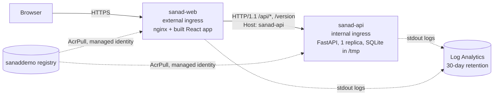

# Sanad on Azure Container Apps — Deployment Record and Lessons Learned

**Recorded:** 2026-11-15 (drafted by Claude Code)  
**Status:** `TECH_TBD`. This records one manual deploy of the synthetic demo. It is not the deploy-on-merge that AC-01.4 asks for, and it does not decide the deploy target (OD-05, owner: Tech Lead).  
**Task:** T1.4 (AC-01.4, TC-01.4). How-to steps live in the [RUNBOOK](../RUNBOOK.md#deploy-to-azure-container-apps-manual); service and region guidance in the [Azure service guide](azure-service-guide.md).

Sanad is a research prototype, not a medical device. The hosted demo holds synthetic data only. Hosting it on Azure says nothing about clinical safety, validity, interoperability or legal compliance, and a working deploy is not evidence of any of those.

## 1. What we deployed

The Azure service guide (§2) names App Service Linux as the first candidate and Container Apps as the alternative. The team chose Container Apps because it wanted container-based releases.



All resources are in resource group `sanad-demo-rg`, region **UAE North**:

| Resource | Name | Settings as deployed |
|---|---|---|
| Container registry | `sanaddemo` | Standard tier, created in the portal. Admin user off; RBAC registry permissions; public network access on. |
| Container Apps environment | `sanad-env` | Consumption profile. Logs go to Log Analytics. |
| Log Analytics workspace | `workspace-sanaddemorg…` | Created automatically by `az containerapp env create`. PerGB2018, 30-day retention (the default, not a reviewed choice). |
| API app | `sanad-api` | Image `sanad-api:c2cda0c`. Internal ingress, target port 8000, insecure HTTP allowed inside the environment. Exactly 1 replica, 0.5 vCPU, 1 GiB. Two secrets (Mock staff passwords). No custom health probes. |
| Web app | `sanad-web` | Image `sanad-web:3a5d4a6-r2`. External HTTPS ingress, target port 80. 1–2 replicas, 0.5 vCPU, 1 GiB. `API_HOST=sanad-api`. No custom health probes. |

Both apps use a system-assigned managed identity to pull from the registry, so no registry password exists. Both use single-revision mode.

Repository files: [`apps/api/Dockerfile`](../apps/api/Dockerfile), [`apps/web/Dockerfile`](../apps/web/Dockerfile), [`apps/web/nginx/default.conf.template`](../apps/web/nginx/default.conf.template), [`.dockerignore`](../.dockerignore).

To find the public address: `az containerapp show -g sanad-demo-rg -n sanad-web --query properties.configuration.ingress.fqdn -o tsv`.

## 2. Lessons learned

### 2.1 The repository shape decides the image shape

- **Build both images from the repository root.** The API reads `rules/`, `catalogue/`, `schemas/`, `data/synthetic/` and `knowledge/passages.v0.1.json` at start-up (`sanad_api/catalogues.py`). Three web pages import `../../../../rules/` and `../../../../catalogue/`. A build context of `apps/api` or `apps/web` fails.
- **A normal `pip install` breaks the repo-root lookup.** `config._repo_root()` walks three folders up from its own file, which works only in a checkout. Installed into site-packages it points to `/usr/local/lib`. The image sets `SANAD_REPO_ROOT=/app`.
- **SQLite lives inside the container.** The API is pinned to one replica, and every restart, redeploy or new revision deletes all cases. That is acceptable only because the data is synthetic and the demo is single-instance (azure-service-guide §3, §7).

### 2.2 The web app and API must share one origin

This was a constraint of the code, not a design preference:

- The client calls the relative path `/api` (`apps/web/src/api/client.ts`).
- The service worker skips API traffic by checking the path `/api/` (invariant 11).
- Quick Exit sends `navigator.sendBeacon('/api/session/end')`.

So nginx in the web container forwards `/api/*` and `/version` to the API, and the API needs no public address. Three details matter:

1. **Proxy with HTTP/1.1.** See §2.3. This was the one production failure.
2. **Set `Host` to the API app name.** The Container Apps router picks the target app by `Host`; passing the browser's host through would reach the wrong app.
3. **Port differs between Azure and local Docker.** In Azure, `http://sanad-api` reaches the environment's router on port 80, which forwards to target port 8000. Plain Docker has no router, so a local test needs `API_HOST=sanad-api:8000`.

Also learned:

- nginx resolves `sanad-api` when it starts and exits if it cannot. **Create the API app before the web app.**
- `--allow-insecure` was set on the API's internal ingress from the start, because nginx speaks plain HTTP inside the environment. We did not test whether it is required.

### 2.3 HTTP 426 on "Start assessment"

| | |
|---|---|
| **Symptom** | Static pages loaded (`/`, `/urgent.html` returned 200). Every request forwarded to the API (`/version`, `/api/openapi.json`, `POST /api/cases`) returned **426 Upgrade Required**, so the start button failed. |
| **Cause** | nginx sends requests upstream as HTTP/1.0 unless told otherwise. The Container Apps router in front of the internal API answers HTTP/1.0 with 426. |
| **Fix** | `proxy_http_version 1.1;` in the proxy block (commit `a392bf2`). After a web-only redeploy, every forwarded route reached the API. The API image did not change. |
| **Why tests missed it** | The local two-container test passed because Docker has no router between nginx and the API. Only a deploy to Azure exercises that hop. |

**Lesson:** a local Docker run proves the images and the nginx rules, not the platform's networking. Always smoke-test the forwarded API routes on the hosted URL after the first deploy.

### 2.4 Cache and fallback rules

- Every API response, including 4xx errors, gets `Cache-Control: no-store` (`always` on `add_header`). nginx removes any upstream `Cache-Control` first.
- `index.html` and `sw.js` get `Cache-Control: no-cache`, so a new deploy replaces the cached shell and service worker (AC-05.6).
- **A missing `/assets/` file must be a 404, not the app shell.** With only the single-page-app fallback, a missing asset came back as `index.html` with status 200. A stale page asking for an old bundle would then get HTML in place of JavaScript, and the service worker's precache could store HTML under an image name without failing. `location /assets/ { try_files $uri =404; }` fixed it.
- `client_max_body_size 2m` sits above the API's own 256 KB upload limit, so oversized files get the API's error code, not an nginx 413 page.

### 2.5 Per-IP rate limits behind two proxies

The API limits new cases and logins per client IP (`sanad_api/auth/rate_limit.py`). Behind nginx, every request would otherwise look like it came from the web container, and all users would share one budget (30 cases and 10 logins a minute).

- nginx takes the client address from the **last** `X-Forwarded-For` entry, which the Container Apps ingress adds (`real_ip_recursive off`). It ignores earlier entries, which a client can forge.
- uvicorn runs with `--proxy-headers --forwarded-allow-ips "*"`. Trusting every forwarder is acceptable only because the API's ingress is internal.
- **Checked locally only.** Ten failed logins from one address returned 401. An eleventh with a forged first entry returned 429, and a different address still got 401. Not yet confirmed on Azure (§4).

### 2.6 Build context, secrets and the registry upload

- `az acr build` uploads the build context to Azure. `apps/api/.env`, which can hold an Azure OpenAI key, exists on developer machines, so `.dockerignore` is a security control here, not just a speed-up.
- **The Azure CLI uses its own `.dockerignore` parser.** We confirmed the exclusions by running the CLI's own packing function locally and listing the archive. No `.env`, `.env.*`, `*.db`, `node_modules`, `.venv` or `.git` entries were included. One difference from Docker: `**/.DS_Store` did not match the file at the repository root, so `.dockerignore` also lists `.DS_Store`. Re-run that check if you change `.dockerignore`.
- `az acr build` builds `linux/amd64` in Azure, so the Apple Silicon development Mac needed neither local Docker nor `--platform` flags.
- The Mock staff passwords were generated on the developer's machine into `apps/api/.env.azure-demo`. That file is readable only by its owner, ignored by Git and excluded from the upload. The passwords are stored as Container Apps secrets referenced with `secretref:` and were never printed or pasted into a chat. Never reuse `run.sh`'s local default password for a hosted demo.
- Secrets are Container Apps secrets, **not Key Vault**. The Azure service guide (§7) asks for managed identity and Key Vault; this deploy covers only the first.

### 2.7 Image tags and `/version`

- `/version` reports the API's `SANAD_COMMIT_SHA` (currently `c2cda0c`). It says nothing about the web image.
- The nginx fix was built before it was committed, so the running web image is tagged `3a5d4a6-r2`, while the fix landed in commit `a392bf2`. The tags no longer identify the exact source.
- **Lesson:** commit first, then build both images from the same SHA and tag them with it. Treat a suffix such as `-r2` as a sign that the build came from uncommitted work.

### 2.8 Account and permissions

- **The Azure CLI login expired** after 90 days of inactivity (`AADSTS700082`). `az account show` still listed the subscription, because it reads only the local cache, but every API call failed. Run `az login` again before a deploy.
- `--registry-identity system` creates an `AcrPull` role assignment for each app, so the person deploying needs **Owner**, or Contributor plus User Access Administrator. With Contributor only, use the registry's admin credentials instead.
- The providers `Microsoft.App`, `Microsoft.ContainerRegistry` and `Microsoft.OperationalInsights` must be registered. Check that `Microsoft.App` lists UAE North for `managedEnvironments` before creating anything (azure-service-guide §5).
- The RUNBOOK creates a Basic registry; this deploy used Standard, created in the portal. Either works for this demo.

### 2.9 Process: who creates billable resources

The coding agent built and pushed both images. Claude Code's auto-mode permission check blocked it from creating the Container Apps environment, because that creates billable cloud resources. A person ran the `create` commands, and the agent then verified the result and redeployed the web image to fix the 426.

Suggested practice (`PROPOSED`): agents may build, push and verify, but a person creates or deletes billable resources and approves any change that makes data reachable from outside.

## 3. Verification results

### 3.1 Local (Docker 29.2.1, Apple Silicon)

| Check | Result |
|---|---|
| API image builds; container runs as UID 10001; catalogues load; SQLite at `/tmp/sanad.db` | Pass |
| Web image builds (`tsc -b` and `vite build`) | Pass |
| `/version`, `/api/openapi.json`, `/`, `/intake` (app fallback), `/urgent.html`, `/sw.js`, precached image, favicon | All 200 |
| API responses, including a 422, carry `Cache-Control: no-store` | Pass |
| `index.html` and `sw.js` carry `Cache-Control: no-cache` | Pass |
| Missing `/assets/` file returns 404 | Pass after the fix in §2.4 |
| Login rate limit uses the last `X-Forwarded-For` entry | Pass (§2.5) |
| `az acr build` upload excludes secrets and local state | Pass (§2.6) |

### 3.2 Azure, hosted URL

| Check | Result |
|---|---|
| `/` and `/urgent.html` | 200 |
| `/version` | `{"commit_sha":"c2cda0c"}` |
| `/api/openapi.json` | 200, `cache-control: no-store` (after the 426 fix) |
| `GET /api/consent/current` | 200 |
| `POST /api/cases` with a blank start, as the start button sends | 201, returns `case_id`, `session_token`, `state`, `expires_at` |
| `/sw.js` | 200, `cache-control: no-cache` |
| Missing `/assets/` file | 404 |

## 4. Not yet verified or still open

Against AC-01.4 and the Azure service guide's §7 checklist:

| Item | State |
|---|---|
| Deploy on merge to `main` (AC-01.4, TC-01.4) | Not built. This deploy is manual. |
| A failed deploy leaves the previous version live (AC-01.4) | Not tested. Single-revision mode is expected to keep the old revision until the new one is ready; confirm with a forced failure. |
| Rate limits see the real client address on Azure | Not tested. It would lock logins from the tester's network for a minute. |
| Emergency page works offline after the first load (AC-05.4) | Not tested in a browser on the hosted URL. |
| Mock labels visible, consent-negative requests rejected, emergency rules work with optional services off (azure-service-guide §7) | Not checked on the hosted URL. The pytest suite covers the API behaviour; the hosted UI needs a manual pass. |
| Interactive API docs (`/api/docs`, `/api/openapi.json`) | **Publicly reachable.** Uncomment the two `return 404` lines in the nginx template to hide them (azure-service-guide §3). |
| Secrets in Key Vault | Not done; Container Apps secrets are used (§2.6). |
| Log retention and log content review | 30 days is the workspace default, not a reviewed choice. API logs have not been reviewed for content in Azure. |
| Health probes | No custom probes. `/version` is not used as a readiness probe yet. |
| Durable storage | None. SQLite in the container, one replica (§2.1). PostgreSQL is not validated (azure-service-guide §3). |
| Matching image tags | Web image `3a5d4a6-r2` does not match a commit (§2.7). |
| Deploy target decision (OD-05) | Open. Tech Lead. |
| Model providers | Off. `SANAD_MODEL_PROVIDER` is unset (CC-011, OD-13 and OD-17 are open). Langfuse is off. |

## 5. Troubleshooting

| Symptom | Likely cause | Fix |
|---|---|---|
| Static pages load, every `/api` call returns **426** | nginx sends HTTP/1.0 upstream | `proxy_http_version 1.1;` (§2.3) |
| `/api` calls return **404** from the platform | `Host` header is not the API app name | `proxy_set_header Host ${API_HOST};` with `API_HOST=sanad-api` |
| Web container exits at start: `host not found in upstream` | API app missing, or a different name | Create `sanad-api` first; check `API_HOST` |
| Local test: `connect() failed (111: Connection refused)` to port 80 | No Container Apps router locally | Run the local web container with `API_HOST=sanad-api:8000` |
| Web-to-API calls get redirects | Internal ingress forces HTTPS | `az containerapp ingress update -g sanad-demo-rg -n sanad-api --allow-insecure` |
| Many users hit 429 at once | Rate limit sees the proxy address | Check uvicorn's `--proxy-headers` and the nginx `real_ip` settings (§2.5) |
| All cases disappeared | API restarted or redeployed; SQLite is in the container | Expected (§2.1) |
| Azure CLI calls fail with `AADSTS700082` | Login token expired | `az login` |
| Image pull fails on create | Deployer lacks rights to assign `AcrPull` | Use an Owner account, or registry admin credentials |

## 6. Operating the current deployment

```bash
RG=sanad-demo-rg
az containerapp show -g $RG -n sanad-web --query properties.configuration.ingress.fqdn -o tsv   # public address
az containerapp logs show -g $RG -n sanad-api --tail 50                                         # recent API logs
az containerapp revision list -g $RG -n sanad-web -o table                                      # active revision
```

To redeploy, follow the RUNBOOK: commit, build both images from that commit's SHA, then `az containerapp update` each app. An API redeploy deletes all cases.

**What keeps costing money while it runs:** the Standard registry, both apps (each keeps at least one replica running), and Log Analytics ingestion. To remove everything, including the registry and stored images, run `az group delete -n sanad-demo-rg`. That cannot be undone.
