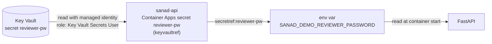

# Sanad on Azure — Keeping Secrets in Key Vault, Step by Step

**Written:** 2026-11-15 (drafted by Claude Code)  
**Status:** `TECH_TBD`. **Not yet run on the project subscription.** Every command was checked against the Azure CLI 2.85.0 help and Microsoft's [Manage secrets in Azure Container Apps](https://learn.microsoft.com/en-us/azure/container-apps/manage-secrets) (page updated 2026-09-11, read 2026-11-15). Update this file with what actually happens on the first run.  
**Task:** T1.4. Closes the "secrets in Key Vault" item in [azure-container.md §4](azure-container.md#4-not-yet-verified-or-still-open) and the [Azure service guide §7](azure-service-guide.md#7-verification-checklist-before-a-cloud-demo) checklist.

Sanad is a research prototype, not a medical device, and the hosted demo holds synthetic data only. Key Vault holds credentials, never patient data. Storing secrets in Key Vault makes the demo's configuration safer; it says nothing about clinical safety or legal compliance.

## 1. What goes where

The API reads its settings from environment variables (`sanad_api/config.py`). In Azure there is no `.env` file: `.dockerignore` keeps it out of the image.

| Setting | Where it lives in Azure | Notes |
|---|---|---|
| `SANAD_REPO_ROOT`, `SANAD_DATABASE_URL` (SQLite default) | Baked into the image (`apps/api/Dockerfile`) | Not secret, the same in every environment |
| `SANAD_COMMIT_SHA` | Container app environment variable on `sanad-api` | Changes on every deploy |
| `API_HOST` | Container app environment variable on `sanad-web` | `sanad-api` |
| `SANAD_CASES_PER_MINUTE_PER_IP`, `SANAD_LOGINS_PER_MINUTE_PER_IP`, `SANAD_*_TTL_SECONDS`, `SANAD_DELAYED_FLAG_SECONDS` | Container app environment variables, only if you change the defaults | Not secret |
| `SANAD_DEMO_REVIEWER_PASSWORD`, `SANAD_DEMO_MOCK_FACILITY_PASSWORD` | **Key Vault**: this guide | Mock staff sign-ins |
| `SANAD_DATABASE_URL` once PostgreSQL is used | **Key Vault**, with the same pattern ([§6](#6-add-another-secret-later)) | The URL would contain a password. PostgreSQL is not yet validated (azure-service-guide §3). |
| `LANGFUSE_SECRET_KEY` | **Key Vault**, only if tracing is ever turned on | Tracing is off in Azure |
| `SANAD_MODEL_PROVIDER` and every model setting (`SANAD_AZURE_OPENAI_*`, `SANAD_LAYA_*`, `SANAD_MODEL_*`, `SANAD_DECISION_MIN_PROB`) | **Leave unset** | Model use is not approved (CC-011, OD-13, OD-17) |
| `SANAD_LANGFUSE_ENABLED`, `LANGFUSE_BASE_URL`, `LANGFUSE_PUBLIC_KEY` | **Leave unset** | Tracing is off |
| `SANAD_ENV_FILE` | **Leave unset** | There is no settings file in the container |

If Azure OpenAI is ever approved, do not store `SANAD_AZURE_OPENAI_API_KEY` anywhere. Set `SANAD_AZURE_OPENAI_AUTH=entra_id`, give the API's managed identity the **Cognitive Services OpenAI User** role on the Azure OpenAI resource, and set the endpoint and deployment as plain environment variables. The API already supports this ([RUNBOOK](../RUNBOOK.md#optional-azure-openai-answer-matching-in-the-chat)).

## 2. How it fits together



The API's environment variables already say `SANAD_DEMO_REVIEWER_PASSWORD=secretref:reviewer-pw`. This guide changes only what the Container Apps secret `reviewer-pw` points to: from a value stored in the app to a Key Vault reference. No image rebuild and no environment-variable change is needed.

Facts from Microsoft's page that shape the steps:

- **Version:** a reference without a version uses "the latest version that exists in the key vault".
- **Refresh:** Container Apps fetches a new version "within 30 minutes" and then **restarts** the revisions that use it in an environment variable. For Sanad, a restart deletes every case, because SQLite lives in the container.
- **Changes need a restart:** adding or changing a secret "doesn't automatically affect existing revisions". You restart or deploy a revision.
- **Role:** the identity reading the vault needs the **Key Vault Secrets User** role.

## 3. Before you start

- [ ] **A person runs these steps.** They create a billable resource and change who can read credentials ([azure-container.md §2.9](azure-container.md#29-process-who-creates-billable-resources)).
- [ ] You are signed in: run `az login`. Tokens expire after 90 days of inactivity, and `az account show` can look fine while every call fails.
- [ ] You are **Owner** on the subscription (or Contributor plus User Access Administrator), so you can create role assignments.
- [ ] `sanad-api` is deployed and has a system-assigned identity. Check: `az containerapp show -g sanad-demo-rg -n sanad-api --query identity.type -o tsv` prints `SystemAssigned`.
- [ ] `apps/api/.env.azure-demo` exists on your machine and holds the two current passwords. Keep it until [step 8](#step-8--check-it-works) passes; it is your rollback copy.
- [ ] No demo is running. Step 7 restarts the API and deletes all cases.

## 4. Steps

Run everything from the repository root in one terminal, so the variables carry over.

### Step 1 — Set names

```bash
cd /Users/macmini/Desktop/AIApp/sanad-front-door
RG=sanad-demo-rg
LOC=uaenorth
KV=sanad-demo-kv$RANDOM        # globally unique: 3–24 letters, digits or hyphens

az keyvault check-name --name $KV --query nameAvailable -o tsv   # expect: true
```

If it prints `false`, pick another name. A vault deleted in the last few days still reserves its name ([§8](#8-remove-the-vault)).

### Step 2 — Create the vault

```bash
az keyvault create -g $RG -n $KV -l $LOC --sku standard \
  --enable-rbac-authorization true --retention-days 7 -o none

KVID=$(az keyvault show -n $KV --query id -o tsv)
KV_URI=$(az keyvault show -n $KV --query properties.vaultUri -o tsv)   # ends with a slash

az keyvault show -n $KV --query "{location:location, rbac:properties.enableRbacAuthorization, softDeleteDays:properties.softDeleteRetentionInDays, purgeProtection:properties.enablePurgeProtection}" -o table
```

Expect `uaenorth`, `True`, `7`, and empty or `False` for purge protection.

Choices made here:

- **Role-based access** (`--enable-rbac-authorization true`) rather than vault access policies, so access is managed with the same role assignments as the rest of the subscription.
- **7-day soft delete** (the CLI allows 7 to 90; the default is 90). This is a suggestion for a short-lived demo: a deleted vault and its name come back sooner. Choose longer if you want more time to recover from an accidental delete.
- **Purge protection off**, so the demo can be fully removed. Once turned on, it cannot be turned off.
- **Public network access stays on** (the default). The Consumption environment has no virtual network, so the API reaches the vault over its public endpoint, protected by the role assignments. A private endpoint would need a virtual-network-integrated environment, which is out of scope and not verified.

### Step 3 — Give yourself permission to write secrets

Being Owner lets you assign roles, but in a role-based vault it does **not** let you read or write secrets. Give yourself the secrets role on this vault only:

```bash
az role assignment create \
  --assignee-object-id "$(az ad signed-in-user show --query id -o tsv)" \
  --assignee-principal-type User \
  --role "Key Vault Secrets Officer" --scope "$KVID" -o none
```

New role assignments can take a few minutes to take effect. If step 4 returns `Forbidden`, wait and try again.

### Step 4 — Store the two passwords

This reads the values from the local file, so they are never typed or printed:

```bash
set -a; source apps/api/.env.azure-demo; set +a

az keyvault secret set --vault-name $KV -n reviewer-pw --value "$SANAD_DEMO_REVIEWER_PASSWORD" -o none
az keyvault secret set --vault-name $KV -n facility-pw --value "$SANAD_DEMO_MOCK_FACILITY_PASSWORD" -o none

az keyvault secret list --vault-name $KV --query "[].name" -o tsv   # expect: facility-pw, reviewer-pw
```

Keep `-o none` on every `secret set`. Without it, the CLI prints the secret's value.

### Step 5 — Let the API read the vault

```bash
API_PRINCIPAL=$(az containerapp show -g $RG -n sanad-api --query identity.principalId -o tsv)

az role assignment create \
  --assignee-object-id "$API_PRINCIPAL" --assignee-principal-type ServicePrincipal \
  --role "Key Vault Secrets User" --scope "$KVID" -o none

az role assignment list --scope "$KVID" --query "[].{role:roleDefinitionName, type:principalType}" -o table
```

Expect two rows: **Key Vault Secrets Officer** for `User` (you), and **Key Vault Secrets User** for `ServicePrincipal` (the API). The API can read secrets and nothing else. The web app gets no access: it holds no secrets.

### Step 6 — Point the API's secrets at Key Vault

Keep the secret names (`reviewer-pw`, `facility-pw`), so the `secretref:` environment variables stay as they are:

```bash
az containerapp secret set -g $RG -n sanad-api --secrets \
  "reviewer-pw=keyvaultref:${KV_URI}secrets/reviewer-pw,identityref:system" \
  "facility-pw=keyvaultref:${KV_URI}secrets/facility-pw,identityref:system" -o none

az containerapp secret list -g $RG -n sanad-api --query "[].{name:name, keyVaultUrl:keyVaultUrl, identity:identity}" -o table
```

Expect both secrets with a `https://<vault>.vault.azure.net/secrets/...` address and identity `system`.

`identityref:system` uses the app's system-assigned identity. The CLI help documents it ("Use 'system' for a system-defined identity"); Microsoft's page shows only user-assigned examples. If the command rejects `system`, use a user-assigned identity:

```bash
az identity create -g $RG -n sanad-api-id -l $LOC -o none
UAI_ID=$(az identity show -g $RG -n sanad-api-id --query id -o tsv)
UAI_PRINCIPAL=$(az identity show -g $RG -n sanad-api-id --query principalId -o tsv)

az role assignment create --assignee-object-id "$UAI_PRINCIPAL" --assignee-principal-type ServicePrincipal \
  --role "Key Vault Secrets User" --scope "$KVID" -o none
az containerapp identity assign -g $RG -n sanad-api --user-assigned "$UAI_ID" -o none

az containerapp secret set -g $RG -n sanad-api --secrets \
  "reviewer-pw=keyvaultref:${KV_URI}secrets/reviewer-pw,identityref:${UAI_ID}" \
  "facility-pw=keyvaultref:${KV_URI}secrets/facility-pw,identityref:${UAI_ID}" -o none
```

### Step 7 — Restart the API

The container reads environment variables only when it starts. **This deletes all demo cases.**

```bash
REV=$(az containerapp show -g $RG -n sanad-api --query properties.latestRevisionName -o tsv)
az containerapp revision restart -g $RG -n sanad-api --revision $REV
```

### Step 8 — Check it works

```bash
az containerapp revision show -g $RG -n sanad-api --revision $REV \
  --query "{health:properties.healthState, running:properties.runningState}" -o tsv   # expect: Healthy, Running
az containerapp logs show -g $RG -n sanad-api --type system --tail 30                 # look for Key Vault or secret errors
```

Then open the hosted site, choose **Mock Reviewer** and sign in with the password from `apps/api/.env.azure-demo`. Do the same for **Mock Facility**. Both must succeed. A wrong password must still be refused.

### Step 9 — Optional: record who reads the vault

Send the vault's audit log to the demo's existing Log Analytics workspace. The audit log records operations and callers, not secret values.

```bash
az monitor diagnostic-settings categories list --resource "$KVID" --query "[].name" -o tsv   # confirm AuditEvent is listed
az monitor diagnostic-settings create -n kv-audit --resource "$KVID" \
  --workspace "$(az monitor log-analytics workspace list -g $RG --query '[0].id' -o tsv)" \
  --logs '[{"category":"AuditEvent","enabled":true}]' -o none
```

The workspace keeps data for 30 days, its default. That retention has not been reviewed ([azure-container.md §4](azure-container.md#4-not-yet-verified-or-still-open)).

### Step 10 — Remove the local copy

Only after step 8 passes. Key Vault is then the only copy:

```bash
rm apps/api/.env.azure-demo
```

To read a password later (it prints to your terminal, so do it privately):

```bash
az keyvault secret show --vault-name $KV -n reviewer-pw --query value -o tsv
```

## 5. Change a password

Do this outside a demo session: either way, the API restarts and every case is deleted.

```bash
NEW=$(openssl rand -base64 18 | tr -d '/+=')
az keyvault secret set --vault-name $KV -n reviewer-pw --value "$NEW" -o none
unset NEW
```

Then choose one:

- **Wait.** Container Apps fetches the new version within 30 minutes and restarts the API by itself. You don't control the moment.
- **Apply now.** Point the secret at the exact new version, then restart:

  ```bash
  VER=$(az keyvault secret show --vault-name $KV -n reviewer-pw --query id -o tsv)   # address including the version
  az containerapp secret set -g $RG -n sanad-api --secrets "reviewer-pw=keyvaultref:${VER},identityref:system" -o none
  REV=$(az containerapp show -g $RG -n sanad-api --query properties.latestRevisionName -o tsv)
  az containerapp revision restart -g $RG -n sanad-api --revision $REV
  ```

  The secret is now pinned to that version. To follow the latest version again, re-run step 6.

Tell the people who use the Mock Reviewer or Mock Facility sign-in that the password changed. Share it through a private channel, never an issue, PR, commit or chat log.

## 6. Add another secret later

The same four moves work for any secret, for example a PostgreSQL URL once that is validated:

```bash
az keyvault secret set --vault-name $KV -n database-url --value "$VALUE" -o none                   # 1. store it
az containerapp secret set -g $RG -n sanad-api \
  --secrets "database-url=keyvaultref:${KV_URI}secrets/database-url,identityref:system" -o none     # 2. link it
az containerapp update -g $RG -n sanad-api --set-env-vars SANAD_DATABASE_URL=secretref:database-url  # 3. use it
```

Move 3 creates a new revision, which restarts the API, so no separate restart is needed. When you change only a secret's value and no environment variable, restart the revision as in [step 7](#step-7--restart-the-api).

Use lowercase letters, digits and hyphens in secret names, and keep the same name in Key Vault and Container Apps so they're easy to match.

## 7. Roll back

To go back to values stored in the app, you need the local file from [§3](#3-before-you-start), or read the values from Key Vault first:

```bash
set -a; source apps/api/.env.azure-demo; set +a
az containerapp secret set -g $RG -n sanad-api --secrets \
  reviewer-pw="$SANAD_DEMO_REVIEWER_PASSWORD" facility-pw="$SANAD_DEMO_MOCK_FACILITY_PASSWORD" -o none
REV=$(az containerapp show -g $RG -n sanad-api --query properties.latestRevisionName -o tsv)
az containerapp revision restart -g $RG -n sanad-api --revision $REV
```

## 8. Remove the vault

`az group delete -n sanad-demo-rg` removes the vault along with everything else, but Key Vault **soft-deletes** it: the vault and its name are kept for the retention period (7 days if you followed step 2). To free the name at once (possible only because purge protection is off):

```bash
az keyvault list-deleted --query "[].name" -o tsv
az keyvault purge -n $KV -l $LOC
```

Purging cannot be undone.

## 9. Troubleshooting

| Symptom | Likely cause | Fix |
|---|---|---|
| `check-name` prints `false` | Name taken, or a soft-deleted vault holds it | Pick another name, or purge your own deleted vault ([§8](#8-remove-the-vault)) |
| `Forbidden` on `keyvault secret set` | Step 3's role is missing or not yet effective | Check with `az role assignment list --scope "$KVID" -o table`; wait a few minutes |
| `containerapp secret set` rejects `identityref:system` | CLI or API version difference | Use the user-assigned identity in [step 6](#step-6--point-the-apis-secrets-at-key-vault) |
| System logs show "Authentication failed", or the revision is unhealthy | The API's identity can't read the vault: step 5 missing or not yet effective, or a typo in the vault address | Check step 5's role list and the `keyVaultUrl` from step 6 |
| Sign-in fails with the right password | The API wasn't restarted after step 6 | [Step 7](#step-7--restart-the-api) |
| The old password still works after a change | The new version hasn't been fetched yet | Wait up to 30 minutes, or use **Apply now** in [§5](#5-change-a-password) |
| Every `az` call fails with `AADSTS700082` | Login token expired | `az login` |

## 10. Rules

- Never paste a secret value into a chat, issue, PR, commit, log, screenshot or this file. Name secrets; don't quote them.
- Keep `-o none` on `secret set` commands. Don't run `--show-values` or `secret show` while sharing your screen.
- Don't store Azure credentials in GitHub. The future deploy-on-merge step (AC-01.4) should sign in with OIDC (workload identity federation), which needs only the client ID, tenant ID and subscription ID as GitHub variables.
- Key Vault holds credentials only. Never put case data, answers or lab values in it (synthetic data only).
- Give the API **Key Vault Secrets User** only. Don't give apps the Officer role, and don't give the web app any vault access.

## 11. After the first run

- [ ] Correct anything in this guide that differed in practice, and remove the "Not yet run" status.
- [ ] Update the Key Vault row in [azure-container.md §4](azure-container.md#4-not-yet-verified-or-still-open) and the secrets note in its §2.6.
- [ ] Change the RUNBOOK's first-deploy commands to create the Key Vault references from the start.
- [ ] Decide the soft-delete retention and the audit-log retention, and record who decided.
