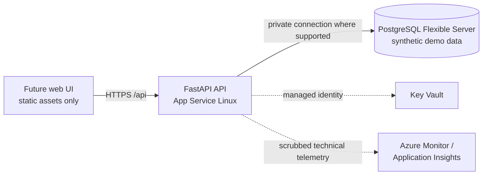

# Sanad Azure Service Guide

**Research date:** 2026-11-04  
**Status:** `TECH_TBD` — service and region choices require subscription-level verification. This guide is an implementation aid, not an approval to process real health data.

## 1. Purpose and scope

This guide maps the current Sanad prototype to Azure services. It follows the README, BRD v0.4 and PRD v0.4: a synthetic/public-data research prototype, not a medical device, with no real clinic transport and no real patient records. BRD/PRD scope wins over the README where they differ.

The repository currently contains a Python 3.12+ FastAPI API. It has no patient or clinician web UI, no Azure integration, and no model calls. The API defaults to a local SQLite database (`sqlite:///./sanad-dev.db`) and accepts `SANAD_DATABASE_URL`. Azure should therefore be treated as a possible host for the existing API and its synthetic demo data, not as a reason to add AI or planned roadmap features.

## 2. Recommendation

For a bounded synthetic-data demo, evaluate this small set first:

| Need | Candidate | Recommendation |
|---|---|---|
| Run the FastAPI API | **Azure App Service on Linux** | First hosting candidate if the required plan can be created in the chosen region. Microsoft documents a FastAPI quickstart and Python startup configuration. It avoids introducing container build and registry steps. |
| API hosting fallback | **Azure Container Apps** | Use if App Service capacity or subscription availability blocks the chosen region, or if container-based releases are preferred. The API can run as one container; avoid adding microservices. Microsoft lists UAE North for Container Apps Express, but confirm its feature fit and actual subscription deployment. |
| Persist demo cases | **Azure Database for PostgreSQL Flexible Server** | Use if a cloud demo must retain data across app restarts or serve multiple API instances. UAE North is listed in the service’s regional availability table. Validate SQLAlchemy compatibility and migrations before switching from SQLite. |
| Secrets | **Azure Key Vault + managed identity** | Keep database credentials and signing secrets out of source and deployment files. Grant the app identity only the secret permissions it needs. |
| Operations | **Azure Monitor / workspace-based Application Insights** | Capture availability and technical health. Keep telemetry to low-risk metadata; never send answers, lab values, free text, tokens, or barrier selections. Configure a UAE North workspace and regional ingestion where available, and confirm endpoints and retention settings. |
| Future web UI | **Azure Static Web Apps** | Consider only after the UI exists. Keep the site static and send API calls to the separately hosted API. Static assets can be distributed globally, so do not place case content or health data in static files, build artifacts, browser analytics, or cached responses. |

**Practical default:** start with App Service Linux for a direct Python deployment. Check that the intended App Service plan/SKU can actually be provisioned in UAE North for the project subscription; public service documentation does not guarantee subscription quota or regional capacity. If it cannot, test Container Apps as the alternative. Keep the API and database in the same region when possible.

The current SQLite file is suitable for local development and tests. Do not treat a container or web-app local filesystem as a durable, shared database for multi-instance cloud use. For a hosted demo that needs durable cases, use PostgreSQL; if persistence is unnecessary, make the loss of data on restart explicit and keep the demo single-instance.

## 3. Suggested prototype topology



The UI is planned, not present in this repository. Until it exists, the diagram is only a target shape. Emergency handling and consent/referral gates stay in the API. Azure hosting, a model, or identity product must not become the policy authority. Preserve the API’s deterministic emergency path and backend checks on every action.

### App Service setup notes

- Use Linux and a supported Python runtime compatible with the repository’s Python 3.12+ requirement.
- Configure the app’s startup command to run the existing factory, for example:

  ```sh
  python -m uvicorn sanad_api.main:create_app --factory --app-dir apps/api --host 0.0.0.0 --port 8000
  ```

- Set `SANAD_DATABASE_URL` through protected configuration, not a committed file. App Service can use a managed identity to access Key Vault.
- Confirm the API health endpoint (`/version`) and OpenAPI route (`/api/docs`) are appropriate for the public demo. Disable or restrict interactive API documentation if it exposes demo operations users should not access.
- Do not assume the local project’s demo reviewer accounts or passwords are production authentication. Restrict the deployed demo to synthetic data and the intended audience.

### PostgreSQL notes

- The API uses SQLAlchemy and supports a configurable database URL, but PostgreSQL has not been established as a verified deployment target. Validate schema creation, transaction behavior, URL/driver configuration, expiry cleanup, and database migrations before using it.
- Keep PostgreSQL private to the application where the selected network configuration permits it; do not open it to the public internet for convenience.
- Decide backup and retention behavior before the demo. Backups are copies of data and must follow the same synthetic-only boundary. General case-data retention and deletion remain open product/security decisions in the source specs.

### Monitoring notes

- Use request counts, status codes, latency, dependency health, deployment revision, and software version for operational monitoring.
- Review automatic request/exception collection and redact URL query strings, headers, request bodies, SQL parameters, and user-controlled text before enabling telemetry.
- Set a short, reviewed retention period appropriate for a synthetic demo, and restrict workspace access. Application Insights telemetry is immutable after ingestion, so prevention and scrubbing must happen before data is sent.

## 4. Service comparison and boundaries

| Service | Fit for Sanad now | Trade-off / boundary |
|---|---|---|
| App Service Linux | Good fit for the existing Python API and simplest code-based deployment route. | Need to verify the selected region/SKU and deployment startup behavior; quota alone does not prove capacity. |
| Container Apps | Good fit when the team wants an OCI container, revisions, ingress control, or a later background job. It supports HTTPS ingress and autoscaling. | Requires a container image/build workflow. Do not introduce separate services or agent orchestration for the current single API. Express and standard Container Apps have different capabilities; verify the exact feature set. |
| Azure Functions | Not recommended for the current API. | The existing FastAPI app is a stateful web API with SQLAlchemy and a lifespan cleanup task. A Functions conversion would be an unnecessary architectural change. Reconsider only if a bounded event-driven job appears. |
| API Management | Not needed for a private challenge demo with one API. | Adds configuration and cost. Revisit for a real external API product, partner-facing policies, or a reviewed multi-API gateway requirement. It does not replace FastAPI’s consent and authorization checks. |
| Azure Static Web Apps | Future option for a static frontend. | Its managed APIs are Azure Functions; bringing an existing API is a separate integration. Static content is globally distributed. Keep all case data in the API and verify routing, caching, and region behavior before a pilot. |
| PostgreSQL Flexible Server | Good hosted persistence option if durable synthetic demo data is required. | Requires migration/compatibility work and an explicit retention/deletion plan. Never interpret persistence as approval to use real data. |
| Azure OpenAI / Foundry Models, AI Search, Agent Service | Out of current implementation scope. | The code makes no model calls; BRD/PRD separate deterministic rules from optional model work and require replaceability/fallback. Do not add these services to the P0 cloud footprint. Any future model or retrieval work needs its own source, privacy, region, quota, Arabic, licensing, and safety review. |
| Healthcare Agent Service, Document Intelligence, Content Safety | Not needed for current backend. OCR is a later synthetic-only option; clinical content/rules remain human reviewed. | Do not use a healthcare-branded service as evidence of clinical validity, medical-device status, or regulatory compliance. Confirm availability and feature support before a future evaluation. |
| Azure Health Data Services (FHIR) | Not for the prototype. | The FHIR artifact is conceptual and `NOT_EVALUATED`; there is no exporter or conformance claim. Reassess only after legal, residency, partner, profile, security, and implementation reviews. |

## 5. Region, residency, and data boundary

The product targets UAE users. For this prototype, use only synthetic or appropriately licensed public data. The BRD and PRD require legal/privacy review before any real-data pilot; this guide does not determine whether a service or deployment satisfies UAE law.

- Prefer UAE North for the API, database, Key Vault, and monitoring workspace when each service and the subscription support the needed configuration.
- Microsoft’s current Azure region list identifies UAE North in Dubai and marks it as a region with access restrictions. Confirm that the project subscription can deploy there; if access is unavailable, request access or stop and obtain a documented data-boundary decision. Do not silently move health data to another geography.
- Azure Container Apps Express and Azure Database for PostgreSQL Flexible Server pages list UAE North. App Service plan/SKU capacity and availability must be confirmed in the subscription’s create flow or by a deployment check. Service presence is not a promise of SKU capacity.
- If using Application Insights, choose a workspace-based resource and verify the workspace region and ingestion endpoint. Microsoft states that a global Application Insights endpoint does not guarantee regional data residency; use regional endpoints for regional routing.
- Be cautious with global products and backups. Static Web Apps distributes static assets globally; geo-redundant backups, diagnostic exports, CI/CD artifacts, source repositories, and support bundles also need a data review if they could contain user data. The demo build should contain no real case data.
- Confirm the exact region for every resource, not just the resource group. Review deployment logs and telemetry as data stores too.

## 6. Security and product constraints for any Azure demo

1. **Synthetic-only:** no real patient data in cloud resources, fixtures, test runs, logs, screenshots, or prompts.
2. **No outbound care transport:** no email/SMS/referral HTTP integration or real provider endpoint. Mock referral semantics remain explicit in both UI and data.
3. **Keep emergency handling local to the rules path:** a model, retrieval service, network dependency, or clinician session must not block it.
4. **Backend remains authoritative:** Azure authentication or front-end visibility does not replace server-side role, consent, case-state, and approval checks.
5. **Minimize logs:** retain action/version metadata only. Do not collect clinical answers, lab results, free text, psychosocial responses, access tokens, or navigation barrier selections.
6. **No API caching:** configure any future CDN, proxy, static-site route, or service worker so API responses are not cached. Only explicitly allowed static assets may be cached.
7. **No implied clinical or regulatory status:** cloud hosting, encryption, or a healthcare service name does not make Sanad a medical device, clinically validated, interoperable, or legally compliant.
8. **No claim of care completion:** acknowledgements and progress remain session-scoped and source-labelled. Do not write `PROVIDER_VERIFIED` or `CARE_COMPLETED`.

## 7. Verification checklist before a cloud demo

- [ ] Confirm the target subscription can create the chosen service/SKU in UAE North and check service quotas and capacity.
- [ ] Deploy synthetic fixtures only; verify no real values appear in environment variables, artifacts, application logs, telemetry, or database backups.
- [ ] If persistence is required, validate PostgreSQL compatibility and set an explicit demo retention/deletion plan; otherwise document that local SQLite data may be lost on restart and run one instance only.
- [ ] Use managed identity and Key Vault for secrets; remove default/demo credentials or restrict them to an isolated demo audience.
- [ ] Scrub Application Insights and platform logs; verify workspace region, ingestion endpoint, access, retention, and no request-body capture.
- [ ] Verify `/version`, health behavior, HTTPS, allowed origins, API response cache headers, and that only intended routes are externally reachable.
- [ ] Verify consent-negative cases are rejected by the API, mock-only labels remain visible, and emergency rules work with all optional services unavailable.
- [ ] Keep the deployment reversible and do not deploy, publish, or add live services as part of this research guide.
- [ ] Before any pilot with real data, obtain privacy/legal review and close the source specs’ open questions on residency, consent, retention, deletion, and identity.

## 8. Research sources

Microsoft service documentation was checked on 2026-11-04. Region lists and plan availability can change; verify them in the target subscription before committing to an architecture.

- [Azure App Service Python/FastAPI quickstart](https://learn.microsoft.com/en-us/azure/app-service/quickstart-python) and [Python configuration/startup guidance](https://learn.microsoft.com/en-us/azure/developer/python/configure-python-web-app-on-app-service)
- [Azure Container Apps overview](https://learn.microsoft.com/en-us/azure/container-apps/overview), [Express region availability](https://learn.microsoft.com/azure/container-apps/express-overview), and [ingress options](https://learn.microsoft.com/en-us/azure/container-apps/ingress)
- [Azure Database for PostgreSQL Flexible Server overview and region matrix](https://learn.microsoft.com/en-us/azure/postgresql/flexible-server/service-overview)
- [Azure Container Apps Key Vault secret references](https://learn.microsoft.com/azure/container-apps/manage-secrets) and [App Service managed identity with Key Vault](https://learn.microsoft.com/en-us/azure/key-vault/tutorial-web-application-keyvault)
- [Application Insights FAQ: data residency, endpoints, privacy, and retention](https://learn.microsoft.com/azure/azure-monitor/app/application-insights-faq)
- [Static Web Apps API options](https://learn.microsoft.com/en-us/azure/static-web-apps/apis-overview) and [Static Web Apps FAQ: global distribution and regions](https://learn.microsoft.com/en-us/azure/static-web-apps/faq)
- [Azure public region list](https://learn.microsoft.com/en-us/azure/reliability/regions-list)

## 9. Source documents

- [README](../README.md) — intended architecture, current implementation, data boundaries, and existing Azure proposal.
- [BRD v0.4](Sanad_AetherHealth_BRD_v0.4.md) — bounded scope, business rules, data policy, and unresolved Azure/residency questions.
- [PRD v0.4](Sanad_AetherHealth_PRD_v0.4.md) — product contracts, state, privacy, and acceptance criteria.

