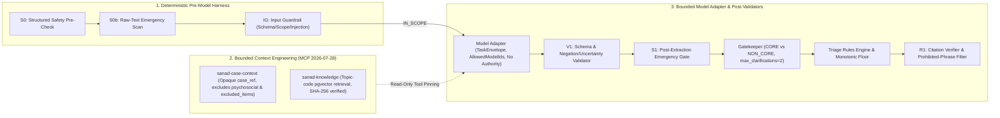

# Sanad Codebase Review, Harness & Context Engineering, and Full-Flow Verification

**Date:** 2026-11-14  
**Reviewed Against:**
1. [BRD v0.4.2](Sanad_AetherHealth_BRD_v0.4.md)
2. [PRD v0.4.2](Sanad_AetherHealth_PRD_v0.4.md)
3. [E2E Workflow v0.4](Sanad_E2E_Workflow_v0.4.md)
4. [Product Spec](referal-flows/product-spec.md), [Implementation Plan](referal-flows/implementation-plan.md), [API Design](referal-flows/api-design.md), [Test Plan](referal-flows/test-plan.md)
5. [Harness Spec](harness.md) & [MCP Context Design](mcp-context-design.md)
6. [README.md](../README.md)

> **Scope & Safety Notice:** Sanad is a research prototype for men's reproductive health, not a medical device. All clinical rules and thresholds are `CLINICAL_TBD`, all simulated components are explicitly labelled **Mock** (`is_mock: true`, `verification_source: SIMULATED`), and passing software tests verify specification conformance on synthetic data only (`clinical_agreement = NOT_EVALUATED`).

---

## 1. Source Code Review vs. README, BRD v0.4.2, and PRD v0.4.2

### 1.1 Implemented & Verified Capabilities
1. **Deterministic Case State Machine (`PRD §4.7`, `HR-07`):**
   - `apps/api/sanad_api/cases/state_machine.py` enforces the 14-state, 20-event transition table (`DRAFT` through `CLOSED` / `CONSENT_REVOKED`).
   - Verified via AST inspection (`test_tc_04_4_only_the_state_machine_writes_case_state`) that `transition()` is the only function in the codebase that mutates `Case.state`.
2. **Server-Side Access, Consent & Order Guard (`PRD-FR-12..14`, `HR-08`, `HR-09`):**
   - `apps/api/sanad_api/cases/guards.py` validates session token ownership (`404 NOT_FOUND` on cross-case access to prevent ID enumeration), active purpose-level consent scopes (`403 CONSENT_REQUIRED`), and state eligibility (`409 INVALID_TRANSITION`, audited) before reading request bodies.
   - Five granular consent scopes (`assessment`, `clinician_review`, `provider_share`, `spouse_share`, `research_use`) default to `granted: false` and support cascading revocation (`CC-009`: revoking `clinician_review` withdraws pending review and returns to `ASSESSING`; revoking `provider_share` or `assessment` marks live mock referrals `MOCK_WITHDRAWN` and clears their snapshot).
3. **Deterministic Emergency Pre-Check & Offline Reachability (`PRD-FR-03`, `HR-01..03`):**
   - `apps/api/sanad_api/rules_engine/emergency.py` evaluates `rules/emergency.draft-0.1.json` immediately on safety check (`S0`) and on every fact write (`profile/sample`, `profile/upload`, `answers`).
   - `apps/web/src/pages/SafetyScreen.tsx` evaluates the bundled `emergency.draft-0.1.json` locally in the browser before waiting on the network.
   - `apps/web/public/urgent.html` has zero external assets, and `apps/web/public/sw.js` precaches `/urgent.html` while explicitly bypassing `/api/*` (`Cache-Control: no-store` enforced on all API responses).
4. **Epistemic Honesty & Thin `SemanticFact` (`PRD-FR-16..18`, `INV-05`):**
   - `apps/api/sanad_api/facts/service.py` preserves `KNOWN_POSITIVE`, `KNOWN_NEGATIVE`, `UNKNOWN`, `DECLINED`, `NOT_ASKED`, and `CONFLICTING` distinctly, alongside `PAST`/`CURRENT` temporal status and `AFFIRMED`/`NEGATED` polarity.
   - `apps/api/sanad_api/observations/service.py` holds unconfirmed or invalid-unit/date lab observations at `NEEDS_USER_CONFIRMATION` without unit conversion, and detects conflicts when a confirmed lab observation contradicts a self-reported `Q-SEMEN-TEST-DONE = false`.
5. **Triage Rules Engine, Monotonic Floor & Template Drafts (`PRD-FR-07..10`, `HR-04`, `HR-06`):**
   - `apps/api/sanad_api/rules_engine/triage.py` and `floor.py` compute risk signals and enforce the monotonic triage floor (`EMERGENCY_GUIDANCE > PRIORITY_REVIEW > SPECIALIST > PRIMARY_CARE > EDUCATION`).
   - Reviewer edits below the floor are rejected with `422 TRIAGE_BELOW_FLOOR`.
6. **Policy-as-Code Referral Gate & Mock Facility Lifecycle (`PRD-FR-21..23`, `HR-10`, `HR-11`):**
   - `apps/api/sanad_api/referral/gate.py` (`evaluate_gate`) checks all three conditions (`provider_share` active, `SIMULATED_APPROVAL` matching current `case_version` + `report_hash` + un-expired TTL, and backend policy) without short-circuiting.
   - `apps/api/sanad_api/referral/service.py` (`send_mock_referral`) is the sole constructor of `Referral` rows, and neither `referral/` nor `mock_facility/` imports any network/HTTP/SMTP/SMS client.
7. **v0.4 P0 Additions (`PRD-FR-24..32`):**
   - **Optional Psychosocial Micro-Intake (`T4.1`):** `apps/api/sanad_api/psychosocial/` stores up to 3 contextual self-reports (`PATIENT_REPORTED`, `UNVERIFIED`, `CONTEXT_ONLY_NOT_TRIAGE`) in a separate table that never enters triage rules.
   - **Voluntary Closed-Loop Navigation (`T4.2`):** `apps/api/sanad_api/navigation/` implements explicit guidance acknowledgement (`SYSTEM_EVENT`), idempotent self-reported progress (`BOOKING_SELF_REPORTED`, `VISIT_SELF_REPORTED` as `USER_REPORTED`/`UNVERIFIED`), bounded barrier reporting (`PREFER_NOT_TO_SAY` exclusivity, no free text), automatic purge on session end/expiry, and the reviewer `/api/evaluation/navigation-funnel` endpoint (`provider_verified_visits` and `care_completed` hardcoded to `NOT_AVAILABLE`).
   - **Conceptual FHIR R4 & Synthetic Fixture Manifests (`T4.3`, `T4.4`):** `catalogue/fhir-r4-mapping-0.1.json` (`DESIGN_ONLY`, `NOT_EVALUATED`, `is_export_enabled: false`) and startup-validated `data/synthetic/fixture-manifest.v0.4.json`.

### 1.2 Identified Gaps & Document Drift
1. **README Drift:** `README.md` line 528 still states *"There is no `apps/web`... in the current source tree"*, whereas `apps/web` is implemented and wired to the API (as correctly noted in `README.md` line 46 and `RUNBOOK.md`).
2. **Pre-Model Input Guardrail (`IG`) & Raw-Text Emergency Gate (`S0b`) (`BRD v0.4.2 BR-41/42/45`, `PRD-FR-03/35/38`):**
   - `S0` (structured safety questions) and `S1` (fact-based post-write emergency check) are implemented, but `S0b` (raw-text emergency pattern scan prior to guardrail disposition) and `IG` (deterministic schema, length, script, scope, and prompt-injection guardrail returning `IN_SCOPE | OUT_OF_SCOPE | NEEDS_CORRECTION | UNSAFE_OR_PROMPT_INJECTION`) are not yet implemented.
3. **Missing-Data Criticality Tiers (`CORE` vs. `NON_CORE`) & Clarification Cap (`max_clarifications`) (`BRD v0.4.2 BR-43/44`, `PRD-FR-36`):**
   - `catalogue/questions.draft-0.1.json` currently uses `required: true` rather than `criticality: "CORE" | "NON_CORE"` and `clarification_priority`.
   - `gatekeeper/service.py` does not yet cap clarification rounds at `max_clarifications = 2` before transitioning unresolved `CORE` cases to `LIMITED_REPORT` (`NEEDS_MORE_INFORMATION`).
4. **Bounded Model Adapter (`PRD-FR-37..40`) & MCP Context Engineering (`specs/mcp-context-design.md`):**
   - The prototype currently runs 100% deterministically with zero LLM dependencies. Implementing the optional v0.4.2 model adapter requires the harness and context engineering layer detailed in Section 2.

---

## 2. Harness & Context Engineering Recommendations

### 2.1 Harness Engineering Architecture (`specs/harness.md`, `HR-01` to `HR-30`)

1. **Pre-Model Input Guardrail (`IG`) with `S0b` Precedence (`HR-01..03`, `HR-17`, `PRD-FR-35/38`):**
   - Create `sanad_api/guardrail/service.py` to process any optional free-text/chat or upload input in strict order:
     - **Step 1 (`S0` / `S0b`):** Run structured safety rules (`S0`) and deterministic raw-text emergency pattern matching (`S0b`) first. If an emergency red flag is present alongside out-of-scope or malformed text, `S0b` wins immediately and transitions to `EMERGENCY_GUIDANCE_ISSUED` (`BR-45`, `PRD-AC-49`).
     - **Step 2 (`IG`):** Enforce UTF-8/length bounds, Arabic/English language script checks, prompt-injection/jailbreak regexes, and reproductive-health scope classification (`IN_SCOPE`, `OUT_OF_SCOPE`, `NEEDS_CORRECTION`, `UNSAFE_OR_PROMPT_INJECTION`) without invoking any model or echoing raw input in logs (`PRD-AC-50`).
2. **Gatekeeper `CORE` / `NON_CORE` Criticality & `max_clarifications` Cap (`HR-05`, `PRD-FR-36`):**
   - Add `criticality: Literal["CORE", "NON_CORE"]` and `clarification_priority: int` to `QuestionDef` in `catalogue/questions.draft-0.1.json`.
   - Track `clarification_count` on `Case` (capped at `max_clarifications = 2`). When `CORE` fields remain `UNKNOWN`/`DECLINED`/`NOT_ASKED` after 2 clarification rounds, produce a `LIMITED_REPORT` (`NEEDS_MORE_INFORMATION`) listing `missing_core_fields` and `interpretive_limits` rather than looping indefinitely or defaulting to `NORMAL`.
3. **Bounded Model Adapter & Deterministic Post-Validators (`HR-18..27`, `PRD-FR-37..40`):**
   - Implement `sanad_api/model_adapter/` with a strict `TaskEnvelope`:
     - **Allowlisted Tasks & Models:** Restrict to `INTAKE_EXTRACTION`, `CLARIFICATION_QUESTION`, `PATIENT_EXPLANATION`, and `CLINICIAN_SUMMARY` using `AllowedModelIds` (`temperature=0`, bounded `timeout_ms`, `max_attempts=2`).
     - **Post-Extraction Validator (`V1`):** Verify output against closed Pydantic/JSON schemas, check that every extracted `SemanticFact` cites a verbatim `evidence_span` in the input, and reject any collapse of `UNKNOWN`/`DECLINED` into `KNOWN_NEGATIVE`.
     - **Post-Generation Citation & Safety Filter (`R1`):** Verify that every `citation_id` exists in the retrieved evidence set (`VERIFIED` vs. `INSUFFICIENT_EVIDENCE`) and scan output against forbidden phrases (`infertil*`, probability percentages, diagnoses, unapproved SLAs). Any validation failure or timeout falls back deterministically to `reports/drafts.py` (`FALLBACK_USED`, `PRD-AC-56`).
     - **Privacy-Preserving Execution Traces (`PRD-FR-40`, `HR-14`):** Log `trace_id`, `task_type`, `model_id`, `prompt_version`, `schema_version`, `latency_ms`, `validation_status`, and `fallback_reason`—never raw prompts or patient text.

### 2.2 Context Engineering Architecture (`specs/mcp-context-design.md`)
1. **Read-Only MCP Servers (`2026-07-28`) with Tool Hash Pinning (`HR-20`):**
   - Expose only read-only context tools (`sanad-knowledge`, `sanad-case-context`, `sanad-mock-calendar`). Keep all state transitions, consent writes, review decisions, and referral gate evaluations in the FastAPI backend outside MCP.
   - Pin all MCP tool schemas in `catalogue/tools.manifest.json` with SHA-256 digests verified at startup to prevent tool poisoning.
2. **Least-Privilege Case Context Handle (`sanad-case-context`):**
   - Issue a short-lived (`60s` TTL), single-use opaque `case_ref` handle instead of passing bearer tokens or database sessions into model prompts.
   - Automatically strip `excluded_concepts` (`RF-16`), unconfirmed lab observations (`RF-15`), and `PsychosocialSelfReport` rows (`Invariant 15`) from the model context.
3. **Topic-Code Grounded Retrieval (`sanad-knowledge` + `pgvector`):**
   - Never embed raw patient free text. Map deterministic `risk_signals` and `triage_action` codes to controlled `topic_codes`, query pre-embedded vetted guideline chunks via a read-only `knowledge_reader` role, and verify `sha256(content) == content_sha256` before context assembly.

---

## 3. Automated Testing & Live Full-Flow System Verification

### 3.1 Automated Pytest Suite (231 Tests across 12 Test Files)
We implemented automated tests across `apps/api/tests/` covering every backend, manifest, architecture, and invariant test ID in `specs/referal-flows/test-plan.md`:
- `test_cases.py` (`TC-02.2`, `TC-04.3`, `TC-04.4`)
- `test_consent.py` (`TC-03.1` to `TC-03.6`, `G3`, `G4`)
- `test_profiles.py` (`TC-02.4`, `TC-02.5`)
- `test_safety.py` (`TC-10.2`, `TC-10.4` to `TC-10.7`)
- `test_intake.py` (`TC-06.1` to `TC-06.5`, `TC-INV-05`)
- `test_triage.py` (`TC-11.1` to `TC-11.6`)
- `test_review.py` (`TC-07.3` to `TC-07.6`, `TC-08.1` to `TC-08.9`)
- `test_navigation.py` (`TC-19.1` to `TC-19.6`)
- `test_psychosocial.py` (`TC-18.1` to `TC-18.4`)
- `test_referral_and_facility.py` (`TC-12.1` to `TC-12.9` including all 16 truth-table rows `GT-1..GT-16`, `TC-13.1` to `TC-13.6`, `TC-14.2` to `TC-14.6`, `TC-17.2`)
- `test_observations_and_evidence.py` (`TC-15.1` to `TC-15.6`, `TC-16.1` to `TC-16.4`)
- `test_invariants_and_manifests.py` (`TC-09.5`, `TC-09.6`, `TC-20.1`, `TC-20.2`, `TC-INV-01` to `TC-INV-09`, `TC-J*`)

### 3.2 Live Full-Stack Execution (`apps/web` Vite + `apps/api` FastAPI)
In addition to the 231 Python API/unit tests, we created and executed [apps/web/e2e-full-flow.test.mjs](../apps/web/e2e-full-flow.test.mjs) (`npm --prefix apps/web run test:e2e`), which starts the live FastAPI server (`http://127.0.0.1:8000`) and Vite web server (`http://127.0.0.1:3000`) and exercises the full multi-actor flow through Vite's `/api` proxy:

1. **Step 1 — Static Web Assets, Service Worker & Emergency Page (`TC-05.1`, `TC-05.4`, `TC-10.1`):**
   - Requests `/`, `/urgent.html`, and `/sw.js` from `http://127.0.0.1:3000` and `/version` from `http://127.0.0.1:8000`.
   - Verifies `/urgent.html` is reachable without authentication or consent, displays `Mock emergency page · CLINICAL_TBD`, UAE emergency numbers `998` and `999`, the non-device disclaimer, and zero external `http(s)://` URLs.
   - Verifies `/sw.js` precaches `/urgent.html` and bypasses `/api/*`, and `/version` sets `Cache-Control: no-store`.
2. **Step 2 — Patient Start Screen & Sample Discovery (`TC-02.1`, `TC-02.2`):**
   - Calls `GET /api/samples` via Vite proxy (`http://127.0.0.1:3000/api/samples`), confirms `J1-002` is listed and `CN-*` calibration records are excluded, then calls `POST /api/cases` to create an anonymous `SANAD-<12 hex>` case in `DRAFT` (`route: /consent`).
3. **Step 3 — Granular 5-Scope Consent Ledger & Sample Profile Application (`TC-03.1..03.4`):**
   - Fetches `GET /api/consent/current` (`CONSENT-0.1`, 5 scopes), grants `assessment`, `clinician_review`, and `provider_share` (`PUT /api/cases/{id}/consent`) while verifying `spouse_share` and `research_use` remain `false`, and loads synthetic fixture `J1-002` (`POST /api/cases/{id}/profile/sample`).
4. **Step 4 — Deterministic Safety Pre-Check (`TC-10.2..10.4`):**
   - Submits `POST /api/cases/{id}/safety-check` (`SAFETY-01..03 = NO`), verifying `SAFE_TO_CONTINUE` and transition to `ASSESSING` (`route: /intake`).
5. **Step 5 — Structured Follow-Up Intake, Optional Psychosocial Context & J3 Lab Confirmation (`TC-06.2`, `TC-15.1`, `TC-18.1..18.3`):**
   - Submits `Q-BODY-FAT = NOT_SURE` (`POST /api/cases/{id}/answers`), verifying epistemic preservation as `UNKNOWN`.
   - Submits optional psychosocial context `PSY-STRESS-01` (`PUT /api/cases/{id}/psychosocial`), verifying `diagnostic_label: null`.
   - Submits a lab observation (`POST /api/cases/{id}/observations`), verifies it starts in `NEEDS_USER_CONFIRMATION`, confirms it (`POST .../confirm`), and triggers `POST /api/cases/{id}/assess` (`SPECIALIST` proposal and floor).
6. **Step 6 — Patient Report Verification (Withheld Next Step) & Review Request (`TC-07.4`, `AC-08.9`):**
   - Verifies `GET /api/cases/{id}/report` carries `is_mock: true`, `screening_notice: "Screening, not diagnosis"`, `next_step: null`, `next_step_withheld: "PENDING_REVIEW"`, `psychosocial_context_use: "CONTEXT_ONLY_NOT_TRIAGE"`, and `body_fat_percent` in `unknown`.
   - Submits `POST /api/cases/{id}/review-requests` -> transitions to `PENDING_CLINICIAN_REVIEW` (`route: /tracking`).
7. **Step 7 — Mock Reviewer Portal Login, Queue Inspection, Monotonic Floor Check & Approval (`TC-08.1..08.7`):**
   - Authenticates as `demo-reviewer` (`POST /api/auth/login`), inspects `GET /api/reviews/queue` (`review_mode: SIMULATED`) and `GET /api/reviews/{id}`.
   - Attempts to downgrade triage below the `SPECIALIST` floor to `PRIMARY_CARE` (`POST /api/reviews/{id}/decision`) and verifies `422 TRIAGE_BELOW_FLOOR`.
   - Approves the case (`decision: APPROVE`) -> `SIMULATED_APPROVAL`, state `GUIDANCE_AVAILABLE`.
8. **Step 8 — Released Patient Guidance, Closed-Loop Navigation (`J9`/`J10`) & Referral Gate (`TC-12.1`, `TC-19.1..19.6`):**
   - Verifies `GET /api/cases/{id}/report` now exposes `next_step.action = SPECIALIST` (`is_mock: true`).
   - Starts navigation (`POST /api/cases/{id}/navigation/start` -> `NAVIGATION_STARTED`), records explicit guidance acknowledgement (`SYSTEM_EVENT`), idempotent `BOOKING_SELF_REPORTED` progress (`USER_REPORTED`/`UNVERIFIED`), and `COST_CONCERN` barrier (`free_text_opt_in: false`).
   - Verifies `GET /api/evaluation/navigation-funnel` reports `provider_verified_visits: "NOT_AVAILABLE"` and `care_completed: "NOT_AVAILABLE"`.
   - Previews `GET /api/cases/{id}/referral-gate` (`ALLOW`) and dispatches `POST /api/cases/{id}/mock-referral` (`MOCK_SENT`).
9. **Step 9 — Mock Facility Portal Login, Snapshot Privacy & Lifecycle Progression (`TC-13.1..13.6`):**
   - Authenticates as `demo-mock-facility`, inspects `GET /api/mock-facility/referrals/{ref_id}`, and verifies the snapshot uses a display `case_code` (`C-...`) and never leaks the internal `SANAD-...` `case_id`.
   - Advances the referral through `MOCK_RECEIVED` -> `MOCK_ACCEPTED` -> `MOCK_APPOINTMENT_SCHEDULED` (`label: "Mock appointment, not a real booking"`) -> `MOCK_CLOSED`.
10. **Step 10 — Patient Tracking Timeline & Quick Exit Session Invalidation (`TC-14.1`, `TC-09.5`, `TC-19.4`):**
    - Verifies `GET /api/cases/{id}/tracking` shows `case_state: "CLOSED"` and `mock_status: "MOCK_CLOSED"`.
    - Triggers Quick Exit (`POST /api/session/end` -> `204`) and confirms subsequent patient requests with the old token are rejected with `401 AUTH_REQUIRED`.

### 3.3 Verification Command Summary & Results

| Verification Suite | Command | Result |
|---|---|---|
| **Live Full-Stack E2E (Vite + FastAPI)** | `node --test apps/web/e2e-full-flow.test.mjs` | **11 passed, 0 failed (`1.08s`)** |
| **Backend Automated Test Suite** | `apps/api/.venv/bin/python -m pytest apps/api/tests -v` | **231 passed in `9.51s`** |
| **Backend Linter (Ruff)** | `apps/api/.venv/bin/ruff check apps/api/sanad_api apps/api/tests` | **All checks passed!** |
| **Backend Typecheck (Mypy)** | `apps/api/.venv/bin/mypy --config-file apps/api/pyproject.toml apps/api/sanad_api` | **Success: no issues found in 75 source files** |
| **Frontend Build & Typecheck** | `npm --prefix apps/web run build` | **Built in `76ms` (`tsc -b && vite build`)** |
| **Frontend Linter (Oxlint)** | `npm --prefix apps/web run lint` | **0 warnings, 0 errors across 15 files** |

