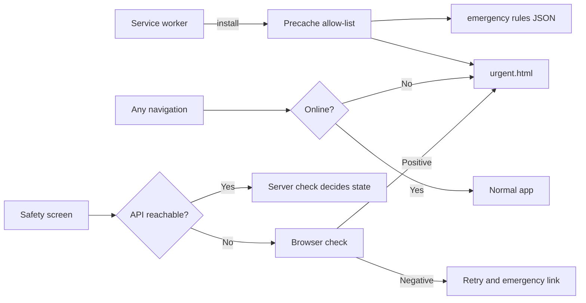
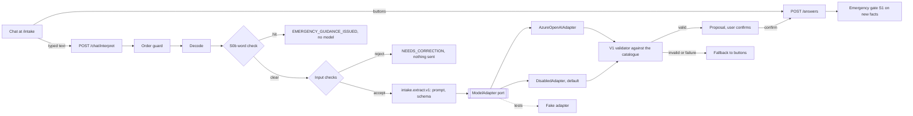
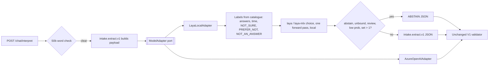
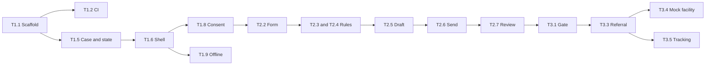

# Referral Flows — Implementation Plan

| Item | Value |
|---|---|
| **Status** | Draft for team review. Python API and React/TypeScript UI source exist; UI/API acceptance, browser coverage and CI verification remain partial or pending. |
| **Version / date** | 0.2, 2026-11-03 |
| **Implements** | [Product spec](product-spec.md) `RF-01` to `RF-17` and `RF-21` |
| **Verified by** | [Test plan](test-plan.md) |

Everything here is `PROPOSED` until the Tech Lead accepts it. Requirements live in the product spec, and this document only says how to build them.

## 1. Schedule

The M1–M3 milestones were drafted against the [BRD delivery plan](../Sanad_AetherHealth_BRD_v0.4.md#17-delivery-plan--change-control); v0.4 P0 additions are tracked separately below.

| Milestone | Dates | BRD phase | Exit |
|---|---|---|---|
| **M1** App foundation | 2–4 Nov | Core workflow | §7 M1 exit criteria |
| **M2** J1 and J4 | 4–6 Nov | Core workflow ends 6 Nov | §7 M2 exit criteria |
| **M3** J2, J3, referral path | 7–12 Nov | Review and lab path ends 12 Nov | §7 M3 exit criteria |
| Evaluation and hardening, including the [uncovered P0 items](product-spec.md#33-prd-p0-items-this-spec-does-not-deliver) | 13–17 Nov | Evaluation | Separate spec |
| Freeze / submission | 19 / 20 Nov | Submission | |

**M1 and M2 together have five working days, and that is tight.** If they slip, keep the safety, consent and order-guard work and cut in this order:

1. RF-16 (J2, exploratory).
2. Polish on the reviewer pages. The four decisions and the gates stay.
3. The CD step (AC-01.4). Run the demo from a local build over HTTPS instead.

Never cut the gate, the emergency path, consent checks or Mock labels. Those are the BRD's stop-the-demo conditions.

## 2. Stack

The specs leave the stack open. This choice follows what they mention and favours speed for a two-week build.

| Layer | Choice | Why |
|---|---|---|
| Web | React, TypeScript, Vite | Fast to build. One app serves patient, reviewer and mock facility routes. |
| Offline | Hand-written service worker, about 50 lines | A short allow-list is easier to audit than a generated cache policy, and AC-05.4 depends on exactly what is cached. |
| API | Python, FastAPI, Pydantic | The PRD names Pydantic for the Gatekeeper, and it generates the OpenAPI schema. |
| Store | SQLite through SQLAlchemy | Enough for a synthetic single-instance demo. No cloud dependency. Swappable later. |
| Types across the boundary | TypeScript generated from OpenAPI | Stops client and server contracts drifting. CI fails on drift. |
| Rules | Versioned JSON read by both Python and TypeScript | The emergency check must run in the browser if the API is down (AC-10.3). |
| Tests | pytest, Vitest, Playwright | Playwright can switch the network off and test mobile viewports. |
| CI/CD | GitHub Actions | The repository is on GitHub. |
| Local run | Docker Compose | Meets the BRD's one-command requirement (AC-01.5). |
| Model adapter (RF-21) | `openai` Python SDK 3.x against Azure OpenAI's v1 API, as an optional `azure` extra | Microsoft's current Python guidance uses the standard `OpenAI` client with `base_url=.../openai/v1/`. Optional, so the default install has no model dependency (INV-01). |

Azure hosting stays a deployment candidate only (`TECH_TBD`). The only Azure-specific code is the optional, off-by-default model adapter (T4.5, CC-011), and nothing else depends on it.

## 3. Repository layout

This follows the README's proposal where it can. The differences are one web app instead of two (R14), and `apps/api` instead of `functions/`, because Azure Functions is unconfirmed.

```text
sanad-front-door/
├── apps/
│   ├── web/
│   │   ├── public/
│   │   │   ├── urgent.html            # RF-05: self-contained, no framework
│   │   │   └── sw.js                  # RF-05: allow-listed precache
│   │   └── src/
│   │       ├── routes/{patient,clinician,mock-facility}/
│   │       ├── components/            # MockBadge, QuickExit, UrgentLink
│   │       ├── session/               # Token handling, quick-exit wipe
│   │       └── api/                   # Generated types and client
│   └── api/
│       └── sanad_api/
│           ├── cases/                 # Case model, state machine, routes
│           ├── consent/               # Ledger, scope checks
│           ├── rules_engine/          # Safety check, signals, floors
│           ├── gatekeeper/            # Completeness, conflicts, units
│           ├── facts/                 # Thin SemanticFact
│           ├── reports/               # Template drafts
│           ├── review/                # Queue, decisions
│           ├── referral/              # Gate, referral, lifecycle
│           ├── mock_facility/         # Mock events
│           ├── tracking/              # Timeline, delayed flag
│           └── audit/                 # Minimal audit log
├── rules/
│   ├── emergency.draft-0.1.json       # CLINICAL_TBD
│   └── triage.draft-0.1.json          # CLINICAL_TBD
├── catalogue/
│   └── questions.draft-0.1.json
├── schemas/
│   └── upload-profile.schema.json     # RF-02: closed schema
├── data/synthetic/assessments/        # One folder per case, PRD §4.2
├── eval/golden/                       # PRD §7 layout
├── scripts/                           # fixture-guard, spec-trace
├── .github/workflows/
└── docker-compose.yml
```

## 4. Key design decisions

### 4.1 Case state

- One table-driven module, `cases/state_machine.py`, holds every allowed transition. All state changes go through `transition(case, event, actor)`. No other code writes `state`.
- `GET /cases/{id}/state` returns state, version, route and allowed actions. The client stores none of these. It redirects on the `route` value, so a reload resumes correctly and storage edits do nothing (AC-04.1, AC-04.6).
- `case_version` goes up with each change to facts. Review decisions and referrals bind to a version (AC-08.5, AC-12.4).

### 4.2 Session

- `POST /cases` returns an opaque token. The client keeps it in `sessionStorage` and sends it as a Bearer header.
- A per-tab token over a cookie means the presenter can hold patient, reviewer and mock facility sessions in one browser, and it matches the OD-03 default.
- Reviewer and mock facility users sign in with seeded demo accounts. Their passwords come from environment variables and never from the repo.

### 4.3 Referral gate

`referral/gate.py` has two parts:

- `evaluate_gate(inputs) -> GateDecision` is a **pure function** with no I/O and no early return, so it collects every failing code. Tests can drive it through the full truth table, including combinations the state machine would never reach.
- `POST /cases/{id}/mock-referral` loads fresh consent, review and case data inside one database transaction, calls `evaluate_gate`, and writes the decision and the referral together. Only this function constructs a `Referral`, and an architecture test enforces that (AC-12.7, AC-12.8).

`GET /cases/{id}/referral-gate` runs the same function for the preview on `/referral`. A preview grants nothing.

### 4.4 Emergency path



- `urgent.html` uses inline CSS and a small inline script for Quick exit. Links to it are plain anchors, so opening it does not depend on the React bundle.
- The service worker handles only `GET` requests that match the allow-list. It never touches `/api/*`, and it is network-only for anything else. API responses set `Cache-Control: no-store`.
- The cache name includes the build SHA, so a new deploy replaces the old copy (AC-05.6).
- Service workers require HTTPS or localhost, so staging must be HTTPS (OD-05).
- The start screen's offline message reads the worker's real state (AC-05.7).

### 4.5 Quick exit

The handler in `session/quickExit.ts` runs in this order and is deliberately synchronous up to the last step:

1. Read the session token into a local variable.
2. Clear the root element's content and reset in-memory stores, including any selected `File`.
3. Clear `sessionStorage` and `localStorage`, leaving Cache Storage alone because it holds only static emergency files.
4. Send the token in the body with `navigator.sendBeacon('/api/session/end', body)`, which is fire-and-forget and may fail silently. Beacons cannot set an `Authorization` header.
5. Call `location.replace(neutralUrl)`.

HTML responses set `Cache-Control: no-store`. A `pageshow` handler treats `event.persisted` as a reason to wipe and redirect, which covers the back-forward cache (AC-09.3).

### 4.6 Rules and drafts

- `rules/*.json` are versioned data files, each rule carrying `rule_id`, `version` and `approval_status: CLINICAL_TBD`. Rule logic reads them. No thresholds are written into code.
- Triggers and thresholds are taken from the README's draft table. **Numeric reference limits and the BMI cut-off need BA and Clinical input and are not invented by engineers.** Until supplied, fixtures use `reference_source` values with explicit test data.
- Proposed rule IDs: `DRAFT-EMERG-01` to `03`, `DRAFT-BMI-CONTEXT-01`, `DRAFT-STEROID-01`, `DRAFT-LAB-BELOW-REF-01`, `DRAFT-LAB-NO-SPERM-01`, `DRAFT-METABOLIC-01`, `DRAFT-GENETIC-01`.
- Drafts come from templates, so the same input always gives the same text (AC-11.5). Evidence sections show "insufficient evidence" until RAG exists.

### 4.7 Mock boundary

- Referral and mock facility code has no outbound client, which an import-lint test enforces (AC-12.8).
- A single `MockBadge` component is the way to show mock status. `eval/mock-screens.json` lists each screen with simulated data, and the E2E audit visits all of them (AC-17.3).
- `PROVIDER_VERIFIED` and `CARE_COMPLETED` are absent from the event enums, so writing them fails validation (AC-13.3).

### 4.8 Delayed flag

Computed on read in `tracking/delay.py` from the last event time, the current time and the configured threshold. There is no background job and no notification path. The clock is injected, so tests can check both sides of the boundary (AC-14.2).

### 4.9 Model adapter (RF-21, ports and adapters)



- **Port.** `model_adapter/port.py` defines `ModelAdapter`: `provider`, `model_id`, `label`, `enabled` and `complete_json(ModelRequest) -> ModelResult`. The request carries the PRD 4.7.2 envelope (task, purpose, schema and prompt versions, catalogue version, one deadline, maximum attempts) and no case ID.
- **Adapters.** `DisabledAdapter` is the default and never touches the network. `AzureOpenAIAdapter` holds only transport: it calls `chat.completions.create` with strict `json_schema` output, maps SDK errors to statuses, and retries within the deadline with SDK retries off. `factory.build_model_adapter` chooses from settings at start-up and fails fast on a bad configuration. Another provider, such as a local SLM, is one new class.
- **Task.** `model_adapter/intake_extract.py` owns the prompt, the per-question schema, the V1 validator and the confirmation label. It is the same for every provider.
- **Precedence.** `chat/routes.py` runs the guard, decoding, S0b (`rules_engine/emergency_text.py`), input checks (`chat/guardrail.py`), then the task. A proposal is never written; the client saves it through `POST /answers`, which runs the existing emergency gate.
- **Trace.** `MODEL_TASK_RUN` and `INPUT_CHECKED` audit events hold codes and counts only.
- **Settings.** `SANAD_MODEL_PROVIDER` (`disabled` or `azure_openai`), `SANAD_AZURE_OPENAI_ENDPOINT`, `SANAD_AZURE_OPENAI_DEPLOYMENT`, `SANAD_AZURE_OPENAI_AUTH` (`api_key` or `entra_id`), `SANAD_AZURE_OPENAI_API_KEY`, `SANAD_MODEL_TIMEOUT_MS` (12000), `SANAD_MODEL_MAX_ATTEMPTS` (2), `SANAD_MODEL_MAX_COMPLETION_TOKENS` (800). The defaults are the PRD's engineering defaults and stay `TECH_TBD` (OQ-32).
- **Where settings live.** `config.Settings.from_env` reads `apps/api/.env` (Git-ignored, located from the package, or `SANAD_ENV_FILE`) through `python-dotenv`, overlaid by the real environment, which wins. `os.environ` is not changed, values are literal, and empty values count as unset. `apps/api/.env.example` is the committed template with placeholders only; a test fails if it holds a key or password or turns the model on. Hosted deployments use protected app settings or Key Vault instead of a file.

### 4.10 Local decision model (RF-25)



- **Why behind the same port.** The task, its schema, validator, trace and fallback stay identical, so the RF-23 harness compares providers on the same case file and the route code does not change.
- **Backends.** `laya` (PyTorch; CPU, CUDA, MPS) is the portable default and the one Windows hosts use. `laya-mlx` is an Apple Silicon port with the same `load` and `predict` calls; it is optional and never required in CI.
- **Setup notes.** Install with `pip install -e "apps/api[decision]"`. Set `USE_TF=0` if TensorFlow is installed, because the upstream model card reports a hang at load otherwise. Download the pinned revision once, then run with `HF_HUB_OFFLINE=1`. The checkpoints total about 2.3 GB; only the English checkpoint is in scope.
- **Calibration.** Upstream describes the shipped checkpoints as over-confident and thresholds as policy choices to fit on one's own data. `SANAD_DECISION_MIN_PROB` is therefore set from the scorecard, not from vendor guidance. Fitting a per-question head (`agent.fit`) needs a few hundred labelled rows; it is planned as T4.11 under CC-017, after zero-shot runs of both engines failed OD-15 (checkpoint 0.26, vegaml 0.17, both with zero unsafe conversions).
- **Fitted head (T4.11).** The vegaml engine keeps the reader frozen and fits a small head per question on the rows of AC-25.13, then a temperature, a conformal threshold and a band placed where precision holds at 0.95 on held-out rows. Routing then comes from the band, not from a guessed confidence. The fit reads only synthetic rows reviewed by a second team member (OD-18); the RF-23 cases stay unseen, so the scorecard measures transfer, not recall. A passing scorecard is still not evidence of accuracy on real patients' wording.

## 5. API

The full contract, including endpoints, access checks, action rules and error codes, is in the [API design](api-design.md). Each endpoint there names the task that builds it.

## 6. Tasks

Owners follow the [README team table](../../README.md#team) as a suggestion and need confirming. "Status" is updated in the PR that finishes the task.

### M1 App foundation

| Task | Work | Delivers | Depends on | Suggested owner | Status |
|---|---|---|---|---|---|
| T1.1 | Monorepo scaffold, Docker Compose, quickstart in README, real commands in AGENTS.md | AC-01.5 | None | Trung | Not started |
| T1.2 | CI workflow, required checks, `fixture-guard`, `spec-trace`, secret scan | AC-01.1, AC-01.3 | T1.1 | Trung | In progress; backend pytest and Ruff workflow added, remaining checks and branch protection pending |
| T1.3 | Branch protection on `main` (needs repo admin) | AC-01.2 | T1.2 | Trung | Not started |
| T1.4 | CD to HTTPS staging with `/version` | AC-01.4 | T1.2, OD-05 | Trung | Not started |
| T1.5 | Case model, state machine table, audit log, session token, state API, OpenAPI type generation | AC-04.3, AC-04.4, AC-04.6, AC-04.7, INV-03, INV-04, INV-09 | T1.1 | Trung, Vinh | Not started |
| T1.6 | Patient shell, route guard, UrgentLink, QuickExit placeholder | AC-04.1, AC-04.2, AC-05.8, INV-10, INV-11 | T1.5 | Vinh | In progress; patient shell and API-state routing present, acceptance/CI verification pending |
| T1.7 | Start screen with samples, file selection and blank start | AC-02.1, AC-02.2, AC-02.3, AC-02.6 | T1.6 | Vinh | In progress; blank and synthetic sample starts present; file-selection/upload UI remains outstanding |
| T1.8 | Consent screen, consent ledger, `/privacy`, `/education` | AC-03.1 to AC-03.6 | T1.5, T1.6 | Vinh, Trung | In progress; screens use consent API/catalogue; acceptance/CI verification pending |
| T1.9 | `urgent.html`, service worker, offline indicator | AC-04.5, AC-05.1 to AC-05.7 | T1.6 | Vinh | In progress; static emergency page/cache path present; offline acceptance checks and content approval pending |
| T1.10 | First fixtures, upload schema and validator, profile API | AC-02.4, AC-02.5, INV-02 | T1.5, T1.8 | Đạt, Vinh | Not started |
| T1.11 | Consent, emergency and education copy draft, tagged `CLINICAL_TBD` where clinical | Copy for AC-03.1, AC-05.5, INV-08 | None | Đạt | In progress; unreviewed education claims removed from UI; reviewed patient-facing education/emergency copy remains pending |

### M2 J1 and J4

| Task | Work | Delivers | Depends on | Suggested owner | Status |
|---|---|---|---|---|---|
| T2.1 | Emergency catalogue, server and browser checks, safety screen, late-trigger edge | AC-10.1 to AC-10.7, INV-01, INV-07 | T1.9 | Trung, Vinh | In progress; draft catalogue is shared with browser screen; browser acceptance checks and clinical content approval pending |
| T2.2 | Question catalogue, follow-up form, field states | AC-06.1 to AC-06.6, INV-05 | T1.8 | Vinh, Đạt | In progress; catalogue-driven intake and explicit unknown/declined states present; acceptance/CI verification pending |
| T2.3 | Thin `SemanticFact` and Gatekeeper | AC-06.3, AC-11.2 | T2.2 | Trung | Not started |
| T2.4 | Triage rules, risk signals, floor enforcement | AC-11.1, AC-11.5, AC-11.6, INV-06 | T2.3 | Trung | Not started |
| T2.5 | Template drafts for patient and reviewer, `/result` | AC-11.3, AC-11.4 | T2.4 | Vinh | In progress; patient report screen reads API draft; acceptance/CI verification pending |
| T2.6 | MockBadge and send button with just-in-time consent | AC-07.1 to AC-07.6, AC-17.1, AC-17.2, AC-17.4 | T2.5 | Vinh | In progress; review request and consent checks are wired; acceptance/CI verification pending |
| T2.7 | Reviewer sign-in, role checks, queue, detail, decisions, version conflict, banner | AC-08.1 to AC-08.9 | T2.6 | Vinh, Trung | In progress; Mock Reviewer sign-in, queue and decision UI present; negative-path/CI verification pending |
| T2.8 | Quick exit, full wipe, session end, back-forward cache protection, neutral titles | AC-09.1 to AC-09.8 | T1.9, T1.6 | Vinh | In progress; pre-network screen/storage wipe, BFCache redirect and neutral titles are wired; acceptance/CI verification pending |
| T2.9 | Remaining J1, J4 and J5 fixtures, golden cases, J1 and J4 E2E | Journey tests in the test plan | T2.1 to T2.8 | Đạt, Hoàng | Not started |

### M3 J2, J3 and the referral path

| Task | Work | Delivers | Depends on | Suggested owner | Status |
|---|---|---|---|---|---|
| T3.1 | `evaluate_gate`, send endpoint, preview endpoint, architecture tests | AC-12.1 to AC-12.5, AC-12.7 to AC-12.9 | T2.7 | Trung | Not started |
| T3.2 | `NAVIGATION_STARTED`, `/referral` screen, three-condition display | AC-12.6 | T3.1 | Vinh | In progress; referral gate and J9/J10 UI are wired to API; acceptance/CI verification pending |
| T3.3 | Referral and event models, lifecycle table | AC-13.2, AC-13.3, AC-13.6 | T3.1 | Trung | Not started |
| T3.4 | Mock facility console and mock directory | AC-13.1, AC-13.2, AC-13.4, AC-13.5 | T3.3 | Vinh | In progress; Mock Facility screen is wired to API; acceptance/CI verification pending |
| T3.5 | Tracking screen, timeline, delayed flag | AC-14.1 to AC-14.7 | T3.3 | Vinh, Trung | In progress; tracking screen reads API timeline and state; acceptance/CI verification pending |
| T3.6 | Consent revocation in flight | AC-13.4, OD-10 | T3.4 | Trung | Not started |
| T3.7 | J3 lab entry, confirmation, conflict handling, draft rules | AC-15.1 to AC-15.6 | T2.5 | Vinh, Hoàng | Not started |
| T3.8 | J2 selective evidence (drop first if late) | AC-16.1 to AC-16.4 | T3.1 | Vinh, Đạt | Not started |
| T3.9 | Mock label audit, full E2E, demo script for this flow | AC-17.3 | T3.1 to T3.7 | Hoàng, Đạt | Not started |

### v0.4 bounded additions

These are additive P0 backend/design tasks from PRD v0.4; they do not activate clinical rules or external integrations.

| Task | Work | Delivers | Depends on | Suggested owner | Status |
|---|---|---|---|---|---|
| T4.1 | Optional psychosocial micro-intake, separate provenance store, consent guard, report context only | PRD-FR-29/30, PRD-AC-42/43 | T2.2, T2.5 | Backend, Product | In progress; API and intake/report UI source present, acceptance tests and review pending |
| T4.2 | Session-bound guidance acknowledgement, idempotent progress/barrier writes, retention deletion and funnel | PRD-FR-24 to 28, PRD-AC-35 to 41 | T3.2 | Backend, Security, QA | In progress; API and `/referral` J9/J10 UI source present, TC-19.6 added, frontend acceptance/CI and review pending |
| T4.3 | Versioned conceptual FHIR R4 mapping manifest; no export or conformance claim | PRD-FR-31, PRD-AC-46/48 | T1.10, T3.7 | Backend, Architect | In progress; manifest present, review pending |
| T4.4 | Synthetic fixture provenance manifest and startup file-integrity validation; keep unreviewed ranges explicit | PRD-FR-32, PRD-AC-45 | T2.9, T3.7 | QA, Clinical Advisor | In progress; manifest/loader present, review pending |
| T4.5 | Chat intake at `/intake`, model adapter port, disabled and Azure OpenAI adapters, `intake.extract.v1` task and validator, stage 2a word check, input checks, chat endpoints, trace events | RF-21, AC-21.1 to AC-21.12; PRD-FR-04/37/38/40 | T2.1, T2.2, T4.1 | Backend, Frontend, Security | In progress; API, adapters, chat UI and TC-21.1 to TC-21.12 (pytest) present. Spec review, CC-011 and CC-012 approval, browser E2E and a run against a real Azure deployment pending. Provider off by default. |
| T4.6 | Team-curated passage file and loader, `TEAM_CURATED` evidence refs, citation fields in the report, `report.explain.v1` task and validator, `POST /cases/{id}/report/explanation` | RF-22, AC-22.1 to AC-22.10; BR-08, PRD-FR-07/37/38 | T4.5, CC-013 | Backend, Security; passage selection: team with clinical input | In progress; backend and TC-22.1 to TC-22.10 (pytest) present, smoke-run once against a real Azure deployment with a synthetic passage. The shipped passage file is empty until the team selects sources. Patient UI, spec review and CC-013 approval pending. Provider off by default. |
| T4.7 | Evaluation case files for `intake.extract.v1` and `report.explain.v1`, replay and Azure runner reusing the production task code, scorecard, CI replay job; per-case model call cap; token counts in `MODEL_TASK_RUN`; `GET /evaluation/model-runs` | RF-23, AC-23.1 to AC-23.10; PRD-FR-14/18, NFR-14, HR-25 | T4.5, T4.6 | Backend, QA | In progress; budget, token trace, `GET /evaluation/model-runs`, 43 synthetic cases, runner, CI replay step and TC-23.1 to TC-23.10 (pytest) present. Live runs on gpt-6-luna (2026-11-14, two runs): intake 27/27 and explanation 5/5 on live cases, zero unsafe conversions, p95 latency 2.2–3.4 s. Spec review and a reviewer UI panel for the metrics pending. |
| T4.8 | `decision_record` in the reviewer detail, built from stored facts, rules, catalogues and model-run audit entries | RF-24, AC-24.1 to AC-24.4; PRD-FR-08, HR-14 | T2.7, T4.7 (model-run list) | Backend, Frontend (reviewer page) | In progress; `decision_record` in `GET /reviews/{case_id}` and TC-24.1 to TC-24.4 (pytest) present; collapsible "Decision record" panel on the reviewer page. Browser check and spec review pending. |
| T4.9 | `LayaLocalAdapter` behind the model port, optional extra `apps/api[decision]`, settings and start-up checks, label mapping and abstain rules, `--provider laya_local` in the evaluation runner, RUNBOOK setup for Windows (torch, CPU) and macOS (laya-mlx) | RF-25, AC-25.1 to AC-25.10; OD-16, OD-17 | T4.7, CC-015 | Backend, QA, Security | In progress; `LayaLocalAdapter`, `[decision]` extra, settings, local disclosure, `--provider laya_local`, RUNBOOK section and TC-25.1 to TC-25.9 present (stub in CI). Live local run 2026-11-14 (laya 0.4.31, reviewed revision `55cf4c4e`, CPU): 23 in-scope cases, accuracy 0.26, **zero unsafe conversions**, p50 169 ms, p95 195 ms, peak 2.8 GB; 9 cases outside its scope (numbers, explanation). Zero-shot top labels are often wrong and lowering the 0.80 threshold would create unsafe conversions, so it fails OD-15 and **stays off**. Weight licence unconfirmed: local evaluation only. |
| T4.10 | Optional offline bake-off of hosted Jev: an evaluation-only provider in `eval/`, never imported by `sanad_api`, using the same label mapping as T4.9 | RF-23 AC-23.2 extension, OD-16 | T4.9, CC-014 approval, API access | Backend, Security | Withdrawn 2026-11-14: the team dropped hosted Jev (CC-014 withdrawn). Not planned. |
| T4.11 | Fitted decision head: `SANAD_LAYA_ENGINE` and `SANAD_LAYA_CALIBRATION` settings and checks, label family as the decision key, `route`/`calibrated` abstain rules, rows file `eval/decision/intake_rows.v0.1.jsonl`, `eval/fit_decision_head.py`, scorecard fields | RF-25, AC-25.11 to AC-25.14; OD-15, OD-17, OD-18 | T4.9, CC-017 | Backend, QA, Security | In progress. Settings, label-family key, `calibrated`/`route` abstain, rows file (306 rows, `MODEL_DRAFTED_UNREVIEWED`), `eval/fit_decision_head.py`, scorecard fields and TC-25.10 to TC-25.12 present. Fitted run 2026-11-14: accuracy 0.87 on the unseen RF-23 cases, **zero unsafe conversions**, p50 350 ms; misses abstained. Below OD-15, so it **stays off**. Rows await second-person review (OD-18). |
| T4.12 | Identifier blocking and redaction: `TEXT_CONTAINS_IDENTIFIER` in the chat guardrail, `redact()` in the same module called from the `intake.extract.v1` builder, `redactions`/`redaction_count` in `MODEL_TASK_RUN`, `redacted_types` in the interpret response and chat line, identifier cases and `pii_leaks` in the RF-23 runner | RF-27, AC-27.1 to AC-27.8; OD-19 | T4.5, T4.7, CC-018 | Backend, Frontend, Security | Not started. Spec only. |

### Harness implementation (CC-016; code present, acceptance pending)

These tasks are outside the current M1–M3 exit path. The requester explicitly asked for the bounded code implementation and identified themself as Product/Security approver. Formal Tech Lead review, M3 exit criteria, acceptance checks and CC-016 closure remain pending. No task may add a clinical rule or runtime model call under this scope.

| Task | Work | Delivers | Depends on | Suggested owner | Status |
|---|---|---|---|---|---|
| T5.11 | Preserve the existing emergency ordering, closed API schemas, reason-code errors and single Python `evaluate_gate` referral path; add structured input guardrail | RF-26, AC-26.1/2, HR-01/02/10/19/28 | M3 exit, CC-016 | Backend, Security, QA | Code present; TC-HR acceptance and formal review pending |
| T5.12 | Optional Langfuse spans with explicit field allowlist, off-by-default config, no automatic body/prompt capture and non-blocking exporter failure | RF-26, AC-26.4/5, PRD NFR-03/08/21 | T5.11, Tech Lead review, self-hosted endpoint/operator configuration | Backend, Security | Code present; TC-HR acceptance and operator configuration pending |
Mode A MCP code now covers the empty source manifest and topic catalogue, read-only database schema, pinned tool manifest, and stdio server. Offline ingestion, shared report citation verification and the CI checks remain open. Mode B case-context and calendar MCP remain dependent on PRD-FR-37 and separate change control. The existing Python referral gate is the policy engine for this scope; adopting OPA/Cedar is not proposed.

### Critical path



T1.5 and T3.1 carry the most design risk and should get the closest review.

## 7. Milestone exit criteria

Every item is required to exit its milestone. "Blocking tests" means the tests marked `B` in the [test plan](test-plan.md) for that milestone's requirements.

**M1**
- [ ] All M1 blocking tests pass in CI.
- [ ] A broken branch is shown to be blocked from merging.
- [ ] Offline emergency guidance is confirmed on a real phone, not only in Playwright.
- [ ] A wrong-order URL and a forbidden API call are both refused in a demo run.

**M2**
- [ ] All M2 blocking tests pass in CI.
- [ ] J1 runs from sample to reviewer decision, with the Mock banner visible.
- [ ] J4 reaches guidance with no model configured and with the API stopped.
- [ ] Quick exit passes the manual checklist on a real phone.

**M3**
- [ ] All M3 blocking tests pass in CI.
- [ ] A live run shows the referral blocked for each missing condition, then allowed once all three pass.
- [ ] A mock referral runs through accept, appointment and close, and through reject, and the delayed flag appears and clears.
- [ ] The Mock label audit passes.
- [ ] J3 completes from lab entry to mock referral.

## 8. Risks

| Risk | Effect | Response |
|---|---|---|
| No clinical advisor before the demo (BRD R-07) | Emergency and floor content stays unapproved | Stays labelled simulated. Escalate OD-02 now. |
| Clinical values missing for rules | J1 BMI context and J3 rules cannot be finalised | Fixtures carry explicit test values, labelled draft. BA obtains values, and engineers do not choose them. |
| Service worker behaves differently on iOS Safari | Offline guarantee fails on a common phone | Manual check on a real iPhone at M1 exit. Fix before M2. |
| Staging is not HTTPS or Azure is unconfirmed (OD-05) | Offline does not work in a deployed demo | Decide by 3 Nov. The fallback is any HTTPS container host. |
| M1 and M2 run past 6 Nov | M3 compresses, and evaluation time shrinks | Apply the cut order in §1. |
| J9, J10, evidence and funnel unplanned | MVP not met even if M3 passes | Raise with Product now. Needs a follow-up spec. |
| Session lasts only as long as the tab (OD-03) | A real facility's slow response could not be tracked | Acceptable for a demo. Stated as a limitation. Must change before any pilot. |
| Shared device or real data typed in | Privacy exposure | "Do not enter real data" notices, a closed upload schema, no-store responses, Quick exit. |

## 9. Before starting

Needed to begin M1:

- [ ] Tech Lead accepts §2 and §3.
- [ ] Owners are confirmed against §6.
- [ ] Repo admin access is available for T1.3.

Needed soon, but not blocking the start:

- [ ] OD-05 (deploy target) by 3 Nov.
- [ ] OD-01 (send button meaning) by the start of T2.6.
- [ ] Rule values from BA and Clinical by the start of T2.4.
- [ ] OD-12 (who approves the change-control items) before the M3 demo.
