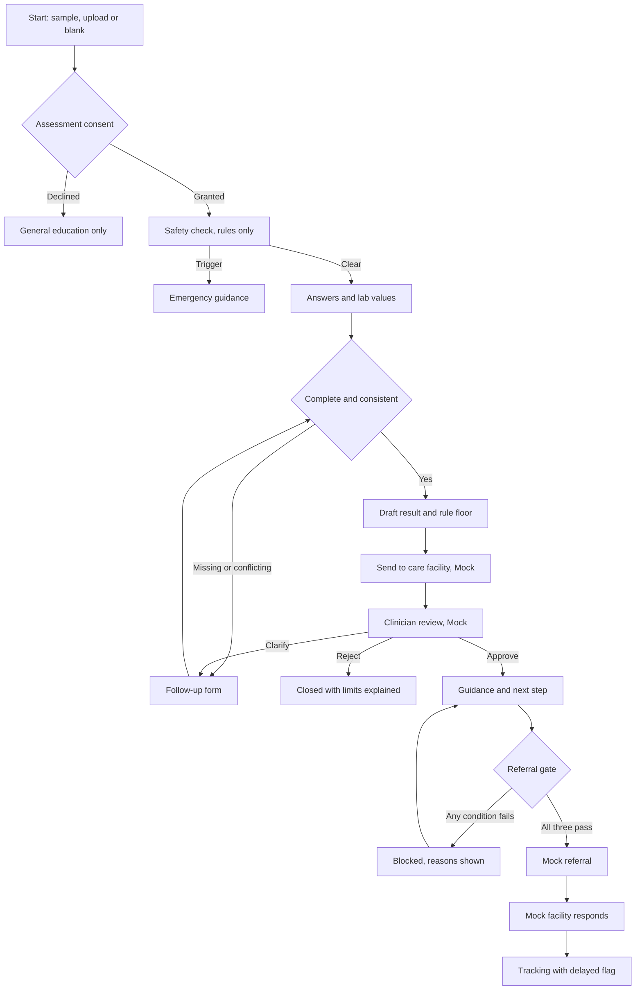
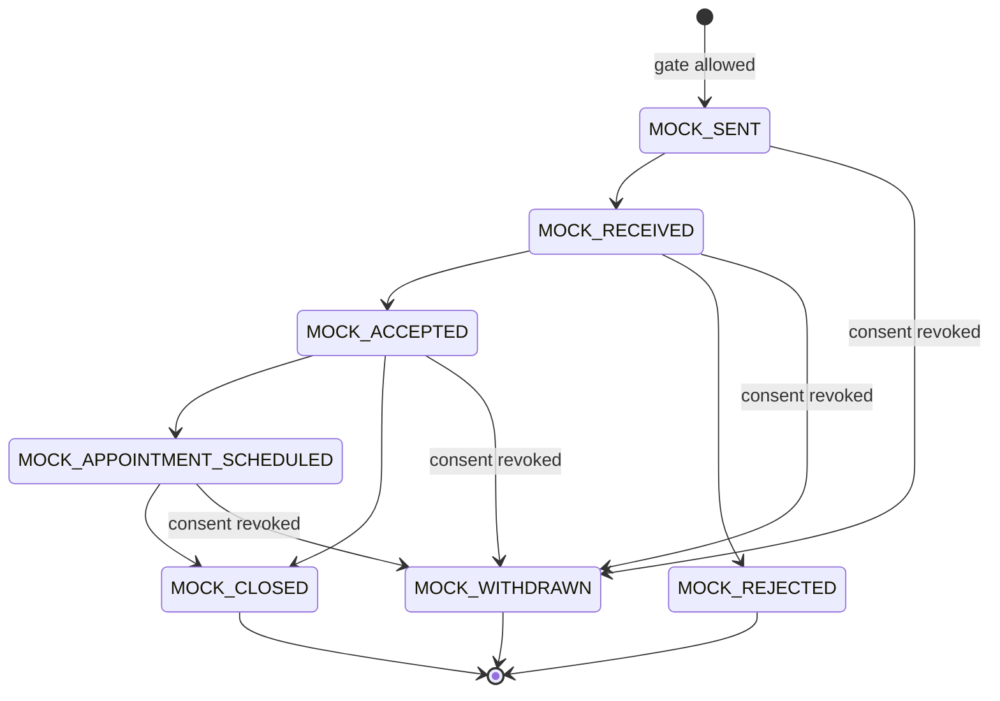

# Referral Flows — Product Spec

| Item | Value |
|---|---|
| **Document ID** | `AETHERHEALTH/SANAD/SPEC/REFERRAL-FLOWS/0.2` |
| **Status** | Draft for team review. Not approved. Clinical content not approved. |
| **Version / date** | 0.2, 2026-11-12 |
| **Parent documents** | [BRD v0.4](../Sanad_AetherHealth_BRD_v0.4.md), [PRD v0.4](../Sanad_AetherHealth_PRD_v0.4.md); this document retains the v0.3 M1–M3 referral-flow detail where not superseded |
| **Companion documents** | [Implementation plan](implementation-plan.md), [API design](api-design.md), [Test plan](test-plan.md), [Change log](change-log.md) |
| **Milestones** | M1 App foundation, M2 Journeys J1 and J4, M3 Journeys J2 and J3 plus the referral path |

> **Boundary.** Sanad is a research prototype and not a medical device. This flow uses synthetic data only. Clinical rules are drafts (`CLINICAL_TBD`), review is simulated, and every facility, referral and appointment is **Mock**. Nothing here reaches a real clinic.

## 1. Summary

This spec turns the team's three-part brief into testable requirements for the path from first screen to a tracked mock referral:

1. A visitor picks a sample profile or uploads synthetic data, then sees exactly what consent covers.
2. The app remembers the case's step and refuses wrong-order moves. Emergency guidance stays open at all times, including offline.
3. Missing information is asked for, not guessed. The user can send the case for review, and a reviewer decides. The user can leave and wipe the screen with one tap.
4. A referral goes out only when the user has consented, the reviewer has approved and the backend allows it.
5. A mock facility responds, and the user can follow the case and see when it is delayed.



Two things sit outside this path. Emergency guidance and Quick exit are available from every patient screen.

## 2. Source brief and requirement map

The original brief is quoted so reviewers can check the interpretation. Rows marked *implied* are not in the brief, but the journey it names cannot run without them.

| ID | Brief (verbatim) | Requirement | Milestone |
|---|---|---|---|
| RF-01 | Dựng hệ thống tự động build và kiểm tra code (CI/CD) để cả nhóm đẩy code lên không bị lỗi. | CI/CD pipeline with merge protection | M1 |
| RF-02 | Làm màn hình bắt đầu, nơi người dùng chọn một hồ sơ mẫu hoặc tải dữ liệu lên. | Start screen | M1 |
| RF-03 | Làm màn hình hỏi sự đồng ý, nói rõ dữ liệu được dùng để làm gì. | Consent screen | M1 |
| RF-04 | Làm chức năng ghi nhớ từng bước của ca khám, để người dùng không nhảy cóc sang bước sai. | Case step memory and order guard | M1 |
| RF-05 | Làm màn hình hướng dẫn cấp cứu, mở được ngay cả khi mất mạng. | Offline emergency guidance | M1 |
| RF-06 | Làm form hỏi thêm khi thiếu thông tin. | Follow-up form | M2 |
| RF-07 | Làm nút "Gửi cho cơ sở y tế" ... | Send to care facility (Mock) | M2 |
| RF-08 | ... và trang bác sĩ để duyệt ca. | Clinician review page | M2 |
| RF-09 | Làm chức năng thoát nhanh (quick-exit) xóa sạch dữ liệu trên màn hình khi người dùng bấm. | Quick exit | M2 |
| RF-10 | *Implied by* "chạy được hành trình J1 và J4" | Safety check and J4 | M2 |
| RF-11 | *Implied by* "chạy được hành trình J1 và J4" | J1 facts, rule floor and draft result | M2 |
| RF-12 | Làm cổng gửi chuyển tuyến. Cổng này chỉ cho gửi khi đủ 3 điều kiện: người dùng đồng ý, bác sĩ đã duyệt, và backend cho phép. Thiếu điều kiện nào thì bị chặn. | Referral gate | M3 |
| RF-13 | Làm giả lập phía cơ sở y tế (nhận ca, từ chối, hẹn khám...). | Mock facility | M3 |
| RF-14 | Làm màn hình theo dõi ca đã gửi đi đến đâu, có cờ khi bị treedx | Tracking with delayed flag. "treedx" is read as a typo for *trễ* (delayed). | M3 |
| RF-15 | *Implied by* "hoàn thiện J2, J3" | J3 manual lab entry | M3 |
| RF-16 | *Implied by* "hoàn thiện J2, J3" | J2 selective evidence (exploratory) | M3 |
| RF-17 | Mọi chỗ giả lập phải ghi rõ là "Mock" để không nhầm với dữ liệu thật. | Mock labelling across the app | M2, M3 |
| RF-18 | Add bounded deterministic harness controls, optional redacted observability and read-only authoring-time MCP. | Harness controls proposal (CC-011); no runtime model calls or new clinical rules | Post-M3, pending review |
| RF-21 | *Added 2026-11-08 by change request* (chat intake using Azure OpenAI, UX flow v0.3 step 4). Parent contracts: PRD-FR-04, PRD-FR-37, PRD 4.7.1–4.7.2. `PROPOSED`, CC-011 and CC-012. | Chat intake with a bounded model adapter | v0.4 additions |

RF-18 to RF-20 are not used, because `TC-18.*` to `TC-20.*` already name the PRD v0.4 psychosocial, navigation and FHIR tests in the test plan.

## 3. Scope

### 3.1 In scope

- Everything in §2, in English, mobile-first for patients and desktop-first for reviewer and mock facility pages.
- Deterministic rules and template-built drafts. No model decides anything in the flow.
- One bounded model task, off by default: matching a typed chat message to an answer from the question catalogue, for the user to confirm (RF-21, `PROPOSED`).
- Synthetic fixtures for J1, J2, J3, J4, J5 and consent-negative cases.

### 3.2 Out of scope

- Real referrals, real clinics, booking, payments, FHIR or EHR links, and any outbound message other than RF-21's optional model request.
- LLM or SLM tasks other than RF-21's answer matching, RAG, knowledge registry and OCR. PDF or image upload is excluded with them.
- Arabic and RTL, reminders and notifications, spouse sharing features, and care plans.
- J6, J7 and J8.

RF-18 is a review proposal only. These out-of-scope items remain excluded until CC-011 is approved; its Mode A MCP proposal must also resolve the source-manifest, protocol and knowledge-store decisions in `mcp-context-design.md`.

**Parent-scope conflicts to resolve:** this draft lists Arabic/RTL as out of scope, while BRD §8.1 lists Arabic/English and key-screen RTL in P0, BRD FR-11 marks it P1, and PRD-FR-11 marks it Should. BRD §8.1 also calls for P0 evaluation/reporting while BRD FR-14 marks its dashboard P1 and PRD-FR-14 marks golden-set evaluation Must. PRD-AC-40 separately requires a J9/J10 funnel dashboard. Product must reconcile these classifications; this draft does not choose among them.

### 3.3 PRD P0 items this spec does not deliver

**Finishing M1 to M3 does not finish the MVP.** These P0 items still need their own spec and owner:

| Item | PRD reference | State after M3 |
|---|---|---|
| J9 acknowledgement and self-reported progress | PRD-FR-24, PRD-FR-25 | API and `/referral` UI source are present under T4.2; frontend acceptance checks, CI and review remain pending. |
| J10 care barriers and support | PRD-FR-26 | Session-bound API and `/referral` UI source are present under T4.2; frontend acceptance checks, CI and review remain pending. |
| Defer and no-update handling beyond Quick exit | PRD-FR-28 | Partly covered: leaving is never recorded as failure |
| Evidence retrieval and citations | PRD-FR-07 | Abstention only: claims show "insufficient evidence" (AC-11.4) |
| Funnel metrics and evaluation report | PRD-FR-14, PRD-FR-27 | Closed-loop funnel API and a reviewer-console panel are present. Golden-set evaluation runner, failure-case dashboard and report export are not built. |
| J5 as a demonstrated journey | BRD §15 item 4 | Mechanism built in RF-06. Fixtures included, no separate demo script. |

J9/J10 are now tracked in T4.2, matching PRD v0.4. The implementation status above records source presence separately from acceptance and review.

## 4. Actors and access

| Actor | Identity | Can | Cannot |
|---|---|---|---|
| **Patient user** | Pseudonymous session token, no account | Use patient screens for their own case only | See another case, review, act as facility |
| **Reviewer** (simulated clinician) | Seeded demo account, role `REVIEWER` | Read consented cases, record decisions | Send referrals, grant consent |
| **Mock facility operator** | Seeded demo account, role `MOCK_FACILITY` | Read approved mock referral packets, post mock events | Read cases with no referral, change triage or review |

Tokens are per browser tab, so a presenter can run all three roles side by side in one browser.

## 5. Screens and case state

### 5.1 Screens

| Route | Screen | Milestone | Source |
|---|---|---|---|
| `/` | Start | M1 | PRD Screen 1 |
| `/consent` | Consent | M1 | PRD Screen 2 |
| `/privacy` | Review or revoke consent | M1 | PRD Screen 2 |
| `/education` | General education | M1 | PRD-AC-02 |
| `/urgent.html` | Emergency guidance, static and offline | M1 | PRD Screen 3 |
| `/safety` | Safety check | M2 | PRD Screen 3 |
| `/intake` | Answers and follow-up form. Opens in the chat view (RF-21), with the form one tap away. | M2 | PRD Screen 4 |
| `/result` | Draft result and send button | M2 | PRD Screen 6 |
| `/clinician`, `/clinician/cases/:id` | Review queue and case detail | M2 | PRD Screen 7 |
| `/lab` | Manual lab entry | M3 | PRD Screen 5 |
| `/referral` | Referral gate | M3 | PRD Screen 8 |
| `/tracking` | Tracking | M3 | PRD Screen 8 |
| `/mock-facility` | Mock facility console | M3 | New |

Patient screens other than `/urgent.html` show the current state's content only. Every patient screen, including `/urgent.html`, shows Quick exit, and all the others show a link to `/urgent.html`.

### 5.2 Which step each case state allows

The case state machine is PRD §4.7 with the additions in §10. The backend returns the state, and the client routes on it.

| Case state | Patient route |
|---|---|
| `DRAFT` | `/consent` |
| `EDUCATION_ONLY` | `/education` |
| `CONSENTED` | `/safety` |
| `EMERGENCY_GUIDANCE_ISSUED` | `/urgent.html` |
| `ASSESSING` | `/result` when a draft exists, otherwise `/intake` or `/lab` |
| `NEEDS_INFORMATION`, `REVISION_REQUIRED` | `/intake` |
| `PENDING_CLINICIAN_REVIEW` | `/tracking` |
| `APPROVED`, `REPORT_RELEASED`, `GUIDANCE_AVAILABLE`, `REJECTED` | `/result` |
| `NAVIGATION_STARTED` | `/referral` |
| `REFERRAL_REQUESTED` | `/tracking` |
| `CLOSED` | `/tracking` if a referral exists, otherwise `/` with the session ended |
| `CONSENT_REVOKED` | `/privacy` |

`APPROVED` moves through `REPORT_RELEASED` to `GUIDANCE_AVAILABLE` without user action. `NAVIGATION_STARTED` is set when the user chooses to explore a next step on `/result`.

### 5.3 Mock referral lifecycle

The case stays in `REFERRAL_REQUESTED` while this separate lifecycle runs. When the referral reaches an end state, the case moves to `CLOSED`.



`MOCK_CLOSED` means the mock facility has finished with the demo case. It does not mean care took place. Each case can have one referral in this version.

## 6. Requirements: M1 App foundation

### RF-01 CI/CD pipeline

Protects the team from merging broken code. PRD mapping: NFR-05. BRD mapping: NFR-06.

| ID | Acceptance criterion |
|---|---|
| AC-01.1 | Given a pull request to `main`, the required checks run: lint and types, unit tests, API tests, build, E2E, secret scan, fixture guard and spec traceability. |
| AC-01.2 | A pull request cannot merge while a required check fails or before one approving review. |
| AC-01.3 | Checks on pull requests pass with no LLM key and no cloud secret. |
| AC-01.4 | A merge to `main` deploys to an HTTPS staging URL that reports its commit SHA. A failed deploy leaves the previous version live. |
| AC-01.5 | From a fresh clone, one documented command starts the app with fixtures loaded. |

### RF-02 Start screen

Lets the user begin with a sample profile, an upload or a blank case, before any health data is collected. PRD mapping: PRD-FR-01, PRD-AC-01, PRD-AC-23. BRD mapping: BR-01, BR-18.

Upload accepts **synthetic structured data only**. A template is offered for download.

| ID | Acceptance criterion |
|---|---|
| AC-02.1 | With no login, the screen shows the sample list, upload, a blank start, the emergency link, Quick exit and a "not a diagnosis" notice. It asks for no name, phone or email, and requires no appointment. |
| AC-02.2 | Choosing a sample or blank start creates a `DRAFT` case with a random `case_id` containing no personal data, then opens `/consent`. No profile data is applied to the case yet. |
| AC-02.3 | Selecting a file sends nothing and does not read the file's content until assessment consent is granted. |
| AC-02.4 | After consent, a valid file loads into the case. Its values carry `source: USER_UPLOADED` and `verification_status: UNVERIFIED`. |
| AC-02.5 | The app rejects a file that is not JSON, exceeds 256 KB, fails the schema, has any field outside the schema, or lacks `is_synthetic: true`. The error names the rule broken, repeats none of the file's content, and stores nothing. |
| AC-02.6 | Declining consent discards the selected file reference. |

Limit to state in the UI: the app cannot prove a file is synthetic. The closed schema has no fields for names or contact details, which reduces the risk but does not remove it. The upload area says "Do not upload real health data".

### RF-03 Consent screen

States what the data is used for, purpose by purpose, before any is collected. PRD mapping: PRD-FR-02, PRD-AC-02, PRD-AC-03. BRD mapping: BR-01, BR-02, BR-12.

| ID | Acceptance criterion |
|---|---|
| AC-03.1 | Each of the five scopes (`assessment`, `clinician_review`, `provider_share`, `spouse_share`, `research_use`) states what data it covers, what it is used for, who sees it and what happens if it stays off. Scopes this flow does not use say so. All start off. |
| AC-03.2 | Granting `assessment` saves a `ConsentRecord` with consent version and timestamp and moves the case to `CONSENTED`. |
| AC-03.3 | Declining moves the case to `EDUCATION_ONLY`. No assessment data is stored, and education and emergency guidance stay available. |
| AC-03.4 | Granting `assessment` leaves every other scope off, checked at the API. |
| AC-03.5 | From `/privacy` the user can revoke any scope. New actions needing it are denied from that moment, and the audit entry holds no health content. |
| AC-03.6 | Writing patient data without active `assessment` consent returns 403 `CONSENT_REQUIRED`, and nothing is stored. |

### RF-04 Case step memory and order guard

Keeps each case on its correct step. The server holds the step, and the client only holds a session token. PRD mapping: PRD §4.7, state-transition metric. BRD mapping: BRD §7.1 stateful handoff.

| ID | Acceptance criterion |
|---|---|
| AC-04.1 | Reloading the tab returns to the current step with the case's data intact. |
| AC-04.2 | Opening a route the current state does not allow, by URL or the Back button, redirects to the allowed step and changes nothing. |
| AC-04.3 | An API call for a transition not allowed from the current state returns 409 `INVALID_TRANSITION`, leaves the state unchanged and writes an audit entry. |
| AC-04.4 | Every allowed edge of the state machine is accepted and every other pair is rejected, tested from one table. |
| AC-04.5 | The route guard never applies to `/urgent.html`, in any state and with or without a session. |
| AC-04.6 | Editing browser storage or client state cannot advance a case. |
| AC-04.7 | A missing, expired or ended session opens the start screen and shows no case data. |

### RF-05 Offline emergency guidance

Keeps emergency guidance available without a network. PRD mapping: PRD-FR-03, PRD Screen 3, OQ-12, NFR-04. BRD mapping: BR-06.

`/urgent.html` is a self-contained static page: inline styles, no framework, no API call, no user data. It tells the user to seek emergency help now, shows a one-tap call link to 998, lists draft warning signs and carries the label *Draft guidance for a research prototype, not clinically approved*.

**Limit:** no web app can open on a device's first-ever visit with no network. The guarantee starts once the first online load has finished setting up the offline copy. The start screen shows "Emergency guidance available offline" only when that is true. Private browsing or cleared site data can remove the copy.

| ID | Acceptance criterion |
|---|---|
| AC-05.1 | After one online load, `/urgent.html` shows its full content with the network off. |
| AC-05.2 | With the network off, navigating to any other route shows the emergency content with an "offline" notice. |
| AC-05.3 | The page renders with its own HTML and inline CSS when every script and external file is blocked, and the 998 link works. |
| AC-05.4 | After a full J1 run, browser Cache Storage holds only allow-listed static files, and no API response. |
| AC-05.5 | The page shows its content version and approval label and needs no consent, session or case. |
| AC-05.6 | After a new deploy, the next online load updates the cached copy. |
| AC-05.7 | The start screen shows the offline-ready message only after the offline copy is stored. |
| AC-05.8 | The emergency link is one tap away on every patient screen, including decline, error and offline states. |

## 7. Requirements: M2 and M3

### RF-06 Follow-up form (M2)

Asks only for what is missing or conflicting, from a fixed question catalogue. PRD mapping: PRD-FR-04, PRD-FR-05, PRD-AC-05, 07, 08, 17, 22. BRD mapping: BR-03, BR-04.

| ID | Acceptance criterion |
|---|---|
| AC-06.1 | In `NEEDS_INFORMATION` or `REVISION_REQUIRED`, the form shows only missing or conflicting questions, each offering `Prefer not to answer` and `Not sure`. |
| AC-06.2 | `Prefer not to answer` stores `DECLINED`, and `Not sure` stores `UNKNOWN`. Neither becomes `NO` or `NORMAL`. |
| AC-06.3 | Conflicting values are both kept and marked `CONFLICTING`. The system picks neither, and the user may resolve or decline. |
| AC-06.4 | High BMI with strength training prompts context questions and never produces `obesity_confirmed`. |
| AC-06.5 | If only `DECLINED` or `UNKNOWN` items remain, the user may continue. The result is `NEEDS_MORE_INFORMATION` unless a rule floor applies, lists the limits, and is never presented as low risk. Unanswered and `CONFLICTING` items block continuing. |
| AC-06.6 | An emergency answer given in this form goes straight to emergency guidance. |

### RF-07 Send to care facility, Mock (M2)

The brief's "Gửi cho cơ sở y tế" button. It asks a reviewer at a mock facility to check the case. **It is not the referral.** The referral comes later, through RF-12, and needs that review first. PRD mapping: PRD §4.7, PRD-FR-09, PRD-AC-14. BRD mapping: BR-12, BR-14.

The label is **Send to care facility (Mock)**. Helper text: *A reviewer at a mock facility checks this first. Nothing goes to a real clinic.*

| ID | Acceptance criterion |
|---|---|
| AC-07.1 | The button appears only when a draft result exists and the case is `ASSESSING`, with the label and helper text above. |
| AC-07.2 | Without `clinician_review` consent, tapping it asks for that scope and explains it. Declining sends nothing and the draft result, with its limits, stays visible. |
| AC-07.3 | Calling the API directly without `clinician_review` returns 403 and the state is unchanged. |
| AC-07.4 | Success moves the case to `PENDING_CLINICIAN_REVIEW`, puts it in the queue and writes an audit entry. A repeat tap creates no duplicate. |
| AC-07.5 | This action creates no referral and does not need `provider_share`. |
| AC-07.6 | It is not offered on emergency or education-only cases, and the API refuses it. |

### RF-08 Clinician review page (M2)

PRD mapping: PRD-FR-09, PRD-AC-12, 13, 14. BRD mapping: BR-10, BR-11, BR-14, BR-07.

| ID | Acceptance criterion |
|---|---|
| AC-08.1 | Pages and API require role `REVIEWER`. Other callers get 401 or 403 and the case does not change. |
| AC-08.2 | The queue lists pending cases. The detail view shows each fact with source and time, unknown fields, rule IDs and version, rule approval status and evidence status. |
| AC-08.3 | Queue, detail and decision views show the banner `MOCK — SIMULATED REVIEW — NOT CLINICALLY APPROVED`. |
| AC-08.4 | `APPROVE`, `EDIT`, `REJECT` and `REQUEST_CLARIFICATION` move the case per the state machine and record actor, time, case version and reason. `REJECT` requires a reason. An approval is stored as `SIMULATED_APPROVAL`. |
| AC-08.5 | A decision on a stale case version returns 409 and overwrites nothing. |
| AC-08.6 | Once `clinician_review` is revoked, the case leaves the queue and decisions on it are denied. |
| AC-08.7 | An edit that lowers the triage action below the rule floor is rejected with 422. |
| AC-08.8 | `REQUEST_CLARIFICATION` returns the case to the user's follow-up form. |
| AC-08.9 | While review is pending, the user sees no next-step recommendation that requires approval. |

### RF-09 Quick exit (M2)

Clears the screen and leaves at once, for a user who needs to hide the app quickly. PRD mapping: PRD-FR-11, NFR-08. BRD mapping: BR-32.

**Limit:** the browser's history list and any device-level backups are outside the app's control, and synthetic server records remain until they expire (OD-04). The app can clear what it holds and block the way back. It cannot erase what the operating system holds.

| ID | Acceptance criterion |
|---|---|
| AC-09.1 | The control is on every patient screen, works with one tap and no confirmation, and is reachable by keyboard. |
| AC-09.2 | The tap clears the page content, form values, in-memory state, selected file reference and browser storage before any network call. |
| AC-09.3 | The tab leaves through a history replacement to a neutral page. Pressing Back shows no case data, including from the browser's back-forward cache. |
| AC-09.4 | It works with the network off and with the API down. |
| AC-09.5 | When reachable, the server ends the session, and the old token is rejected from then on. |
| AC-09.6 | The case state and triage do not change, and only a `SESSION_ENDED` audit entry is written. Nothing records failure, refusal or non-adherence. |
| AC-09.7 | After Quick exit, `/urgent.html` still opens offline. |
| AC-09.8 | Patient tab titles read only "Sanad" and contain no health terms. |

### RF-10 Safety check and J4 (M2, implied)

PRD mapping: PRD-FR-03, PRD-AC-04, US-09. BRD mapping: BR-06, AC-J4-01.

Questions and triggers come from a versioned draft catalogue (`CLINICAL_TBD`), and the same file drives a browser check and a server check. The server decides the case state. The browser check exists so that a positive answer shows guidance even when the server cannot be reached.

| ID | Acceptance criterion |
|---|---|
| AC-10.1 | After consent and before any other question, the safety check runs from the versioned catalogue, and the screen discloses that it is a simulated draft. |
| AC-10.2 | A trigger moves the case to `EMERGENCY_GUIDANCE_ISSUED` and shows guidance at once. It skips remaining questions and makes no model or clinician call. |
| AC-10.3 | If the API is unreachable, a positive answer still shows guidance from the browser check. A negative answer offers retry and the emergency link, and never reports "all clear". |
| AC-10.4 | Browser and server checks return the same result for every rule-conformance case. |
| AC-10.5 | An emergency case cannot be sent for review or referred. |
| AC-10.6 | A trigger arriving later, from upload or the follow-up form, has the same effect from any state before guidance is released. |
| AC-10.7 | The audit entry records rule ID and catalogue version, and no answer text. |

### RF-11 J1 facts, rule floor and draft result (M2, implied)

PRD mapping: PRD-FR-05, 06, 08, 17, PRD-AC-06, 10, 11, 24, 25. BRD mapping: BR-05, BR-07, BR-08, BR-11, BR-16, BR-19.

Facts follow PRD §4.9 in thin form. Drafts are built from templates and labelled **Draft, generated from draft rules**. The PRD's `AI-generated draft` label is not used because no AI is involved, and it returns when AI drafting does (§10, R12).

| ID | Acceptance criterion |
|---|---|
| AC-11.1 | High BMI with reported steroid use yields two separate signals and the draft `SPECIALIST` floor (`DRAFT-STEROID-01`) with `CLINICAL_TBD` visible. |
| AC-11.2 | "Used steroids last year" stays `temporal_status: PAST` and "I do not smoke" stays `polarity: NEGATED`, through to the display. |
| AC-11.3 | The result shows what is known, what is not known, why this next step and who approves it, in patient and reviewer formats. It contains no infertility diagnosis or probability. |
| AC-11.4 | A claim with no verified source is removed or labelled insufficient evidence. A placeholder source never displays as a citation. |
| AC-11.5 | The same fixture and rule version always produce the same output. |
| AC-11.6 | The final triage action can never sit below the rule floor. |

### RF-12 Referral gate (M3)

PRD mapping: PRD-FR-10, PRD-AC-03, 14, 15, 21. BRD mapping: BR-10, BR-12, BR-22, AC-CONSENT-01.

The gate has three conditions. All three must pass, and the server evaluates them at the moment of the send.

| Condition | Passes when | Denial codes |
|---|---|---|
| **1. User consent** | `provider_share` is active at that moment | `CONSENT_PROVIDER_SHARE_MISSING`, `CONSENT_PROVIDER_SHARE_REVOKED` |
| **2. Clinician approval** | The latest decision on the current case version is an approval. `SIMULATED_APPROVAL` counts because the only outcome is a mock referral. | `APPROVAL_MISSING`, `APPROVAL_REJECTED`, `APPROVAL_STALE` |
| **3. Backend policy** | Case is `NAVIGATION_STARTED`, triage is `PRIMARY_CARE`, `SPECIALIST` or `PRIORITY_REVIEW`, the case is synthetic, it has no referral yet, and the target is in the mock directory | `STATE_NOT_ELIGIBLE`, `TRIAGE_NOT_ELIGIBLE`, `CASE_NOT_SYNTHETIC`, `REFERRAL_ALREADY_EXISTS`, `TARGET_NOT_IN_MOCK_DIRECTORY` |

| ID | Acceptance criterion |
|---|---|
| AC-12.1 | Only when all three conditions pass does the call create a mock referral in `MOCK_SENT` and move the case to `REFERRAL_REQUESTED`. |
| AC-12.2 | If any condition fails, the call returns 403 with every failing code, creates no referral and writes an audit entry. |
| AC-12.3 | The check runs on the server at send time. Revoking consent between viewing the screen and sending results in a denial. |
| AC-12.4 | An approval applies to one case version. If the version has changed, the result is `APPROVAL_STALE`. |
| AC-12.5 | Each backend policy code in the table above denies when its condition is the only one failing. |
| AC-12.6 | `/referral` shows the three conditions, whether each passes and what the user can do about it in plain language. Missing consent can be granted there. |
| AC-12.7 | The gate is the only code path that creates a referral, enforced by an architecture test. |
| AC-12.8 | The referral and mock facility modules import no outbound network, email or SMS client. |
| AC-12.9 | Active `provider_share` grants nothing to a spouse. Any spouse share request is denied. |

### RF-13 Mock facility (M3)

PRD mapping: PRD-FR-10, PRD-AC-15, NFR-17. BRD mapping: BR-22, BR-29.

| ID | Acceptance criterion |
|---|---|
| AC-13.1 | `/mock-facility` requires role `MOCK_FACILITY` and shows a permanent "Mock facility, not a real provider" banner. |
| AC-13.2 | The operator can receive, accept, reject with a reason, schedule a mock appointment and close. Each writes an event with `verification_source: SIMULATED`, `verification_status: UNVERIFIED` and `is_mock: true`. Moves outside §5.3 return 409. |
| AC-13.3 | No path produces `PROVIDER_VERIFIED`, `CARE_COMPLETED`, `BOOKING_SELF_REPORTED` or `VISIT_SELF_REPORTED`. The event schema does not allow them. |
| AC-13.4 | The operator sees only the approved snapshot: case code, care type, reviewer summary and limits. After consent is revoked, the referral becomes `MOCK_WITHDRAWN` and the snapshot is hidden. |
| AC-13.5 | Facility names are invented and include "Mock", and appointments read "Mock appointment, not a real booking". |
| AC-13.6 | Mock events never change triage, review decision or consent. |

### RF-14 Tracking with delayed flag (M3)

PRD mapping: PRD-FR-25 boundary, NFR-17, PRD-AC-41 boundary. BRD mapping: BR-29, BR-32, BR-33.

The delayed flag is a **workflow timer, not a clinical deadline**. No review or response time has clinical approval. A stage is flagged when the case has waited longer than a configured threshold in `PENDING_CLINICIAN_REVIEW`, `MOCK_SENT`, `MOCK_RECEIVED` or `MOCK_ACCEPTED`. The default is 120 seconds, set for a live demo (OD-07).

| ID | Acceptance criterion |
|---|---|
| AC-14.1 | The timeline runs from "sent for review" to the latest event. Each entry shows time and a source label, and mock events show Mock. |
| AC-14.2 | The server computes the flag from timestamps. It is off exactly at the threshold and on just past it, tested with a controlled clock. |
| AC-14.3 | The flag reads "Delayed: no Mock update for 2 min. Mock timer, not a clinical deadline." It clears on the next event and never shows on an end state. |
| AC-14.4 | The flag never changes triage, sends no reminder and does not attribute the delay to the user. |
| AC-14.5 | A rejected or closed referral explains its status and offers non-clinical options. No screen says care was completed. |
| AC-14.6 | A session can read its own case only. Another case's ID returns 404. The reviewer's case detail shows the same flag. |
| AC-14.7 | The flag is conveyed by text and icon as well as colour. |

### RF-15 J3 manual lab entry (M3, implied)

PRD mapping: PRD-FR-12, PRD-AC-09, 26. BRD mapping: AC-J3-01, BRD §15 item 2. The PRD rates lab entry P1 while J3 is a required journey, and this spec treats it as required.

| ID | Acceptance criterion |
|---|---|
| AC-15.1 | The user enters value, unit, collection date and reference source, then confirms in a preview. |
| AC-15.2 | A missing or invalid unit or date holds the value at `NEEDS_USER_CONFIRMATION`. It is not used, and no unit conversion is attempted. |
| AC-15.3 | The result draws no conclusion about having children from a value and states: *A result below a reference limit does not mean you cannot have children.* |
| AC-15.4 | After consent and the safety check, a user with results can go to `/lab` without completing the full intake. |
| AC-15.5 | J3 uses the same send, review, gate and tracking path as J1. |
| AC-15.6 | A self-report that contradicts a lab value keeps both, with their sources, marked `CONFLICTING`. |

### RF-16 J2 selective evidence (M3, implied, exploratory)

PRD mapping: US-05, US-06, PRD §6. BRD mapping: J2. J2 is exploratory, so it is the **first item to drop if M3 runs late**.

| ID | Acceptance criterion |
|---|---|
| AC-16.1 | The user chooses, item by item, which history, medicines and result documents count towards the assessment. Excluded items are not used and stay marked as excluded. |
| AC-16.2 | No output infers a genetic condition from family relationships or missing information. |
| AC-16.3 | Genetics support appears only when a genetics result exists in the case and its consent is valid (OD-08). |
| AC-16.4 | J2 cases require review and use the same gate as other journeys. |

### RF-17 Mock labelling (M2, M3)

PRD mapping: PRD §11.3, NFR-17. BRD mapping: BR-11, BR-14.

| ID | Acceptance criterion |
|---|---|
| AC-17.1 | The word **Mock** appears on the send button, review banner, referral screen, referral record, facility console, appointment, each mock timeline event and delayed flag. |
| AC-17.2 | Each API response carrying simulated data includes `is_mock: true`, with `verification_source: SIMULATED` on events. |
| AC-17.3 | An automated check visits every screen listing simulated data and fails CI if the word Mock is not visible. |
| AC-17.4 | Enum values such as `SIMULATED` or `MOCK_ACCEPTED` are shown to users through plain labels that include Mock, never as raw codes alone. |

### RF-18 Harness controls (PROPOSED; CC-011)

This proposal extends the deterministic API. It does not authorize model calls, new clinical rules or a patient-facing free-text flow. Implementation remains blocked until Product, Security and Tech Lead review CC-011 and the dependencies in the implementation plan pass.

| ID | Acceptance criterion |
|---|---|
| AC-18.1 | Existing action authorization remains server-side and default-deny. Referral decisions continue through the pure Python `evaluate_gate`; no alternate code path creates a referral. |
| AC-18.2 | Deterministic input checks use closed schemas and reason codes. Existing emergency checks run before non-emergency disposition. RF-18 adds no clinical trigger, threshold or emergency wording. |
| AC-18.3 | MCP is limited to local authoring-time `sanad-knowledge` in this proposal. It is read-only, uses only approved manifest sources, has no case-store access and is absent from the patient and emergency paths. Runtime MCP remains deferred until PRD-FR-37 and its reviewed contract are implemented. |
| AC-18.4 | Langfuse is disabled by default. When explicitly enabled against an approved endpoint, only allow-listed operational codes, versions, status and duration may be exported. Request bodies, answers, labs, prompts, passages, tokens and case identifiers are never exported. Export failure cannot change an API or policy decision. |
| AC-18.5 | The existing audit log remains the authoritative policy record. Langfuse is diagnostic telemetry only and cannot authorize actions, alter case state or establish clinical validity. |
### RF-21 Chat intake with a bounded model adapter (v0.4 addition, `PROPOSED`)

The `/intake` step opens as a chat that asks the catalogue questions one at a time ([UX flow v0.3](../UX-flow.md) step 4, on branch `spec/ux-flow`). Answers use buttons and number fields, exactly as the form does. When an operator enables a model provider, the user may also type an answer. A model then suggests which catalogue answer the text means, and the user confirms it before it is saved. The model decides nothing, writes nothing and writes no text the user reads. PRD mapping: PRD-FR-03, PRD-FR-04, PRD-FR-17, PRD-FR-35, PRD-FR-37, PRD-FR-38, PRD-FR-40, PRD 4.7.1–4.7.2, NFR-09, NFR-19, NFR-21, NFR-22. BRD mapping: BR-06, BR-09, BR-20. Change control: [CC-011](change-log.md#cc-011-optional-model-call-for-typed-chat-text), [CC-012](change-log.md#cc-012-draft-emergency-word-patterns-for-typed-text).

This requirement covers the chat at `/intake` only. The full session dashboard in UX flow §3 changes the route model in §5 and is not part of RF-21.

| ID | Acceptance criterion |
|---|---|
| AC-21.1 | A typed message that matches a draft emergency word pattern moves the case to `EMERGENCY_GUIDANCE_ISSUED` and returns the emergency outcome with no model call, whether or not a provider is enabled. The audit entry holds rule IDs, catalogue version and origin `CHAT_TEXT`, never the text. |
| AC-21.2 | The emergency word check runs before every other check on the same text. A message that would be rejected (contact details, an unsupported script, a safety or unknown question ID, a missing disclosure acknowledgement) still reaches emergency guidance if it matches. |
| AC-21.3 | Empty text, text outside the supported script, and text holding an email address or a long number return `NEEDS_CORRECTION` with a reason code. Nothing is sent to a model, the case does not change, and the audit entry holds the reason code only. |
| AC-21.4 | A valid model match returns a proposal for the current question, with a confirmation label built from catalogue labels and marked as AI-generated, unverified and needing confirmation. No fact is written and `case_version` does not change. Only the user's confirmation, through the normal answer endpoint, saves it as `PATIENT_REPORTED`. |
| AC-21.5 | Model output outside the contract (not JSON, extra or missing fields, wrong type, an answer the question does not offer, a value outside the catalogue range, yes without current or past where the question asks it, an opt-out carrying a value) gives a fallback, never a guessed answer. Not sure and prefer not to answer are kept as they are and never become No. |
| AC-21.6 | When the model is disabled, times out, is unavailable, is filtered, refuses, abstains or fails in any other way, the user gets a fixed message and the buttons. Every model call leaves a code-only trace: task, provider, model, prompt, schema and catalogue versions, status, error code, outcome, attempts and elapsed time. |
| AC-21.7 | The server applies the same guard as for answers: patient token for this case (401, 404), active `assessment` consent (403) and an intake state (409). |
| AC-21.8 | Only intake catalogue questions can be sent. Safety question IDs are refused (422) and never reach a model. Text is limited to 500 characters. When a provider is enabled, a request without the current disclosure version is refused (422). |
| AC-21.9 | The request to the model holds the question and the typed text only, with no case ID, token or earlier answer. Typed text is not stored in any table, audit entry, response or log line. |
| AC-21.10 | The assistant is labelled "Sanad assistant · Scripted questions from a draft catalogue". With no provider, typing is off and nothing says AI. With a provider, the user sees a disclosure naming it before typing, and every proposal names the provider and says it is matched by AI and not verified. |
| AC-21.11 | The Azure OpenAI adapter uses the v1 API (`/openai/v1/`, no `api-version`), the deployment name as `model`, and strict structured output. It retries timeouts, connection errors, 429 and 5xx within one deadline and a maximum number of attempts, never retries a content-filter block or another 4xx, and treats a filtered, truncated or refused completion as no answer. A missing or invalid setting stops start-up with a message that repeats no secret. |
| AC-21.12 | With default settings the API builds no model client and makes no model call (INV-01). |

## 8. Invariants

These hold on every screen and API call. Each one has a test in the test plan.

| ID | Invariant | Source |
|---|---|---|
| INV-01 | The flow runs with no model configured, and by default makes no LLM or SLM call. The only model call is RF-21's optional answer matching, made only when an operator enables a provider. Emergency rules, consent, case state, triage, review and the referral gate never call a model. Amended by CC-011, `PROPOSED`. | PRD-AC-04, PRD-AC-17, NFR-09 |
| INV-02 | Only synthetic data enters the system. The fixture guard blocks anything else from the repo. | BR-15 |
| INV-03 | Logs, audit entries and telemetry hold no answers, lab values or free text. | BR-17, NFR-01 |
| INV-04 | Consent, role and state are enforced on the server. Each protected endpoint has a negative API test. | BR-10, NFR-02 |
| INV-05 | `UNKNOWN`, `NOT_ASKED` and `DECLINED` are never stored or shown as `NO` or `NORMAL`. | BR-03 |
| INV-06 | No output contains an infertility diagnosis, a personal probability or `obesity_confirmed`. | BR-04, BR-05 |
| INV-07 | The app never asks for camera or microphone access. | BR-23, PRD-AC-33 |
| INV-08 | Copy uses neutral language and assumes nothing about marriage, religion or plans for children. | PRD-FR-11, cultural principles |
| INV-09 | Every audit entry records actor, time, event type, case ID and the relevant rule, consent or case version. | NFR-03 |
| INV-10 | Basic accessibility holds: keyboard use, labelled fields, readable errors, sufficient contrast. | NFR-11 |
| INV-11 | Patient screens work at phone width with no horizontal scrolling. | PRD §3 |

## 9. Data contract additions

These extend the PRD's contracts. Field names are proposed and will be finalised in the OpenAPI schema.

**Case state response**

```json
{
  "case_id": "SANAD-7f3c91",
  "state": "NEEDS_INFORMATION",
  "case_version": 3,
  "route": "/intake",
  "allowed_actions": ["SUBMIT_ANSWERS"]
}
```

**Gate decision**

```json
{
  "decision": "DENY",
  "conditions": {
    "user_consent": {"passed": false, "scope": "provider_share"},
    "clinician_approval": {"passed": true, "kind": "SIMULATED_APPROVAL", "case_version": 3},
    "backend_policy": {"passed": true}
  },
  "reason_codes": ["CONSENT_PROVIDER_SHARE_MISSING"],
  "policy_version": "gate-0.1",
  "is_mock": true,
  "evaluated_at": "2026-11-10T09:00:00Z"
}
```

**Referral** (`ReferralDraft` in the PRD, extended with `mock_status`)

```json
{
  "referral_id": "REF-41ab",
  "case_id": "SANAD-7f3c91",
  "case_version": 3,
  "status": "SIMULATED",
  "mock_status": "MOCK_RECEIVED",
  "care_type": "SPECIALIST",
  "target_mock_facility_id": "MOCK-CLINIC-A",
  "is_mock": true,
  "created_at": "2026-11-10T09:00:01Z"
}
```

**Referral event** (append-only)

```json
{
  "event_id": "EVT-90c2",
  "referral_id": "REF-41ab",
  "mock_status": "MOCK_RECEIVED",
  "occurred_at": "2026-11-10T09:01:00Z",
  "recorded_at": "2026-11-10T09:01:00Z",
  "actor": "MOCK_FACILITY",
  "verification_source": "SIMULATED",
  "verification_status": "UNVERIFIED",
  "is_mock": true
}
```

**Tracking flag**

```json
{
  "flag": "DELAYED",
  "stage": "MOCK_SENT",
  "waiting_since": "2026-11-10T09:00:01Z",
  "threshold_seconds": 120,
  "threshold_kind": "MOCK_WORKFLOW_TIMER"
}
```

## 10. Reconciliation with the BRD and PRD

The brief and the parent documents differ in these places. The right column is what this spec does. Items marked **CC** alter a PRD contract or policy and are tracked for approval in the [change log](change-log.md).

| ID | Difference | Resolution |
|---|---|---|
| R1 | The brief allows upload. The PRD restricts real uploads, and OCR is P2. | Upload takes synthetic JSON through a closed schema only (RF-02). |
| R2 | The brief puts profile choice before consent. BR-01 forbids collecting data before consent. | Choosing records only a reference. File content is untouched until consent (AC-02.2, AC-02.3). |
| R3 | The brief requires offline emergency guidance. The BRD does not require a PWA, and OQ-12 leaves offline open with health data not cached. | Only a static emergency page and allow-listed files are stored offline. Resolves OQ-12 for this flow. **CC** |
| R4 | The README lists Quick exit as unscoped design intent, and PRD-FR-11 says "if time allows". | Must-have in M2. **CC** |
| R5 | The brief has two send actions. The PRD has `clinician_review` and `provider_share`. | The M2 button maps to `clinician_review` and requests review. The M3 gate maps to `provider_share` and creates the referral. |
| R6 | The brief wants "Mock" everywhere. The PRD mandates `SIMULATED REVIEW — NOT CLINICALLY APPROVED`. | Both: `MOCK — SIMULATED REVIEW — NOT CLINICALLY APPROVED`. Enums stay `SIMULATED`. |
| R7 | The PRD's case moves from `REFERRAL_REQUESTED` straight to `CLOSED`. The brief needs facility responses. | A separate mock lifecycle (§5.3) runs while the case waits. **CC** |
| R8 | The brief wants a delayed flag. The PRD and README set no times until a clinician approves them. | Mock workflow timer, labelled as not a clinical deadline, with no effect on triage or reminders (RF-14). **CC** |
| R9 | PRD §4.7 only allows the emergency edge from `CONSENTED`, so a trigger found later has no path. `REJECTED` has no exit. | Add an emergency edge from `ASSESSING`, `NEEDS_INFORMATION` and `REVISION_REQUIRED`. Add `REJECTED → CLOSED`. **CC** |
| R10 | No clinician exists, so a strict approval check could never pass. | The gate accepts `SIMULATED_APPROVAL`. This cannot release a real action because no real action exists (AC-12.8). |
| R11 | PRD §4.7 moves to review automatically when policy requires. The brief has a user button. | The case waits in `ASSESSING` until the user sends. No new state. A draft that needs review shows no approved recommendation (AC-08.9). |
| R12 | BR-11 and PRD-FR-08 require an `AI-generated draft` label. This flow has no AI. | Label reads "Draft, generated from draft rules", which is the truthful form of the rule. |
| R13 | The brief offers sample or upload. PRD-FR-01 expects a private start. | A blank start is added (AC-02.2). All fields begin `NOT_ASKED`. |
| R14 | The README proposes separate `apps/web` and `apps/clinician-console`. | One web app with separate route groups, because it is simpler to build and demo. See the implementation plan. |
| R15 | §3.2 put every LLM task out of scope, and INV-01 forbade any model call. PRD-FR-37 (Must) and PRD-FR-04 call for a bounded model adapter for extraction and catalogue-bounded questions. | RF-21 adds one task, answer matching, off by default and confirmed by the user. INV-01 is amended. **CC** (CC-011) |
| R16 | The `assessment` consent text says data is seen by "Only this session". RF-21's optional model call sends typed text to an outside service. | No consent scope or text is changed here. Typing stays off unless an operator enables it, and the user must read a just-in-time disclosure naming the provider before typing. Revising the consent text needs Product, Security and Legal approval. **CC** (CC-011) |
| R17 | Typed text needs the stage 2a emergency check (PRD-FR-03, GOLD IG-01), but no approved word patterns exist. | Draft patterns that only restate the three existing draft triggers, labelled `CLINICAL_TBD` and simulated. **CC** (CC-012) |

## 11. Open decisions

Each has a working default, so work need not stop. A named owner must confirm it. The default stands until then, and any change goes in the change log.

| ID | Decision | Working default | Owner | Refs |
|---|---|---|---|---|
| OD-01 | Is the M2 send button a review request and not the referral? | Yes (R5) | Product | Brief |
| OD-02 | Who approves emergency triggers and guidance, the 998 wording and the J1 floor? | Nobody yet. Shown as simulated. | Product + Clinical | OQ-01, TBD-01 |
| OD-03 | How long does a session last? Can a user resume after closing the tab? | Tab lifetime, 24-hour server expiry, no resume | Backend + Security | OQ-04, OQ-19, TBD-04, TBD-19 |
| OD-04 | What happens on the server at Quick exit? | Session ends, and the case stays until expiry and stays in the queue if already sent | Product + Security | OQ-04 |
| OD-05 | Where does CD deploy? It must be HTTPS or offline support fails. | Azure if quota is confirmed by 3 Nov, otherwise any HTTPS container host, as the data is synthetic | Tech Lead | OQ-09, TBD-06 |
| OD-06 | Does past steroid use trigger the floor, or only current use? | Both trigger it, and the display keeps the difference. | Clinical | BR-16, OQ-01 |
| OD-07 | What are the delayed-flag thresholds? | 120 seconds for all stages, set in config | Product + QA | TBD-02, TBD-07 |
| OD-08 | What consent covers a genetics result? No scope exists for it. | `assessment` plus `clinician_review` plus a per-item choice | Product + Security | BR-12 |
| OD-09 | Which facility list does the mock use? | Invented names only | BA + Legal | OQ-16, TBD-16, TBD-21 |
| OD-10 | What happens to a mock referral if consent is revoked in flight? | `MOCK_WITHDRAWN` with the snapshot hidden | Backend + Security | OQ-04 |
| OD-11 | Where does Quick exit send the user? | Configurable neutral site, `about:blank` if offline | UX | PRD-FR-11 |
| OD-12 | Who approves the **CC** items in §10? | Pending, marked `PROPOSED` | Tech Lead + Product | Change control |
| OD-13 | Is the RF-21 model provider enabled in the demo, and which Azure region, deployment type and model? | Disabled. Typing is off until enabled, and the buttons work alone. If enabled: a Standard (regional) deployment in the resource's geography, a model that supports structured outputs, abuse-monitoring status recorded. | Tech Lead + Security | OQ-09, OQ-31, TBD-06 |
| OD-14 | Who approves the emergency word patterns for typed text, and are they needed in Arabic? | Nobody yet. English only, shown as simulated, and text in other scripts is never sent on. | Clinical + Localization | OQ-30, OD-02 |
